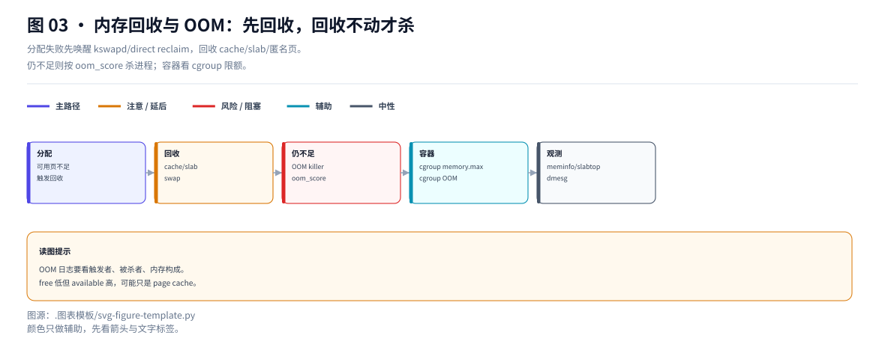

# OOM 与性能分析

内存不够时内核先回收 cache/slab，回收不动就触发 OOM killer。性能问题则要先定位瓶颈在 CPU、内存、IO 还是锁。

> 本篇定位：内存压力与 OOM 的判断、常见内存泄漏/碎片、perf/ftrace 的基本用法与排障顺序。

## 目录

- [1 一句话模型](#s1)
- [2 速览](#s2)
- [3 内存回收与 OOM](#s3)
- [4 常见内存问题](#s4)
- [5 性能分析工具](#s5)
- [6 设计取舍与边界](#s6)
- [7 与相邻主题的关系](#s7)
- [名词解释](#名词解释)
- [8 参考与关联](#s8)

## 1 · 一句话模型：先回收，回收不动才杀进程

```text
分配内存 → 可用页不足
  ├─ 回收 page cache / slab / 可回收匿名页
  ├─ 仍然不足 → 触发 OOM killer，按 oom_score 选进程
  └─ 或直接分配失败（原子上下文/严格 overcommit）
```

三个关键认知：

1. **OOM 不是“内存总量小”**，而是“当前申请 + 不可回收内存超过可用”。
2. **free 低不一定 OOM**：page cache 可回收，`available` 更可信。
3. **OOM 日志要看“谁触发、杀了谁、当时内存构成”**，不要只看被杀进程。

## 2 · 速览

| 项 | 内容 |
| --- | --- |
| 内存指标 | free、available、cache、slab、swap |
| 回收 | kswapd、direct reclaim、drop_caches |
| OOM | oom_score、oom_score_adj、cgroup memory.max |
| 泄漏 | 匿名页增长、slab 增长、fd 泄漏 |
| 性能工具 | perf、ftrace、bpftrace、vmstat、iostat |
| 观测 | `/proc/meminfo`、`/proc/<pid>/status`、`slabtop` |
| 日志 | `dmesg` 的 OOM 记录、pstore |

## 3 · 内存回收与 OOM



**读图**：分配失败先回收 cache/slab/swap，仍不足才按 oom_score 杀进程；容器看 cgroup 限额。

> 图源：`images/图03-OOM与回收.svg`


```text
alloc_pages 失败
  └─ 唤醒 kswapd / direct reclaim
       ├─ 回收 page cache（干净页直接丢，脏页回写）
       ├─ 回收 slab（可回收对象）
       ├─ 换出匿名页（有 swap）
       └─ 仍不足 → out_of_memory()
            └─ 按 oom_score 选进程，SIGKILL
```

OOM 日志关键字段：触发进程、cgroup、total/available、被杀进程的 rss/oom_score。容器场景先看 cgroup 限额，不一定是宿主内存不足。

## 4 · 常见内存问题

| 现象 | 可能原因 |
| --- | --- |
| 匿名页持续增长 | 应用泄漏、缓存无上限、连接未释放 |
| slab 持续增长 | 内核对象泄漏（dentry/inode/网络） |
| free 低但 available 高 | page cache 占多数，正常 |
| 频繁 direct reclaim | 内存压力大，分配延迟抖动 |
| OOM 杀错进程 | oom_score_adj 配置不当 |
| 容器 OOM | cgroup memory.max 太低/泄漏 |
| swap 抖动 | 内存不足，频繁换入换出 |

排查顺序：`meminfo` → `smaps`/`status` → `slabtop` → `dmesg` OOM 日志 → 复现/压测。

## 5 · 性能分析工具

| 工具 | 看什么 |
| --- | --- |
| `vmstat` | 内存/CPU/IO 总体趋势 |
| `iostat` | 磁盘 IO 与等待 |
| `perf top/record/report` | CPU 热点、调用栈 |
| `perf sched` | 调度延迟/迁移 |
| `ftrace` | 内核函数/事件跟踪 |
| `bpftrace` | 动态内核/用户态探针 |
| `slabtop` | slab 占用 |
| `ss`/`ip -s` | 网络队列/丢包 |

性能排障顺序：先确认瓶颈类型（CPU/内存/IO/锁/网络），再用工具取样，最后才调参数。

## 6 · 设计取舍与边界

### 6.1 overcommit 与 OOM

允许 overcommit 提高利用率，但可能 OOM；严格模式让分配更早失败，但可能浪费内存。选择取决于业务对“晚失败”还是“早失败”的容忍。

### 6.2 oom_score_adj

调整进程被 OOM 的优先级：关键服务调低，非关键/可重启服务调高。不要简单“关掉 OOM”，否则可能整机卡死。

### 6.3 容器内存限制

cgroup memory.max 触发的是 cgroup 内 OOM，日志和宿主 OOM 不同；要同时看容器指标和宿主压力。

### 6.4 性能不是单点

CPU 高可能是锁竞争/内存带宽/软中断；IO 慢可能是队列/文件系统/磁盘。先分层定位，避免“看到 CPU 高就加核”。

## 7 · 与相邻主题的关系

| 相邻主题 | 关系 |
| --- | --- |
| 虚拟内存/分配器 | 回收对象与分配路径 |
| 进程与调度 | OOM 选择进程、调度延迟 |
| cgroup | 容器内存限制与 OOM |
| 网络 | 软中断/队列导致的 CPU 高 |
| 调试与追踪 | perf/ftrace/bpftrace |

一句话：**OOM 是内存回收失败的结果，性能是整条链路的瓶颈；先测量，再调参。**

## 名词解释

> 缩写给出英文全称；非缩写用“—”表示。

| 术语 | 英文全称 | 解释 |
| --- | --- | --- |
| OOM | Out Of Memory | 内存不足触发杀进程。 |
| oom_score | OOM Score | 进程被 OOM 选择的评分。 |
| kswapd | Kernel Swap Daemon | 后台内存回收线程。 |
| direct reclaim | Direct Reclaim | 分配路径中同步回收。 |
| overcommit | Memory Overcommit | 虚拟内存超配。 |
| slabtop | Slab Top | 查看 slab 占用。 |
| perf | Performance | Linux 性能采样工具。 |

## 8 · 参考与关联

**参考**

- Linux 内核文档：`Documentation/admin-guide/mm/`、`Documentation/admin-guide/oom.rst`
- `mm/oom_kill.c`、`mm/vmscan.c`
- perf/ftrace/bpftrace 文档

**关联**

- [00-虚拟内存.md](./00-虚拟内存.md)
- [01-分配器与页缓存.md](./01-分配器与页缓存.md)
- [04-进程与并发/03-namespace与cgroup.md](../04-进程与并发/03-namespace与cgroup.md)
- [07-调试与追踪](../07-调试与追踪/.readme.md)

---

> **本篇定位**：内存回收/OOM 的判断与性能工具的分层使用，建立“先定位瓶颈，再调参”的顺序。
> **素材来源**：通用 Linux 内存/性能知识补写；源仓库无对应成稿。
> **待验证**：OOM 评分、cgroup 行为、工具可用性随内核/发行版而变。
