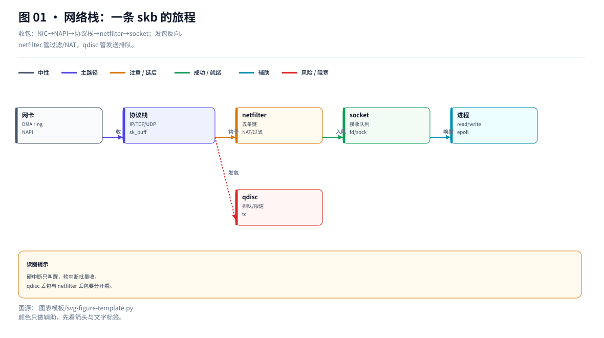

# 网络栈概览

Linux 网络栈把“网卡收发的帧”变成“进程读写的 socket”：中间经过驱动、NAPI、协议栈、netfilter、qdisc。

> 本篇定位：网络栈的全局对象与路径地图。收包/发包/socket/epoll 的细节看后续篇；netfilter 已有专篇。

## 目录

- [1 一句话模型](#s1)
- [2 速览](#s2)
- [3 核心对象](#s3)
- [4 收包与发包的总路径](#s4)
- [5 netfilter 与 qdisc 的位置](#s5)
- [6 设计取舍与边界](#s6)
- [7 与相邻主题的关系](#s7)
- [名词解释](#名词解释)
- [8 参考与关联](#s8)

## 1 · 一句话模型：一条 skb 的旅程

```text
网卡 → 驱动/NAPI → 协议栈 → netfilter → socket 接收队列 → 进程
进程 → socket → TCP/UDP → IP → netfilter → 邻居 → qdisc → 驱动 → 网卡
```

三个关键认知：

1. **`sk_buff` 是唯一载体**：收发都围绕 skb，头部逐层加/剥，数据尽量不拷贝。
2. **硬中断只叫醒，软中断批量收**：NAPI 用轮询替代每包中断。
3. **qdisc 在驱动之前**：发送排队/限速/优先级都在这里，和 netfilter 不是一个层。

## 2 · 速览

| 对象 | 作用 |
| --- | --- |
| `sk_buff` | 网络包载体，含头部空间与元数据 |
| `net_device` | 网卡/虚拟设备抽象 |
| `napi_struct` | 收包轮询实例 |
| `socket/sock` | 用户 fd 与协议状态 |
| `qdisc` | 发送队列规则（tc） |
| netfilter hook | IP 层的五条链 |
| `neigh` | 邻居表（ARP/NDP） |

## 3 · 核心对象

- **sk_buff**：数据缓冲区 + 各层头指针 + 设备/队列/协议元数据。`skb_reserve` 预留头部空间，逐层 push 头。
- **net_device**：`ndo_start_xmit` 是发送出口，`net_device_ops` 定义操作。
- **NAPI**：`netif_napi_add` 注册 poll，硬中断置位后由软中断批量收。
- **socket/sock**：`fd→file→socket→sock`，协议操作集决定 send/recv 行为。
- **qdisc**：`dev_queue_xmit` 进入，按 tc 规则排队/调度。

## 4 · 收包与发包的总路径



**读图**：收包 NIC→NAPI→协议栈→netfilter→socket；发包反向，qdisc 在驱动之前。

> 图源：`images/图01-网络栈路径.svg`


收包：

```text
NIC → DMA ring → 硬中断 → NAPI poll → netif_receive_skb
  → IP/ARP → netfilter PREROUTING/INPUT → TCP/UDP → socket 队列 → 唤醒进程
```

发包：

```text
send → tcp_sendmsg/udp_sendmsg → ip_queue_xmit → netfilter OUTPUT/POSTROUTING
  → neigh → dev_queue_xmit → qdisc → ndo_start_xmit → DMA ring → NIC
```

两者的分水岭：

- 收包在**软中断**里完成入队，用户拷贝在进程上下文。
- 发包在**进程上下文**启动，可能被拥塞/qdisc 阻塞，完成回收在软中断。

## 5 · netfilter 与 qdisc 的位置

| 机制 | 层 | 作用 |
| --- | --- | --- |
| netfilter | IP 层 | 过滤/NAT/mangle，五条链 |
| qdisc | 设备层 | 排队、限速、优先级、丢包 |
| eBPF/XDP | 驱动/早期 | 高性能过滤/转发 |

netfilter 管“包要不要/怎么改”，qdisc 管“包什么时候发/发多少”。两者都可能丢包，排障要分开看。

## 6 · 设计取舍与边界

### 6.1 零拷贝的边界

DMA 让网卡直接写内存，但协议栈仍可能拷贝（用户↔内核、skb clone）。MSG_ZEROCOPY、XDP 可以减少拷贝，但有复杂度和兼容性代价。

### 6.2 中断 vs 轮询

NAPI 在高流量下降低中断开销，但低流量时轮询浪费 CPU；内核在两者之间自适应。

### 6.3 虚拟设备

veth/bridge/tun 也走 net_device，但路径可能绕过物理队列；容器/虚拟化排障要看清设备类型。

### 6.4 分层排障

先确认是收包、协议栈、socket、qdisc 还是驱动；用 `ethtool -S`、`ip -s`、`ss`、`tc -s`、`/proc/net/softnet_stat` 分段看。

## 7 · 与相邻主题的关系

| 相邻主题 | 关系 |
| --- | --- |
| 收包/发包流程 | 本图的展开 |
| socket 与 epoll | 用户态交付 |
| netfilter | IP 层过滤/NAT |
| bridge/netlink | 二层转发与控制面 |
| 中断与底半部 | NAPI 依赖软中断 |

一句话：**网络栈是“skb 在驱动、协议栈、netfilter、socket 之间流动”，排障先定位在哪一段。**

## 名词解释

> 缩写给出英文全称；非缩写用“—”表示。

| 术语 | 英文全称 | 解释 |
| --- | --- | --- |
| sk_buff | Socket Buffer | 网络包载体。 |
| net_device | Network Device | 网卡/虚拟设备抽象。 |
| NAPI | New API | 中断+轮询收包机制。 |
| qdisc | Queueing Discipline | 发送队列规则。 |
| netfilter | Netfilter | IP 层钩子框架。 |
| socket | Socket | 进程网络接口。 |

## 8 · 参考与关联

**参考**

- Linux 内核文档：`Documentation/networking/`
- `include/linux/skbuff.h`、`net/core/dev.c`
- 源仓库 `1.内核接收网络包.md`、`3.内核发送网络包.md`

**关联**

- [01-收包流程.md](./01-收包流程.md)
- [02-发包流程.md](./02-发包流程.md)
- [03-socket与epoll.md](./03-socket与epoll.md)
- [04-网桥与netlink.md](./04-网桥与netlink.md)
- [01-netfilter](./01-netfilter/.readme.md)

---

> **本篇定位**：网络栈的对象与总路径，建立“skb 流动 + 分段排障”的全局图。
> **素材来源**：`studyspace/1.知识体系/5.linux网络/` 三篇；通用 Linux 网络知识补写。
> **待验证**：不同内核版本的 NAPI/qdisc/XDP 接口与默认参数会变化。
