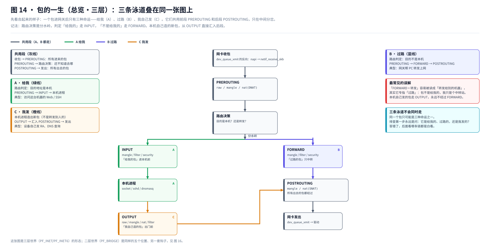
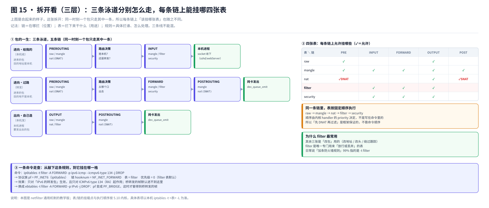
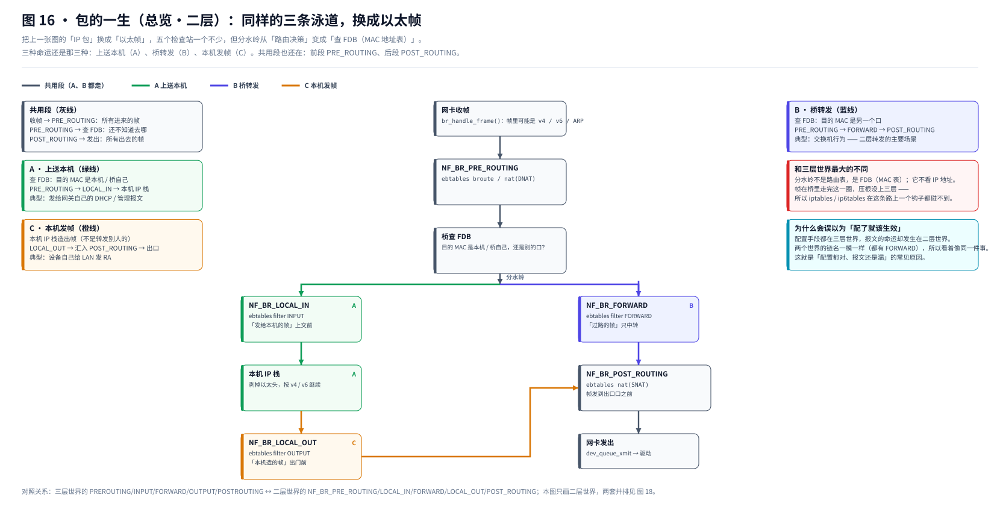
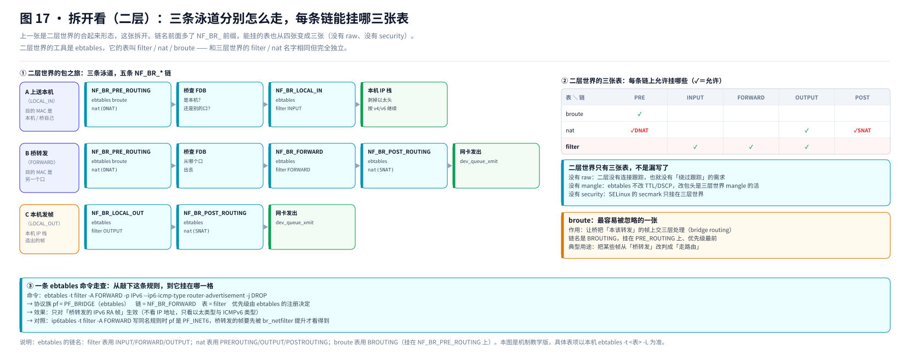
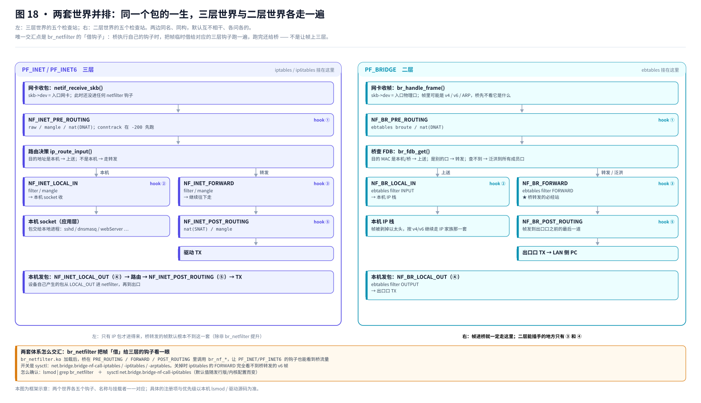
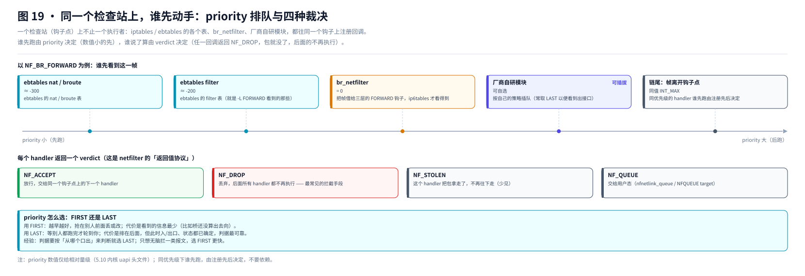

# netfilter 框架入门

一个包的一生经过哪五条链、每条链上能挂哪几张表、两个世界怎么并行、同一条链上谁先动手。通用教材，不含任何具体问题单的内容。

> 原文生成时间：2026-11-06 17:11

## 目录

- [1 地基（三层世界）](#s1)
- [2 二层世界](#s2)
- [3 两个世界](#s3)
- [4 检查站排队](#s4)
- [5 常见坑](#s5)
- [6 排查方法](#s6)
- [7 命令速查](#s7)

## 1 · 地基：一个包的一生，和它路上的表与链

只记三句话：**链**＝在哪儿拦（位置），**表**＝拦下来干什么（用途），**规则**＝具体拦谁、怎么处理。iptables 只是一条往内核里写规则的命令，真正干活的是内核里的 netfilter。

### 图 14 · 包的一生（总览·三层）

灰色＝共用段，绿＝A 给我，蓝＝B 过路，橙＝C 我发。路由决策是分水岭，只在中间分岔。



> 图源：`图14-包的一生总览-三层世界.svg`

> **先看合并图，再看拆开图：**上图把三条路径叠在同一张拓扑上——共用 PREROUTING 与 POSTROUTING，只在中间分岔。 分水岭是**路由决策**：判断目的地址是不是本机，「是」走 INPUT，「不是」走 FORWARD。

### 图 15 · 拆开看（三层）

三条泳道分开走、四张表在五条链上的挂载矩阵、表内执行顺序，以及一条命令落在哪个格子的走查。



> 图源：`图15-三条泳道与表链矩阵-三层世界.svg`

### 1.1 逐条链：五条链各自能做什么

同一个包只走其中一条路，所以每条链「这时能看到什么信息」不同，能挂的表也就不同。看第三列就能推出第四列——不用背。

| 链 | 什么时候被问到 | 这时已知什么 | 能挂的表 | 典型用途 | 容易踩的坑 |
| --- | --- | --- | --- | --- | --- |
| PREROUTING | 帧刚离开网卡，还没做路由决策 | 入接口（-i）、以太类型、目的 IP；还不知道这包是给本机还是转发 | `raw、mangle、nat(DNAT)` | 端口映射（DNAT）、打 MARK、决定不跟踪 | 没有「出接口」可匹配（还没算）；filter 挂不上——还不知道身份，谈不上过滤 |
| INPUT | 路由判定「目的地址是本机」，进本机协议栈之前 | 入接口、完整 IP 头与传输层头 | `mangle、filter、security` | 限制谁能访问本机：SSH / Web / 管理口 | 桥转发的帧不经过这里（它只收「发给桥自己」的帧） |
| FORWARD | 路由判定「不是本机」，要转出去 | 入接口 + 出口接口（此时已定） + 完整头 | `mangle、filter、security` | 网关访问控制、状态防火墙的主体 | 只对「走 IP 路由」的包生效；桥转发的帧走 PF_BRIDGE 的 FORWARD，是另一套 |
| OUTPUT | 本机进程产生了新包，发出之前 | 出接口、完整头，还有进程信息（-m owner 可用） | `raw、mangle、nat、filter、security` | 限制本机进程出网、按 uid/进程匹配、本机发起的 DNAT | 设备自己发的包只走这里，永远不走 FORWARD |
| POSTROUTING | 包马上交给驱动发出（所有包的最后一道） | 出口接口（-o）、完整头、mark | `mangle、nat(SNAT)` | SNAT / MASQUERADE、改 TTL、打标给 QoS | 不能过滤（filter 不挂这里）；DNAT 在这里没意义（都已经要出门了） |

### 1.2 逐张表：五张表（外加一个 conntrack）

注意 conntrack 常被当成第六张表，其实它是独立模块——iptables 的 `-m state` 只是去查它。

| 表 | 管什么 | 挂在哪 | 一条典型规则 | 什么时候用 | 容易踩的坑 |
| --- | --- | --- | --- | --- | --- |
| raw | 在连接跟踪之前做决定，主用途是「不跟踪」 | PREROUTING、OUTPUT（conntrack 也在这两处，所以必须抢在它前面） | `iptables -t raw -A PREROUTING -p udp --dport 53 -j NOTRACK` | 海量短连接不想撑爆 conntrack 表时 | NOTRACK 之后 -m state 的状态匹配就失效了；家用网关基本用不到 |
| mangle | 改包头字段：TTL / HOPLIMIT、DSCP、MARK、connmark | 五条链全挂（唯一一张） | `iptables -t mangle -A PREROUTING -i wan0 -j MARK --set-mark 2` | 多 WAN 策略路由、QoS 分级、TTL 伪装 | MARK 只在本机内部有效，不会带到网络上；改 TTL 会影响 traceroute |
| nat | 改源/目的地址与端口 | PREROUTING(DNAT)、POSTROUTING(SNAT)、OUTPUT（本机发起，少见） | `iptables -t nat -A POSTROUTING -o wan0 -j MASQUERADE` | 端口映射、共享上网、按 WAN 分流 | 只有新连接的第一个包会走 nat 规则，后续包由 conntrack 直接翻译——计数器只涨 1 是正常的 |
| filter | 放行 / 丢弃，唯一专门做过滤的表 | INPUT、FORWARD、OUTPUT | `iptables -A FORWARD -m state --state ESTABLISHED,RELATED -j ACCEPT` | 99% 场景说的「防火墙规则」 | 注意默认策略；-A（追加）与 -I（插入）顺序不同结果不同；DROP 与 REJECT 语义不同 |
| security | SELinux 的 secmark 标签匹配 | INPUT、FORWARD、OUTPUT | `iptables -t security -A INPUT -m secmark --secmark 1 -j ACCEPT` | 跑 SELinux 的发行版 | 普通网关/嵌入式设备用不到 |
| conntrack | 连接跟踪：给 nat 和 -m state 提供状态依据（它不是表，是独立模块） | 在 PREROUTING / FORWARD / OUTPUT 各挂一个（priority -200） | `cat /proc/net/nf_conntrack　或　conntrack -L` | 状态防火墙、NAT 的地基 | 表满会丢新连接（dmesg 里有 nf_conntrack: table full）；只对 IP 家族有效，二层没有 |

- **链（chain）＝位置**：PREROUTING 刚进门、INPUT 确认给我、FORWARD 只是过路、OUTPUT 我自己发、POSTROUTING 就要出门
- **表（table）＝用途**：filter 放行/丢弃、nat 改地址、mangle 改包头、raw 绕过连接跟踪、security SELinux
- **规则（rule）＝一条判断**：匹配条件（协议/地址/端口/网卡）+ 目标（ACCEPT / DROP / REJECT / LOG / 跳到自定义链）
- **顺序敏感**：同一个链里从前往后匹配，第一条命中的规则生效；表与表之间按 raw→mangle→nat→filter 固定顺序

## 2 · 把包的一生再走一遍：这次进二层

按网络分层，转发的对象分两种：**二层**是「按 MAC 表（FDB）转发的以太帧」，**三层**是「按路由表转发的 IP 包」。netfilter 对这两层各有一套检查站，互不干扰，除非中间有人搭桥（见 §3）。

> **为什么内核里这个协议族叫 `PF_BRIDGE`、不叫 `PF_L2`：** 它的钩子最初是跟着 Linux 的 bridge 模块做的，沿用了这个名字。但要分清楚——**桥只是二层转发的一种实现**。 所以本教材按层说话（二层 / 三层），只在提内核符号时才写 `PF_BRIDGE`。 另一个边界：二层转发若被交换芯片硬件 offload，帧可能根本不经过内核的 bridge 代码，那种情况下 `PF_BRIDGE` 的钩子也不会执行。

| 维度 | 三层世界（PF_INET / PF_INET6） | 二层世界（PF_BRIDGE） |
| --- | --- | --- |
| 看的东西 | IP 包（以太头已经剥掉） | 以太帧（原样，里面可能是 v4 / v6 / ARP） |
| 配置工具 | iptables / ip6tables / nftables | ebtables（以及自研的内核模块） |
| 五条链的名字 | PREROUTING / INPUT / FORWARD / OUTPUT / POSTROUTING | 一模一样的五个名字，但前缀是 NF_BR_* |
| 表 | raw / mangle / nat / filter / security | filter / nat / broute（没有 raw、没有 security） |
| 「转发」靠什么 | 查路由表，TTL 减一 | 查 FDB（MAC 地址表），TTL 不变 |
| 转发经过哪几条链 | PREROUTING → FORWARD → POSTROUTING | PRE_ROUTING → FORWARD → POST_ROUTING（同名、不同族） |

### 图 16 · 包的一生（总览·二层）

同样的三条泳道换成以太帧：分水岭从「路由决策」变成「查 FDB」，帧在桥里走完一圈压根不上三层。



> 图源：`图16-包的一生总览-二层世界.svg`

> **只换三样：**分水岭从「路由决策」变成「查 FDB（MAC 表）」；表从四张变成三张；链名前面加了 `NF_BR_` 前缀。三种命运和共用段完全一样。

### 图 17 · 拆开看（二层）

三条泳道分开走、ebtables 的三张表（filter / nat / broute）在五条 NF_BR_* 链上的挂载矩阵、一条命令走查。



> 图源：`图17-三条泳道与表矩阵-二层世界.svg`

### 2.1 逐条链（二层世界）：五条 NF_BR_* 链各自能做什么

和 1.1 那张表完全同构。对着看一遍，就知道「同名不同族」到底差在哪。

| 链 | 什么时候被问到 | 这时已知什么 | 能挂的表 | 典型用途 | 容易踩的坑 |
| --- | --- | --- | --- | --- | --- |
| NF_BR_PRE_ROUTING | 帧刚从网卡上来，桥还没查 FDB | 入接口、目的 MAC、以太类型（里面装的是什么协议还不用关心） | `broute、nat(DNAT)` | 把该走路由的帧「上交」三层；改去向 | broute 表的链名叫 BROUTING，不叫 PREROUTING；这里没有 filter |
| NF_BR_LOCAL_IN | 查 FDB 判定「发给本机 / 桥自己」 | 入接口、完整帧（里面已经能看到 IP 头） | `filter` | 限制谁能访问网关自己（管理、DHCP、ARP） | 桥转发的帧不经过这一站 —— 写在这儿的过滤规则管不到转发 |
| NF_BR_FORWARD | 查 FDB 判定「从另一个口出去」 | 入接口 + 出接口 + 完整帧 | `filter` | 桥转发的访问控制：谁能和谁通 | 只做 MAC 层转发，不看 IP 路由；三层世界也有一条叫 FORWARD 的链，是另一套 |
| NF_BR_LOCAL_OUT | 本机协议栈产生帧（要发给某个口） | 出接口、完整帧；没有入接口这个概念 | `filter、nat` | 拦设备自己发的帧 | 常用 LAST 优先级，等桥算完出接口再判 |
| NF_BR_POST_ROUTING | 帧即将交给驱动发出 | 出接口、完整帧 | `nat(SNAT)` | 改源地址映射 | 过滤不挂这里；ebtables 也不做 TTL 改写（那是三层世界的 mangle） |

### 2.2 逐张表（二层世界）：ebtables 的三张表

二层世界只有三张表。不是漏写了——二层没有连接跟踪，也就没有 raw；不做包头改写，也就没有 mangle；没有 SELinux 标签，也就没有 security。

| 表 | 管什么 | 挂在哪 | 一条典型规则 | 什么时候用 | 容易踩的坑 |
| --- | --- | --- | --- | --- | --- |
| filter | 放行 / 丢弃以太帧 —— 二层世界唯一做过滤的表 | INPUT、FORWARD、OUTPUT | `ebtables -t filter -A FORWARD -p IPv6 -j DROP` | 桥转发的访问控制、按域隔离 | 只知道「哪个口进、哪个口出」，不知道三层的业务语义（比如哪条 WAN 绑了哪个口）——粒度较粗 |
| nat | 改 MAC / IP 地址映射 | PREROUTING(DNAT)、OUTPUT、POSTROUTING(SNAT) | `ebtables -t nat -A PREROUTING -p IPv4 -d 00:11:22:33:44:55 -j dnat --to-destination 66:77:88:99:aa:bb` | 桥下按 MAC 做透明改址（少见） | 和三层世界的 nat 是两套独立实现；日常几乎不用 |
| broute | 把「本该桥转发」的帧上交三层处理（bridge routing） | BROUTING（挂在 NF_BR_PRE_ROUTING 上，优先级最前） | `ebtables -t broute -A BROUTING -p IPv4 -i eth0 -j DROP` | 把某些帧从「桥转发」改判成「走路由/上交」 | 最容易忽略的一张表；链名不叫 PREROUTING，写错就永远不命中 |
| （没有 raw / mangle / security） | 二层没有连接跟踪，也没有包头改写和 SELinux 标签 | — | `—` | 这些需求都在三层世界用 iptables 的对应表做 | 别在 ebtables 里找 raw/mangle——找不到，不是没装 |

## 3 · 两个世界：各问各的，靠 br_netfilter 才交汇

把两张「包的一生」摆在一起：链名完全相同（都有 FORWARD），却是两次不相干的询问。同一时刻一个包只在一个世界里被问。

### 图 18 · 两套世界并排

左：三层世界的五个检查站；右：二层世界的同名五个检查站。底部：br_netfilter 怎么把帧借给三层钩子看一眼（不是让帧上三层）。



> 图源：`图18-两套世界对照.svg`

### 3.1 最常见的一个疑问：一个包会不会「先二层、再三层」？

不会。**同一时刻只走一条，是分岔，不是串联。**之所以感觉像串行，是因为三层转发的「收包那一段」确实经过二层设备（帧先从网卡上来、桥先看到它），但那不叫二层转发。

```text
收帧 → 查 FDB
  ├─ 目的 MAC = 本机 / 桥自己  → 上交三层（这才是三层的入口）
  │      └─ 查路由 ─┬─ 目的地址是本机 → 交给本机进程
  │                 └─ 不是本机     → 三层转发：TTL−1、重新封装、从出口发出
  └─ 目的 MAC = 另一个口        → 二层转发：帧原样从那个口送出去，结束（压根不上三层）
```

| 对比项 | 二层转发（bridge forwarding） | 三层转发（IP routing） |
| --- | --- | --- |
| 按什么转发 | 目的 **MAC** | 目的 **IP** |
| 还是原来那个帧吗 | 是，原样送出 | **不是**：剥以太头 → TTL−1 → 重新封装，出去的是新帧 |
| 上不上三层 | 不上 | 上（这就是三层的活） |
| 谁在做 | `br_handle_frame` → `br_forward` | `ip_rcv` → `ip_forward` → `ip_output` |
| netfilter 钩子 | `PF_BRIDGE` 的 FORWARD | `PF_INET / PF_INET6` 的 FORWARD |
| 典型场景 | 交换机行为：同网段互访、组播泛洪 | 网关行为：跨网段转发、NAT |

> **由此得到一条实用推论：**一个报文要么被 bridge 转发、要么被 IP 路由转发，**不会两者都走**。 所以拿 iptables 的 FORWARD 规则去拦「被桥转发的流量」，注定不命中——那些帧从来没上到三层。

> **一个边界：**三层转发的**出口**如果恰好是桥的成员口（例如出口是 `br0`），发帧时会再经过一次桥的 `LOCAL_OUT` / `POST_ROUTING`。但那是「本机发出的帧经过桥」，路径与「桥转发」不同，别混。

### 3.2 顺着问一句：三层的 INPUT / OUTPUT / 转发，在二层分别长什么样？

先加一个**前提**：接口必须在桥上（是 bridge 成员，或本身就是桥设备）。如果是独立 IP 接口（不在任何 bridge 里），`PF_BRIDGE` 那一套从头到尾不参与。满足这个前提，四条路径的形状如下：

| 报文命运 | 桥（二层）看到的钩子 | IP（三层）看到的钩子 |
| --- | --- | --- |
| 二层转发 | PRE_ROUTING → **FORWARD** → POST_ROUTING | 不经过（除非 br_netfilter 提升） |
| 三层转发（IP routing） | PRE_ROUTING → **LOCAL_IN** → **LOCAL_OUT** → POST_ROUTING | PRE_ROUTING → **FORWARD** → POST_ROUTING |
| 送给本机（三层 INPUT） | PRE_ROUTING → **LOCAL_IN** | PRE_ROUTING → LOCAL_IN |
| 本机发出（三层 OUTPUT） | **LOCAL_OUT** → POST_ROUTING | LOCAL_OUT → POST_ROUTING |

> **为什么会这样——桥只认 MAC，不认 IP。**三层转发时，帧的目的 MAC 是网关自己的 MAC， 桥查 FDB 看到「这个 MAC 是我」，就当作「发给本机的帧」走 `LOCAL_IN` 上交三层； IP 层拆开看目的 IP 发现不是自己，才走 `NF_INET_FORWARD` 转出去；发出去时对桥来说又是「本机产生的新帧」，走 `LOCAL_OUT`。 所以三层转发在桥层看，形状是**收上来再发出去**，中间那个「转发」决策桥完全不知道。

> **最有用的一个结论：两个世界的「转发链」是错开的。** 二层转发用桥的 `FORWARD`；三层转发用 IP 的 `FORWARD`。同一台网关里一个报文只会进其中一个—— 所以先判「它是二层转发还是三层转发」，再决定去看哪一张 `FORWARD` 表，顺序不能反。

> **一处别过度断言：**表里「三层转发的桥层 `LOCAL_OUT`」是否真被调用，取决于桥的发送路径与 `br_netfilter` 是否加载——某些内核配置下桥的 `LOCAL_OUT` / `POST_ROUTING` 钩子点不会被触发。 严谨说法是：**只要桥参与了这个帧，形状就如上表**；具体到某台设备是否触发，要看模块加载与内核配置。

把「哪个世界 × 哪个检查站」摊成矩阵：四个世界各问各的，互不代劳。

| pf ＼ hooknum | PRE_ROUTING | LOCAL_IN | FORWARD | LOCAL_OUT | POST_ROUTING |
| --- | --- | --- | --- | --- | --- |
| PF_INET / PF_INET6 | raw·mangle·nat(DNAT)<br>conntrack | filter·mangle | filter·mangle | raw·mangle·nat | mangle·nat(SNAT) |
| PF_BRIDGE | ebtables nat·broute | ebtables filter | **ebtables filter** | **ebtables filter·nat** | ebtables nat |

- **PF_ARP**：ARP 用自己的一套三钩子：`NF_ARP_IN` / `NF_ARP_OUT` / `NF_ARP_FORWARD`（对应 arptables 的 INPUT / OUTPUT / FORWARD），与上面五个 hooknum 不一一对应。
- **PF_NETDEV**：ingress / egress（tc 层，在协议栈更早的位置，与防火墙规则无关）。

> **两个世界唯一的交汇点：**`br_netfilter.ko` 加载后，桥在执行自己的钩子时，会把帧「借」给**对应的那个**三层钩子跑一遍（桥的 `FORWARD` → IP 的 `FORWARD`），跑完再还给桥继续处理。 开关是 `net.bridge.bridge-nf-call-iptables` / `-ip6tables` / `-arptables`，默认值随发行版和内核配置而变。 关着的时候，ip6tables 的 FORWARD 完全看不到桥转发的 v6 帧。

## 4 · 同一个检查站上，谁先动手

知道「在哪条链」还不够。一条链上可能同时站着好几个执行者（各个表、br_netfilter、厂商模块），必须再回答两个问题：**谁先跑**（priority）、**谁说了算**（verdict）。上一章那句「表按 raw→mangle→nat→filter 固定顺序执行」，其实就是这张图在三层世界的表现。

### 图 19 · 同一个检查站上，谁先动手

一条链上多个执行者按 priority 排队、四种 verdict 的含义，以及 FIRST / LAST 怎么选。



> 图源：`图19-检查站排队与裁决.svg`

- **priority 小的先跑**：表之间的固定顺序、自研模块插队，都靠它
- **任一 handler 返回 DROP 就结束**：后面的 handler 不再执行，包直接没了
- **FIRST vs LAST**：想抢先拦用 FIRST；想按「从哪个口出」判断，用 LAST
- **同优先级不可依赖**：谁先跑由注册先后决定，别把逻辑压在这上面

## 5 · 新人最常踩的八个坑

1. **DROP 还是 REJECT**：DROP 静默丢，客户端只能等到超时；REJECT 会回一个错误，体验更好，但也会暴露「这儿有防火墙」。
2. **忘了默认策略**：每条链末尾都有一个隐式 policy（通常是 ACCEPT）。只加 `-j DROP` 而 policy 是 ACCEPT，其余流量照样过；反过来 policy 设 DROP 又忘了放行 ESTABLISHED，连回包都会被丢。
3. **-A 和 -I 混用**：`-A` 追加到末尾、`-I` 插到最前。防火墙是「第一条命中即生效」，插错位置等于没写。
4. **-i / -o 用错链**：INPUT、PREROUTING 只有入接口 `-i`；OUTPUT、POSTROUTING 只有出接口 `-o`；只有 FORWARD 两个都能用。
5. **以为 nat 规则每次都命中**：nat 只处理新连接的第一个包，后续包由 conntrack 直接翻译。规则计数器只涨 1 是正常的，不是没生效。
6. **用 iptables 去挡桥流量**：桥转发的帧默认不经过 IP 家族的钩子，得靠 br_netfilter 把帧借给三层看一眼；否则规则写得再对也拦不住。
7. **状态匹配依赖 conntrack**：`-m state` / `-m conntrack` 的前提是 conntrack 在跑；raw 表里打了 NOTRACK 之后，状态匹配就失效了。
8. **规则忘了持久化**：iptables 命令只作用于运行期，重启即丢。要用 `iptables-save` / `netfilter-persistent`，或者系统自己的配置体系落盘。

## 6 · 通用排查方法：三步定位

任何「防火墙配了却没生效」的问题，都按这三步走。跳步一定会误判。

| 步骤 | 问什么 | 怎么答 | 答错的后果 |
| --- | --- | --- | --- |
| ① 判泳道 | 这个包是**给我的**、**过路的**、还是**我发的**？ | 抓包看目的地址 / 目的 MAC；看它是送到本机服务，还是被转出去 | 泳道判错，后面看哪条链都是白看 |
| ② 找世界与链 | 它在哪个世界被问：IP 还是桥？走的是哪条链？ | 二层转发 → 二层世界的 FORWARD；IP 转发 → 三层世界的 FORWARD；发往本机 → LOCAL_IN | 拿 iptables 的规则去拦桥转发，永远不命中 |
| ③ 看表与规则 | 那条链上站着谁？规则的匹配条件对得上吗？计数器涨不涨？ | `iptables/ebtables -L -v` 看规则与命中计数；对不上就换方向 / 换接口 / 换协议 | 规则在但没命中，会被误判成「规则没生效」 |

> **一个常见误判的例子：**二层面的 INPUT 链计数器在涨，就以为「这类报文已经被拦住了」。 它涨只说明有报文到了「发给本机」那一站，而过路的报文根本不经过那一站 —— 两件事不能互相证明。

## 7 · 常用命令速查

| 命令 | 看什么 | 说明 |
| --- | --- | --- |
| `iptables -t filter -L -v --line-numbers` | 看 IPv4 过滤规则与计数器 | -v 才有命中计数；--line-numbers 方便删 |
| `ip6tables -t filter -L -v` | 看 IPv6 过滤规则 | 桥流量需要 br_netfilter 才出现在这里 |
| `iptables -t nat -L -v` | 看 DNAT / SNAT 规则 | 计数器只涨 1 是正常（只处理新连接） |
| `ebtables -t filter -L -v` | 看二层过滤规则 | INPUT / FORWARD / OUTPUT 三条链 |
| `ebtables -t broute -L` | 看 broute 规则 | 链名叫 BROUTING，挂在 PRE_ROUTING |
| `cat /proc/net/nf_conntrack` | 看连接跟踪表 | 只对 IP 家族有效；二层没有 |
| `sysctl net.bridge.bridge-nf-call-ip6tables` | br_netfilter 是否把桥帧交给 ip6tables | 0 表示 ip6tables 看不到桥转发的 v6 |
| `lsmod \| grep -E "br_netfilter\|nf_"` | 相关内核模块是否加载 | br_netfilter 没加载时，上面的 sysctl 不存在 |
| `iptables-save > /etc/...` | 持久化规则 | 重启后自动加载需要发行版配套机制 |

> **看计数器的习惯：**先 `iptables -Z` / `ebtables -Z` 清零，再复现一次，这样计数才干净。 `-v` 不加，看不到命中次数，就等于在猜。

> **说明**
>
> 本 Markdown 由原 HTML 转换而来，后续以 Markdown 为准。
> 通用机制按 Linux 5.10 内核；具体表项、sysctl 默认值以本机输出为准，不同发行版/内核可能有差异。
> 本报告**不含任何具体问题单的内容**；带实测、判据与修复分析的内容不在本教材范围内。
