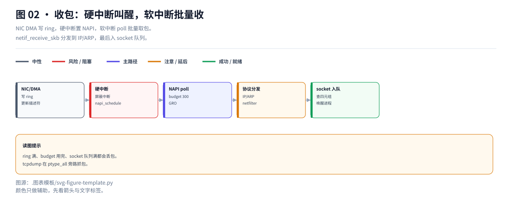

# 收包流程

网卡收到帧后，硬中断只负责“叫醒”NAPI；真正的收包、协议分发、入 socket 队列都在软中断里批量完成。

> 本篇定位：DMA ring→硬中断→NAPI poll→netif_receive_skb→IP/TCP→socket 队列的完整路径与丢包点。

## 目录

- [1 一句话模型](#s1)
- [2 速览](#s2)
- [3 收包五阶段](#s3)
- [4 NAPI 与软中断](#s4)
- [5 协议分发与入队](#s5)
- [6 设计取舍与边界](#s6)
- [7 与相邻主题的关系](#s7)
- [名词解释](#名词解释)
- [8 参考与关联](#s8)

## 1 · 一句话模型：硬中断叫醒，软中断批量收

```text
NIC → DMA ring → 硬中断（屏蔽中断/置 NAPI）→ NET_RX_SOFTIRQ
  → poll 批量取包 → GRO → netif_receive_skb → IP/ARP
  → TCP/UDP 查 sock → 入接收队列 → 唤醒进程
```

三个关键认知：

1. **硬中断不搬包**，只做最少的事，避免长时间关中断。
2. **NAPI 用轮询替代每包中断**，高流量下显著降低 CPU。
3. **入队与用户拷贝分离**：软中断入 socket 队列，进程上下文再拷贝。

## 2 · 速览

| 阶段 | 关键动作 |
| --- | --- |
| 网卡 | DMA 写 ring buffer |
| 硬中断 | 屏蔽中断、`napi_schedule` |
| 软中断 | `net_rx_action` 调 `poll` |
| 协议分发 | `netif_receive_skb` → IP/ARP |
| 传输层 | 四元组查 sock，入接收队列 |
| 用户 | `recv` 从队列拷贝 |

## 3 · 收包五阶段



**读图**：硬中断只置 NAPI，软中断 poll 批量收；协议分发后入 socket 队列唤醒进程。

> 图源：`images/图02-收包流程.svg`


1. **网卡接收**：DMA 把帧写进 rx ring，更新描述符。
2. **硬中断**：驱动确认中断、屏蔽该队列中断、置 NAPI、唤醒 `NET_RX_SOFTIRQ`。
3. **软中断收包**：`net_rx_action` 遍历 poll_list，调用驱动 `poll` 批量取包，受 budget（默认 300）和时间限制。
4. **协议分发**：`netif_receive_skb` 按 EtherType 交给 `ip_rcv`/`arp_rcv`；netfilter PREROUTING 在这里介入。
5. **交付 socket**：IP 层判断本机/转发；本机 TCP/UDP 按四元组查 sock，入 `sk_receive_queue`，唤醒等待进程。

## 4 · NAPI 与软中断

- `netif_napi_add` 注册 poll；`napi_enable` 后才参与调度。
- 硬中断里 `napi_schedule` 把 NAPI 挂到 per-CPU poll_list。
- `net_rx_action` 有 budget，防止软中断长期霸占 CPU；没处理完会重新调度。
- **GRO** 在进入协议栈前合并小包，减少上层开销。
- **RPS/RFS** 可以把收包分发到多核，提升并行；配置不当会增加跨核开销。

## 5 · 协议分发与入队

```text
netif_receive_skb
  ├─ ptype_all（tcpdump/AF_PACKET）
  ├─ VLAN 处理
  ├─ ARP → arp_rcv
  └─ IP → ip_rcv → netfilter → 本机/转发
       └─ TCP/UDP → 查 sock → 入接收队列 → sk_data_ready 唤醒
```

`tcpdump` 能抓到被防火墙丢弃的包，是因为 `ptype_all` 在 netfilter 之前被遍历（具体顺序随钩子位置）。

## 6 · 设计取舍与边界

### 6.1 中断 vs NAPI

每包中断延迟低但 CPU 高；NAPI 批量轮询吞吐高但低流量时可能空转。内核自适应，驱动要正确实现 poll/budget。

### 6.2 GRO 的代价

GRO 合并减少上层包数，但会增加延迟、影响精确抓包；实时/转发场景可能关闭 GRO。

### 6.3 多核分发

RPS/RFS 提升并行，但跨核缓存失效；高性能场景常用多队列网卡 + RSS，把流固定到队列/CPU。

### 6.4 丢包点

ring 满（`rx_dropped`）、NAPI budget 用完、协议栈队列满、socket 接收队列满（`RcvbufErrors`）。先看 `ethtool -S`、`/proc/net/softnet_stat`、`ss -m`。

## 7 · 与相邻主题的关系

| 相邻主题 | 关系 |
| --- | --- |
| 网络栈概览 | 全局对象与路径 |
| 发包流程 | 对称路径 |
| socket/epoll | 入队后如何唤醒 |
| netfilter | PREROUTING/INPUT 的位置 |
| 中断与底半部 | NAPI 依赖软中断 |

一句话：**收包性能的关键是 DMA、NAPI 批量、GRO 和 budget；丢包要按阶段看计数器。**

## 名词解释

> 缩写给出英文全称；非缩写用“—”表示。

| 术语 | 英文全称 | 解释 |
| --- | --- | --- |
| NAPI | New API | 中断+轮询收包。 |
| GRO | Generic Receive Offload | 收包合并。 |
| RPS | Receive Packet Steering | 收包软分发到多核。 |
| RFS | Receive Flow Steering | 按流分发到 CPU。 |
| ring buffer | Ring Buffer | 网卡 DMA 描述符环。 |
| softirq | Software Interrupt | 软中断。 |
| ptype_all | Packet Type All | 所有协议包的旁路链表。 |

## 8 · 参考与关联

**参考**

- Linux 内核文档：`Documentation/networking/napi.rst`
- `net/core/dev.c`、`net/ipv4/ip_input.c`
- 源仓库 `1.内核接收网络包.md`

**关联**

- [00-网络栈概览.md](./00-网络栈概览.md)
- [02-发包流程.md](./02-发包流程.md)
- [03-socket与epoll.md](./03-socket与epoll.md)
- [01-netfilter](./01-netfilter/.readme.md)

---

> **本篇定位**：收包五阶段与 NAPI/GRO/丢包点，建立“硬中断叫醒、软中断批量收”的模型。
> **素材来源**：`studyspace/1.知识体系/5.linux网络/1.内核接收网络包.md`（主）；通用内核知识补写。
> **待验证**：GRO/RPS/RFS 默认值与驱动实现随内核/网卡而变。
