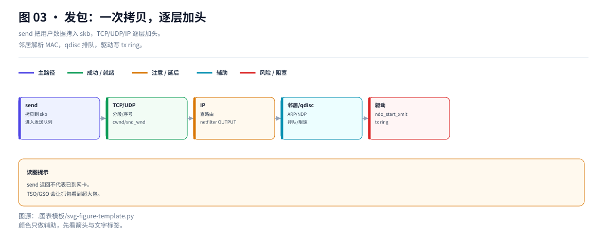

# 发包流程

发送从进程的 `send` 开始：用户数据拷入 skb，传输层加头、网络层查路由、邻居解析 MAC、qdisc 排队，最后由驱动写 ring。

> 本篇定位：send→TCP/UDP→IP→netfilter→邻居→qdisc→驱动→ring 的完整路径，以及队列/丢包点。

## 目录

- [1 一句话模型](#s1)
- [2 速览](#s2)
- [3 发送路径](#s3)
- [4 三层队列](#s4)
- [5 邻居与 qdisc](#s5)
- [6 设计取舍与边界](#s6)
- [7 与相邻主题的关系](#s7)
- [名词解释](#名词解释)
- [8 参考与关联](#s8)

## 1 · 一句话模型：一次拷贝，逐层加头

```text
send → skb（用户数据拷入）→ TCP/UDP 头 → IP 头 → 邻居 MAC
  → qdisc → ndo_start_xmit → tx ring → NIC
```

三个关键认知：

1. **send 返回不等于发到网卡**，只代表进入内核发送队列。
2. **skb 预留头部空间**，各层只移动头指针，不重复拷贝数据。
3. **qdisc 在驱动之前**：限速、优先级、排队都在这里，队列满会丢包/背压。

## 2 · 速览

| 阶段 | 关键动作 |
| --- | --- |
| socket | `sendmsg` 找 socket/sock |
| 传输层 | 分段、序号、校验和、窗口 |
| 网络层 | 查路由、netfilter OUTPUT、分片 |
| 邻居 | ARP/NDP 解析下一跳 MAC |
| qdisc | 排队、调度、限速 |
| 驱动 | `ndo_start_xmit` 写 tx ring |
| 完成 | 中断/软中断回收 skb |

## 3 · 发送路径



**读图**：send 一次拷贝进 skb，逐层加头；邻居解析 MAC，qdisc 排队，驱动写 tx ring。

> 图源：`images/图03-发包流程.svg`


1. `__sys_sendto` → `sock_sendmsg` → `tcp_sendmsg`/`udp_sendmsg`。
2. 用户数据拷入 skb；TCP 按 MSS 分段，检查 cwnd/snd_wnd。
3. `ip_queue_xmit` 查路由，经过 netfilter OUTPUT。
4. `ip_finish_output` 处理 MTU/分片，`neigh_output` 解析下一跳 MAC。
5. `dev_queue_xmit` 进入 qdisc，`ndo_start_xmit` 写 tx ring。
6. 网卡发送完成中断 → 软中断回收 skb/DMA 映射。

## 4 · 三层队列

| 队列 | 位置 | 作用 |
| --- | --- | --- |
| `sk_write_queue` | TCP | 已发未确认，重传基础 |
| socket 写队列 | socket | 用户已写未发 |
| qdisc | 设备层 | 排队/限速/优先级 |

队列满时：TCP 停止窗口增长/阻塞发送；UDP 丢包或 `ENOBUFS`；qdisc 可能直接 drop。

## 5 · 邻居与 qdisc

- **邻居表**：`NUD_INCOMPLETE → REACHABLE → STALE`；未命中发 ARP/NDP，skb 排队等待。
- **qdisc**：pfifo_fast、fq_codel、htb、tbf 等；`tc -s qdisc` 看 backlog/drop。
- **TSO/GSO**：大包交给网卡分段，降低 CPU；抓包可能看到“超大包”。
- **多队列**：`tx` 队列与 CPU 绑定，减少锁竞争。

## 6 · 设计取舍与边界

### 6.1 拷贝 vs 零拷贝

普通 send 一次拷贝，简单可靠；MSG_ZEROCOPY 把用户页 pin 进 skb，减少拷贝但需要通知/回收，复杂度高。

### 6.2 qdisc 的取舍

`fq_codel` 抗 bufferbloat、公平；`pfifo_fast` 简单；`htb/tbf` 限速但配置复杂。选型看业务（交互/下载/语音）。

### 6.3 卸载的边界

TSO/GSO/校验和卸载减少 CPU，但虚拟化/隧道场景可能失效；抓包看到的是卸载前的大包。

### 6.4 发送丢包

`tx_errors`、`tx_dropped`、qdisc drop、ring 满（`NETDEV_TX_BUSY`）要分开看；不要只怪网卡。

## 7 · 与相邻主题的关系

| 相邻主题 | 关系 |
| --- | --- |
| 收包流程 | 对称路径，共享 skb/NAPI/中断机制 |
| socket/epoll | 发送缓冲与可写事件 |
| netfilter | OUTPUT/POSTROUTING |
| qdisc/TC | 限速与队列 |
| 传输层 | 拥塞/窗口决定发多少 |

一句话：**发送路径的关键是一次拷贝、逐层加头、qdisc 排队和 ring 回收；丢包要分清是协议栈、qdisc 还是驱动。**

## 名词解释

> 缩写给出英文全称；非缩写用“—”表示。

| 术语 | 英文全称 | 解释 |
| --- | --- | --- |
| TSO | TCP Segmentation Offload | TCP 分段卸载。 |
| GSO | Generic Segmentation Offload | 通用分段卸载。 |
| qdisc | Queueing Discipline | 发送队列规则。 |
| neighbor | Neighbor Table | ARP/NDP 邻居表。 |
| DMA ring | DMA Ring | 发送描述符环。 |
| MSG_ZEROCOPY | Message Zero Copy | 减少用户到内核拷贝。 |

## 8 · 参考与关联

**参考**

- Linux 内核文档：`Documentation/networking/`
- `net/core/dev.c`、`net/ipv4/ip_output.c`
- 源仓库 `3.内核发送网络包.md`

**关联**

- [00-网络栈概览.md](./00-网络栈概览.md)
- [01-收包流程.md](./01-收包流程.md)
- [03-socket与epoll.md](./03-socket与epoll.md)
- [01-netfilter](./01-netfilter/.readme.md)

---

> **本篇定位**：发送路径与三层队列、邻居/qdisc/ring 的协作与丢包点。
> **素材来源**：`studyspace/1.知识体系/5.linux网络/3.内核发送网络包.md`（主）；通用内核知识补写。
> **待验证**：qdisc 默认值、TSO/GSO 支持与驱动实现随内核/网卡而变。
