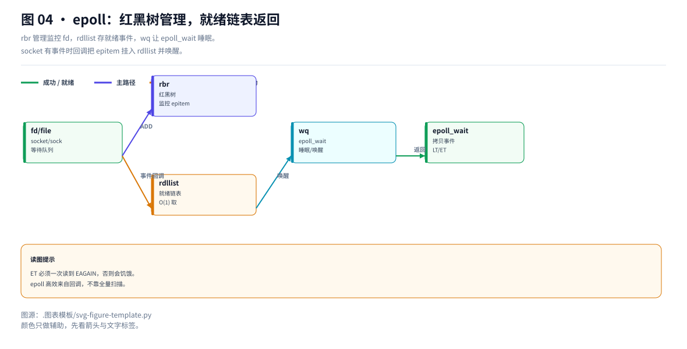

# socket 与 epoll

`fd → file → socket → sock` 是用户操作网络的内核链路；epoll 用红黑树管理监控对象、就绪链表返回事件、回调避免全量扫描。

> 本篇定位：socket 内核结构、阻塞 recv、epoll 的 rbr/rdllist/wq、LT/ET 与高并发边界。

## 目录

- [1 一句话模型](#s1)
- [2 速览](#s2)
- [3 socket 内核结构](#s3)
- [4 阻塞与唤醒](#s4)
- [5 epoll 三个结构](#s5)
- [6 设计取舍与边界](#s6)
- [7 与相邻主题的关系](#s7)
- [名词解释](#名词解释)
- [8 参考与关联](#s8)

## 1 · 一句话模型：fd 找到 sock，回调通知 epoll

```text
fd → struct file → struct socket → struct sock
epoll：rbr（监控树）+ rdllist（就绪）+ wq（等待）
```

三个关键认知：

1. **socket 也是文件**，所以 `read/write/close` 能操作它。
2. **数据到达是“入队 + 唤醒”**，用户拷贝在进程上下文。
3. **epoll 高效来自回调**：socket 有事件时直接挂就绪链表，不靠 `epoll_wait` 扫描。

## 2 · 速览

| 结构 | 作用 |
| --- | --- |
| `struct socket` | BSD 抽象，关联 file |
| `struct sock` | 协议状态、收发队列、等待队列 |
| `struct proto` | 协议操作集（tcp_prot/udp_prot） |
| `eventpoll` | epoll 实例 |
| `rbr` | 红黑树，监控的 epitem |
| `rdllist` | 就绪链表 |
| `wq` | epoll_wait 睡眠队列 |

## 3 · socket 内核结构

```text
用户 fd
  └─ struct file（VFS）
       └─ struct socket（BSD 层）
            └─ struct sock（TCP/UDP 状态）
                 ├─ sk_receive_queue
                 ├─ sk_write_queue
                 └─ sk_wq（等待队列）
```

`tcp_sendmsg/tcp_recvmsg`、`udp_sendmsg/udp_recvmsg` 通过 `proto_ops` 分发。`fdget` 从 fd 拿到 file，再拿到 socket/sock。

## 4 · 阻塞与唤醒

```text
recvfrom → tcp_recvmsg
  ├─ 接收队列有数据 → 拷贝到用户
  └─ 没有 → sk_wait_data 睡眠（TASK_INTERRUPTIBLE）
       └─ 软中断收包入队 → sk_data_ready → 唤醒
            └─ 进程醒来，拷贝数据
```

关键点：**软中断只入队和唤醒，不拷贝用户数据**；拷贝在进程上下文，避免占用软中断。

## 5 · epoll 三个结构



**读图**：rbr 管理监控 fd，rdllist 存就绪事件，wq 让 epoll_wait 睡眠；事件回调挂入 rdllist。

> 图源：`images/图04-epoll结构.svg`


| 结构 | 作用 |
| --- | --- |
| `rbr` 红黑树 | 管理所有监控 fd，O(log n) 增删查 |
| `rdllist` 就绪链表 | 有事件的 epitem，`epoll_wait` 直接取 |
| `wq` 等待队列 | 无事件时 `epoll_wait` 睡眠 |

流程：

1. `epoll_ctl(ADD)` 创建 epitem，把 `ep_poll_callback` 挂到 socket 等待队列。
2. 数据到达 → 协议栈唤醒 socket 队列 → 回调把 epitem 挂入 rdllist → 唤醒 wq。
3. `epoll_wait` 遍历 rdllist，把事件拷贝到用户数组。
4. **LT**：还有数据就继续返回；**ET**：只在状态变化时通知，必须一次读完。

## 6 · 设计取舍与边界

### 6.1 select/poll vs epoll

select/poll 每次全量扫描，O(n)；epoll 用回调 + 就绪链表，适合大量连接。连接少时差异不大。

### 6.2 LT vs ET

LT 不容易漏事件、编程简单；ET 减少重复通知，但要求非阻塞 + 一次读到 `EAGAIN`，否则会饥饿。

### 6.3 阻塞 vs 非阻塞

阻塞模型每连接一线程，简单但线程开销大；epoll + 非阻塞适合高并发，但状态机复杂。

### 6.4 epoll 不是万能

CPU 密集/慢系统调用仍会阻塞事件循环；多线程 epoll 要注意惊群与锁竞争。

## 7 · 与相邻主题的关系

| 相邻主题 | 关系 |
| --- | --- |
| 收包流程 | 数据入队后唤醒 socket |
| 发包流程 | 发送缓冲与可写事件 |
| IPC | socketpair/Unix socket |
| 进程与调度 | 阻塞/唤醒影响调度 |
| 性能 | 高并发连接与 epoll 开销 |

一句话：**socket 负责“数据放在哪”，epoll 负责“告诉进程哪个 socket 可以读写了”。**

## 名词解释

> 缩写给出英文全称；非缩写用“—”表示。

| 术语 | 英文全称 | 解释 |
| --- | --- | --- |
| socket | Socket | BSD socket 抽象。 |
| sock | Socket State | 协议状态与队列。 |
| eventpoll | Event Poll | epoll 实例。 |
| rbr | Red-Black Root | epoll 红黑树。 |
| rdllist | Ready List | epoll 就绪链表。 |
| LT | Level Triggered | 水平触发。 |
| ET | Edge Triggered | 边沿触发。 |

## 8 · 参考与关联

**参考**

- `man 2 epoll_create/epoll_ctl/epoll_wait`
- `fs/eventpoll.c`、`net/socket.c`
- 源仓库 `2.内核与用户进程协作.md`

**关联**

- [00-网络栈概览.md](./00-网络栈概览.md)
- [01-收包流程.md](./01-收包流程.md)
- [02-发包流程.md](./02-发包流程.md)
- [04-进程与并发/02-IPC与信号.md](../04-进程与并发/02-IPC与信号.md)

---

> **本篇定位**：socket 结构、阻塞唤醒与 epoll 的 rbr/rdllist/wq、LT/ET。
> **素材来源**：`studyspace/1.知识体系/5.linux网络/2.内核与用户进程协作.md`（主）；通用内核知识补写。
> **待验证**：epoll 实现细节与惊群处理随内核版本变化。
