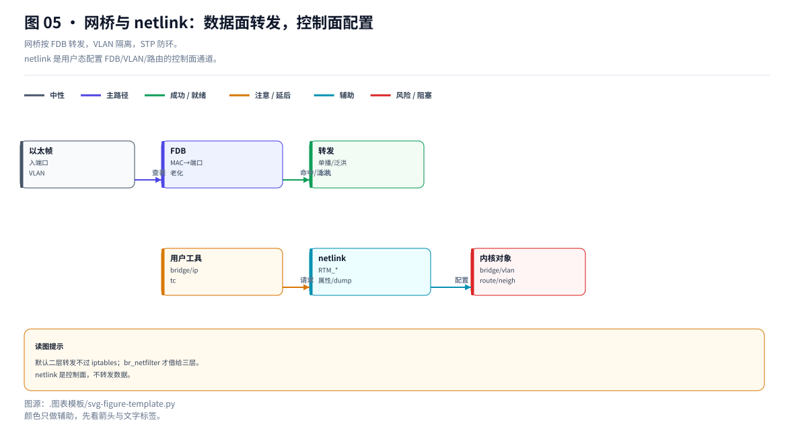

# 网桥与 netlink

网桥是软件二层交换机：按 FDB 转发以太帧；netlink 是用户态配置内核网络对象的控制面通道。

> 本篇定位：bridge 的端口/FDB/VLAN/STP 与 `br_netfilter` 边界；netlink 的 rtnetlink/generic netlink 消息模型与排障。

## 目录

- [1 一句话模型](#s1)
- [2 速览](#s2)
- [3 网桥转发](#s3)
- [4 网桥与 netfilter](#s4)
- [5 netlink 控制面](#s5)
- [6 设计取舍与边界](#s6)
- [7 与相邻主题的关系](#s7)
- [名词解释](#名词解释)
- [8 参考与关联](#s8)

## 1 · 一句话模型：FDB 转发，netlink 配置

```text
网桥：帧 → 查 FDB → 单播转发/泛洪/本机
netlink：用户请求（RTM_*）→ 内核 → 回复/通知
```

三个关键认知：

1. **网桥只认 MAC**，不认 IP；跨网段仍要路由。
2. **FDB 是软状态**，会老化；MAC 漂移会导致转发异常。
3. **netlink 是控制面**，不是数据面；它配置 FDB/VLAN/路由/邻居。

## 2 · 速览

| 项 | 内容 |
| --- | --- |
| 网桥对象 | bridge、port、FDB、VLAN |
| 转发依据 | 目的 MAC + VLAN |
| 防环 | STP/RSTP/MSTP |
| 用户工具 | `bridge`、`ip link`、`brctl`（旧） |
| netlink 类型 | rtnetlink、generic netlink、netfilter netlink |
| 常见 family | `NETLINK_ROUTE`、`NETLINK_GENERIC` |
| 排障 | `bridge fdb`、`bridge vlan`、`ip -s link` |

## 3 · 网桥转发



**读图**：网桥按 FDB 转发，VLAN 隔离；netlink 是用户态配置 bridge/vlan/route 的控制面。

> 图源：`images/图05-网桥与netlink.svg`


```text
收帧 → 学源 MAC（VLAN+MAC→端口）
  ├─ 目的 MAC 是本机/广播/组播 → 上交或泛洪
  ├─ 命中 FDB 且非入端口 → 从该口转发
  └─ 未命中 → 泛洪（VLAN 内）
```

关键点：

- FDB 按 VLAN 隔离；同一 MAC 在不同 VLAN 各一份。
- 端口有 PVID、allowed VLAN、tagged/untagged 规则。
- 环路必须有 STP，否则广播风暴。
- 网桥不改帧（透明转发），但 `br_netfilter` 可把帧借给 iptables。

## 4 · 网桥与 netfilter

默认二层转发不经过 IP 的 iptables 链。加载 `br_netfilter` 后，桥的钩子会把帧“借”给对应的三层钩子（如桥 FORWARD → IP FORWARD），由 `net.bridge.bridge-nf-call-iptables` 控制。

边界：这是“借给三层看一眼”，不是让帧上三层；性能有开销，规则要谨慎。

## 5 · netlink 控制面

```text
用户 socket(AF_NETLINK, SOCK_RAW, NETLINK_ROUTE)
  └─ 构造 nlmsghdr + 属性 → sendto 内核
       └─ 内核处理 → 回复/多播通知
```

| 部分 | 作用 |
| --- | --- |
| `nlmsghdr` | 长度、类型、标志、序列号 |
| 属性 TLV | 嵌套参数（接口、地址、VLAN） |
| dump | 分批返回全量对象 |
| 多播组 | 链路/路由/邻居事件通知 |

rtnetlink 管链路/地址/路由/邻居；generic netlink 给子系统自定义 family（如 nl80211、devlink）。

## 6 · 设计取舍与边界

### 6.1 软件网桥 vs 硬件交换

软件网桥灵活、成本低，但性能受 CPU/内核路径限制；硬件交换芯片/DSA 把转发 offload 到芯片，性能高但配置复杂。

### 6.2 br_netfilter 的代价

让 iptables 能看到桥流量，方便复用防火墙规则；但增加一次协议栈遍历，性能下降，且容易误判“为什么 iptables 能挡桥流量”。

### 6.3 netlink vs ioctl/sysfs

netlink 支持批量、事件通知、嵌套属性，是现代网络配置主通道；ioctl 简单但扩展性差，sysfs 适合简单属性。

### 6.4 排障顺序

网桥问题先看 FDB/VLAN/STP，再看 `br_netfilter` 和 iptables；netlink 问题先看 family/属性/权限，再看内核回调。

## 7 · 与相邻主题的关系

| 相邻主题 | 关系 |
| --- | --- |
| 网络栈概览 | bridge/netlink 是子系统 |
| netfilter | br_netfilter 把桥帧借给三层 |
| 收包/发包 | 桥转发在收包路径中 |
| 02-链路层 | VLAN/STP/FDB 原理 |
| 22-OpenWrt | netifd/bridge 配置 |

一句话：**网桥负责“二层怎么转”，netlink 负责“用户怎么配置内核网络对象”。**

## 名词解释

> 缩写给出英文全称；非缩写用“—”表示。

| 术语 | 英文全称 | 解释 |
| --- | --- | --- |
| FDB | Forwarding Database | 网桥 MAC 表。 |
| bridge | Bridge | 软件二层交换机。 |
| netlink | Netlink | 用户态与内核网络配置通道。 |
| rtnetlink | Route Netlink | 链路/地址/路由 netlink。 |
| br_netfilter | Bridge Netfilter | 把桥帧借给三层钩子。 |
| DSA | Distributed Switch Architecture | 交换芯片驱动框架。 |

## 8 · 参考与关联

**参考**

- Linux 内核文档：`Documentation/networking/bridge.rst`、`Documentation/netlink/`
- `net/bridge/`、`net/netlink/`
- 源仓库 `7.openwrt/4.内核网络/2.内核关键模块/2.网桥模块.md`、`5.netlink.md`

**关联**

- [00-网络栈概览.md](./00-网络栈概览.md)
- [01-netfilter](./01-netfilter/.readme.md)
- [01-收包流程.md](./01-收包流程.md)
- [02-链路层/02-VLAN与Trunk.md](../../../10-基础理论/11-网络科学/02-链路层/02-VLAN与Trunk.md)

---

> **本篇定位**：网桥 FDB/VLAN/STP 与 br_netfilter 边界，netlink 的消息模型与控制面排障。
> **素材来源**：`studyspace/1.知识体系/7.openwrt/4.内核网络/2.内核关键模块/2.网桥模块.md`、`5.netlink.md`；通用 Linux 知识补写。
> **待验证**：DSA/硬件 offload 与 netlink family 支持随平台/内核而变。
