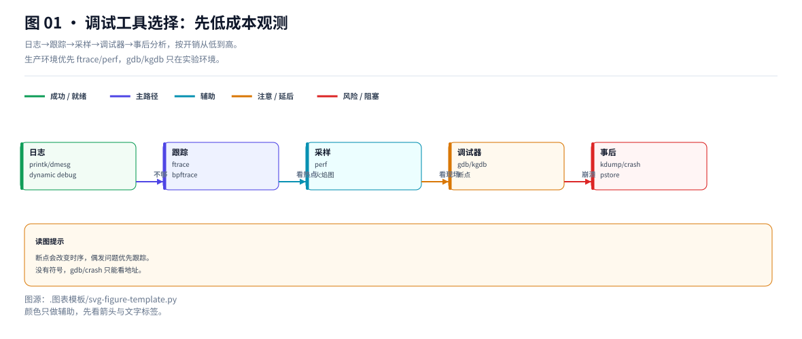

# 调试与追踪概览

先判断问题在用户态、内核态还是硬件；再选“日志/跟踪/采样/调试器”。不要一上来就上 gdb。

> 本篇定位：常用手段的分工与选择顺序，具体 ftrace/perf、gdb/crash 见后续篇。

## 目录

- [1 一句话模型](#s1)
- [2 速览](#s2)
- [3 手段分工](#s3)
- [4 选择顺序](#s4)
- [5 panic 与事后分析](#s5)
- [6 设计取舍与边界](#s6)
- [7 与相邻主题的关系](#s7)
- [名词解释](#名词解释)
- [8 参考与关联](#s8)

## 1 · 一句话模型：先看现象，再选工具

```text
用户态问题 → strace/gdb/perf
内核逻辑 → printk/ftrace/bpf
性能 → perf/ftrace/bpftrace
崩溃 → kdump/crash/pstore
```

三个关键认知：

1. **日志是成本最低的**，但要有级别、限速、可动态开关。
2. **跟踪看“发生了什么”**，采样看“时间花在哪”，调试器看“现场状态”。
3. **生产环境优先低开销手段**，gdb/kgdb 通常只在开发/实验环境。

## 2 · 速览

| 手段 | 用途 | 开销 |
| --- | --- | --- |
| printk/dmesg | 内核日志 | 低-中 |
| dynamic debug | 动态开关 pr_debug | 低 |
| ftrace | 函数/事件跟踪 | 中 |
| perf | 采样/性能计数 | 低-中 |
| bpftrace | 动态探针 | 中 |
| strace | 系统调用 | 高 |
| gdb/kgdb | 断点/单步 | 很高 |
| kdump/crash | 崩溃转储分析 | 事后 |

## 3 · 手段分工

| 问题 | 先用 | 再用 |
| --- | --- | --- |
| 应用卡住/报错 | strace、日志 | gdb、perf |
| 内核 oops/panic | dmesg、pstore | kdump/crash |
| 性能下降 | perf top/record | ftrace/bpftrace |
| 驱动 probe 失败 | dmesg、dynamic debug | ftrace |
| 偶发死锁 | lockdep | ftrace/crash |
| 内存泄漏 | meminfo/slabtop | kmemleak/bpftrace |

## 4 · 选择顺序



**读图**：从日志→跟踪→采样→调试器→事后分析，开销递增；生产优先低成本手段。

> 图源：`images/图01-调试工具选择.svg`


```text
① 复现与现象（日志/计数器）
② 缩小范围（用户态/内核/硬件）
③ 低开销跟踪（ftrace/perf）
④ 高开销调试（gdb/kgdb）
⑤ 事后分析（vmcore/pstore）
```

先问“能不能稳定复现”“有没有日志”“影响面多大”，再决定工具。生产环境避免长时间开高开销跟踪。

## 5 · panic 与事后分析

- **panic**：内核无法继续，打印调用栈；`panic=` 控制超时/重启。
- **pstore/ramoops**：把最后日志存到保留内存，重启后读取。
- **kdump**：崩溃时启动捕获内核，保存 vmcore；用 `crash` 分析。
- **watchdog**：卡死复位，但要区分“真死”与“启动慢”。

## 6 · 设计取舍与边界

### 6.1 日志不是越多越好

`pr_info` 刷屏会拖慢启动、占串口；用 `pr_debug` + dynamic debug，按需开启。

### 6.2 跟踪的开销

ftrace function_graph 开销大，perf 采样频率高也会影响性能；先低频率/窄范围，再逐步扩大。

### 6.3 调试器改变时序

断点会改变并发时序，可能让 bug 消失；偶发问题优先用跟踪/日志，不用断点。

### 6.4 生产环境边界

kgdb/kprobes 有安全风险；生产只开必要探针，权限受控，事后关闭。

## 7 · 与相邻主题的关系

| 相邻主题 | 关系 |
| --- | --- |
| 启动失败定位 | earlycon/initcall/pstore |
| 内存与性能 | perf/ftrace/OOM |
| 网络 | 收发包计数器、ftrace 事件 |
| 驱动 | probe/中断调试 |
| 进程与锁 | lockdep、调度跟踪 |

一句话：**先低成本观测，再高成本调试；先缩小范围，再上重工具。**

## 名词解释

> 缩写给出英文全称；非缩写用“—”表示。

| 术语 | 英文全称 | 解释 |
| --- | --- | --- |
| printk | Print Kernel | 内核日志输出。 |
| dynamic debug | Dynamic Debug | 动态开关 pr_debug。 |
| ftrace | Function Tracer | 内核函数/事件跟踪。 |
| perf | Performance | 采样与性能计数。 |
| kgdb | Kernel GDB | 内核源码级调试。 |
| kdump | Kernel Dump | 崩溃转储。 |
| pstore | Persistent Storage | 保留 panic 日志。 |

## 8 · 参考与关联

**参考**

- Linux 内核文档：`Documentation/admin-guide/dynamic-debug-howto.rst`、`Documentation/trace/`
- `man perf`、`man gdb`、`man crash`
- 源仓库 `7.openwrt/6.其他/故障排查.md`

**关联**

- [01-ftrace与perf.md](./01-ftrace与perf.md)
- [02-gdb与crash.md](./02-gdb与crash.md)
- [03-启动与根文件系统/02-启动失败定位.md](../03-启动与根文件系统/02-启动失败定位.md)

---

> **本篇定位**：调试手段的分工与选择顺序，建立“日志→跟踪→采样→调试器→事后分析”的路径。
> **素材来源**：`studyspace/1.知识体系/7.openwrt/6.其他/故障排查.md`；通用 Linux 调试知识补写。
> **待验证**：工具可用性与权限受内核配置/发行版限制。
