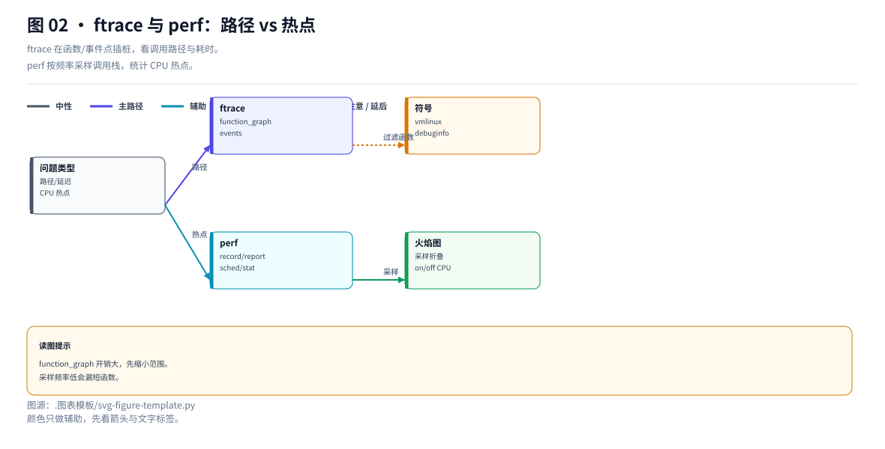

# ftrace 与 perf

ftrace 看“内核里发生了什么”，perf 看“时间花在哪”。两者都低开销、可在生产环境短时使用。

> 本篇定位：ftrace 的 function/function_graph/events、tracefs；perf 的 record/report/top、火焰图与常见用法。

## 目录

- [1 一句话模型](#s1)
- [2 速览](#s2)
- [3 ftrace](#s3)
- [4 perf](#s4)
- [5 火焰图与采样](#s5)
- [6 设计取舍与边界](#s6)
- [7 与相邻主题的关系](#s7)
- [名词解释](#名词解释)
- [8 参考与关联](#s8)

## 1 · 一句话模型：跟踪事件 vs 采样热点

```text
ftrace：在函数/事件点插桩，记录“谁调用了谁、耗时多少”
perf：按频率采样调用栈，统计“哪些函数占 CPU”
```

三个关键认知：

1. **ftrace 适合“路径/延迟”**，perf 适合“CPU 热点”。
2. **两者都能用 tracefs/perf_event**，但配置和开销不同。
3. **采样有偏差**：频率低会漏短函数，频率高会影响性能。

## 2 · 速览

| 工具 | 入口 | 典型用途 |
| --- | --- | --- |
| ftrace function | `available_filter_functions` | 看函数调用 |
| function_graph | `current_tracer` | 看调用耗时 |
| events | `events/` | 调度/中断/网络事件 |
| trace_pipe | `trace_pipe` | 实时读取 |
| perf top | `perf top` | 实时热点 |
| perf record/report | `perf record` | 采样调用栈 |
| perf sched | `perf sched` | 调度延迟 |
| bpftrace | `bpftrace` | 动态探针 |

## 3 · ftrace

```text
mount -t tracefs nodev /sys/kernel/tracing
echo function_graph > current_tracer
echo 'ip_rcv' > set_graph_function
cat trace_pipe
```

常用：

- `function`：记录函数调用（开销较低，但函数多）。
- `function_graph`：记录调用图与耗时（开销较高，建议过滤函数）。
- `events`：调度、中断、网络、块设备事件，适合看“发生了什么”。
- `set_ftrace_filter`/`set_graph_function`：缩小范围，降低开销。

## 4 · perf



**读图**：ftrace 看路径/延迟，perf 采样看 CPU 热点；两者都需要符号与合理采样频率。

> 图源：`images/图02-ftrace与perf.svg`


```text
perf record -g -p <pid> -- sleep 10
perf report
perf top
perf sched record/report
```

要点：

- `-g` 采集调用栈；需要 frame pointer 或 DWARF。
- `perf report` 看符号/调用链；没有符号先装 debuginfo。
- `perf stat` 看 IPC、cache miss、分支预测。
- 容器/权限受限时，检查 `perf_event_paranoid`。

## 5 · 火焰图与采样

- 采样调用栈后折叠成“栈 + 计数”，用 flamegraph 渲染。
- 横向宽度是采样占比，不是时间轴；看“哪条栈最宽”。
- on-CPU 火焰图看 CPU 热点；off-CPU 看阻塞/等待。
- 采样频率与运行时间要足够，短函数可能被漏掉。

## 6 · 设计取舍与边界

### 6.1 ftrace vs perf

ftrace 精确、可过滤，但插桩多时开销大；perf 采样低开销，但可能漏短函数、需要符号。

### 6.2 生产环境

ftrace function_graph 可能显著拖慢系统；生产先用 events/perf 低频率采样，缩小范围后再开 graph。

### 6.3 符号与调用栈

没有 debuginfo/frame pointer，perf 只能看到地址；嵌入式要保留 vmlinux/符号表。

### 6.4 不要只看热点

CPU 高可能是锁竞争、内存带宽、软中断；结合 `perf sched`、`vmstat`、`ftrace events` 一起看。

## 7 · 与相邻主题的关系

| 相邻主题 | 关系 |
| --- | --- |
| 调试概览 | 工具选择 |
| 内存/性能 | OOM、回收、page cache |
| 网络 | 收发包/NAPI 事件 |
| 调度 | sched 事件/延迟 |
| gdb/crash | 现场与事后分析 |

一句话：**ftrace 回答“走了哪条路”，perf 回答“时间花在哪”，两者配合定位性能问题。**

## 名词解释

> 缩写给出英文全称；非缩写用“—”表示。

| 术语 | 英文全称 | 解释 |
| --- | --- | --- |
| ftrace | Function Tracer | 内核跟踪框架。 |
| function_graph | Function Graph | 函数调用图 tracer。 |
| tracefs | Trace File System | ftrace 控制接口。 |
| perf | Performance | 采样/性能计数工具。 |
| flamegraph | Flame Graph | 采样栈可视化。 |
| bpftrace | BPF Trace | 动态探针工具。 |

## 8 · 参考与关联

**参考**

- Linux 内核文档：`Documentation/trace/ftrace.rst`、`Documentation/trace/events.rst`
- `perf` 官方文档、火焰图工具
- 源仓库 `7.openwrt/6.其他/故障排查.md`

**关联**

- [00-调试与追踪概览.md](./00-调试与追踪概览.md)
- [02-gdb与crash.md](./02-gdb与crash.md)
- [05-内存与性能/02-OOM与性能分析.md](../05-内存与性能/02-OOM与性能分析.md)

---

> **本篇定位**：ftrace 的 tracer/events 与 perf 的采样/报告，建立“路径 vs 热点”的选择。
> **素材来源**：通用 Linux 跟踪/性能知识补写；源仓库无对应成稿。
> **待验证**：tracefs 路径、perf 权限与符号支持随内核/发行版而变。
