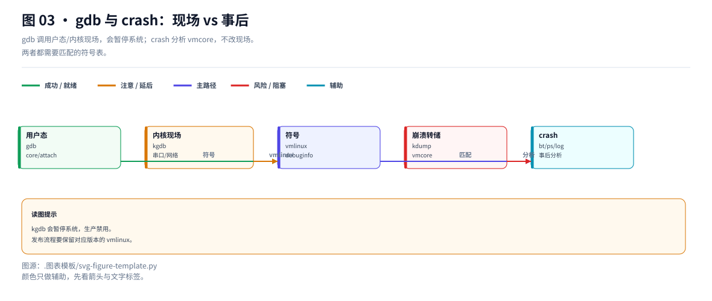

# gdb 与 crash

gdb 调用户态和内核（kgdb），crash 分析 vmcore。它们都依赖符号表（vmlinux/debuginfo），没有符号只能看地址。

> 本篇定位：用户态 gdb、kgdb 远程调试、kdump/crash 事后分析、pstore 的边界与准备。

## 目录

- [1 一句话模型](#s1)
- [2 速览](#s2)
- [3 用户态 gdb](#s3)
- [4 kgdb 内核调试](#s4)
- [5 kdump 与 crash](#s5)
- [6 设计取舍与边界](#s6)
- [7 与相邻主题的关系](#s7)
- [名词解释](#名词解释)
- [8 参考与关联](#s8)

## 1 · 一句话模型：现场用 gdb，事后用 crash

```text
用户态：gdb ./app core / attach pid
内核现场：kgdb + gdb vmlinux（串口/网络）
内核事后：kdump 生成 vmcore → crash vmlinux vmcore
```

三个关键认知：

1. **符号表是前提**：vmlinux、debuginfo、未 strip 的二进制。
2. **gdb 会改变时序**：断点可能让并发 bug 消失。
3. **crash 是事后分析**：不能改内存，只能看现场。

## 2 · 速览

| 工具 | 场景 | 依赖 |
| --- | --- | --- |
| gdb | 用户态进程/core | 可执行文件、符号 |
| gdbserver | 远程用户态 | 目标端 gdbserver |
| kgdb | 内核源码级调试 | 串口/网络、vmlinux |
| kdump | 崩溃转储 | 预留内存、捕获内核 |
| crash | 分析 vmcore | vmlinux、vmcore |
| pstore | 保留最后日志 | 保留内存 |

## 3 · 用户态 gdb

```text
gdb ./app
  (gdb) run
  (gdb) bt
  (gdb) info registers
  (gdb) x/16gx $rsp
```

常见：

- `core` 文件：`ulimit -c unlimited`，用 `gdb app core` 看崩溃栈。
- attach：`gdb -p <pid>`，看线程/栈/变量；注意权限（ptrace_scope）。
- 多线程：`info threads`、`thread apply all bt`。
- 符号：编译加 `-g`，不要 strip；发布包可单独保留 debuginfo。

## 4 · kgdb 内核调试

```text
内核配置：CONFIG_KGDB、CONFIG_KGDB_SERIAL_CONSOLE
启动参数：kgdboc=ttyS0,115200 kgdbwait
主机：gdb vmlinux
  (gdb) target remote /dev/ttyUSB0
  (gdb) b do_sys_open
  (gdb) c
```

要点：

- 需要串口/网络连接，目标机停在内核里，系统会暂停。
- 断点会改变时序，偶发问题优先 ftrace。
- 需要 vmlinux 与目标内核完全匹配。

## 5 · kdump 与 crash



**读图**：gdb 看现场会暂停系统，crash 分析 vmcore 不改现场；两者都依赖匹配的 vmlinux。

> 图源：`images/图03-gdb与crash.svg`


```text
崩溃 → 捕获内核启动 → 保存 vmcore → crash vmlinux vmcore
```

crash 常用：

- `bt`：当前/指定进程栈。
- `ps`：进程列表。
- `log`：内核日志。
- `struct`/`p`：查看结构体/变量。
- `kmem`/`vm`：内存信息。

准备：预留 crashkernel 内存、配置 kdump 服务、保留 vmlinux；嵌入式可用 pstore/ramoops 替代完整 vmcore。

## 6 · 设计取舍与边界

### 6.1 gdb vs 跟踪

gdb 能看到精确现场，但会暂停系统、改变时序；跟踪/日志更适合偶发/并发问题。

### 6.2 kgdb 的代价

kgdb 需要目标机暂停，可能影响业务；生产环境通常禁用，只在实验室使用。

### 6.3 kdump 的边界

kdump 需要预留内存、捕获内核可用；有些嵌入式/低内存设备不适合，改用 pstore/panic 日志。

### 6.4 符号管理

没有符号，crash/gdb 只能看地址；发布流程要保留 vmlinux/debuginfo，并与版本一一对应。

## 7 · 与相邻主题的关系

| 相邻主题 | 关系 |
| --- | --- |
| 调试概览 | 工具选择 |
| ftrace/perf | 低开销跟踪/采样 |
| 启动失败定位 | pstore/panic |
| 进程与内存 | 栈/结构体/内存分析 |
| 驱动 | probe/中断断点 |

一句话：**gdb 看现场，crash 看事后；两者都依赖符号，且都会改变/冻结系统。**

## 名词解释

> 缩写给出英文全称；非缩写用“—”表示。

| 术语 | 英文全称 | 解释 |
| --- | --- | --- |
| gdb | GNU Debugger | GNU 调试器。 |
| kgdb | Kernel GDB | 内核源码级调试。 |
| kdump | Kernel Dump | 崩溃转储机制。 |
| crash | Crash Utility | vmcore 分析工具。 |
| vmcore | Virtual Memory Core | 内核崩溃转储文件。 |
| pstore | Persistent Storage | 保留 panic 日志。 |
| debuginfo | Debug Information | 调试符号信息。 |

## 8 · 参考与关联

**参考**

- `man gdb`、`man crash`、`man kdump`
- Linux 内核文档：`Documentation/dev-tools/kgdb.rst`、`Documentation/admin-guide/kdump/`
- 源仓库 `7.openwrt/6.其他/recovery.md`

**关联**

- [00-调试与追踪概览.md](./00-调试与追踪概览.md)
- [01-ftrace与perf.md](./01-ftrace与perf.md)
- [03-启动与根文件系统/02-启动失败定位.md](../03-启动与根文件系统/02-启动失败定位.md)

---

> **本篇定位**：用户态 gdb、kgdb、kdump/crash 的适用场景与准备条件。
> **素材来源**：通用 Linux 调试知识补写；源仓库无对应成稿。
> **待验证**：kgdb/kdump 配置与 SoC 支持差异较大。
