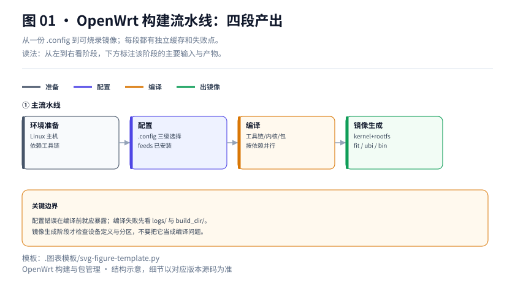

# OpenWrt 构建体系总览

一句话结论：OpenWrt 的构建系统是一个**以 `.config` 为输入、以可烧录镜像为输出的 buildroot 流水线**；理解它，关键是分清“配置选择”“包编译”“镜像拼装”三段，而不是记住某一条 make 命令。

> 本篇定位：给出构建全貌、目录职责和阶段边界。`make` 的具体分派、feeds 细节、Device 配方分别见本目录后续篇；内核编译机制见 [21-Linux](../../21-Linux/.readme.md)。

## 目录

- [1 一句话模型](#s1)
- [2 速览](#s2)
- [3 目录与关键对象](#s3)
- [4 构建流程](#s4)
- [5 状态机与定时器](#s5)
- [6 设计取舍与边界](#s6)
- [7 与相邻主题的关系](#s7)
- [名词解释](#名词解释)
- [8 参考与关联](#s8)

## 1 · 一句话模型

```text
.config ──► 工具链/内核/包 ──► rootfs + kernel ──► Device 配方 ──► 镜像
  选择         编译产物            文件树            分区与格式       可烧录文件
```

三个关键认知：

1. **`.config` 不是“编译参数”，而是整个系统的选择清单**：目标平台、设备、内核选项、包集合都在里面。
2. **编译与出镜像是两件事**：包能编过，不代表镜像能启动；后者由 Device/Profile 与分区布局决定。
3. **构建系统的目录就是它的接口**：`target/` 管平台，`package/` 管软件，`include/` 管规则，`build_dir/` 放中间产物。

## 2 · 速览

| 项 | 内容 |
| --- | --- |
| 所属层/领域 | OpenWrt 构建与交付 |
| 核心对象 | Target、Subtarget、Device、Package、Image |
| 关键输入 | `.config`、`feeds.conf`、`target/linux/<target>/image/` |
| 关键输出 | `bin/targets/<target>/<subtarget>/` 下的镜像与 `packages/` |
| 典型场景 | 新板适配、裁剪固件、批量出厂镜像、单包调试 |
| 主要标准 | 无协议标准；以 OpenWrt 构建系统约定为准 |

## 3 · 目录与关键对象

| 目录/对象 | 作用 | 什么时候会碰 | 边界与误判 |
| --- | --- | --- | --- |
| `target/linux/<target>/` | 目标平台的内核配置、补丁、镜像规则 | 新 SoC、内核升级、分区调整 | 不是“驱动目录”；驱动通常来自内核源码或 `package/kernel/` |
| `target/linux/<target>/<subtarget>/` | 子目标（SoC 系列/启动介质） | 同 target 下多款芯片 | 设备差异不应都塞进 subtarget |
| `target/linux/<target>/image/` | Device 定义、镜像拼装命令 | 新增板型、改镜像名/分区 | 只描述“怎么拼”，不负责编译内核 |
| `package/` | 主仓库内的包 | 新增/修改软件包 | feeds 包不在主仓库源码里，安装后是链接 |
| `package/feeds/` | `feeds install` 生成的符号链接 | 排查“包从哪来” | 删链接不等于删 feed 源码 |
| `include/` | 通用构建规则（`image.mk`、`package.mk` 等） | 改全局行为 | 改这里影响所有 target，风险最高 |
| `build_dir/` | 解压、编译、安装的中间目录 | 看编译错误、清缓存 | 可删除重建，不是源码 |
| `staging_dir/` | 工具链与已安装的库/头文件 | 交叉编译、查依赖 | 与 `build_dir` 生命周期不同 |
| `bin/targets/` | 最终镜像与包仓库 | 取产物、做发布 | 产物名由 Device 配方决定 |
| `.config` | 全部选择项 | 配置、复现构建 | 手工编辑易漏依赖，优先 `menuconfig`/`defconfig` |
| `feeds.conf` | 外部包源清单 | 加私有 feed | 只声明来源，不拉代码 |

## 4 · 构建流程



**读图**：从左到右是四个阶段；下方说明每段的失败点。配置阶段的错误应在编译前暴露，镜像阶段的错误通常与设备定义、分区或启动介质有关。

> 图源：`images/图01-构建流水线.svg`

### 4.1 正常路径

1. **准备环境**：Linux 主机、大小写敏感文件系统、常见构建依赖；不建议在 macOS 原生文件系统上直接全量编译。
2. **选择目标**：`make menuconfig` 选 Target/Subtarget/Device，再选包；产物写入 `.config`。
3. **拉取外部包**：`./scripts/feeds update -a`、`./scripts/feeds install -a`，把 feed 包挂进 `package/feeds/`。
4. **编译**：`make -j$(nproc)` 先建工具链，再编内核与包，最后进镜像阶段。
5. **取产物**：镜像在 `bin/targets/`，包在 `bin/packages/`；两者版本必须匹配。

### 4.2 异常分支

| 现象 | 优先检查 | 说明 |
| --- | --- | --- |
| 配置项找不到 | feeds 是否 install、`make menuconfig` 是否在正确目录 | 包没进索引就不会出现在菜单 |
| 编译中途缺头文件 | `staging_dir/` 是否完整、依赖是否声明 | 多半是包 Makefile 的 `DEPENDS` 缺失 |
| 镜像生成失败 | `target/linux/<target>/image/Makefile`、DTS、分区 | 编译已过，问题在拼装或设备定义 |
| 镜像能烧但不启动 | 启动介质、分区偏移、bootargs、DTB | 属于板级问题，先看串口日志 |

## 5 · 状态机与定时器

本主题没有协议状态机。构建过程是一个**依赖 DAG**：节点是“工具链/内核/包/镜像”，边是依赖关系；`make` 只保证节点按依赖顺序执行，不保证可重复产出完全相同的二进制（时间戳、路径、并行顺序都可能影响）。

## 6 · 设计取舍与边界

- **为什么用 buildroot 而不是发行版包管理**：嵌入式目标需要统一的交叉工具链、可控的 rootfs 和可复现的镜像；发行版的二进制包不适合这种裁剪。
- **为什么配置和编译分离**：`.config` 可存档、可 diff、可批量复用；先定选择再长时间编译，失败成本更低。
- **代价**：目录和变量多、首次编译慢、缓存状态复杂；出现“昨天能编今天不能”时，先怀疑配置或缓存，而不是源码。
- **不适用**：只想装一个已编译包时，不需要全量 buildroot，用 opkg 或 ImageBuilder 更快。
- **常见误判**：把 `bin/` 里的旧产物当成本次结果；构建前确认时间戳与 `.config` 的 target 一致。

## 7 · 与相邻主题的关系

| 相邻对象 | 关系 |
| --- | --- |
| [01-环境与 make 调用链](./01-环境与make调用链.md) | 本篇的下钻：一条 make 如何分派到包 |
| [02-config 配置原理](./02-config配置原理.md) | `.config` 的三级选择如何生成 |
| [03-feeds 与包 Makefile](./03-feeds与包Makefile.md) | 外部包如何进入构建 |
| [04-镜像生成与 Device/Profile](./04-镜像生成与Device-Profile.md) | 内核与 rootfs 如何拼成镜像 |
| [05-ImageBuilder、SDK 与 opkg](./05-ImageBuilder-SDK与opkg.md) | 不全量编译时的两条替代路径 |
| [21-Linux/03-启动与根文件系统](../../21-Linux/03-启动与根文件系统/.readme.md) | 镜像之后的启动链与 rootfs 挂载 |

一句话边界：本篇讲“系统怎么产出镜像”，不展开某个驱动的编译细节，也不讲产品发布流程。

## 名词解释

> 缩写给出英文全称；非缩写用“—”表示。

| 术语 | 英文全称 | 解释 |
| --- | --- | --- |
| buildroot | — | OpenWrt 使用的构建框架，用 Makefile 组织交叉编译与镜像生成。 |
| Target | — | 构建的目标平台，通常对应 CPU 架构与内核分支。 |
| Subtarget | — | Target 下的子目标，通常对应 SoC 系列或启动介质。 |
| Device | — | 具体板型，绑定 DTS、分区和镜像配方。 |
| Profile | — | ImageBuilder 使用的“设备 + 包集合”预定义组合。 |
| DAG | Directed Acyclic Graph | 有向无环图，描述构建节点之间的依赖顺序。 |
| rootfs | Root Filesystem | 根文件系统，包含 init、库和用户态程序。 |
| SDK | Software Development Kit | 用于在已构建目标上交叉编译单个包的开发包。 |

## 8 · 参考与关联

**标准**

- OpenWrt 官方文档：Build system、Image Builder、SDK 章节（以所用分支为准）。

**关联**

- [本目录索引](./.readme.md)
- [21-Linux 启动与根文件系统](../../21-Linux/03-启动与根文件系统/.readme.md)
- [30-平台与芯片](../../../30-平台与芯片/.readme.md)：具体 SoC 的 SDK 与板级差异

---

> **本篇定位**：构建体系总览与目录职责。
> **素材来源**：`studyspace-v2/7.平台与集成/1.OpenWrt/1.构建体系/`。
> **待验证**：不同 OpenWrt 分支的目录名与镜像配方可能调整；以目标分支源码为准。
