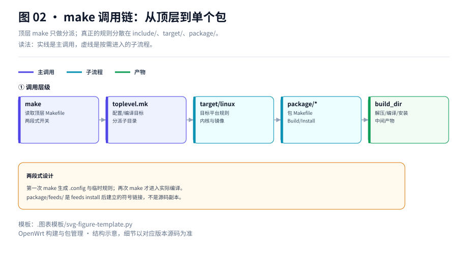

# 环境与 make 调用链

一句话结论：顶层 `make` 只负责**判断阶段和分派目标**，真正的编译规则分散在 `include/`、`target/linux/`、`package/` 里；看懂了“两段式入口 + 元数据扫描 + 包规则”，就能定位绝大多数构建失败发生在哪一层。

> 本篇定位：讲主机环境要求与 make 的分派路径。`.config` 的语义见 [02-config 配置原理](./02-config配置原理.md)，镜像拼装见 [04-镜像生成与 Device/Profile](./04-镜像生成与Device-Profile.md)。

## 目录

- [1 一句话模型](#s1)
- [2 速览](#s2)
- [3 关键文件与变量](#s3)
- [4 调用流程](#s4)
- [5 状态机与定时器](#s5)
- [6 设计取舍与边界](#s6)
- [7 与相邻主题的关系](#s7)
- [名词解释](#名词解释)
- [8 参考与关联](#s8)

## 1 · 一句话模型

```text
make ──► 顶层 Makefile ──► toplevel.mk ──► 元数据扫描 ──► target/package 规则
         （两段式开关）      （配置/分派）     （scan.mk）      （实际编译）
```

三个关键认知：

1. **顶层 Makefile 是“开关”，不是“编译器”**：它根据 `OPENWRT_BUILD` 决定进入配置阶段还是编译阶段。
2. **配置阶段也要“构建”**：`conf`/`mconf`、`prepare-tmpinfo` 会先跑一遍，生成 Kconfig 树和临时规则。
3. **包编译是递归 make**：每个包在自己的 `build_dir/` 里按 `Build/Prepare → Build/Compile → Build/Install` 执行。

## 2 · 速览

| 项 | 内容 |
| --- | --- |
| 所属层/领域 | OpenWrt 构建系统入口 |
| 核心对象 | 顶层 Makefile、`toplevel.mk`、`scan.mk`、包 Makefile |
| 关键变量 | `OPENWRT_BUILD`、`TOPDIR`、`BUILD_DIR`、`STAGING_DIR`、`V`、`-j` |
| 典型场景 | 首次编译、单包重编、配置不生效、并行编译失败 |
| 主要标准 | GNU Make 语义 + OpenWrt 自定义规则 |

## 3 · 关键文件与变量

| 文件/变量 | 作用 | 触发时机 | 边界与误判 |
| --- | --- | --- | --- |
| `Makefile`（顶层） | 判断 `OPENWRT_BUILD`，分派配置或编译 | 每次 `make` | 不要在这里加业务规则 |
| `include/toplevel.mk` | 配置类目标、子目录分派、`world` 目标 | 配置与主构建 | 名字叫 toplevel，但不含所有规则 |
| `include/rules.mk` | 通用编译规则、目录变量 | 编译阶段 | 与 `package.mk` 分工不同 |
| `include/package.mk` | 包的生命周期模板 | 每个包 | 包自己的 Makefile 只填变量和钩子 |
| `include/scan.mk` | 扫描包/目标元数据，生成索引 | `prepare-tmpinfo` | 扫描结果有缓存，改包后可能需重扫 |
| `scripts/config/` | 构建 `conf`/`mconf` 配置工具 | 首次配置 | 配置工具本身也会编译 |
| `OPENWRT_BUILD` | 两段式开关 | 顶层 Makefile | 未设置时走配置入口，设置后走编译入口 |
| `V=s` | 输出完整编译命令 | 调试编译 | 输出量很大，定位后应关掉 |
| `-jN` | 并行编译 | 全量构建 | 并行过高会放大未声明依赖的问题 |
| `TOPDIR` | 源码根目录 | 全局 | 在包规则里不要假设当前目录 |

两段式入口的判断逻辑很简单：

| 进入方式 | `OPENWRT_BUILD` | 载入什么 | 结果 |
| --- | --- | --- | --- |
| 第一次 | 未设置 | 配置入口（Kconfig + 配置目标） | 生成/修改 `.config` |
| 第二次 | `=1` | `rules.mk` + target/package 规则 | 真正编译 |

所以 `make menuconfig` 和 `make -j8` 走的是两条入口；配置阶段报错和编译阶段报错，排查方向完全不同。

**主机环境自检**（不满足时的报错往往很靠前）：

| 项 | 要求 | 不满足的表现 |
| --- | --- | --- |
| 文件系统 | 大小写敏感 | 路径大小写冲突，编译随机失败、清理不干净 |
| 主机 | Linux；macOS/Windows 用容器或 WSL2 | 原生不敏感文件系统上问题难复现 |
| 依赖 | build-essential、gawk、git、rsync、python3、libncurses、zlib、libssl | `Build dependency: Please install ...` |
| 磁盘 | 预留 20~30 GB | 编译到一半 `No space left on device` |
| 用户 | 非 root | 产物属主混乱，后续清理困难 |

## 4 · 调用流程



**读图**：实线是主调用，虚线表示按需进入的子流程。顶层只做分派；`target/linux` 与 `package/*` 才是规则的落点；`build_dir` 是每个包的独立工作区。

> 图源：`images/图02-make调用链.svg`

### 4.1 正常路径

1. **环境自检**：检查主机工具、大小写敏感、磁盘空间；不满足时在 `prepare-tmpinfo` 前后就会报错。
2. **第一次进入**：`OPENWRT_BUILD` 未设置，顶层 Makefile 载入 `toplevel.mk`，执行配置目标（如 `menuconfig`），生成 `.config`。
3. **元数据扫描**：`prepare-tmpinfo` 调用 `scan.mk` 扫描 `target/linux` 与 `package/`，生成包与目标的临时索引。
4. **再次进入**：`OPENWRT_BUILD=1` 后载入 `rules.mk`，按依赖构建工具链、内核、包。
5. **单包重编**：`make package/<name>/compile V=s` 只走该包的规则，但仍依赖已就绪的 `staging_dir`。

单包调试常用的几个目标（同一套前缀，替换 `<pkg>`）：

| 目标 | 作用 | 判断什么 |
| --- | --- | --- |
| `make -n package/<pkg>/compile` | 只打印将执行的命令 | 确认变量展开是否正确，不浪费一次编译 |
| `make package/<pkg>/prepare` | 解压源码、应用补丁 | 补丁冲突在这一步就暴露 |
| `make package/<pkg>/compile V=s` | 编译（不安装） | 语法/链接错误 |
| `make package/<pkg>/install` | 装进 staging 与包目录 | 文件清单、依赖打包 |
| `make package/<pkg>/clean` | 删该包 `build_dir` | 改 Makefile/补丁后必须做 |

> **推论**：`DEPENDS` 只决定“菜单里能不能选、装包时依赖谁”，不自动安排编译顺序。所以“单包编译找不到头文件”多半不是缺依赖声明，而是依赖还没装进 `staging_dir`；先编依赖，再编本包。

### 4.2 异常分支

| 现象 | 优先检查 | 说明 |
| --- | --- | --- |
| 改了包但菜单没变 | 是否重新扫描、是否在正确 feed | 扫描索引可能缓存；先确认包路径 |
| 单包编译找不到依赖 | `staging_dir` 是否安装该依赖 | `DEPENDS` 只影响选择，不自动补编译顺序 |
| 并行编译随机失败 | 未声明的依赖、共享输出目录 | 先用 `-j1` 复现，再补依赖 |
| 配置目标报 `conf` 缺失 | 主机工具链/权限 | 配置工具本身需要先构建 |
| 清理后仍失败 | `build_dir`、`staging_dir`、`tmp/` 的残留 | 分层清理，不要一上来全删 |

## 5 · 状态机与定时器

没有协议状态机，也没有定时器。构建系统只有**阶段切换**：配置阶段 → 扫描阶段 → 编译阶段 → 镜像阶段。阶段之间靠 `.config`、`tmp/` 索引和 `staging_dir/` 传递状态；任一阶段失败，后续阶段不会自动“回滚”。

## 6 · 设计取舍与边界

**清理要分层做**，一上来 `dirclean` 会把可复用的工具链也删掉，下一次全量编译更慢：

| 层级 | 典型命令 | 删掉什么 | 适用 |
| --- | --- | --- | --- |
| 单包 | `make package/<pkg>/clean` | 该包的 `build_dir` | 改包源码/补丁 |
| 内核 | `make target/linux/clean` | 内核编译目录 | 改 DTS/内核补丁 |
| 元数据 | `rm -rf tmp` | scan 生成的索引 | 菜单不更新、包找不到 |
| 全量构建 | `make dirclean` | `build_dir`、`staging_dir`、`bin` | 工具链损坏、换 target |
| 回到初始 | `make distclean` | 连 `.config`、下载缓存 | 复现“全新克隆”的构建 |

- **为什么两段式**：配置目标需要在不加载完整编译规则的情况下运行，否则首次构建会陷入“要编译先配置、要配置先编译”的循环。
- **为什么大量使用 include**：把通用规则集中，target 和 package 只描述差异；代价是调用链不直观，必须靠 `V=s` 和 `make -n` 观察。
- **为什么包内再递归 make**：每个包可以有完全不同的构建系统（autotools、cmake、内核模块），统一入口只能放在包 Makefile。
- **不适用**：只想改一个已安装的脚本或配置时，不必走整条构建链，直接在设备上改 overlay 更快，但不可复现。
- **常见误判**：把“配置没生效”当成 make 缓存；实际上多数是 feeds 未安装或 target 选错。

> **推论**：`-j` 放大的是“未声明依赖”，不是“并行能力”。随机失败先降到 `-j1`，能稳定复现就说明依赖图不完整——这时补依赖比换机器有用。

## 7 · 与相邻主题的关系

| 相邻对象 | 关系 |
| --- | --- |
| [00-构建体系总览](./00-构建体系总览.md) | 本篇是总览中“编译阶段”的下钻 |
| [02-config 配置原理](./02-config配置原理.md) | 解释 `.config` 如何被三级规则消费 |
| [03-feeds 与包 Makefile](./03-feeds与包Makefile.md) | 解释包规则从哪里来 |
| [04-镜像生成与 Device/Profile](./04-镜像生成与Device-Profile.md) | 编译完成后的拼装阶段 |
| [50-软件开发/构建与调试](../../../50-软件开发/.readme.md) | 通用 Make/CMake 知识 |

一句话边界：本篇讲“make 怎么走”，不讲“某个包怎么编”。

## 名词解释

> 缩写给出英文全称；非缩写用“—”表示。

| 术语 | 英文全称 | 解释 |
| --- | --- | --- |
| buildroot | — | 以 Makefile 组织的交叉编译与镜像构建框架。 |
| target | — | 构建系统里的目标平台或 make 目标，需按上下文区分。 |
| feed | — | 独立维护的包源码仓库，通过 `feeds.conf` 引入。 |
| staging_dir | Staging Directory | 存放工具链、库和头文件的中间安装区。 |
| build_dir | Build Directory | 每个包解压、编译、安装的工作目录。 |
| Kconfig | Kernel Configuration | 内核与 buildroot 使用的配置描述语言。 |
| DAG | Directed Acyclic Graph | 有向无环图，描述构建依赖。 |

## 8 · 参考与关联

**标准**

- GNU Make 手册；OpenWrt 官方 Build system 文档。

**关联**

- [本目录索引](./.readme.md)
- [00-构建体系总览](./00-构建体系总览.md)
- [02-config 配置原理](./02-config配置原理.md)

---

> **本篇定位**：构建入口与 make 分派路径。
> **素材来源**：`studyspace-v2/7.平台与集成/1.OpenWrt/1.构建体系/02-make调用链.md`。
> **待验证**：不同分支的 `toplevel.mk` 目标名与扫描缓存路径可能变化。
