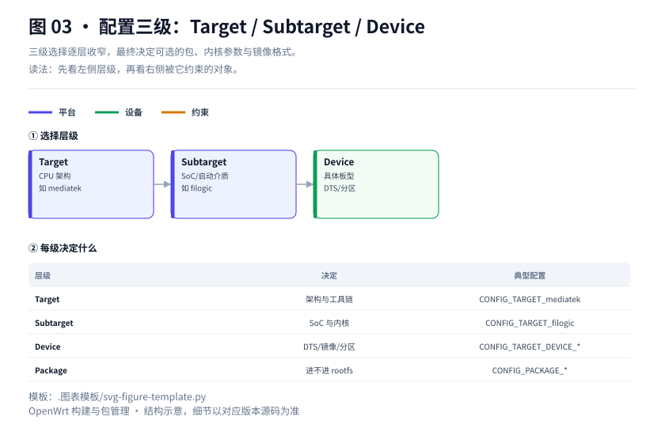

# config 配置原理

一句话结论：OpenWrt 的 `.config` 是**三级目标选择（Target → Subtarget → Device）加两级软件选择（包与内核选项）**的结果；配置错误通常不是“某个选项没开”，而是上一级目标选错导致整棵选项树都变了。

> 本篇定位：讲清 `.config` 从哪来、每一级决定什么、如何复现与对比。构建入口见 [01-环境与 make 调用链](./01-环境与make调用链.md)，包来源见 [03-feeds 与包 Makefile](./03-feeds与包Makefile.md)。

## 目录

- [1 一句话模型](#s1)
- [2 速览](#s2)
- [3 配置层级与字段](#s3)
- [4 配置流程](#s4)
- [5 状态机与定时器](#s5)
- [6 设计取舍与边界](#s6)
- [7 与相邻主题的关系](#s7)
- [名词解释](#名词解释)
- [8 参考与关联](#s8)

## 1 · 一句话模型

```text
Target（架构） → Subtarget（SoC/介质） → Device（板型）
        └────────► 可用包与内核选项 ────────► .config
```

三个关键认知：

1. **上一级决定下一级的可选项**：Target 选错，Subtarget 和 Device 菜单里根本不会出现你要的板子。
2. **`.config` 同时包含“选什么”和“编成什么”**：`CONFIG_TARGET_*` 选平台，`CONFIG_PACKAGE_*` 选软件，内核选项再由平台规则展开。
3. **配置是可存档的构建输入**：保存 `.config` 比记录一长串 make 命令可靠。

## 2 · 速览

| 项 | 内容 |
| --- | --- |
| 所属层/领域 | OpenWrt 构建配置 |
| 核心对象 | `.config`、`target/linux/<target>/`、`target/linux/<target>/<subtarget>/target.mk` |
| 关键变量 | `CONFIG_TARGET_*`、`CONFIG_PACKAGE_*`、`CONFIG_TARGET_DEVICE_*` |
| 典型场景 | 新板配置、裁剪包、复现他人构建、升级内核选项 |
| 主要标准 | Kconfig 语义 |

## 3 · 配置层级与字段

| 层级 | 典型配置项 | 决定什么 | 边界与误判 |
| --- | --- | --- | --- |
| Target | `CONFIG_TARGET_mediatek=y` | CPU 架构、内核分支、工具链 | 不是具体芯片型号 |
| Subtarget | `CONFIG_TARGET_mediatek_filogic=y` | SoC 系列、启动介质、内核配置 | 同系列不同板仍在此级共享 |
| Device | `CONFIG_TARGET_DEVICE_mediatek_filogic_DEVICE_<board>=y` | DTS、分区、镜像配方 | 不选 Device 也可能编出镜像，但不保证适配 |
| Package | `CONFIG_PACKAGE_<name>=y/m` | 编进 rootfs 或编成模块 | `=m` 只对支持模块的包有效 |
| Kernel | `CONFIG_KERNEL_*`、`CONFIG_<driver>` | 内核功能与驱动 | 由平台规则约束，不能任意开 |
| Image | `CONFIG_TARGET_ROOTFS_*`、`CONFIG_TARGET_IMAGES_GZIP` | rootfs 格式与镜像压缩 | 与启动介质强相关 |

### 3.1 `.config` 的生成方式

| 方式 | 适用场景 | 代价 |
| --- | --- | --- |
| `make menuconfig` | 交互选择、首次配置 | 需要终端与配置工具 |
| `make defconfig` | 按当前 target 补全默认值 | 可能悄悄改变未显式设置的项 |
| `make oldconfig` | 升级源码后保留旧选择 | 新选项需要逐个确认 |
| 直接编辑 `.config` | 脚本化、批量 | 易漏依赖，后续 `defconfig` 可能改写 |
| 保存/复用 `.config` | 复现构建、CI | 必须与源码分支和目标一致 |

## 4 · 配置流程



**读图**：左侧是逐级收窄的选择链，右侧矩阵说明每一级约束什么。先确认 Target/Subtarget，再看 Device 是否出现在菜单里；顺序反了会误判为“配置缺失”。

> 图源：`images/图03-config三级.svg`

### 4.1 正常路径

1. 选 Target：决定架构与内核分支。
2. 选 Subtarget：决定 SoC 系列与启动介质。
3. 选 Device：绑定 DTS、分区和镜像名。
4. 选包：按功能选 `CONFIG_PACKAGE_*`，注意依赖会自动带入。
5. `make defconfig` 补全默认值，保存 `.config`。
6. 用 `scripts/diffconfig` 对比两份配置，确认差异符合预期。

### 4.2 异常分支

| 现象 | 原因 | 处理方向 |
| --- | --- | --- |
| 菜单里没有目标板 | Target/Subtarget 选错，或该板未加入当前分支 | 回到上一级确认，查 `image/Makefile` 是否有 Device 定义 |
| 选了包但没进镜像 | 包被依赖排除、`=m` 但无模块支持、被 `CONFIG_PACKAGE_*` 覆盖 | 看最终 `.config` 与 `bin/packages` |
| 升级后配置大量变化 | 新 Kconfig 选项、默认值调整 | 用 `oldconfig` 逐项确认，不要盲目 `defconfig` |
| 两台机器产物不同 | 源码分支、feeds、`.config` 不一致 | 固化三者版本，记录 commit |

## 5 · 状态机与定时器

没有状态机与定时器。配置是一次性求解：Kconfig 根据依赖关系计算可见项与默认值，最终写成 `.config`。注意 `defconfig` 可能**重写未显式设置的项**，这不是运行时状态变化，而是求解结果变化。

## 6 · 设计取舍与边界

- **为什么分三级**：平台、SoC、板型的差异粒度不同；分层能让同 SoC 的多个板共享配置，只写差异。
- **为什么保留 `.config` 文本**：可 diff、可审查、可进 CI；二进制配置格式做不到这一点。
- **代价**：选项之间存在隐式依赖，手工编辑容易产生“看起来开了、实际被覆盖”的项。
- **不适用**：只改运行参数（如 LAN IP）不应重新构建，用 UCI 即可。
- **常见误判**：把 `CONFIG_PACKAGE_x=y` 当成“一定在镜像里”；最终还要看镜像配方是否排除、依赖是否满足。

## 7 · 与相邻主题的关系

| 相邻对象 | 关系 |
| --- | --- |
| [01-环境与 make 调用链](./01-环境与make调用链.md) | 配置阶段如何被 make 触发 |
| [03-feeds 与包 Makefile](./03-feeds与包Makefile.md) | `CONFIG_PACKAGE_*` 对应的包从哪来 |
| [04-镜像生成与 Device/Profile](./04-镜像生成与Device-Profile.md) | Device 选择如何变成镜像配方 |
| [06-定制与裁剪](../06-定制与裁剪/.readme.md) | 裁剪就是配置选择加镜像约束 |

一句话边界：本篇讲“选择怎么产生”，不讲某个选项的业务含义。

## 名词解释

> 缩写给出英文全称；非缩写用“—”表示。

| 术语 | 英文全称 | 解释 |
| --- | --- | --- |
| Kconfig | Kernel Configuration | 描述配置项、依赖和默认值的语言与工具。 |
| Target | — | 目标平台层级，通常对应架构与内核分支。 |
| Subtarget | — | 目标平台下的 SoC/介质子层级。 |
| Device | — | 具体板型，绑定 DTS、分区与镜像。 |
| defconfig | Default Configuration | 按当前规则补全默认值的配置目标。 |
| oldconfig | Old Configuration | 保留旧选择、逐项确认新选项的配置目标。 |
| DTS | Device Tree Source | 设备树源文件，描述板级硬件。 |

## 8 · 参考与关联

**标准**

- Kconfig 语言文档；OpenWrt 官方 Config 与 Target 文档。

**关联**

- [本目录索引](./.readme.md)
- [01-环境与 make 调用链](./01-环境与make调用链.md)
- [04-镜像生成与 Device/Profile](./04-镜像生成与Device-Profile.md)

---

> **本篇定位**：`.config` 的层级、生成与复现。
> **素材来源**：`studyspace-v2/7.平台与集成/1.OpenWrt/1.构建体系/04-config配置原理.md`。
> **待验证**：不同分支的 Kconfig 文件名与 Device 配置项格式可能调整。
