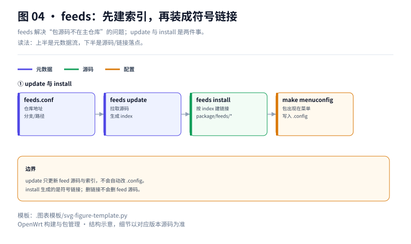

# feeds 与包 Makefile

一句话结论：feeds 负责把**主仓库之外的包源码**拉进来并建立索引，包 Makefile 负责描述**一个包怎么下载、编译、打包、安装**；两者之间靠 `package/feeds/` 的符号链接衔接，而不是把源码复制进主仓库。

> 本篇定位：讲 feeds 的两阶段（update/install）与包 Makefile 的最小结构。配置选择见 [02-config 配置原理](./02-config配置原理.md)，运行时安装见 [05-ImageBuilder、SDK 与 opkg](./05-ImageBuilder-SDK与opkg.md)。

## 目录

- [1 一句话模型](#s1)
- [2 速览](#s2)
- [3 feeds 与包的关键字段](#s3)
- [4 数据流与流程](#s4)
- [5 状态机与定时器](#s5)
- [6 设计取舍与边界](#s6)
- [7 与相邻主题的关系](#s7)
- [名词解释](#名词解释)
- [8 参考与关联](#s8)

## 1 · 一句话模型

```text
feeds.conf ──update──► feeds/<name>/ ──install──► package/feeds/<name>/<pkg> ──► .config
                                      （建索引）        （符号链接）              （选择）
```

三个关键认知：

1. **update 与 install 是两件事**：update 拉源码并生成索引，install 只按索引建立链接。
2. **包 Makefile 是声明式的**：定义元数据、依赖和几个构建钩子，通用流程由 `package.mk` 提供。
3. **feed 版本必须与主仓库匹配**：主仓库与 feed 分支错位，是“包能搜到但编不过”的常见来源。

## 2 · 速览

| 项 | 内容 |
| --- | --- |
| 所属层/领域 | OpenWrt 包生态与构建 |
| 核心对象 | `feeds.conf`、feed 索引、`package/feeds/*`、包 Makefile |
| 关键变量 | `PKG_NAME`、`PKG_VERSION`、`PKG_SOURCE`、`PKG_BUILD_DIR`、`DEPENDS` |
| 典型场景 | 引入私有包、升级 feed、包不出现、依赖缺失 |
| 主要标准 | OpenWrt package Makefile 约定 |

## 3 · feeds 与包的关键字段

### 3.1 feeds 配置

| 字段/路径 | 作用 | 边界与误判 |
| --- | --- | --- |
| `feeds.conf` / `feeds.conf.default` | 声明 feed 名称、地址、分支 | 修改后必须重新 update |
| `feeds/<name>/` | feed 源码与 `.index` | 不是安装后的包目录 |
| `package/feeds/<name>/<pkg>` | 指向 feed 源码的符号链接 | 删链接不会删源码 |
| `.index` | 包名到路径的索引 | 索引过期会导致 install 找不到包 |
| `feeds install -a` | 安装全部 feed 包链接 | 不等于选中编译 |
| `feeds install -p <pkg>` | 只安装指定包 | 依赖仍需自行确认 |

### 3.2 包 Makefile 的最小结构

| 变量/段 | 作用 | 常见错误 |
| --- | --- | --- |
| `PKG_NAME` | 包名，决定目录与配置项 | 与 `Package/` 段名不一致 |
| `PKG_VERSION` / `PKG_RELEASE` | 上游版本与打包修订号 | 只改代码不改 release，产物版本不变 |
| `PKG_SOURCE` / `PKG_SOURCE_URL` | 源码包与下载地址 | 校验值不匹配会直接失败 |
| `PKG_HASH` | 源码校验 | 升级版本忘记更新 |
| `PKG_BUILD_DIR` | 解压/编译目录 | 多包共享目录导致互相覆盖 |
| `include $(INCLUDE_DIR)/package.mk` | 引入通用规则 | 放在变量定义之前导致变量失效 |
| `define Package/<name>` | 元数据段：标题、分类、依赖 | `DEPENDS` 漏写运行时库 |
| `define Build/Compile` | 覆盖默认编译 | 清空后未实现，产物为空 |
| `define Package/<name>/install` | 安装到 rootfs 暂存区 | 路径写错，镜像里找不到 |

一个最小可编译的骨架（字段按实际包替换）：

```makefile
include $(TOPDIR)/rules.mk

PKG_NAME:=hello
PKG_VERSION:=1.0
PKG_RELEASE:=1
PKG_SOURCE:=$(PKG_NAME)-$(PKG_VERSION).tar.gz
PKG_SOURCE_URL:=https://example.com/src
PKG_HASH:=0123456789abcdef...

include $(INCLUDE_DIR)/package.mk

define Package/hello
  SECTION:=utils
  CATEGORY:=Utilities
  TITLE:=Hello demo
  DEPENDS:=+libc
endef

define Build/Compile
	$(MAKE) -C $(PKG_BUILD_DIR)
endef

define Package/hello/install
	$(INSTALL_DIR) $(1)/usr/bin
	$(INSTALL_BIN) $(PKG_BUILD_DIR)/hello $(1)/usr/bin/
endef

$(eval $(call BuildPackage,hello))
```

四段缺一不可：`rules.mk`（顶层变量）、`package.mk`（生命周期）、`Package/`（元数据与依赖）、`BuildPackage`（注册到构建系统）。**`$(1)` 是 install 阶段的暂存根目录**，路径必须写成 `$(1)/usr/bin` 这种绝对形式。

## 4 · 数据流与流程



**读图**：上半是元数据流（配置 → update → 索引 → install），下半是源码与链接的落点。菜单里能选到包，前提是索引和链接都已建立；`.config` 只是最后一步选择。

> 图源：`images/图04-feeds数据流.svg`

### 4.1 正常路径

1. 在 `feeds.conf` 增加或修改 feed 地址与分支。
2. `./scripts/feeds update -a`：拉取源码、生成 `.index`、刷新包清单。
3. `./scripts/feeds install -a`：按索引在 `package/feeds/` 建立链接。
4. `make menuconfig`：包出现在对应分类下，选中后写入 `.config`。
5. 全量编译或 `make package/<name>/compile` 单包编译。

feeds 的常用动作与判据：

| 动作 | 命令 | 判据 |
| --- | --- | --- |
| 列出已装 feed | `./scripts/feeds list -n` | 名字与 `feeds.conf` 一致 |
| 只更新一个 feed | `./scripts/feeds update <name>` | 该 feed 目录 commit 变化 |
| 只装一个包 | `./scripts/feeds install <pkg>` | `package/feeds/<feed>/<pkg>` 链接出现 |
| 搜包 | `./scripts/feeds search <kw>` | 结果来自 `.index`，索引旧则搜不到 |
| 重装全部 | `update -a && install -a` | 检查是否引入不兼容的新包 |

### 4.2 异常分支

| 现象 | 原因 | 处理方向 |
| --- | --- | --- |
| `feeds update` 失败 | 网络、分支不存在、私有仓库鉴权 | 先单独 clone 验证地址与分支 |
| install 后菜单仍没有 | 索引未刷新、包被 `DEPENDS` 排除 | 重跑 update，检查包元数据 |
| 编译时下载失败 | `PKG_SOURCE_URL` 失效、代理/证书 | 换镜像或本地放置源码包 |
| 依赖缺失 | `DEPENDS` 未声明或 feed 未安装 | 补依赖并确认对应 feed 已 install |
| 升级 feed 后大面积失败 | 主仓库与 feed 分支不匹配 | 固定匹配分支，记录 commit |

“包能搜到但编不过”按三处查：

| 步骤 | 查什么 | 判据 | 答错的后果 |
| --- | --- | --- | --- |
| ① 分支匹配 | 主仓库与 feed 是否同一 release | 两边 `git branch`/`git log` | 分支错位会缺 API、结构体变更 |
| ② 补丁可用 | 上游升级后补丁是否还能打 | `make package/<pkg>/prepare` | 补丁冲突在 prepare 就报，不必等全量 |
| ③ 源码校验 | `PKG_HASH` 是否随版本更新 | 日志里的 hash mismatch | 不改 hash 会反复下载失败 |

## 5 · 状态机与定时器

没有状态机与定时器。feeds 只有两个幂等阶段：update（同步源码与索引）和 install（建立链接）。重复执行不会产生额外状态，但**不会自动回滚**到旧版本；需要版本控制或固定 commit。

## 6 · 设计取舍与边界

- **为什么用 feed 而不是全部放进主仓库**：包数量大、维护者分散、发布节奏不同；feed 让主仓库保持精简。
- **为什么用符号链接**：避免源码复制导致的“两份代码不一致”，同时保留 feed 的独立更新能力。
- **代价**：多一层路径与索引，排查时要同时看 `feeds/`、`package/feeds/` 和 `.config`。
- **不适用**：单个私有包、强耦合产品代码，直接放 `package/` 更简单，减少 feed 同步成本。
- **常见误判**：把 `feeds install` 当成“安装到设备”；它只影响构建树，不碰设备 rootfs。

> **推论**：私有包只有一两个时，放 `package/` 比建 feed 便宜——省掉 update/install 两级同步和 `.index` 过期问题。只有当包要独立发版、被多个产品复用时，feed 的代价才值得。

> **边界**：feed 的 `install` 是“按索引建链接”，不会帮你解决依赖顺序；`DEPENDS` 写错时，菜单里可能能选，编译时才暴露。看到“依赖装了还报缺”，先查是不是两个 feed 提供了同名包。

## 7 · 与相邻主题的关系

| 相邻对象 | 关系 |
| --- | --- |
| [01-环境与 make 调用链](./01-环境与make调用链.md) | 包规则如何被 make 调用 |
| [02-config 配置原理](./02-config配置原理.md) | 包如何变成 `CONFIG_PACKAGE_*` |
| [04-镜像生成与 Device/Profile](./04-镜像生成与Device-Profile.md) | 选中的包如何进入镜像 |
| [05-ImageBuilder、SDK 与 opkg](./05-ImageBuilder-SDK与opkg.md) | 预编译包与运行时安装 |
| [06-定制与裁剪/02-裁剪、补丁与 SDK 集成](../06-定制与裁剪/02-裁剪-补丁与SDK集成.md) | 私有 feed 与补丁管理 |

一句话边界：本篇讲“包怎么进来、怎么描述”，不讲包内业务逻辑。

## 名词解释

> 缩写给出英文全称；非缩写用“—”表示。

| 术语 | 英文全称 | 解释 |
| --- | --- | --- |
| feed | — | 独立维护的 OpenWrt 包源码仓库。 |
| index | — | feed 内包名、版本与路径的索引文件。 |
| package.mk | — | 定义包生命周期（准备、编译、安装、打包）的通用规则。 |
| PKG_HASH | Package Hash | 源码包的校验值，防止下载被篡改或版本漂移。 |
| DEPENDS | Dependencies | 包在构建或运行时依赖的其他包。 |
| ipk | — | OpenWrt 传统二进制包格式，本质是 ar 归档。 |
| APK | Alpine Package Keeper | 新版 OpenWrt 逐步引入的包管理器与包格式。 |

## 8 · 参考与关联

**标准**

- OpenWrt 官方 Feed 与 Package Makefile 文档。

**关联**

- [本目录索引](./.readme.md)
- [02-config 配置原理](./02-config配置原理.md)
- [05-ImageBuilder、SDK 与 opkg](./05-ImageBuilder-SDK与opkg.md)

---

> **本篇定位**：feeds 两阶段与包 Makefile 结构。
> **素材来源**：`studyspace-v2/7.平台与集成/1.OpenWrt/1.构建体系/03-feeds机制.md`、`6.包管理与生态/01-opkg.md`。
> **待验证**：apk 在目标分支的默认状态与包格式支持范围。
