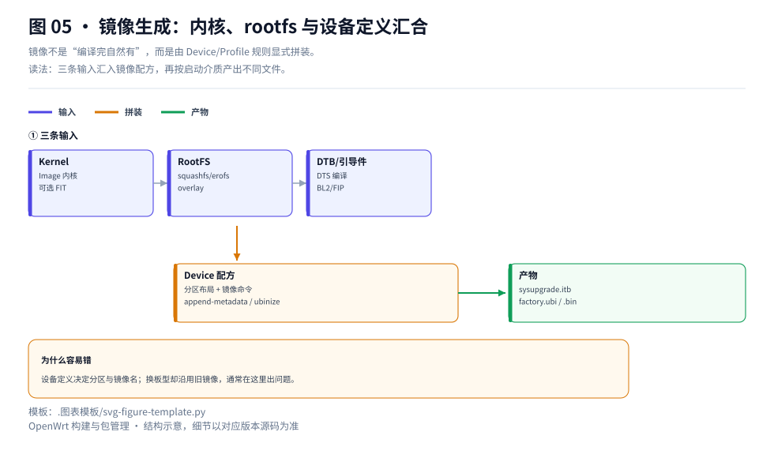

# 镜像生成与 Device/Profile

一句话结论：镜像不是编译的“副产品”，而是**由 Device/Profile 配方显式拼装**出来的：内核、rootfs、DTB/引导件三条输入，按启动介质选择 FIT、UBI 或裸镜像格式，再写入分区布局和升级元数据。

> 本篇定位：讲镜像配方的结构、常见产物与失败边界。具体 SoC 的 BL2/FIP、分区偏移和 DTS 细节放到 [30-平台与芯片](../../../30-平台与芯片/.readme.md)；升级流程见 [05-升级与恢复](../05-升级与恢复/.readme.md)。

## 目录

- [1 一句话模型](#s1)
- [2 速览](#s2)
- [3 镜像配方与关键字段](#s3)
- [4 生成流程](#s4)
- [5 状态机与定时器](#s5)
- [6 设计取舍与边界](#s6)
- [7 与相邻主题的关系](#s7)
- [名词解释](#名词解释)
- [8 参考与关联](#s8)

## 1 · 一句话模型

```text
Kernel + RootFS + DTB/引导件
        └──► Device 配方（分区、格式、元数据）──► 镜像族
             sysupgrade.itb / factory.ubi / factory.bin / initramfs
```

三个关键认知：

1. **Device 定义描述“这块板怎么启动”**，不是“这块板用什么 CPU”；CPU 属于 Target/Subtarget。
2. **同一套内核与 rootfs 可以产出多种镜像**：升级用、工厂烧录用、救援用，格式和分区不同。
3. **镜像元数据决定能不能升级**：设备兼容性、版本、分区名不匹配时，sysupgrade 会拒绝。

## 2 · 速览

| 项 | 内容 |
| --- | --- |
| 所属层/领域 | OpenWrt 镜像拼装 |
| 核心对象 | `Device/`、`BuildImage`、`IMAGE/*`、`ARTIFACT` |
| 关键输入 | 内核镜像、rootfs、DTB、引导件、分区布局 |
| 关键输出 | `sysupgrade.*`、`factory.*`、`initramfs.*` |
| 典型场景 | 新板适配、改分区、双固件、工厂量产 |
| 主要标准 | FIT、UBI、squashfs/erofs、OpenWrt 镜像元数据约定 |

## 3 · 镜像配方与关键字段

| 对象/字段 | 作用 | 边界与误判 |
| --- | --- | --- |
| `Device/Default` | 设备默认镜像命令与分区 | 改它影响同 target 所有设备 |
| `Device/<board>` | 单板覆盖：DTS、镜像名、分区 | 板名与 `.config` 的 Device 项必须一致 |
| `BuildImage` | 镜像构建入口 | 只拼装，不负责编内核 |
| `IMAGE/<name>` | 定义一种镜像的生成命令 | 名字会进入最终文件名 |
| `ARTIFACT` | 可发布的附属文件（如 bootloader） | 不是所有产物都进 sysupgrade |
| `KERNEL_IN_UBI` | 内核放入 UBI 卷 | 与分区布局强绑定，切换需同步改引导 |
| `append-metadata` | 写入 fwtool 元数据 | 缺元数据时升级工具无法校验兼容性 |
| `compat_version` | 设备兼容性版本 | 分区布局变更时必须递增 |
| `IMAGE_SIZE` | 镜像大小限制 | 超限在拼装阶段报错，不是编译错误 |

## 4 · 生成流程



**读图**：三条输入先各自产出，再进入 Device 配方；配方决定分区、格式、元数据和最终文件名。读图时先确认启动介质，再看产物是升级镜像还是工厂镜像。

> 图源：`images/图05-镜像生成.svg`

### 4.1 正常路径

1. 内核管道产出内核镜像（可选 FIT），DTB 由 DTS 编译。
2. rootfs 以 squashfs/erofs 等只读格式生成，overlay 提供可写层。
3. Device 配方按启动介质选择拼装方式：FIT、UBI、裸分区或组合镜像。
4. 写入元数据（设备名、版本、兼容性），生成 `sysupgrade` 与 `factory` 两类产物。
5. 产物落在 `bin/targets/<target>/<subtarget>/`，同时生成校验文件。

### 4.2 异常分支

| 现象 | 原因 | 处理方向 |
| --- | --- | --- |
| 镜像超限 | rootfs 或内核超过分区大小 | 裁剪包、调整分区或压缩格式 |
| 烧录后不启动 | 分区偏移、bootargs、DTB 不匹配 | 串口日志 + 分区表逐项核对 |
| sysupgrade 拒绝 | 设备名/兼容性/镜像类型不匹配 | 检查元数据与 `compat_version` |
| 工厂镜像能烧、升级镜像不能 | 两种镜像的分区假设不同 | 对照 Device 配方中的 IMAGE 定义 |
| 改分区后旧配置丢失 | overlay 位置变化 | 升级前确认配置备份与迁移策略 |

## 5 · 状态机与定时器

没有协议状态机。镜像生成是**一次性拼装**；运行期的“升级/回滚”状态由 bootloader、双分区标记和 sysupgrade 共同维护，见 [05-升级与恢复](../05-升级与恢复/.readme.md)。

## 6 · 设计取舍与边界

- **为什么区分 sysupgrade 与 factory 镜像**：前者保留配置、只替换系统区；后者用于首次烧录或救援，通常包含完整分区。
- **为什么用 FIT/UBI**：FIT 便于携带内核、DTB 和校验；UBI 适配 NAND 的坏块管理。代价是格式与引导程序强耦合。
- **为什么元数据必须存在**：没有兼容性校验，错误镜像可能被写入不匹配的分区，直接变砖。
- **不适用**：只改 rootfs 内文件时，不必重做镜像；用 overlay 或 opkg 更快。
- **常见误判**：把“镜像能烧进去”当成“适配完成”；启动、网络、升级三条链路都要验证。

## 7 · 与相邻主题的关系

| 相邻对象 | 关系 |
| --- | --- |
| [00-构建体系总览](./00-构建体系总览.md) | 镜像阶段在整体流水线中的位置 |
| [02-config 配置原理](./02-config配置原理.md) | Device 选择如何进入 `.config` |
| [05-ImageBuilder、SDK 与 opkg](./05-ImageBuilder-SDK与opkg.md) | 用预编译包重新拼镜像 |
| [05-升级与恢复/01-sysupgrade](../05-升级与恢复/01-sysupgrade.md) | 镜像如何被写入设备 |
| [30-平台与芯片](../../../30-平台与芯片/.readme.md) | BL2/FIP、DTS、分区偏移的厂商差异 |

一句话边界：本篇讲“镜像怎么拼”，不讲“某块板的分区偏移是多少”。

## 名词解释

> 缩写给出英文全称；非缩写用“—”表示。

| 术语 | 英文全称 | 解释 |
| --- | --- | --- |
| FIT | Flattened Image Tree | 用设备树描述的镜像容器，可包含内核、DTB、rootfs 与校验。 |
| DTB | Device Tree Blob | 设备树二进制，告诉内核板级硬件布局。 |
| UBI | Unsorted Block Images | NAND 上的逻辑卷管理层，负责坏块与磨损均衡。 |
| squashfs | — | 只读压缩文件系统，常用于 OpenWrt 系统区。 |
| overlay | — | 可写层，保存配置与运行时改动。 |
| factory image | — | 工厂烧录或救援用完整镜像。 |
| sysupgrade image | — | 系统升级用镜像，通常保留配置。 |
| compat_version | Compatibility Version | 设备兼容性版本，分区布局变化时必须更新。 |

## 8 · 参考与关联

**标准**

- OpenWrt 官方 Image、Device 与 sysupgrade 文档；FIT、UBI 规范。

**关联**

- [本目录索引](./.readme.md)
- [02-config 配置原理](./02-config配置原理.md)
- [05-升级与恢复](../05-升级与恢复/.readme.md)

---

> **本篇定位**：Device/Profile 配方与镜像产物。
> **素材来源**：`studyspace-v2/7.平台与集成/1.OpenWrt/1.构建体系/05-镜像原理/`。
> **待验证**：MT7981 的 BL2/FIP 细节、分区偏移与具体镜像名随板型变化，需对照目标 DTS 与 Device 配方。
