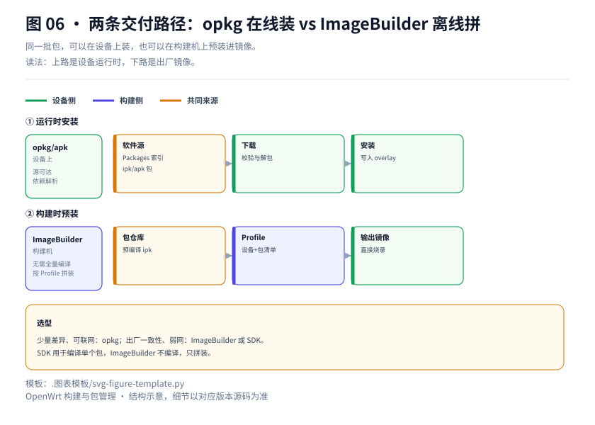

# ImageBuilder、SDK 与 opkg

一句话结论：不想全量编译时有三条路——**ImageBuilder 拼镜像、SDK 编单包、opkg/apk 在设备上装包**；三者都依赖“目标平台 + 包版本”严格匹配，混用不同批次的产物是最常见的失败来源。

> 本篇定位：讲三条交付路径的适用场景与边界。镜像配方见 [04-镜像生成与 Device/Profile](./04-镜像生成与Device-Profile.md)，包源码见 [03-feeds 与包 Makefile](./03-feeds与包Makefile.md)。

## 目录

- [1 一句话模型](#s1)
- [2 速览](#s2)
- [3 三条路径的关键对象](#s3)
- [4 流程与选择](#s4)
- [5 状态机与定时器](#s5)
- [6 设计取舍与边界](#s6)
- [7 与相邻主题的关系](#s7)
- [名词解释](#名词解释)
- [8 参考与关联](#s8)

## 1 · 一句话模型

```text
ImageBuilder：预编译包 + Profile ──► 镜像（不编译）
SDK：         目标工具链 + 包源码 ──► 单个 ipk/apk（编译）
opkg/apk：    设备 + 软件源 ────────► 安装/升级/卸载（运行时）
```

三个关键认知：

1. **ImageBuilder 不编译**：它只把已有包拼进 rootfs，所以不能改包内代码。
2. **SDK 只编单包**：适合驱动/应用迭代，不重新生成整套工具链。
3. **opkg 安装的是 ABI 兼容的二进制包**：内核版本、架构、依赖任一不匹配都可能失败或运行异常。

## 2 · 速览

| 项 | 内容 |
| --- | --- |
| 所属层/领域 | OpenWrt 交付与包管理 |
| 核心对象 | ImageBuilder、SDK、`ipk`/`apk`、软件源索引 |
| 关键输入 | 目标 Profile、包清单、目标工具链、`Packages` 索引 |
| 关键输出 | 定制镜像、单包二进制、设备上的安装结果 |
| 典型场景 | 出厂预装、单包调试、现场补丁、弱网环境 |
| 主要标准 | OpenWrt 包格式与 ABI 约定 |

## 3 · 三条路径的关键对象

| 对象/字段 | 作用 | 边界与误判 |
| --- | --- | --- |
| `PROFILE` | ImageBuilder 的设备配方名 | 不是任意板名，必须在该 ImageBuilder 的 Profile 列表里 |
| `PACKAGES` | 追加/移除包清单 | 只影响本次镜像，不改包仓库 |
| `FILES` | 追加到镜像的文件树 | 覆盖路径要与 rootfs 结构一致 |
| SDK `staging_dir` | 目标工具链与依赖 | SDK 版本必须与设备固件同批 |
| `ipk` | 传统包格式（ar 归档） | 解包后含 control、data、debian-binary |
| `apk` | 新版包格式 | 目标分支未启用时不可用（待验证） |
| `Packages` / `Packages.gz` | 软件源索引 | 索引与包文件必须同源同版本 |
| `arch` | 包架构标识 | 与设备 `opkg print-architecture` 不一致会拒绝安装 |
| `kernel` 依赖 | 内核 ABI 依赖 | 内核升级后旧 kmod 通常需要重装 |

## 4 · 流程与选择



**读图**：上路是设备运行时安装，下路是构建机上预装。两条路共享同一批预编译包，但一个改变运行中的 overlay，一个改变出厂 rootfs。

> 图源：`images/图06-两条交付路径.svg`

### 4.1 ImageBuilder 路径

1. 下载与目标固件同版本的 ImageBuilder。
2. 查 Profile 列表，确认设备名。
3. 指定 `PROFILE`、`PACKAGES`、可选 `FILES`，生成镜像。
4. 产物直接用 sysupgrade 或工厂工具烧录。

```bash
make image PROFILE=<profile> \
  PACKAGES="luci-app-x -dnsmasq dnsmasq-full" \
  FILES=files/
```

`PACKAGES` 里不带前缀是“加”，`-` 前缀是“删”。用 `-dnsmasq +dnsmasq-full` 这种写法换实现，比直接加更稳，因为两者冲突。

### 4.2 SDK 路径

1. 下载与固件同版本的 SDK，解压后先构建基础环境。
2. 把包源码放入 `package/` 或 feed。
3. `make package/<name>/compile V=s` 生成单包。
4. 把包放入自有软件源，或直接安装到设备验证。

```bash
./scripts/feeds update -a && ./scripts/feeds install -a
make package/<name>/compile V=s
```

SDK 的价值是“工具链已经就绪”：不用再编一遍 gcc/glibc，单包迭代从小时级降到分钟级。

### 4.3 opkg 路径

1. 确认设备的架构、内核版本与已安装包版本。
2. 配置软件源（官方源或自有源），更新索引。
3. 安装/升级包，观察依赖解析结果。
4. 需要回退时，保留旧包文件，避免只依赖在线源。

```bash
opkg print-architecture          # 设备架构
opkg update                      # 刷新源索引
opkg install <pkg>               # 安装
opkg list-installed | grep <pkg> # 确认版本
```

**三条路径怎么选**：

| 需求 | 选哪条 | 原因 |
| --- | --- | --- |
| 只换包集合、预装业务 | ImageBuilder | 不编译，分钟级出镜像 |
| 改包代码、驱动补丁 | SDK | 有目标工具链，只编单包 |
| 现场补丁、快速验证 | opkg/apk | 立即生效，但不可复现 |
| 改内核/启动链/分区 | 全量构建 | 前三条都覆盖不到 |

### 4.4 异常分支

| 现象 | 原因 | 处理方向 |
| --- | --- | --- |
| ImageBuilder 找不到 Profile | 版本与设备不匹配 | 换对应版本的 ImageBuilder |
| 镜像里包版本不对 | 包仓库与 ImageBuilder 不同批 | 固定同批产物，禁用混源 |
| SDK 编译缺头文件 | SDK 未初始化或依赖未装 | 先构建基础环境，再补依赖 |
| opkg 报架构不匹配 | 源架构与设备不一致 | 核对 `arch` 与源配置 |
| 内核升级后 kmod 失效 | 内核 ABI 变化 | 重装对应内核模块，勿强装旧包 |
| 安装后空间不足 | overlay 容量有限 | 清理缓存或改用预装镜像 |

## 5 · 状态机与定时器

没有协议状态机。包管理只有**安装状态**（未安装/已安装/配置残留）和**源索引状态**（旧/新）；没有自动回滚。升级失败时是否可恢复，取决于是否保留旧包和 overlay 空间。

## 6 · 设计取舍与边界

- **为什么需要 ImageBuilder**：出厂镜像要求确定性和弱网可用，不能依赖设备现场下载。
- **为什么需要 SDK**：全量编译太慢，单包迭代需要稳定的目标工具链。
- **为什么 opkg 仍重要**：现场补丁、小批量验证、开发调试都离不开运行时安装。
- **代价**：三条路径的版本矩阵容易失控；必须记录固件版本、包版本与源码 commit。
- **不适用**：修改内核或启动链时，ImageBuilder/opkg 都不够，必须回到全量构建。
- **常见误判**：用 `--force-depends` 绕过依赖；短期能装，长期会出现符号缺失或启动失败。

> **推论**：三条路径的版本矩阵是“固件批次 × 包批次 × 工具链批次”。混用任一批次，失败往往不在安装时，而在运行时的符号解析或 kmod ABI——所以发布记录里必须写清三者的 commit，而不只是版本号。

> **边界**：`opkg install` 成功不等于“重启后仍在”。装进 overlay 的包受可用空间限制；空间不足时可能“本次生效、重启丢一半”，大包应走预装镜像。

## 7 · 与相邻主题的关系

| 相邻对象 | 关系 |
| --- | --- |
| [03-feeds 与包 Makefile](./03-feeds与包Makefile.md) | 包源码如何变成二进制包 |
| [04-镜像生成与 Device/Profile](./04-镜像生成与Device-Profile.md) | ImageBuilder 复用的镜像配方 |
| [05-升级与恢复/01-sysupgrade](../05-升级与恢复/01-sysupgrade.md) | 生成镜像如何写入设备 |
| [06-定制与裁剪/02-裁剪、补丁与 SDK 集成](../06-定制与裁剪/02-裁剪-补丁与SDK集成.md) | 私有包与补丁交付 |

一句话边界：本篇讲“怎么把包交付到镜像或设备”，不讲包内部实现。

## 名词解释

> 缩写给出英文全称；非缩写用“—”表示。

| 术语 | 英文全称 | 解释 |
| --- | --- | --- |
| ImageBuilder | — | 用预编译包和 Profile 拼装镜像的工具，不做编译。 |
| SDK | Software Development Kit | 针对已构建目标的交叉编译开发包。 |
| opkg | OpenWrt Package Manager | OpenWrt 传统包管理器。 |
| APK | Alpine Package Keeper | 新版 OpenWrt 引入的包管理器与格式。 |
| ipk | — | opkg 使用的二进制包格式。 |
| ABI | Application Binary Interface | 二进制接口，内核与库升级后可能不兼容。 |
| Profile | — | ImageBuilder 中的设备与包集合定义。 |
| overlay | — | 设备上的可写层，运行时安装的包通常落在这里。 |

## 8 · 参考与关联

**标准**

- OpenWrt 官方 Image Builder、SDK、opkg 文档。

**关联**

- [本目录索引](./.readme.md)
- [03-feeds 与包 Makefile](./03-feeds与包Makefile.md)
- [04-镜像生成与 Device/Profile](./04-镜像生成与Device-Profile.md)

---

> **本篇定位**：三条交付路径的选型与版本约束。
> **素材来源**：`studyspace-v2/7.平台与集成/1.OpenWrt/6.包管理与生态/`、`1.构建体系/06-编译实践.md`。
> **待验证**：目标分支默认使用 opkg 还是 apk，以及 apk 的包格式细节。
