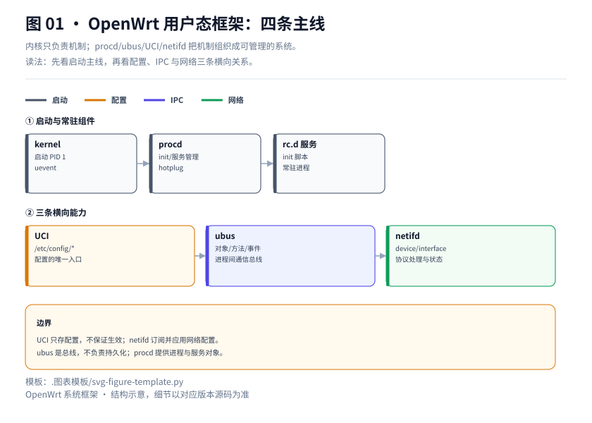

# OpenWrt 系统框架总览

一句话结论：OpenWrt 用户态由**四条主线**构成——procd 管启动与服务、UCI 管配置、ubus 管进程间通信、netifd 把网络配置变成内核状态；理解它们的交界，比单独背某个命令更重要。

> 本篇定位：给出四者的职责、依赖和调用方向。各组件细节见本目录后续篇；内核机制链接到 [21-Linux](../../21-Linux/.readme.md)。

## 目录

- [1 一句话模型](#s1)
- [2 速览](#s2)
- [3 四类对象与职责](#s3)
- [4 启动与协作流程](#s4)
- [5 状态机与定时器](#s5)
- [6 设计取舍与边界](#s6)
- [7 与相邻主题的关系](#s7)
- [名词解释](#名词解释)
- [8 参考与关联](#s8)

## 1 · 一句话模型

```text
kernel ──► procd（PID 1）──► rc.d 服务
              │
              ├── UCI：读 /etc/config
              ├── ubus：对象/方法/事件
              └── netifd：device/interface → 内核网络
```

三个关键认知：

1. **procd 是根**：它接管 init，负责 preinit、服务启动、热插拔和看门狗。
2. **UCI 是配置面，ubus 是运行面**：UCI 落盘，ubus 暴露运行状态与操作入口。
3. **netifd 是网络配置的执行者**：它读 UCI，调用 proto 脚本，把结果写进内核并上报 ubus。

## 2 · 速览

| 项 | 内容 |
| --- | --- |
| 所属层/领域 | OpenWrt 用户态系统框架 |
| 核心对象 | procd、ubusd、UCI、netifd |
| 关键入口 | `/etc/init.d/`、`/etc/config/`、`ubus`、`/lib/netifd/` |
| 典型场景 | 服务不自启、配置不生效、接口状态异常、脚本拿不到事件 |
| 主要标准 | OpenWrt 自身约定，无外部协议标准 |

## 3 · 四类对象与职责

| 组件 | 职责 | 关键入口 | 边界与误判 |
| --- | --- | --- | --- |
| procd | init、服务实例、respawn、hotplug、看门狗 | `/etc/init.d/*`、`/etc/hotplug.d/` | 不是“普通守护进程”；它是 PID 1 |
| ubus | 对象注册、方法调用、事件订阅 | `ubus` 命令、`/usr/share/acl.d/` | 不持久化，不替代配置文件 |
| UCI | 统一配置读写与提交 | `/etc/config/*`、`uci` 命令 | commit 只写文件，不自动重载服务 |
| netifd | 网络设备/接口建模、协议处理、状态上报 | `/etc/config/network`、`/lib/netifd/proto/` | 不负责防火墙规则本身，规则由 fw3/fw4 生成 |

四条主线之间的**交界**才是排障入口：

| 交界 | 方向 | 典型动作 | 断了会怎样 |
| --- | --- | --- | --- |
| UCI → netifd | 读配置 | `ifup wan` 时重新读 `network` | 改了配置不 ifup，内核状态不变 |
| UCI → procd | 触发器 | `procd_add_reload_trigger` / `service_triggers` | 配置提交了但服务不重载 |
| netifd → ubus | 上报状态 | `network.interface.*` 的 status/事件 | LuCI 显示旧状态 |
| procd → ubus | 注册服务 | `service` 对象、进程状态 | 看不到服务，误判“没启动” |

## 4 · 启动与协作流程



**读图**：左侧是启动链，右侧三条横向能力分别对应配置、IPC 和网络。箭头表示“谁读谁/谁调用谁”，不是数据包路径。

> 图源：`images/图01-系统框架总览.svg`

### 4.1 正常路径

1. 内核挂载 rootfs，启动 procd 作为 PID 1。
2. procd 执行 preinit，挂载 overlay，合并配置。
3. procd 按 `/etc/rc.d/` 顺序启动服务；网络服务启动 netifd。
4. netifd 读取 UCI 的 `network` 配置，创建 device、启动 interface。
5. 各服务通过 ubus 注册对象，LuCI/CLI 通过 ubus 查询或操作。

启动链的分界要记清：**preinit 阶段还没有完整配置**（overlay 可能没挂上），`/etc/rc.d/S*` 阶段才有完整 rootfs。所以“配置读不到”要看它发生在哪个阶段——在 preinit 里读 `/etc/config` 读到的是只读底包里的旧值。

> **待验证**：`/etc/preinit` 与 `/sbin/init` 的具体衔接方式随分支/是否 initramfs 变化，以目标源码为准。

### 4.2 异常分支

| 现象 | 优先检查 | 说明 |
| --- | --- | --- |
| 服务不自启 | `/etc/rc.d/` 是否有 S 链接、脚本是否 `USE_PROCD=1` | `enable` 才会建链接 |
| 改了配置不生效 | 是否 commit、是否 reload 对应服务 | UCI 与运行时是两层 |
| 接口起不来 | netifd 日志、proto 脚本、device 是否存在 | 先确认 device，再看 interface |
| 脚本收不到事件 | hotplug 规则、subsystem 名称 | 事件名与环境变量要匹配 |
| ubus 调用被拒 | ACL、对象是否注册 | 不是所有对象默认开放 |

**“配置改了不生效”按四层查**，跳层会白查：

| 层 | 查什么 | 判据 | 答错的后果 |
| --- | --- | --- | --- |
| ① 文件 | UCI 是否已 commit | `uci show <cfg>` / 读 `/etc/config/*` | 只在内存改，重启就丢 |
| ② 运行时 | 对应服务是否 reload | `/etc/init.d/<svc> reload` | commit 不会自动 reload |
| ③ 对象 | ubus 状态是否更新 | `ubus call ... status` | 对象没注册，看到旧值 |
| ④ 内核 | 设备/接口是否真变了 | `ip link` / `ip addr` / `ip route` | 应用层对、内核没动，误判“配置无效” |

## 5 · 状态机与定时器

框架层没有统一状态机，但各组件有局部状态：

- procd：服务实例的启动/运行/退出/重启。
- netifd：interface 的 DOWN/SETUP/UP/TEARDOWN。
- ubus：对象注册/注销，无持久状态。

定时器主要出现在 respawn 退避、DHCP 租约、路由过期等具体组件，不在框架层统一管理。

## 6 · 设计取舍与边界

- **为什么拆成四个组件**：启动、配置、通信、网络各自演进，拆开后可以独立替换（如 UCI 不变、netifd 内部重构）。
- **为什么 UCI 不直接触发服务**：配置写入是低频操作，服务重载策略应由各服务决定，避免全局重启。
- **代价**：排障要跨四层看，单看一个日志容易误判。
- **不适用**：极简固件可以裁掉 LuCI、部分服务，但 procd/ubus/UCI/netifd 通常是网络功能的最小集合。
- **常见误判**：把 ubus 当成配置存储；设备重启后 ubus 对象会重新注册，配置仍在 UCI。

> **推论**：这四层里只有第①层是“持久”的。②③④都是运行态，重启会重建；所以“重启后恢复”说明问题在②③④，“重启后仍错”才回到①层查配置本身。这条判断能省掉一半的反复试错。

## 7 · 与相邻主题的关系

| 相邻对象 | 关系 |
| --- | --- |
| [01-procd 与 init](./01-procd与init.md) | 启动与服务管理 |
| [02-ubus](./02-ubus.md) | 对象、方法与事件 |
| [03-UCI](./03-UCI.md) | 配置模型与生效链路 |
| [04-netifd 设备与接口模型](./04-netifd设备与接口模型.md) | 网络对象建模 |
| [05-netifd 接口生命周期](./05-netifd接口生命周期.md) | 状态机与事件 |
| [06-hotplug 与事件链](./06-hotplug与事件链.md) | 内核与网络事件分发 |
| [21-Linux/03-启动与根文件系统](../../21-Linux/03-启动与根文件系统/.readme.md) | 内核启动与 init 之前的阶段 |

一句话边界：本篇讲“组件怎么分工”，不讲某个配置项的取值。

## 名词解释

> 缩写给出英文全称；非缩写用“—”表示。

| 术语 | 英文全称 | 解释 |
| --- | --- | --- |
| procd | Process Daemon | OpenWrt 的 init 与服务管理守护进程。 |
| ubus | OpenWrt Bus | OpenWrt 的进程间通信总线。 |
| UCI | Unified Configuration Interface | OpenWrt 的统一配置接口。 |
| netifd | Network Interface Daemon | OpenWrt 的网络接口管理守护进程。 |
| PID 1 | Process ID 1 | 用户态第一个进程，承担 init 职责。 |
| ACL | Access Control List | ubus 的访问控制列表。 |
| overlay | — | 可写层，保存配置与运行时变更。 |

## 8 · 参考与关联

**标准**

- OpenWrt 官方 procd、ubus、UCI、netifd 文档。

**关联**

- [本目录索引](./.readme.md)
- [21-Linux 启动与根文件系统](../../21-Linux/03-启动与根文件系统/.readme.md)

---

> **本篇定位**：四组件职责与协作总览。
> **素材来源**：`studyspace-v2/7.平台与集成/1.OpenWrt/3.管理平面/`。
> **待验证**：不同分支的 preinit 脚本路径与服务启动顺序可能调整。
