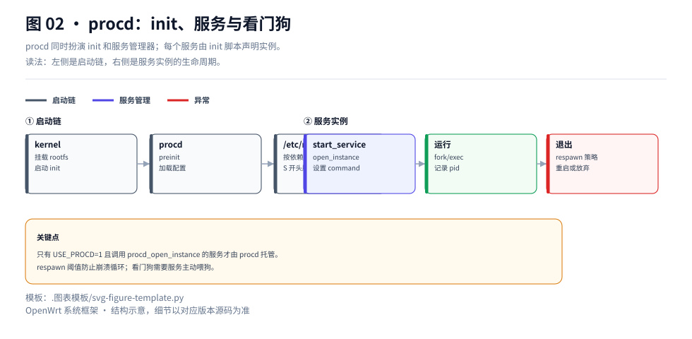

# procd 与 init

一句话结论：procd 是 OpenWrt 的 **PID 1 与服务管理器**；`/etc/init.d/` 脚本只声明“服务是什么、怎么启动、怎么重启”，真正的进程托管、崩溃拉起和热插拔响应由 procd 完成。

> 本篇定位：讲 init 脚本结构、procd 托管参数与启动顺序。事件分发见 [06-hotplug 与事件链](./06-hotplug与事件链.md)，网络接口的启动由 [netifd](./04-netifd设备与接口模型.md) 负责。

## 目录

- [1 一句话模型](#s1)
- [2 速览](#s2)
- [3 init 脚本与 procd 参数](#s3)
- [4 启动与服务流程](#s4)
- [5 状态机与定时器](#s5)
- [6 设计取舍与边界](#s6)
- [7 与相邻主题的关系](#s7)
- [名词解释](#名词解释)
- [8 参考与关联](#s8)

## 1 · 一句话模型

```text
/etc/init.d/<svc> ──enable──► /etc/rc.d/S<nn><svc>
        │                         │
        └── start_service ──► procd 托管实例 ──► 进程
```

三个关键认知：

1. **init 脚本是声明，不是执行体**：`start_service()` 里用 procd 的 API 描述实例，procd 负责 fork/exec。
2. **`enable` 只改启动链接**：它决定开机是否执行，不改变服务当前是否运行。
3. **托管参数决定故障行为**：respawn 阈值、看门狗、环境变量写错，表现是“服务起不来/反复重启”。

## 2 · 速览

| 项 | 内容 |
| --- | --- |
| 所属层/领域 | OpenWrt 启动与服务管理 |
| 核心对象 | procd、`/etc/init.d/*`、`/etc/rc.d/*`、服务实例 |
| 关键变量 | `USE_PROCD`、`START`、`STOP`、`procd_*` 参数 |
| 典型场景 | 新增常驻服务、开机自启、崩溃拉起、配置重载 |
| 主要标准 | OpenWrt init 脚本约定 |

## 3 · init 脚本与 procd 参数

| 对象/参数 | 作用 | 边界与误判 |
| --- | --- | --- |
| `USE_PROCD=1` | 声明由 procd 托管 | 不加时脚本只是普通 shell，不会自动拉起 |
| `START` / `STOP` | rc.d 链接编号，决定顺序 | 数字相同按名字排序，不要依赖巧合 |
| `start_service()` | 描述并启动实例 | 不要在这里写无限循环 |
| `stop_service()` | 自定义停止逻辑 | 多数服务不需要，procd 会发信号 |
| `reload_service()` | 配置重载 | 只重载配置，不重建实例更平滑 |
| `service_triggers()` | 声明配置/接口变化触发 | 触发器名字要与 UCI 配置匹配 |
| `procd_open_instance` | 开始描述一个实例 | 一个服务可有多个实例 |
| `procd_set_param command` | 启动命令与参数 | 必须是绝对路径或 PATH 内命令 |
| `procd_set_param respawn` | 崩溃重启策略 | 阈值太小会频繁重启，太大则恢复慢 |
| `procd_set_param env` | 环境变量 | 不会继承调用者的全部环境 |
| `procd_set_param file` | 配置依赖文件 | 文件变化可触发重载/重启 |
| `procd_set_param netdev` | 依赖的网络设备 | 设备不存在时实例可能不启动 |
| `procd_set_param watchdog` | 看门狗 | 服务必须主动喂狗，否则会被重启 |
| `procd_close_instance` | 结束实例描述 | 忘记关闭会导致配置不完整 |

## 4 · 启动与服务流程



**读图**：左侧是开机启动链，右侧是单个服务实例的生命周期。注意“脚本执行”和“进程运行”是两件事：脚本很快结束，进程由 procd 持续托管。

> 图源：`images/图02-procd.svg`

### 4.1 正常路径

1. 内核启动 procd，procd 执行 preinit、挂载 overlay、准备配置。
2. procd 按 `/etc/rc.d/S*` 顺序调用 init 脚本的 `start`。
3. 脚本调用 `start_service()`，通过 `procd_open_instance` 描述命令、环境、respawn 等。
4. procd fork/exec 进程，记录 pid；进程退出时按 respawn 策略决定是否重启。
5. `reload_config` 或配置触发器到来时，调用 `reload_service()` 或重启实例。

### 4.2 异常分支

| 现象 | 原因 | 处理方向 |
| --- | --- | --- |
| 开机不启动 | 没有 `enable`、`START` 未设置、脚本无执行权限 | 查 `/etc/rc.d/` 链接与脚本权限 |
| 启动后立刻退出 | 命令路径错、缺少环境变量、依赖设备未就绪 | 前台运行命令，核对 stderr |
| 反复重启 | respawn 阈值过小、进程崩溃 | 先修根因，再调阈值 |
| reload 不生效 | 没有实现 `reload_service` 或触发器未声明 | 补触发器或改用 restart |
| 看门狗误杀 | 服务未喂狗、喂狗周期大于超时 | 检查服务实现与 watchdog 参数 |

## 5 · 状态机与定时器

服务实例有四个状态：**未启动 → 启动中 → 运行 → 退出**；退出后按 respawn 策略进入“等待重启”或“放弃”。定时器包括：

- respawn 退避窗口与重试次数；
- 看门狗超时；
- `START`/`STOP` 只决定顺序，不是定时器。

## 6 · 设计取舍与边界

- **为什么用 procd 而不是 systemd**：嵌入式资源有限，procd 更小，且与 ubus、hotplug、netifd 深度集成。
- **为什么脚本只做声明**：把进程生命周期交给统一的 supervisor，避免每个服务各写一套 daemon 逻辑。
- **代价**：procd 的参数有默认值和隐式行为，不熟悉时会出现“脚本看起来对、服务就是不起”。
- **不适用**：一次性任务、短命令不需要 procd 托管，放 hotplug 或 cron 更合适。
- **常见误判**：把 `enable` 当成“立即启动”；它只影响下次开机。

## 7 · 与相邻主题的关系

| 相邻对象 | 关系 |
| --- | --- |
| [00-系统框架总览](./00-系统框架总览.md) | procd 在框架中的位置 |
| [02-ubus](./02-ubus.md) | 服务通过 ubus 暴露状态/方法 |
| [03-UCI](./03-UCI.md) | 服务读取配置、注册重载触发器 |
| [06-hotplug 与事件链](./06-hotplug与事件链.md) | procd 同时负责 hotplug 分发 |
| [21-Linux/03-启动与根文件系统](../../21-Linux/03-启动与根文件系统/01-根文件系统与init.md) | 通用 init 与 rootfs 挂载 |

一句话边界：本篇讲“服务怎么被托管”，不讲具体服务的业务配置。

## 名词解释

> 缩写给出英文全称；非缩写用“—”表示。

| 术语 | 英文全称 | 解释 |
| --- | --- | --- |
| procd | Process Daemon | OpenWrt 的 init 与服务管理守护进程。 |
| init | Initialization | 用户态启动的第一个进程及其职责。 |
| respawn | — | 进程退出后自动重启的策略。 |
| watchdog | — | 看门狗，服务未按时喂狗时触发重启。 |
| rc.d | Runlevel Configuration Directory | 按运行级别组织启动脚本链接的目录。 |
| PID | Process Identifier | 进程标识符。 |

## 8 · 参考与关联

**标准**

- OpenWrt 官方 procd 与 init 脚本文档。

**关联**

- [本目录索引](./.readme.md)
- [02-ubus](./02-ubus.md)
- [06-hotplug 与事件链](./06-hotplug与事件链.md)

---

> **本篇定位**：init 脚本结构与 procd 托管参数。
> **素材来源**：`studyspace-v2/7.平台与集成/1.OpenWrt/3.管理平面/05-procd.md`。
> **待验证**：不同分支的 procd 参数名与默认 respawn 阈值可能调整。
