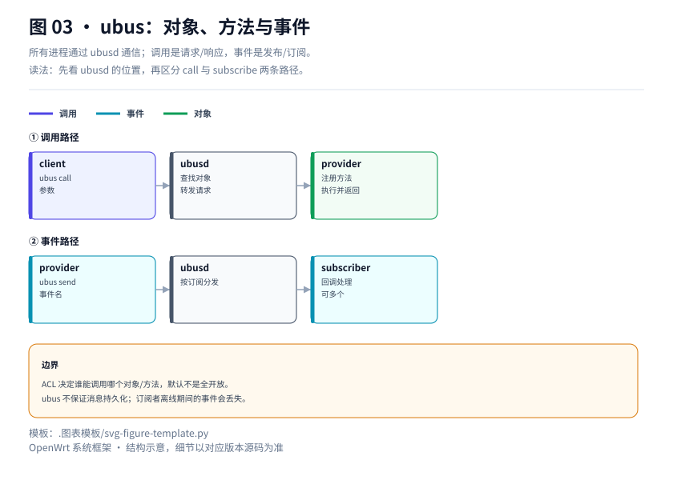

# ubus

一句话结论：ubus 是 OpenWrt 的**进程间通信总线**：进程把能力注册成“对象/方法”，其他进程通过 `ubusd` 调用；状态变化则以“事件”发布，订阅者异步接收，不持久化。

> 本篇定位：讲对象模型、调用/事件两条路径与 ACL 边界。服务如何被 procd 托管见 [01-procd 与 init](./01-procd与init.md)；网络对象由 [netifd](./04-netifd设备与接口模型.md) 注册。

## 目录

- [1 一句话模型](#s1)
- [2 速览](#s2)
- [3 对象、方法与事件](#s3)
- [4 调用与订阅流程](#s4)
- [5 状态机与定时器](#s5)
- [6 设计取舍与边界](#s6)
- [7 与相邻主题的关系](#s7)
- [名词解释](#名词解释)
- [8 参考与关联](#s8)

## 1 · 一句话模型

```text
provider ──register──► ubusd ◄──call── client
   │                     │
   └──── send event ─────┴──► subscriber（可多个）
```

三个关键认知：

1. **ubusd 是 broker**：它不执行业务逻辑，只负责按对象名和方法名转发。
2. **调用是同步请求/响应，事件是异步广播**：调用有返回值，事件没有“已读”保证。
3. **对象名是层级字符串**：如 `network.interface.wan`，命名本身就是接口的一部分。

## 2 · 速览

| 项 | 内容 |
| --- | --- |
| 所属层/领域 | OpenWrt 进程间通信 |
| 核心对象 | `ubusd`、object、method、event、ACL |
| 关键入口 | `ubus` 命令、C/Lua/Shell API、`/usr/share/acl.d/` |
| 典型场景 | LuCI 查状态、服务间解耦、网络事件通知 |
| 主要标准 | OpenWrt ubus 约定，无外部协议标准 |

## 3 · 对象、方法与事件

| 对象/字段 | 作用 | 边界与误判 |
| --- | --- | --- |
| object | 一组方法的命名空间 | 不是文件，也不是配置节 |
| method | 可调用的函数，带参数与返回值 | 参数类型由 provider 定义，调用方需匹配 |
| signature | 方法的参数/返回类型描述 | `ubus -v list` 可查看 |
| event | 广播消息，带 payload | 没有订阅者时直接丢弃 |
| `ubusd` | 总线守护进程 | 不持久化对象，重启后需重新注册 |
| ACL | 用户/组的调用权限 | 默认最小权限，不是全开放 |
| `ubus call` | 调用方法 | 路径写错会报“Object not found” |
| `ubus listen` | 订阅事件 | 只收到订阅之后的事件 |
| `ubus monitor` | 观察总线消息 | 调试用，输出量大 |

### 3.1 常见对象

| 对象 | 提供者 | 典型方法/用途 | 边界 |
| --- | --- | --- | --- |
| `network.interface.*` | netifd | `status`、`up`、`down` | 对象名含接口逻辑名 |
| `network.device` | netifd | 查询设备状态 | 与 interface 不是同一层 |
| `service` | procd | 列出/管理服务 | 只覆盖 procd 托管服务 |
| `system` | procd/rpcd | 时间、重启、板级信息 | 方法集合随产品扩展 |
| `session` | rpcd | 登录会话/权限 | 与 ACL 配合 |
| `luci.*` | LuCI/rpcd | 页面/配置操作 | 依赖 LuCI 组件安装 |

对象名不是配置节名：`network.interface.wan` 对应逻辑接口 `wan`，但 `wan` 的配置可能在任意 section 中。

命令行看到的样子（输出随分支/对象变化）：

```text
# ubus list 'network.interface.*'
network.interface
network.interface.lan
network.interface.wan

# ubus call network.interface.wan status
{
        "up": true,
        "pending": false,
        "available": true,
        "proto": "dhcp",
        "device": "wan",
        "data": { ... }
}
```

`up=true` 只说明“netifd 认为接口就绪”，不代表路由、DNS、防火墙都通——这是 ubus 状态最常见的误读。

## 4 · 调用与订阅流程



**读图**：上半是同步调用，下半是异步事件。两条路径都经过 `ubusd`，但调用有明确接收者，事件是广播。

> 图源：`images/图03-ubus.svg`

### 4.1 正常路径（调用）

1. provider 启动后向 `ubusd` 注册对象和方法。
2. client 用对象名 + 方法名发起调用，参数按 signature 编码。
3. `ubusd` 查找对象并转发；provider 执行后返回结果。
4. client 收到响应；对象不存在或 ACL 拒绝时返回错误。

一次 `ifup wan` 在 ubus 上留下的痕迹（理解“谁调用谁”）：

```text
ifup wan
  → ubus call network.interface.wan up
    → netifd 执行 proto 脚本
      → proto 上报地址
        → netifd 发布 interface.up 事件
          → hotplug / mwan3 / 脚本收到事件
```

所以“接口起来了但脚本没反应”，先确认脚本订阅的是 `interface.up` 还是别的对象名，而不是先怀疑 netifd。

### 4.2 正常路径（事件）

1. provider 发布事件（如接口 up/down）。
2. `ubusd` 按订阅关系分发给所有 subscriber。
3. subscriber 在回调中处理；处理慢不会阻塞 provider。

### 4.3 异常分支

| 现象 | 原因 | 处理方向 |
| --- | --- | --- |
| Object not found | 服务未启动/未注册/对象名错 | 先 `ubus list` 确认对象 |
| Permission denied | ACL 未授权 | 检查 `/usr/share/acl.d/` 与调用身份 |
| 调用超时 | provider 阻塞或未响应 | 查 provider 日志，避免在回调里做重活 |
| 收不到事件 | 订阅晚于事件、事件名错 | 先订阅再触发，核对事件名 |
| 重启后对象消失 | ubusd 不持久化 | 服务需在启动时重新注册 |

## 5 · 状态机与定时器

ubus 本身没有业务状态机，只有对象生命周期：**未注册 → 已注册 → 注销**。没有内置定时器；超时由调用方或底层传输控制。事件不排队、不重放。

三条语义边界，决定了“什么时候不能用事件”：

| 语义 | 后果 | 应对 |
| --- | --- | --- |
| 事件不排队、不重放 | 订阅晚于事件就永远收不到 | 启动时先订阅，关键状态改用查询 |
| 广播无确认 | 发布者不知道谁收到、有没有处理 | 需要确认的流程用同步调用 |
| 调用是同步的 | provider 阻塞会拖住 client | 客户端设超时；provider 不在回调里做重活 |

## 6 · 设计取舍与边界

- **为什么用总线而不是直接 socket/RPC**：对象发现、权限控制和事件分发统一，服务之间不硬编码地址。
- **为什么事件不持久化**：嵌入式内存有限，状态应以“查询当前对象”为准，事件只做通知。
- **代价**：调用链跨进程，排障要同时看 client、ubusd、provider 三处。
- **不适用**：高频大数据传输不适合走 ubus；用专门协议或共享内存。
- **常见误判**：把事件当消息队列；订阅者离线期间的事件不会补发。

> **推论**：ubus 事件只适合“通知”，不适合“状态传递”。需要可靠决策的地方，一律**收到事件后再查一次对象状态**——事件可能丢、可能晚，查询拿到的是当前事实。

> **边界**：`ubus call` 没有内建超时，provider 卡住时客户端会一直等。调用方要么自己加超时，要么接受“总线调用可能永久挂起”这个事实。

## 7 · 与相邻主题的关系

| 相邻对象 | 关系 |
| --- | --- |
| [01-procd 与 init](./01-procd与init.md) | 服务由 procd 启动后再注册对象 |
| [03-UCI](./03-UCI.md) | 配置写入 UCI，运行状态通过 ubus 查询 |
| [04-netifd 设备与接口模型](./04-netifd设备与接口模型.md) | netifd 注册 `network.*` 对象 |
| [05-netifd 接口生命周期](./05-netifd接口生命周期.md) | 状态变化通过 ubus 事件上报 |
| [21-Linux/04-进程与并发](../../21-Linux/04-进程与并发/02-IPC与信号.md) | 通用 IPC 机制对比 |

一句话边界：本篇讲“怎么通信”，不讲某个对象的业务字段。

## 名词解释

> 缩写给出英文全称；非缩写用“—”表示。

| 术语 | 英文全称 | 解释 |
| --- | --- | --- |
| ubus | OpenWrt Bus | OpenWrt 的进程间通信总线。 |
| ubusd | ubus Daemon | ubus 的总线守护进程。 |
| IPC | Inter-Process Communication | 进程间通信。 |
| RPC | Remote Procedure Call | 远程过程调用，ubus 调用是其一种形式。 |
| ACL | Access Control List | 访问控制列表。 |
| signature | — | 方法参数与返回值的类型描述。 |
| payload | — | 事件或调用携带的数据内容。 |

## 8 · 参考与关联

**标准**

- OpenWrt 官方 ubus 文档与 `ubus` 命令帮助。

**关联**

- [本目录索引](./.readme.md)
- [01-procd 与 init](./01-procd与init.md)
- [04-netifd 设备与接口模型](./04-netifd设备与接口模型.md)

---

> **本篇定位**：ubus 对象模型、调用/事件与 ACL。
> **素材来源**：`studyspace-v2/7.平台与集成/1.OpenWrt/3.管理平面/06-ubus.md`。
> **待验证**：ACL 文件路径与默认策略随分支/产品定制变化。
