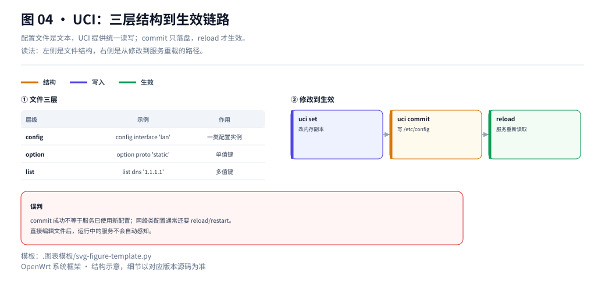

# UCI 配置模型

一句话结论：UCI 用**配置文件（config）→ 配置节（section）→ 选项（option/list）**三层模型统一管理 OpenWrt 配置；`commit` 只负责写盘，配置是否生效取决于对应服务是否重新读取。

> 本篇定位：讲文件结构、读写命令与生效链路。网络配置如何被 netifd 消费见 [04-netifd 设备与接口模型](./04-netifd设备与接口模型.md)；服务重载见 [01-procd 与 init](./01-procd与init.md)。

## 目录

- [1 一句话模型](#s1)
- [2 速览](#s2)
- [3 三层结构与字段](#s3)
- [4 修改到生效流程](#s4)
- [5 状态机与定时器](#s5)
- [6 设计取舍与边界](#s6)
- [7 与相邻主题的关系](#s7)
- [名词解释](#名词解释)
- [8 参考与关联](#s8)

## 1 · 一句话模型

```text
/etc/config/network
  └─ config interface 'lan'      ← section（类型 + 名字）
       ├─ option proto 'static'  ← 单值
       └─ list   dns '1.1.1.1'   ← 多值
```

三个关键认知：

1. **section 有类型和名字**：类型决定谁消费它，名字用于引用；匿名 section 也能存在，但不便于脚本引用。
2. **option 与 list 都是键值**：区别只在单值/多值，不要混用。
3. **UCI 是“配置存储”，不是“配置执行器”**：写入后必须由服务 reload/restart 才进入运行态。

## 2 · 速览

| 项 | 内容 |
| --- | --- |
| 所属层/领域 | OpenWrt 配置管理 |
| 核心对象 | `/etc/config/*`、section、option、list |
| 关键命令 | `uci show/set/add_list/commit/revert` |
| 典型场景 | 批量改网络、脚本生成配置、配置回滚 |
| 主要标准 | OpenWrt UCI 文件格式 |

## 3 · 三层结构与字段

| 层级/字段 | 语法示例 | 作用 | 边界与误判 |
| --- | --- | --- | --- |
| config | `config interface 'lan'` | 声明一个配置节 | 类型写错，服务不会识别 |
| option | `option proto 'static'` | 单值键 | 重复设置会覆盖 |
| list | `list dns '1.1.1.1'` | 多值键 | 用 option 写多值只保留最后一个 |
| 匿名 section | `config route` | 无需名字的节 | 脚本引用需用索引或 `@route[0]` |
| 注释 | `# ...` | 说明 | 不要用行尾注释，部分解析器不容忍 |
| include | 部分配置支持包含 | 拆分大文件 | 不是所有服务都支持 |

### 3.1 常见配置文件

| 文件 | 主要消费者 | 典型 section |
| --- | --- | --- |
| `/etc/config/network` | netifd | `interface`、`device`、`route`、`rule` |
| `/etc/config/wireless` | wifi/netifd | `wifi-device`、`wifi-iface` |
| `/etc/config/dhcp` | dnsmasq/odhcpd | `dnsmasq`、`dhcp`、`host` |
| `/etc/config/firewall` | fw3/fw4 | `zone`、`rule`、`redirect` |
| `/etc/config/system` | procd/系统服务 | `system`、`led`、`ntp` |

### 3.2 常用操作

| 操作 | 作用 | 注意 |
| --- | --- | --- |
| `uci show <config>` | 查看全部配置 | 输出是扁平键值 |
| `uci get <key>` | 读取单个值 | 不存在时返回非零 |
| `uci set <key>=<value>` | 修改/新增 | 只改内存副本 |
| `uci add_list <key>=<value>` | 追加列表项 | 不会去重 |
| `uci delete <key>` | 删除 | 删除 section 用 section 路径 |
| `uci commit <config>` | 写入文件 | 不触发服务重载 |
| `uci revert <config>` | 丢弃未提交修改 | 只影响当前未提交内容 |
| `uci batch` | 批量执行 | 适合脚本，减少多次解析 |

脚本里最常用的一组，以及最容易漏的 `uci changes`：

```bash
uci set network.lan.ipaddr='192.168.2.1'
uci changes network             # 提交前：看清有哪些未落盘改动
uci commit network              # 落盘到 /etc/config/network
```

> **边界**：`uci set` 改的是内存副本，`uci commit` 才写文件；`uci revert` 只丢弃**未提交**的改动，回不到上一个已提交版本。要回滚到历史配置，得靠备份或 overlay 快照。

## 4 · 修改到生效流程



**读图**：左侧是文件三层结构，右侧是“改内存 → 写盘 → 服务重载”的链路。最容易断在最后一步：commit 成功但服务仍用旧配置。

> 图源：`images/图04-UCI.svg`

### 4.1 正常路径

1. `uci set`/`add_list` 修改内存中的配置树。
2. `uci commit` 把改动写入 `/etc/config/<file>`。
3. 调用对应服务的 `reload`（或 `reload_config`）重新读取。
4. 服务把新配置应用到内核/进程；必要时重启实例。

以改 LAN 地址为例，走完整条链：

```text
uci set network.lan.ipaddr='192.168.2.1'
uci commit network
/etc/init.d/network reload        # 或 reload_config
  → netifd 重新读取 network
    → 内核地址变更（ip addr 可见）
      → ubus 状态更新
```

链路里**任何一步断开，现象都像“配置没生效”**，但修法完全不同。所以先确认“改到哪一步了”，再谈为什么。

### 4.2 异常分支

| 现象 | 原因 | 处理方向 |
| --- | --- | --- |
| 改了不生效 | 没 commit、没 reload、服务未监听该 section | 分步确认三层 |
| 配置重启后丢失 | 写到了临时层/未 commit | 确认 `/etc/config` 已更新 |
| section 类型不识别 | 类型拼写错、对应包未安装 | 对照服务文档与已安装包 |
| 多值只剩一个 | 用 option 代替 list | 改用 `add_list` |
| 脚本读取失败 | 引用了匿名 section 的错误索引 | 用 `uci show` 确认实际路径 |

**“改了不生效”三步定位**：

| 步骤 | 查什么 | 判据 | 答错的后果 |
| --- | --- | --- | --- |
| ① 有没有落盘 | `uci changes` 是否为空、文件内容是否变了 | 空 = 已提交；非空 = 只在内存 | 没 commit 就去 reload，等于重读旧值 |
| ② 谁消费这个 section | 服务的 init 脚本/守护进程读不读这个文件 | 看脚本里的 `config_load`/`uci get` | 服务根本不读，改对了也没用 |
| ③ 运行态有没有变 | ubus 状态、`ip addr`、进程配置 | 三者之一应变化 | 只看文件，误判“生效了” |

## 5 · 状态机与定时器

没有运行时状态机。UCI 只有**配置版本状态**：已提交（文件）与未提交（内存/临时区）。没有定时器；延迟生效由服务自己的 reload 策略决定。

## 6 · 设计取舍与边界

- **为什么用统一配置接口**：不同服务的配置文件格式各异，UCI 提供一致的读写方式，便于 LuCI 和脚本操作。
- **为什么把 commit 与 reload 分开**：批量修改时可以先全部写完再统一生效，避免中间态。
- **代价**：配置正确不代表运行正确；需要理解“谁消费这个 section”。
- **不适用**：高频动态数据（邻居表、连接跟踪）不适合放 UCI。
- **常见误判**：直接编辑 `/etc/config` 后以为服务会自动感知；运行中的服务不会监听文件变化。

> **推论**：UCI 的“生效”不是 UCI 的职责，而是**消费者**的职责。所以同一份配置在不同服务上表现不同：network 有 `reload` 钩子，某些服务只能 `restart`，还有的服务启动时读一次就再也不读。判断能不能热生效，先看服务有没有实现 reload。

> **边界**：`uhttpd`/`dnsmasq` 这类服务被 reload 时可能只重读部分配置；遇到“重启就好、reload 不行”，说明该服务的 reload 覆盖不全，属于实现差异而非配置错误。

## 7 · 与相邻主题的关系

| 相邻对象 | 关系 |
| --- | --- |
| [01-procd 与 init](./01-procd与init.md) | 服务通过 init 脚本的 reload 应用配置 |
| [02-ubus](./02-ubus.md) | 运行状态通过 ubus 查询，不写回 UCI |
| [04-netifd 设备与接口模型](./04-netifd设备与接口模型.md) | `network` 配置的主要消费者 |
| [03-网络数据面/01-fw3-fw4](../03-网络数据面/01-fw3-fw4与nftables.md) | `firewall` 配置如何生成规则 |
| [04-无线/02-hostapd 与 wireless 配置](../04-无线/02-hostapd与wireless配置.md) | `wireless` 配置如何变成 hostapd |

一句话边界：本篇讲“配置怎么存、怎么改”，不讲每个 option 的业务含义。

## 名词解释

> 缩写给出英文全称；非缩写用“—”表示。

| 术语 | 英文全称 | 解释 |
| --- | --- | --- |
| UCI | Unified Configuration Interface | OpenWrt 的统一配置接口。 |
| section | — | 配置文件中的一个配置节，带类型和可选名字。 |
| option | — | 单值配置项。 |
| list | — | 多值配置项。 |
| commit | — | 把内存中的修改写入配置文件。 |
| reload | — | 让服务重新读取配置，通常不中断进程。 |
| overlay | — | 可写层，保存修改后的配置文件。 |

## 8 · 参考与关联

**标准**

- OpenWrt 官方 UCI 文档。

**关联**

- [本目录索引](./.readme.md)
- [04-netifd 设备与接口模型](./04-netifd设备与接口模型.md)
- [01-procd 与 init](./01-procd与init.md)

---

> **本篇定位**：UCI 三层模型与生效链路。
> **素材来源**：`studyspace-v2/7.平台与集成/1.OpenWrt/3.管理平面/07-uci.md`。
> **待验证**：未提交修改的临时存储路径与 `reload_config` 的触发范围随分支变化。
