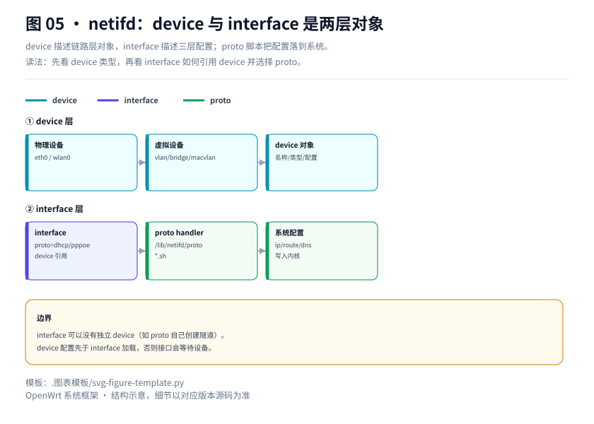

# netifd 设备与接口模型

一句话结论：netifd 把网络拆成两层对象——**device 描述链路层对象（物理口、VLAN、桥、隧道），interface 描述三层配置（proto、地址、路由、DNS）**；proto 脚本负责把 interface 的意图翻译成具体的系统命令。

> 本篇定位：讲清 device/interface/proto 的职责与配置关系。状态迁移见 [05-netifd 接口生命周期](./05-netifd接口生命周期.md)；桥/VLAN 的数据面细节见 [03-网络数据面/02-DSA 与 bridge](../03-网络数据面/02-DSA与bridge-VLAN.md)。

## 目录

- [1 一句话模型](#s1)
- [2 速览](#s2)
- [3 device、interface 与 proto](#s3)
- [4 配置加载与启动流程](#s4)
- [5 状态机与定时器](#s5)
- [6 设计取舍与边界](#s6)
- [7 与相邻主题的关系](#s7)
- [名词解释](#名词解释)
- [8 参考与关联](#s8)

## 1 · 一句话模型

```text
物理口/虚拟口 ──► device ──被引用──► interface ──proto──► ip/route/dns
                                    （三层意图）        （系统状态）
```

三个关键认知：

1. **device 是“链路对象”**：它关心名称、类型、链路参数，不关心 IP 怎么来。
2. **interface 是“三层意图”**：它选择 proto，并声明地址、路由、DNS 等策略。
3. **proto 是“翻译层”**：dhcp/pppoe/static 等脚本把 interface 的配置落到系统，并回报状态。

## 2 · 速览

| 项 | 内容 |
| --- | --- |
| 所属层/领域 | OpenWrt 网络管理 |
| 核心对象 | device、interface、proto handler |
| 关键入口 | `/etc/config/network`、`/lib/netifd/proto/*.sh` |
| 典型场景 | 多 WAN、桥接、VLAN、PPPoE、隧道 |
| 主要标准 | Linux 网络设备模型 + OpenWrt proto 约定 |

## 3 · device、interface 与 proto

### 3.1 device 类型

| 类型 | 作用 | 常见配置 | 边界与误判 |
| --- | --- | --- | --- |
| 物理设备 | 对应网卡 | `option name 'eth0'` | 名字由驱动/DTS 决定，不固定 |
| VLAN | 在父设备上打标签 | `type 'vlan'`、`ifname`、`vid` | 与交换机 VLAN 是两层概念 |
| bridge | 多口二层桥 | `type 'bridge'`、`ports` | 桥成员变化会影响 LAN |
| macvlan | 同一父口派生多个 MAC | `type 'macvlan'` | 依赖父口与驱动支持 |
| bond | 链路聚合 | `type 'bonding'` | 需要交换机侧配合 |
| 隧道 | gre/veth 等 | `type 'gre'` 等 | 参数与内核模块强相关 |

### 3.2 interface 关键字段

| 字段 | 作用 | 边界与误判 |
| --- | --- | --- |
| `proto` | 选择协议处理脚本 | 写错则 interface 无法启动 |
| `device` / `ifname` | 绑定链路设备 | 设备不存在时接口等待或失败 |
| `ipaddr` / `netmask` | 静态地址 | 仅 static 等 proto 使用 |
| `gateway` | 默认网关 | 多 WAN 时需配合 metric/规则 |
| `dns` / `peerdns` | DNS 来源 | 与 dnsmasq 的 upstream 有关 |
| `metric` | 路由优先级 | 影响多 WAN 选路 |
| `defaultroute` | 是否安装默认路由 | 不是所有 proto 都支持 |
| `auto` | 是否随 netifd 自动启动 | 关闭后需手动 up |

一个最小但完整的 `network` 片段（新式写法：device 与 interface 分开）：

```text
config device
	option name 'br-lan'
	option type 'bridge'
	list ports 'lan1'
	list ports 'lan2'

config interface 'lan'
	option device 'br-lan'
	option proto 'static'
	option ipaddr '192.168.1.1'
	option netmask '255.255.255.0'
```

device 段管“链路怎么组成”，interface 段管“三层怎么配”。把 `ipaddr` 写进 device 段不会生效——它根本不是那一层的字段。

### 3.3 proto handler

| 对象 | 作用 | 边界与误判 |
| --- | --- | --- |
| `/lib/netifd/proto/<name>.sh` | 具体协议的启动/停止逻辑 | 不是内核模块 |
| `netifd-proto.sh` | 提供 `proto_init_update`、`proto_add_ipv4_address` 等 helper | 直接写系统命令会绕过状态上报 |
| `proto_handler` | netifd 调用脚本的入口 | 脚本退出码影响接口状态 |
| `ubus` 对象 | `network.interface.<name>` | 状态查询与 up/down 操作的入口 |

## 4 · 配置加载与启动流程



**读图**：先看 device 层（物理/虚拟），再看 interface 如何引用 device 并选择 proto。注意 interface 不一定依赖独立 device，隧道类 proto 可能自己创建链路。

> 图源：`images/图05-netifd对象.svg`

### 4.1 正常路径

1. netifd 启动，读取 `/etc/config/network`。
2. 先加载 device：创建/更新 VLAN、bridge、macvlan 等链路对象。
3. 再加载 interface：解析 proto，准备地址、路由、DNS 参数。
4. 调用 proto 脚本；脚本通过 helper 上报地址与状态。
5. netifd 把结果写入内核，并通过 ubus 暴露 `network.interface.*`。

验证也按这两层看，别一上来抓包：

```text
ip -d link show br-lan                     # device 层：桥/成员是否存在
ubus call network.interface.lan status     # interface 层：up/pending/地址
ifstatus lan                               # 更易读的接口状态（若有该工具）
```

### 4.2 异常分支

| 现象 | 原因 | 处理方向 |
| --- | --- | --- |
| interface 一直 DOWN | device 不存在、proto 脚本失败 | 先确认 device，再看脚本输出 |
| 有 IP 但无默认路由 | `defaultroute` 关闭、metric 竞争 | 查 interface 配置与路由表 |
| 桥不通 | 成员口错误、VLAN 未透传 | 对照 bridge/VLAN 配置与交换机 |
| 多 WAN 选路错 | metric/rule 冲突 | 查策略路由与 mwan3 配置 |
| 改了配置不生效 | 未 reload network | `reload_config` 或重启 network |

**接口起不来，按“设备 → 接口 → 协议 → 路由”四层查**：

| 层 | 查什么 | 判据 | 答错的后果 |
| --- | --- | --- | --- |
| ① device | 链路对象在不在 | `ip link` 能看到、`ip -d link` 类型正确 | 设备不存在，proto 再对也没用 |
| ② interface | netifd 是否接管 | `ubus call ... status` 的 `pending/up` | 把“等待设备”当成“协议失败” |
| ③ proto | 脚本执行结果 | `logread -e netifd`、脚本 stderr | 看不到真正的失败原因 |
| ④ 路由/DNS | 默认路由、resolv.conf | `ip route`、`cat /tmp/resolv.conf.d/resolv.conf.auto` | 有 IP 无网，误判为链路故障 |

## 5 · 状态机与定时器

netifd 有两套状态：device 的创建/存在状态，interface 的运行状态（DOWN/SETUP/UP/TEARDOWN）与配置状态（NONE/ASSIGN/REMOVE）。定时器主要来自 proto：DHCP 租约续期、PPPoE 重连、邻居/路由过期。详见 [05-netifd 接口生命周期](./05-netifd接口生命周期.md)。

## 6 · 设计取舍与边界

- **为什么 device 与 interface 分离**：同一个链路对象可以被多个三层配置引用（如桥上的多个 VLAN 接口），分离后避免重复创建。
- **为什么用 proto 脚本而不是全写进 netifd**：协议差异大、更新快，脚本更容易扩展和厂商定制。
- **代价**：配置错误可能跨 device/interface/proto 三层，日志分散。
- **不适用**：极端性能场景可能绕过 netifd，直接由数据面程序管理接口。
- **常见误判**：把 `ifname` 当成“接口名”；它常指底层设备名，interface 自己有逻辑名。

> **推论**：device 与 interface 分离的代价是“名字有两套”。`lan` 是逻辑接口名，`br-lan` 是设备名，`lan1` 是交换机端口名——排障时对不上号，往往不是配置错，而是把三层名字混用了。

> **边界**：切到 DSA 后，端口名由驱动生成（如 `lan1`/`wan`），旧配置里的 `eth0.1`、`eth1` 可能根本不存在。从旧固件迁移配置时，这比“配置语法错”更常见。

## 7 · 与相邻主题的关系

| 相邻对象 | 关系 |
| --- | --- |
| [03-UCI](./03-UCI.md) | `network` 配置的存储与修改 |
| [05-netifd 接口生命周期](./05-netifd接口生命周期.md) | interface 状态机与事件 |
| [06-hotplug 与事件链](./06-hotplug与事件链.md) | 接口事件如何通知脚本 |
| [03-网络数据面/02-DSA 与 bridge](../03-网络数据面/02-DSA与bridge-VLAN.md) | 链路对象的数据面实现 |
| [21-Linux/06-网络子系统](../../21-Linux/06-网络子系统/00-网络栈概览.md) | 内核网络设备与路由机制 |

一句话边界：本篇讲“对象怎么建模”，不讲某个协议的报文细节。

## 名词解释

> 缩写给出英文全称；非缩写用“—”表示。

| 术语 | 英文全称 | 解释 |
| --- | --- | --- |
| netifd | Network Interface Daemon | OpenWrt 的网络接口管理守护进程。 |
| device | — | 链路层对象，如物理口、VLAN、桥、隧道。 |
| interface | — | 三层配置对象，选择 proto 并声明地址/路由。 |
| proto | Protocol Handler | 把接口配置翻译成系统操作的脚本。 |
| VLAN | Virtual Local Area Network | 虚拟局域网。 |
| DNS | Domain Name System | 域名系统。 |
| metric | — | 路由优先级数值，越小越优先。 |

## 8 · 参考与关联

**标准**

- OpenWrt 官方 network 配置与 netifd 文档。

**关联**

- [本目录索引](./.readme.md)
- [05-netifd 接口生命周期](./05-netifd接口生命周期.md)
- [03-网络数据面](../03-网络数据面/.readme.md)

---

> **本篇定位**：device/interface/proto 的对象模型。
> **素材来源**：`studyspace-v2/7.平台与集成/1.OpenWrt/3.管理平面/01-netifd概览.md`、`09-netifd-bridge.md`、`10-netifd-vlan.md`。
> **待验证**：device 类型与字段随 netifd 版本增加，具体以目标分支为准。
