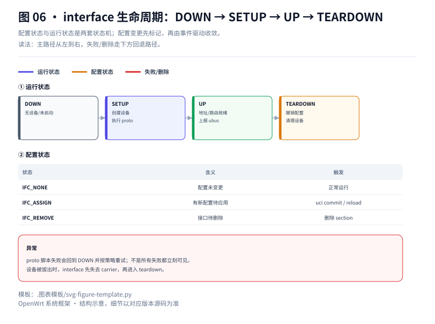

# netifd 接口生命周期

一句话结论：netifd 的 interface 有**两套并行状态**——运行状态（DOWN/SETUP/UP/TEARDOWN）和配置状态（NONE/ASSIGN/REMOVE）；配置变化先打标记，再由事件循环驱动接口收敛到新状态。

> 本篇定位：讲接口从创建到销毁的状态迁移、事件与重试。对象模型见 [04-netifd 设备与接口模型](./04-netifd设备与接口模型.md)；事件分发见 [06-hotplug 与事件链](./06-hotplug与事件链.md)。

## 目录

- [1 一句话模型](#s1)
- [2 速览](#s2)
- [3 两套状态与关键字段](#s3)
- [4 状态迁移流程](#s4)
- [5 状态机与定时器](#s5)
- [6 设计取舍与边界](#s6)
- [7 与相邻主题的关系](#s7)
- [名词解释](#名词解释)
- [8 参考与关联](#s8)

## 1 · 一句话模型

```text
配置变更 ──► IFC_ASSIGN ──► SETUP ──► UP ──► TEARDOWN ──► DOWN
              （待应用）     （建链）   （就绪）   （清理）
```

三个关键认知：

1. **配置状态描述“想变成什么”，运行状态描述“现在是什么”**；两者不同步是正常中间态。
2. **设备就绪是接口启动的前提**：device 未创建时，interface 会等待而不是盲目执行 proto。
3. **失败不是终点**：proto 失败会进入重试/等待，具体取决于 proto 与配置。

## 2 · 速览

| 项 | 内容 |
| --- | --- |
| 所属层/领域 | OpenWrt 网络接口状态管理 |
| 核心对象 | interface、device、proto、ubus 事件 |
| 关键状态 | `IFS_DOWN`、`IFS_SETUP`、`IFS_UP`、`IFS_TEARDOWN` |
| 典型场景 | 插拔网线、DHCP 续约、PPPoE 重连、配置热更新 |
| 主要标准 | OpenWrt netifd 内部约定 |

## 3 · 两套状态与关键字段

| 状态/字段 | 含义 | 边界与误判 |
| --- | --- | --- |
| `IFS_DOWN` | 接口未运行 | 不代表配置不存在 |
| `IFS_SETUP` | 正在创建链路/执行 proto | 可能长时间停留 |
| `IFS_UP` | 地址/路由就绪 | 不代表流量一定通 |
| `IFS_TEARDOWN` | 正在撤销配置 | 清理未完成前不要重复操作 |
| `IFC_NONE` | 配置无变更 | 正常运行态 |
| `IFC_ASSIGN` | 有新配置待应用 | 热更新时出现 |
| `IFC_REMOVE` | 接口待删除 | 删除 section 后出现 |
| `interface_start_pending` | 等待设备/依赖 | 常见于启动早期 |
| `proto` 脚本退出码 | 决定成功/失败 | 非零不一定立即重试 |

## 4 · 状态迁移流程



**读图**：上排是运行状态的主路径，下方矩阵是配置状态。失败或删除会走回退路径；两套状态要分开读，避免把“配置已改”误认为“接口已重启”。

> 图源：`images/图06-接口生命周期.svg`

### 4.1 正常路径

1. 配置加载后，interface 进入待启动；若 device 未就绪，先挂起等待。
2. device 就绪，interface 进入 `SETUP`，调用 proto 脚本。
3. proto 配置地址/路由/DNS，上报成功，interface 进入 `UP`。
4. 配置变更（`IFC_ASSIGN`）触发重配：可能原地更新，也可能 teardown 后重建。
5. 删除接口（`IFC_REMOVE`）进入 `TEARDOWN`，清理地址/路由/设备，回到 `DOWN`。

看状态迁移的两个窗口：

```text
ubus subscribe network.interface     # 事件流：up/down 的顺序与频率
logread -e netifd                    # netifd 自己的日志：创建/等待/失败
```

### 4.2 异常分支

| 现象 | 原因 | 处理方向 |
| --- | --- | --- |
| 长时间 SETUP | 上游无响应、脚本阻塞、设备未就绪 | 查 proto 日志与设备状态 |
| UP 但无流量 | 路由/防火墙/NAT 未就绪 | 分开验证三层与数据面 |
| 反复 DOWN/UP | 链路抖动、认证失败、租约冲突 | 看事件频率与 proto 返回 |
| 配置改了状态不变 | 未触发 reload、配置状态未标记 | 确认 UCI commit 与 reload |
| 删除后残留设备 | teardown 未完成、脚本未清理 | 检查 proto 脚本与内核对象 |

**“一直 SETUP”先分清等什么**：

| 等的东西 | 判据 | 处理 |
| --- | --- | --- |
| 设备未就绪 | `ip link` 里没有目标设备 | 查驱动/DSA/内核模块 |
| 上游无响应 | proto 日志停在“发送请求” | 查链路、服务器、认证 |
| 脚本阻塞 | netifd 日志无后续、进程卡住 | 查脚本里的阻塞命令/死循环 |
| 配置状态未标记 | `ubus status` 的 `pending` 为真但无动作 | 确认 reload 是否真的触发 |

## 5 · 状态机与定时器

本主题的核心就是状态机：

- **运行状态**：`DOWN → SETUP → UP → TEARDOWN → DOWN`，异常时可从 `SETUP` 回到 `DOWN`。
- **配置状态**：`NONE → ASSIGN → NONE`，删除时 `NONE → REMOVE`。

定时器来自具体 proto 与事件循环：DHCP 租约续期、PPPoE 重连间隔、路由/邻居过期、设备等待超时。netifd 本身不提供统一的“重试定时器”，重试策略由 proto 与配置决定。

| 定时器来源 | 典型行为 | 失败表现 |
| --- | --- | --- |
| DHCP 租约 | 到期前续租，失败后重试 | 地址突然消失、重新获取 |
| PPPoE 重连 | 断开后按间隔重拨 | 接口反复 UP/DOWN |
| 设备等待 | 等 `ip link` 出现，超时后放弃 | 长时间 SETUP 或直接 DOWN |
| 路由/邻居过期 | 内核按自身周期清理 | 短暂丢包后恢复 |

> **推论**：重试策略不在 netifd 里统一配置，所以“为什么 30 秒才重连”要去对应 proto 脚本找，而不是在 netifd 配置里找。

## 6 · 设计取舍与边界

- **为什么两套状态**：配置变更和链路状态变化频率不同，分开后可以合并多次配置变更，避免每次 `uci set` 都重建接口。
- **为什么等待设备**：启动早期设备尚未注册，盲目执行 proto 会失败并产生噪声；等待让顺序问题变成延迟问题。
- **代价**：状态多、日志分散，排障需要同时看配置、device、proto 和内核。
- **不适用**：完全由外部程序管理的接口（如某些数据面加速方案）可能绕过这套状态机。
- **常见误判**：看到 `UP` 就认为业务可用；地址就绪不等于路由、防火墙、DNS 都就绪。

> **推论**：`IFS_UP` 只是“netifd 把地址配上了”，它不校验数据面。判断业务可用要看四件事：地址、默认路由、DNS、防火墙/NAT——缺任何一项都会表现成“网不通”，但状态都是 UP。

> **边界**：两套状态不同步是正常中间态。看到“配置已改、状态没变”，先等一个事件循环周期；持续不变才是问题。

## 7 · 与相邻主题的关系

| 相邻对象 | 关系 |
| --- | --- |
| [04-netifd 设备与接口模型](./04-netifd设备与接口模型.md) | 状态机的对象基础 |
| [06-hotplug 与事件链](./06-hotplug与事件链.md) | 状态变化如何变成 ifup/ifdown 事件 |
| [03-网络数据面/04-WAN 接入](../03-网络数据面/04-WAN接入与PPPoE.md) | PPPoE/DHCP 的 proto 行为 |
| [05-升级与恢复](../05-升级与恢复/.readme.md) | 升级后接口重新初始化 |

一句话边界：本篇讲“接口状态怎么变”，不讲某个 proto 的报文交互。

## 名词解释

> 缩写给出英文全称；非缩写用“—”表示。

| 术语 | 英文全称 | 解释 |
| --- | --- | --- |
| netifd | Network Interface Daemon | OpenWrt 的网络接口管理守护进程。 |
| interface | — | 三层网络配置对象。 |
| device | — | 链路层对象。 |
| proto | Protocol Handler | 接口协议处理脚本。 |
| teardown | — | 撤销接口配置并清理资源的过程。 |
| DHCP | Dynamic Host Configuration Protocol | 动态主机配置协议。 |
| PPPoE | Point-to-Point Protocol over Ethernet | 以太网上的点对点协议。 |

## 8 · 参考与关联

**标准**

- OpenWrt 官方 netifd 文档与源码 `interface.c`/`interface.h`。

**关联**

- [本目录索引](./.readme.md)
- [04-netifd 设备与接口模型](./04-netifd设备与接口模型.md)
- [06-hotplug 与事件链](./06-hotplug与事件链.md)

---

> **本篇定位**：接口双状态机、事件与重试。
> **素材来源**：`studyspace-v2/7.平台与集成/1.OpenWrt/3.管理平面/03-netifd接口生命周期.md`。
> **待验证**：状态枚举名与重试策略在不同 netifd 版本中可能调整。
