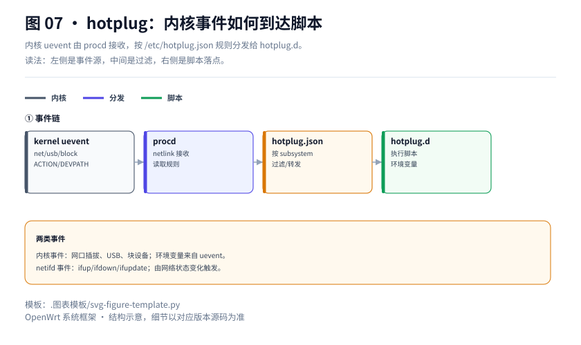

# hotplug 与事件链

一句话结论：OpenWrt 的 hotplug 不是单一守护进程，而是一条**内核 uevent → procd 接收/过滤 → `/etc/hotplug.d/` 脚本**的链；网络接口的 ifup/ifdown 则由 netifd 额外产生一层事件。

> 本篇定位：讲事件从哪来、怎么分发、脚本能拿到什么。procd 的服务管理见 [01-procd 与 init](./01-procd与init.md)，接口状态见 [05-netifd 接口生命周期](./05-netifd接口生命周期.md)。

## 目录

- [1 一句话模型](#s1)
- [2 速览](#s2)
- [3 事件源、规则与环境变量](#s3)
- [4 事件分发流程](#s4)
- [5 状态机与定时器](#s5)
- [6 设计取舍与边界](#s6)
- [7 与相邻主题的关系](#s7)
- [名词解释](#名词解释)
- [8 参考与关联](#s8)

## 1 · 一句话模型

```text
kernel uevent ──► procd ──/etc/hotplug.json──► /etc/hotplug.d/<subsystem>/*
netifd ifup/ifdown ──► iface 事件 ──► /etc/hotplug.d/iface/*
```

三个关键认知：

1. **事件源不止内核**：USB、块设备、网口、按键来自内核；ifup/ifdown 来自 netifd。
2. **脚本靠环境变量识别事件**：`ACTION`、`SUBSYSTEM`、`DEVPATH`、`INTERFACE` 等，而不是命令行参数。
3. **脚本必须快速返回**：hotplug 是事件链的一环，阻塞会延迟后续处理。

## 2 · 速览

| 项 | 内容 |
| --- | --- |
| 所属层/领域 | OpenWrt 事件与热插拔 |
| 核心对象 | uevent、procd、`hotplug.json`、`hotplug.d` 脚本 |
| 关键变量 | `ACTION`、`SUBSYSTEM`、`DEVPATH`、`INTERFACE`、`DEVICE` |
| 典型场景 | 网线插拔、USB 插入、按键、块设备挂载 |
| 主要标准 | Linux uevent 机制 + OpenWrt hotplug 约定 |

## 3 · 事件源、规则与环境变量

### 3.1 事件源

| 事件源 | 典型 `SUBSYSTEM` | 触发时机 | 边界与误判 |
| --- | --- | --- | --- |
| 网络设备 | `net` | 网口注册/注销、链路变化 | 不等于 IP 层 up |
| 网络接口 | `iface`（netifd 事件） | ifup/ifdown/ifupdate | 由 netifd 产生，不是内核 uevent |
| USB | `usb` | 设备插入/拔出 | 枚举完成时间不确定 |
| 块设备 | `block` | 分区/文件系统出现 | 挂载前要确认设备就绪 |
| 按键 | `button` | 按键按下/释放 | 长按/短按需脚本自己判断 |

### 3.2 规则与脚本

| 对象/变量 | 作用 | 边界与误判 |
| --- | --- | --- |
| `/etc/hotplug.json` | 定义哪些事件转发到哪些脚本 | 改错会静默丢事件 |
| `/etc/hotplug.d/<subsystem>/` | 按子系统放置脚本 | 文件名决定执行顺序 |
| `ACTION` | `add`/`remove`/`bind`/`unbind`/`ifup` 等 | 不同子系统取值不同 |
| `SUBSYSTEM` | 事件类别 | 用于过滤，别在脚本里猜 |
| `DEVPATH` | 设备在 sysfs 的路径 | 不是设备节点路径 |
| `DEVICENAME` / `DEVICE` | 设备名/节点 | 不同事件类型可用性不同 |
| `INTERFACE` | 网络接口逻辑名 | iface 事件才有 |
| `PRODUCT` | USB 设备标识 | 用于匹配厂商/产品 |
| `SEQNUM` | 事件序号 | 可用于判断顺序，但不保证跨源 |

两个最小脚本，分别消费内核事件与 iface 事件：

```sh
#!/bin/sh
# /etc/hotplug.d/usb/10-myusb
[ "$ACTION" = add ] || exit 0
logger -t myusb "usb add: $DEVPATH product=$PRODUCT"
```

```sh
#!/bin/sh
# /etc/hotplug.d/iface/20-mywan
[ "$ACTION" = ifup ] || exit 0
[ "$INTERFACE" = wan ] || exit 0
logger -t mywan "wan is up, device=$DEVICE"
```

两段都以“先过滤、再动作”开头：hotplug 脚本会被**所有**同类事件调用，不过滤就等于每次插拔任何 USB 都跑一遍。

## 4 · 事件分发流程



**读图**：左侧是事件源，中间是 procd 的规则过滤，右侧是脚本落点。内核事件和 netifd 事件在 `hotplug.d` 汇合，但变量集合不同。

> 图源：`images/图07-hotplug.svg`

### 4.1 正常路径

1. 内核产生 uevent，procd 通过 netlink 接收。
2. procd 读取 `/etc/hotplug.json`，按 subsystem/规则决定转发。
3. 执行 `/etc/hotplug.d/<subsystem>/` 下脚本，按文件名顺序。
4. 脚本读取环境变量，执行动作（挂载、启停服务、点灯等）。
5. netifd 在接口状态变化时额外产生 iface 事件，走 `hotplug.d/iface/`。

调试时先确认“事件到没到”，再谈脚本逻辑：

```text
logread -f -e hotplug            # 看 procd 分发的记录（若有日志）
hotplug-call iface               # 手动跑一遍 iface 脚本（需环境变量）
```

> **边界**：`hotplug-call` 只是“按目录执行脚本”，不会伪造完整事件环境；手动测试要自己 `export ACTION/INTERFACE`，否则脚本第一行过滤就退出了。

### 4.2 异常分支

| 现象 | 原因 | 处理方向 |
| --- | --- | --- |
| 脚本完全不执行 | 规则未匹配、目录/权限错、脚本无执行位 | 先确认事件是否到达 |
| 偶发不执行 | 设备枚举慢、事件早于依赖 | 脚本内做就绪检查或重试 |
| 变量为空 | 事件类型不提供该变量 | 按 subsystem 分支处理 |
| 阻塞后续事件 | 脚本里做长任务/等待网络 | 后台化或交给服务 |
| 重复执行 | 设备多次 add、脚本未幂等 | 用锁或状态检查 |

**“脚本没跑”四步查**：

| 步骤 | 查什么 | 判据 | 答错的后果 |
| --- | --- | --- | --- |
| ① 事件有没有到 | 内核是否产生该 uevent | `logread`、sysfs 变化 | 事件没到，改脚本无用 |
| ② 规则是否匹配 | `hotplug.json` 是否转发该 subsystem | 规则里的 subsystem 名 | 名字写错会静默丢事件 |
| ③ 脚本是否可执行 | 权限、解释器 | `ls -l`、`sh -n` | 权限错只有一行报错 |
| ④ 变量是否为空 | 该事件类型有没有这个变量 | 脚本里打印 `env` | 按错误变量分支，逻辑全错 |

## 5 · 状态机与定时器

hotplug 本身没有状态机，是**一次性事件回调**。定时器通常由脚本自己引入（延时、重试、去抖）；系统层没有“事件队列重放”。脚本应当幂等，因为同一设备可能多次触发 add。

## 6 · 设计取舍与边界

- **为什么用脚本而不是集中式事件总线**：嵌入式场景简单直接，厂商/产品可以按目录覆盖行为。
- **为什么区分内核事件与 iface 事件**：链路就绪和 IP 就绪是两件事，消费方需要不同的时机。
- **代价**：脚本之间没有显式依赖，顺序靠文件名；复杂流程容易变成隐式耦合。
- **不适用**：需要严格顺序、事务性或高可靠的事件处理，应放到常驻服务里。
- **常见误判**：把 `net` 事件当成“可以上网了”；它只表示设备/链路变化，地址和路由可能还没就绪。

> **推论**：需要“网络可用”时，订阅 `iface` 的 `ifup` 且确认 `INTERFACE`，不要订阅 `net` 的 add。`net` 事件来得早，此时地址、路由、DNS 都还没配好，脚本会拿到一个“有链路、没三层”的半成品。

> **边界**：hotplug 脚本没有超时保护。脚本里 `sleep`/等网络/等挂载，会拖住同一事件的后续脚本；耗时任务应 `&` 后台化或交给 procd 托管服务。

## 7 · 与相邻主题的关系

| 相邻对象 | 关系 |
| --- | --- |
| [01-procd 与 init](./01-procd与init.md) | procd 同时负责服务与 hotplug 分发 |
| [05-netifd 接口生命周期](./05-netifd接口生命周期.md) | iface 事件的来源 |
| [03-网络数据面/04-WAN 接入](../03-网络数据面/04-WAN接入与PPPoE.md) | WAN 事件与拨号状态 |
| [05-升级与恢复/03-failsafe](../05-升级与恢复/03-failsafe与恢复模式.md) | 按键/恢复模式事件 |

一句话边界：本篇讲“事件怎么到脚本”，不讲脚本里的业务逻辑。

## 名词解释

> 缩写给出英文全称；非缩写用“—”表示。

| 术语 | 英文全称 | 解释 |
| --- | --- | --- |
| hotplug | — | 设备/接口热插拔事件机制。 |
| uevent | — | 内核向用户态发送的设备事件。 |
| netlink | — | 内核与用户态通信的套接字机制。 |
| procd | Process Daemon | OpenWrt 的 init 与服务管理守护进程。 |
| iface | Interface | netifd 产生的网络接口事件类别。 |
| sysfs | — | 内核暴露设备信息的虚拟文件系统。 |
| idempotent | — | 幂等，重复执行结果一致。 |

## 8 · 参考与关联

**标准**

- Linux uevent/netlink 文档；OpenWrt hotplug 文档。

**关联**

- [本目录索引](./.readme.md)
- [01-procd 与 init](./01-procd与init.md)
- [05-netifd 接口生命周期](./05-netifd接口生命周期.md)

---

> **本篇定位**：hotplug 事件源、规则与脚本变量。
> **素材来源**：`studyspace-v2/7.平台与集成/1.OpenWrt/2.启动与板级/02-热插拔.md`。
> **待验证**：`hotplug.json` 的规则语法与默认脚本集合随分支变化。
