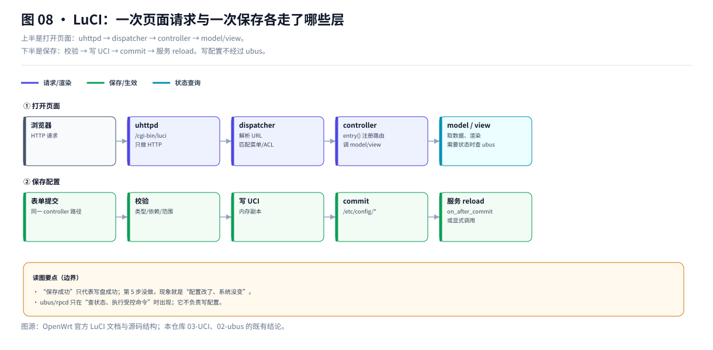

# LuCI 框架

LuCI 是 OpenWrt 的 Web 管理框架：浏览器发来的请求由 `uhttpd` 交给 LuCI 的 dispatcher，dispatcher 按菜单/权限找到 controller，controller 再调用 model（表单或数据）与 view（模板/前端视图）渲染页面。**页面保存时，写配置的是 LuCI 进程自己（通过 UCI），不是 ubus**；ubus/rpcd 负责的是“查状态、执行受控命令”。

> 本篇定位：LuCI 的 MVC 结构、两代前端、请求与保存链路、菜单与 ACL。UCI 的读写语义去 [03-UCI](./03-UCI.md)，ubus 的对象/方法去 [02-ubus](./02-ubus.md)，产品化品牌定制去 [06-定制与裁剪/01-品牌与默认配置](../06-定制与裁剪/01-品牌与默认配置.md)。

## 目录

- [1 一句话模型](#s1)
- [2 速览](#s2)
- [3 两代前端：CBI 与 JS 视图](#s3)
- [4 目录与对象](#s4)
- [5 请求与保存链路](#s5)
- [6 写一个页面并绑定 UCI](#s6)
- [7 菜单、权限与 ACL](#s7)
- [8 状态机与定时器](#s8)
- [9 设计取舍与边界](#s9)
- [10 与相邻主题的关系](#s10)
- [名词解释](#名词解释)
- [11 参考与关联](#s11)

## 1 · 一句话模型：dispatcher 找页面，controller 调 model，model 写 UCI

```text
浏览器 ──HTTP──► uhttpd ──/cgi-bin/luci──► dispatcher
                                             │ 按 menu/ACL 找 controller
                                             ▼
                                    controller（注册路由）
                                             │
                              ┌──────────────┴──────────────┐
                              ▼                             ▼
                    model（CBI/表单）                view（模板/JS）
                              │                             │
                              └────────► UCI ◄──────────────┘
                                           │ commit + reload
                                           ▼
                                     系统服务生效
```

三个关键认知：

1. **LuCI 是“配置界面”，不是“配置中心”**：它最终写的是 `/etc/config/*`，与命令行 `uci` 改的是同一份文件。
2. **两代前端并存**：老页面是 Lua CBI（服务端渲染），新页面是 JS 视图 + 前端表单框架；判断一个页面属于哪代，看文件后缀与目录。
3. **权限不在页面里，在 ACL 里**：菜单能看见不等于能操作，最终由 rpcd/ubus 的 ACL 决定。

## 2 · 速览

| 项 | 内容 |
| --- | --- |
| 所属层/领域 | OpenWrt 管理面 |
| 核心对象 | dispatcher、controller、model/view、menu.d、ACL |
| 关键入口 | `/cgi-bin/luci`、`/usr/lib/lua/luci/`、`/www/luci-static/` |
| 典型场景 | 加产品页面、改现有页面、控制菜单可见性、排查保存失败 |
| 主要标准 | LuCI 自身约定；无外部协议标准 |

## 3 · 两代前端：CBI 与 JS 视图

| 维度 | Lua CBI（老） | JS 视图（新） |
| --- | --- | --- |
| 渲染 | 服务端生成 HTML | 浏览器端渲染 |
| 文件 | `model/cbi/<app>.lua` | `view/<app>/<page>.js` |
| 表单 API | `Map`/`TypedSection`/`Value` | `form.Map`/`form.GridSection` |
| 数据读写 | 直接 `luci.model.uci` | 经 rpcd/ubus 调用受 ACL 控制的接口 |
| 典型版本 | 早期分支 | 19.07 之后逐步成为主流 |
| 边界 | 简单直接，交互弱 | 交互强，但依赖前端框架与 rpcd |

> **边界**：两代不是“新旧替代”那么干净。很多分支里 CBI 与 JS 页面并存，同一个菜单下可能两种都有。改页面前先看它属于哪一代，否则会在错误的文件里改半天。

## 4 · 目录与对象

| 对象/路径 | 作用 | 边界与误判 |
| --- | --- | --- |
| `/cgi-bin/luci` | 统一入口（uhttpd 的 CGI） | 不是静态文件目录 |
| `dispatcher` | 解析 URL、匹配菜单、鉴权、调度 | 找不到路由返回 404，不是“页面丢了” |
| `controller/` | 注册路由（`entry()`） | 只做注册，不写业务逻辑 |
| `model/cbi/` | 表单模型：字段、校验、保存 | 字段名必须与 UCI 选项名一致 |
| `view/` | 模板或 JS 视图 | 模板里不要直接改 UCI |
| `/usr/share/luci/menu.d/*.json` | 菜单结构与顺序 | 菜单不显示，先查这里与 ACL |
| `/usr/share/rpcd/acl.d/*.json` | 权限（读/写/执行） | 能看不能改，问题在这里 |
| `/etc/config/luci` | LuCI 自身配置（语言、主题） | 与业务配置分开 |
| `uhttpd` | Web 服务器 | 只负责 HTTP，不处理业务 |

## 5 · 请求与保存链路



**读图**：上半是“打开页面”：浏览器 → uhttpd → dispatcher → controller → model/view → 渲染。下半是“保存”：表单校验 → 写 UCI → commit → 调服务 reload。注意 ubus/rpcd 只出现在“查状态/执行命令”的支路上，写配置不经过它。

> 图源：`images/图08-LuCI请求路径.svg`

### 5.1 打开页面

1. 浏览器请求 `/cgi-bin/luci/admin/services/myapp`。
2. uhttpd 把请求交给 LuCI 的 CGI/dispatcher。
3. dispatcher 解析路径，匹配 `menu.d` 里的菜单项与 controller 的 `entry()`。
4. 检查会话与 ACL：未登录跳登录页，无权限返回 403。
5. controller 调用 model（取数据/构造表单）或 view（渲染页面）。
6. 渲染结果返回浏览器；需要运行状态的字段走 rpcd/ubus 查询。

### 5.2 保存配置

1. 前端表单提交到同一个 controller 路径。
2. CBI/JS 表单做类型与依赖校验，失败则回显错误。
3. 校验通过后写入 UCI（内存副本）。
4. `commit` 落盘到 `/etc/config/<file>`。
5. 调用服务 reload（`on_after_commit` 或显式 `luci.sys.call("/etc/init.d/x reload")`）。
6. 服务重新读取配置，运行态变化。

> **推论**：页面“保存成功”只代表第 3~4 步成功。第 5 步没做或失败时，现象是“配置改了、系统没变”——这与命令行 `uci commit` 后忘记 reload 是同一个问题。

## 6 · 写一个页面并绑定 UCI

最小可用的三步：注册路由、写表单模型、加菜单与 ACL。

**① controller**（`controller/myapp.lua`）：

```lua
module("luci.controller.myapp", package.seeall)

function index()
	entry({"admin", "services", "myapp"}, cbi("myapp"), _("My App"), 60)
end
```

**② CBI model**（`model/cbi/myapp.lua`）：

```lua
local m, s, o

m = Map("myapp", translate("My App"))
m.description = translate("演示：读写 /etc/config/myapp")

s = m:section(TypedSection, "basic", translate("Basic"))
s.addremove = false
s.anonymous = true

o = s:option(Flag, "enabled", translate("Enable"))
o.rmempty = false

o = s:option(Value, "server", translate("Server"))
o.datatype = "host"
o.placeholder = "example.com"

return m
```

**③ 菜单由 controller 的 `entry()` 自动生成**（新版也可写 `menu.d/*.json`）；ACL 在 `/usr/share/rpcd/acl.d/myapp.json` 里声明 `uci` 的读写范围。

映射关系只有一条：**`TypedSection` 对应 `config <type>`，`option(Value, "x")` 对应 `option x`**。UCI 里写成 `list` 的字段要用 `DynamicList`，写成 `Flag` 的用 `Flag`——类型错了，页面会显示异常或保存丢失。

> **边界**：`o.datatype` 只做前端与后端校验，不改变 UCI 的存储类型；所有值最终都是字符串。需要数字时在服务侧再转换。

## 7 · 菜单、权限与 ACL

| 现象 | 先查 | 说明 |
| --- | --- | --- |
| 菜单不显示 | `menu.d` 有没有该 entry、ACL 是否允许 | 没权限的菜单会被隐藏 |
| 菜单显示但 403 | ACL 的 `read`/`write` 范围 | 看着像“页面坏了”，其实是权限 |
| 能改但保存 500 | rpcd 的 `exec`/`uci` 权限、文件属主 | 写 `/etc/config` 需要对应权限 |
| 保存后不生效 | `on_after_commit`/reload 是否执行 | 与 UCI reload 链路相同 |

> **推论**：LuCI 的权限模型是“菜单可见性 + rpcd ACL”两层。只改菜单不改 ACL，会出现“看得见点不动”；只改 ACL 不改菜单，会出现“有权限但找不到入口”。两者要一起改。

## 8 · 状态机与定时器

LuCI 本身没有业务状态机，只有**会话状态**（未登录 → 已登录 → 过期）与**表单状态**（编辑中 → 校验失败 → 已提交）。没有定时器；会话超时由 uhttpd/rpcd 的 session 配置决定。

## 9 · 设计取舍与边界

- **为什么用 MVC**：页面、数据、路由分开，产品可以在不改核心的情况下加页面；代价是多一层目录与约定。
- **为什么 CBI 直接写 UCI**：简单、快、无需额外服务；代价是前端能力弱、复杂交互难做。
- **为什么新前端走 rpcd**：浏览器端不能直接碰 `/etc/config`，必须由受 ACL 控制的服务代写；代价是链路更长、排障要同时看前端与 rpcd 日志。
- **不适用**：高频刷新、实时图表这类页面不适合 CBI；用 JS 视图 + 轮询/事件。
- **常见误判**：把“页面显示的值”当成“运行态”；页面读的是 UCI，运行态要靠 ubus 查。

> **推论**：改 LuCI 页面的第一原则是“不要绕过 UCI”。任何直接写文件、直接调系统命令而不走 UCI 的页面，都会让“页面配置”和“命令行配置”出现两个正本，升级后必打架。

## 10 · 与相邻主题的关系

| 相邻主题 | 关系 |
| --- | --- |
| [03-UCI](./03-UCI.md) | 页面读写的数据模型与 commit/reload 语义 |
| [02-ubus](./02-ubus.md) | 运行状态查询与 rpcd 调用 |
| [01-procd与init](./01-procd与init.md) | 保存后 reload 的服务由 procd 托管 |
| [06-定制与裁剪/01-品牌与默认配置](../06-定制与裁剪/01-品牌与默认配置.md) | 默认页面、主题与品牌 |
| [11-网络科学/05-应用层](../../../10-基础理论/11-网络科学/05-应用层/00-应用层概览.md) | HTTP、CGI 的通用机制 |

一句话：**LuCI 是 UCI 的图形外壳，ubus 是它的状态来源。**

## 名词解释

> 缩写给出英文全称；非缩写用“—”表示。

| 术语 | 英文全称 | 解释 |
| --- | --- | --- |
| LuCI | Lua Configuration Interface | OpenWrt 的 Web 管理框架。 |
| MVC | Model-View-Controller | 模型-视图-控制器分层。 |
| CBI | Configuration Binding Interface | LuCI 的服务端表单模型。 |
| dispatcher | — | LuCI 的 URL 解析与调度模块。 |
| controller | — | 注册页面路由的模块。 |
| model | — | 数据与表单模型。 |
| view | — | 页面模板或前端视图。 |
| UCI | Unified Configuration Interface | 统一配置接口。 |
| ubus | OpenWrt Bus | 进程间通信总线。 |
| rpcd | RPC Daemon | 受 ACL 控制的 RPC 服务。 |
| ACL | Access Control List | 访问控制列表。 |
| CGI | Common Gateway Interface | 通用网关接口。 |

## 11 · 参考与关联

**标准**

- OpenWrt 官方 LuCI 文档与 `luci-base` 源码。
- OpenWrt 官方 UCI、rpcd/ubus 文档。

**关联**

- [03-UCI](./03-UCI.md)
- [02-ubus](./02-ubus.md)
- [06-定制与裁剪/01-品牌与默认配置](../06-定制与裁剪/01-品牌与默认配置.md)
- [本目录索引](./.readme.md)

---

> **本篇定位**：LuCI 的 MVC 结构、两代前端、请求/保存链路与菜单 ACL；不展开前端框架 API 与模板语法。
> **素材来源**：OpenWrt 官方 LuCI 文档与源码结构；本仓库 [03-UCI](./03-UCI.md)、[02-ubus](./02-ubus.md) 的既有结论。
> **待验证**：CBI 与 JS 视图在各分支的默认状态、`menu.d`/ACL 文件路径与字段随版本变化。
