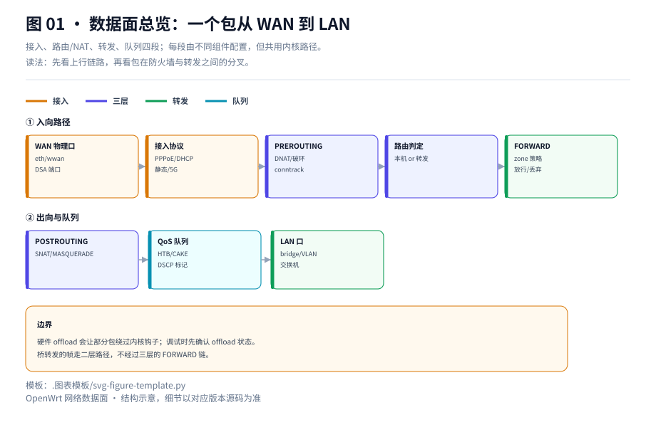

# 网络数据面总览

一句话结论：OpenWrt 的数据面是**内核转发路径 + 用户态配置**的组合：接口与链路由 netifd 建好，NAT/过滤由 fw4 生成 nftables 规则，队列由 tc/QoS 管理，交换机端口由 DSA 暴露；数据包本身几乎不经过用户态。

> 本篇定位：给出端到端路径与组件分工。netfilter 内核机制见 [21-Linux/06-网络子系统](../../21-Linux/06-网络子系统/01-netfilter/netfilter框架入门.md)；各组件细节见本目录后续篇。

## 目录

- [1 一句话模型](#s1)
- [2 速览](#s2)
- [3 数据面组件与边界](#s3)
- [4 端到端流程](#s4)
- [5 状态机与定时器](#s5)
- [6 设计取舍与边界](#s6)
- [7 与相邻主题的关系](#s7)
- [名词解释](#名词解释)
- [8 参考与关联](#s8)

## 1 · 一句话模型

```text
WAN 口 ──► 接入 proto ──► PREROUTING(NAT) ──► 路由 ──► FORWARD ──► POSTROUTING(SNAT) ──► LAN
                              │                         │
                          conntrack                  fw4 规则
```

三个关键认知：

1. **用户态只配置，不转发**：netifd/fw4 把意图写进内核，包走内核快路径。
2. **NAT 与过滤是两条规则集**：DNAT 在 PREROUTING，SNAT 在 POSTROUTING，过滤主要在 FORWARD。
3. **offload 会改变可观测性**：命中快路径后，部分钩子和计数器不再执行。

## 2 · 速览

| 项 | 内容 |
| --- | --- |
| 所属层/领域 | OpenWrt 网络转发与策略 |
| 核心对象 | interface、nftables 规则、conntrack、qdisc、交换机端口 |
| 关键入口 | `/etc/config/network`、`/etc/config/firewall`、`tc` |
| 典型场景 | 共享上网、端口映射、多 WAN、VLAN、限速 |
| 主要标准 | IPv4/IPv6、NAT、802.1Q、nftables |

## 3 · 数据面组件与边界

| 组件 | 作用 | 配置入口 | 边界与误判 |
| --- | --- | --- | --- |
| netifd | 建接口、地址、路由 | `/etc/config/network` | 不生成防火墙规则 |
| fw4 | UCI firewall → nftables | `/etc/config/firewall` | 不是守护进程，reload 时重建 |
| conntrack | 连接跟踪与 NAT 状态 | 内核 | 表满会丢新连接 |
| DSA/swconfig | 交换机端口与 VLAN | `/etc/config/network`、`bridge` | 端口名由 DTS 决定 |
| dnsmasq/odhcpd | DHCP/DNS/RA | `/etc/config/dhcp` | 不参与转发 |
| tc/SQM | 队列、整形、限速 | `tc`、`sqm` | 与 offload 可能冲突 |

## 4 · 端到端流程



**读图**：入向从 WAN 口到 FORWARD，出向从 POSTROUTING 到 LAN 口；QoS 队列在出向侧。注意桥转发是二层路径，不经过三层的 FORWARD 链。

> 图源：`images/图01-数据面路径.svg`

### 4.1 正常路径

1. WAN 物理口收到帧，DSA/驱动交给内核。
2. 接入 proto（PPPoE/DHCP/静态/5G）建立地址与默认路由。
3. PREROUTING 做 DNAT/破环，conntrack 建立或命中连接。
4. 路由判定：本机则 INPUT，转发则 FORWARD。
5. FORWARD 按 zone/rule 放行；POSTROUTING 做 SNAT/MASQUERADE。
6. 出向队列按 QoS 调度，帧从 LAN 口发出。

### 4.2 异常分支

| 现象 | 原因 | 处理方向 |
| --- | --- | --- |
| 能拨号但不能上网 | 转发/NAT/防火墙未放行 | 按 PREROUTING→FORWARD→POSTROUTING 分段查 |
| 端口映射不生效 | DNAT 规则、zone、回程路由 | 查 redirect 与 conntrack |
| 多 WAN 选路错 | metric/rule/mwan3 | 查路由表与策略规则 |
| 限速不生效 | offload 绕过队列 | 关闭 offload 或改用硬件队列 |
| VLAN 不通 | DSA 端口 VLAN 未配置 | 查 bridge vlan 与交换机侧 |

## 5 · 状态机与定时器

数据面没有统一状态机，但有连接级状态：conntrack 的 NEW/ESTABLISHED/RELATED/INVALID，以及 TCP 自身的状态机。定时器包括 conntrack 超时、ARP/ND 邻居过期、DHCP 租约、路由缓存过期。接口级状态见 [02-系统框架/05-netifd 接口生命周期](../02-系统框架/05-netifd接口生命周期.md)。

## 6 · 设计取舍与边界

- **为什么尽量在内核转发**：用户态转发吞吐低、延迟高；OpenWrt 只在配置面使用用户态。
- **为什么用 nftables 替代 iptables**：统一 IPv4/IPv6、规则集原子更新、性能更好；代价是语法与旧脚本不兼容。
- **为什么提供 offload**：家用/CPE 的 CPU 较弱，快路径能显著提升吞吐；代价是观测与 QoS 复杂度上升。
- **不适用**：需要深度包检测或用户态处理的场景，仍要上送或使用专门数据面。
- **常见误判**：把“接口 UP”当成“数据面通”；地址、路由、防火墙、NAT 任一层都可能断。

## 7 · 与相邻主题的关系

| 相邻对象 | 关系 |
| --- | --- |
| [01-fw3/fw4 与 nftables](./01-fw3-fw4与nftables.md) | 过滤与 NAT 规则生成 |
| [02-DSA 与 bridge/VLAN](./02-DSA与bridge-VLAN.md) | 二层端口与链路对象 |
| [03-NAT 与 offload](./03-NAT与offload.md) | 地址转换与快路径 |
| [04-WAN 接入与 PPPoE](./04-WAN接入与PPPoE.md) | 上行接入与默认路由 |
| [05-QoS 与流量控制](./05-QoS与流量控制.md) | 队列、整形与限速 |
| [21-Linux/06-网络子系统](../../21-Linux/06-网络子系统/00-网络栈概览.md) | 内核收发包与 netfilter 机制 |

一句话边界：本篇讲“包怎么走、谁配置”，不讲某个协议的报文格式。

## 名词解释

> 缩写给出英文全称；非缩写用“—”表示。

| 术语 | 英文全称 | 解释 |
| --- | --- | --- |
| NAT | Network Address Translation | 网络地址转换。 |
| DNAT | Destination Network Address Translation | 目的地址转换，常用于端口映射。 |
| SNAT | Source Network Address Translation | 源地址转换，常用于共享上网。 |
| conntrack | Connection Tracking | 内核连接跟踪。 |
| DSA | Distributed Switch Architecture | 把交换机端口暴露为独立网络设备的框架。 |
| QoS | Quality of Service | 服务质量，涉及分类、标记、队列与整形。 |
| offload | — | 将转发卸载到快路径或硬件。 |

## 8 · 参考与关联

**标准**

- RFC 3022（NAT）、IEEE 802.1Q、nftables 文档。

**关联**

- [本目录索引](./.readme.md)
- [21-Linux netfilter 框架入门](../../21-Linux/06-网络子系统/01-netfilter/netfilter框架入门.md)

---

> **本篇定位**：数据面端到端路径与组件分工。
> **素材来源**：`studyspace-v2/7.平台与集成/1.OpenWrt/4.网络业务/`。
> **待验证**：offload 的默认开关与硬件支持随平台/分支变化。
