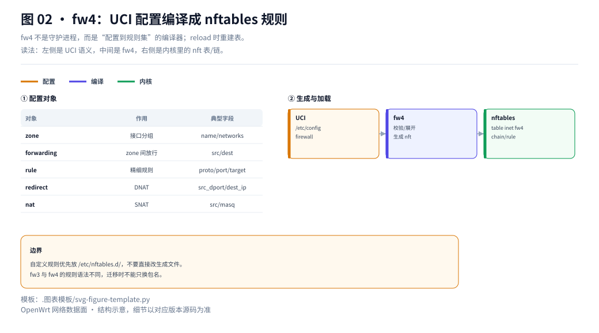

# fw3/fw4 与 nftables

一句话结论：OpenWrt 的防火墙不是手写规则，而是**用 UCI 的 zone/forwarding/rule/redirect/nat 描述意图，由 fw3/fw4 编译成内核规则集**；新版本用 fw4 + nftables，旧版本用 fw3 + iptables，语法和规则结构都不同。

> 本篇定位：讲 UCI 防火墙模型与 fw4 的生成逻辑。netfilter 的链/表机制见 [21-Linux netfilter 入门](../../21-Linux/06-网络子系统/01-netfilter/netfilter框架入门.md)；NAT/offload 见 [03-NAT 与 offload](./03-NAT与offload.md)。

## 目录

- [1 一句话模型](#s1)
- [2 速览](#s2)
- [3 UCI 对象与字段](#s3)
- [4 生成与加载流程](#s4)
- [5 状态机与定时器](#s5)
- [6 设计取舍与边界](#s6)
- [7 与相邻主题的关系](#s7)
- [名词解释](#名词解释)
- [8 参考与关联](#s8)

## 1 · 一句话模型

```text
/etc/config/firewall ──► fw4 ──► nftables（table inet fw4）
  zone/forwarding/rule/redirect/nat       chain + rule
```

三个关键认知：

1. **zone 是策略边界**：先把接口分到 zone，再定义 zone 间是否放行。
2. **规则顺序与默认策略**：放行/丢弃不仅看单条规则，还看链的默认策略和规则顺序。
3. **fw4 是编译器，不是 daemon**：`reload` 时重建规则集，运行中没有常驻进程持续匹配。

## 2 · 速览

| 项 | 内容 |
| --- | --- |
| 所属层/领域 | OpenWrt 防火墙与 NAT |
| 核心对象 | zone、forwarding、rule、redirect、nat |
| 关键入口 | `/etc/config/firewall`、`/etc/nftables.d/` |
| 典型场景 | LAN/WAN 隔离、端口映射、DMZ、多 WAN |
| 主要标准 | nftables、iptables（旧）、RFC 3022 |

## 3 · UCI 对象与字段

| 对象 | 作用 | 关键字段 | 边界与误判 |
| --- | --- | --- | --- |
| `zone` | 接口分组与默认策略 | `name`、`networks`、`input`、`output`、`forward`、`masq` | zone 名不是接口名 |
| `forwarding` | 允许两个 zone 间转发 | `src`、`dest` | 只放行，不做 NAT |
| `rule` | 精细匹配与动作 | `src`、`dest`、`proto`、`dest_port`、`target` | 顺序影响结果 |
| `redirect` | DNAT/端口映射 | `src`、`src_dport`、`dest_ip`、`dest_port`、`reflection` | 回程需要 NAT/conntrack |
| `nat` | SNAT | `src`、`dest`、`snat_ip`、`masq` | 与 zone 的 masq 可能重复 |
| `include` | 引入自定义规则 | `path`、`type` | 路径/语法错误会导致 reload 失败 |
| `defaults` | 全局默认策略 | `input`、`output`、`forward`、`syn_flood` | 改默认策略影响全局 |

### 3.1 fw3 与 fw4 的差异

| 维度 | fw3 | fw4 |
| --- | --- | --- |
| 后端 | iptables/ip6tables | nftables |
| 规则集 | 多张表、多条链 | `table inet fw4` 统一 IPv4/IPv6 |
| 自定义规则 | `/etc/firewall.user` | `/etc/nftables.d/*.nft` |
| 原子更新 | 较弱 | 规则集原子替换 |
| 典型版本 | 旧分支 | 22.03 及以后常见（待验证） |

## 4 · 生成与加载流程



**读图**：左侧是 UCI 语义对象，右侧是内核里的 nft 表/链。`fw4` 把 zone 展开成接口集合，把 forwarding/rule 展开成链上的规则。

> 图源：`images/图02-fw4.svg`

### 4.1 正常路径

1. 读取 `/etc/config/firewall`，校验 zone、接口与地址。
2. 展开接口集合与地址族，生成 nftables 规则文本。
3. 原子替换 `table inet fw4`，加载自定义 include。
4. 规则生效；NAT 依赖 conntrack，首包建立映射。
5. 配置变更后 `reload`，重建规则集。

### 4.2 异常分支

| 现象 | 原因 | 处理方向 |
| --- | --- | --- |
| reload 失败 | UCI 语法/字段错、include 语法错 | 先看 fw4 报错行 |
| 放行了仍不通 | zone 接口未匹配、NAT/路由缺失 | 查 zone networks 与路由 |
| 端口映射不通 | DNAT 后回程未 SNAT、防火墙未放行 | 查 redirect 与 forward |
| 规则计数不增长 | offload 命中 | 关闭 offload 复测 |
| IPv6 行为不同 | 只配了 IPv4 规则 | 检查地址族与 `masq6` |

## 5 · 状态机与定时器

防火墙本身没有状态机，但依赖 **conntrack 的连接状态**（NEW/ESTABLISHED/RELATED/INVALID）。定时器包括 conntrack 超时、`syn_flood` 速率窗口等；规则集本身在 reload 前保持不变。

## 6 · 设计取舍与边界

- **为什么用 zone 而不是逐接口写规则**：家用/CPE 的接口多、变化频繁，zone 把“接口分组”和“策略”解耦。
- **为什么 fw4 用 nftables**：统一地址族、原子更新、规则集更紧凑；代价是旧脚本和教程不能直接套用。
- **代价**：UCI 到 nft 的展开不直观，排障要同时看配置和最终规则集。
- **不适用**：需要复杂状态机/应用层识别的防火墙，应使用专门方案。
- **常见误判**：只看 `rule` 不看 `forwarding` 和 zone 默认策略；三者共同决定是否放行。

## 7 · 与相邻主题的关系

| 相邻对象 | 关系 |
| --- | --- |
| [00-数据面总览](./00-数据面总览.md) | 防火墙在端到端路径中的位置 |
| [03-NAT 与 offload](./03-NAT与offload.md) | DNAT/SNAT 与快路径 |
| [02-DSA 与 bridge/VLAN](./02-DSA与bridge-VLAN.md) | zone 背后的接口/桥 |
| [02-系统框架/03-UCI](../02-系统框架/03-UCI.md) | `firewall` 配置的读写与生效 |
| [21-Linux netfilter 入门](../../21-Linux/06-网络子系统/01-netfilter/netfilter框架入门.md) | 链/表/conntrack 的内核机制 |

一句话边界：本篇讲“配置怎么变成规则”，不讲 nftables 语法大全。

## 名词解释

> 缩写给出英文全称；非缩写用“—”表示。

| 术语 | 英文全称 | 解释 |
| --- | --- | --- |
| fw3 | Firewall 3 | 基于 iptables 的 OpenWrt 防火墙配置工具。 |
| fw4 | Firewall 4 | 基于 nftables 的 OpenWrt 防火墙配置工具。 |
| zone | — | 防火墙区域，把接口分组并定义默认策略。 |
| DNAT | Destination Network Address Translation | 目的地址转换。 |
| SNAT | Source Network Address Translation | 源地址转换。 |
| conntrack | Connection Tracking | 内核连接跟踪。 |
| DMZ | Demilitarized Zone | 隔离区，通常放行外部访问的内部主机。 |
| nftables | — | Linux 新一代包过滤框架。 |

## 8 · 参考与关联

**标准**

- nftables 文档、RFC 3022；OpenWrt 官方 firewall 文档。

**关联**

- [本目录索引](./.readme.md)
- [03-NAT 与 offload](./03-NAT与offload.md)
- [21-Linux netfilter 入门](../../21-Linux/06-网络子系统/01-netfilter/netfilter框架入门.md)

---

> **本篇定位**：UCI 防火墙模型与 fw4 生成逻辑。
> **素材来源**：`studyspace-v2/7.平台与集成/1.OpenWrt/4.网络业务/3.关键组件服务/02-防火墙配置.md`。
> **待验证**：目标分支默认 fw3 还是 fw4，以及 `/etc/nftables.d/` 的支持范围。
