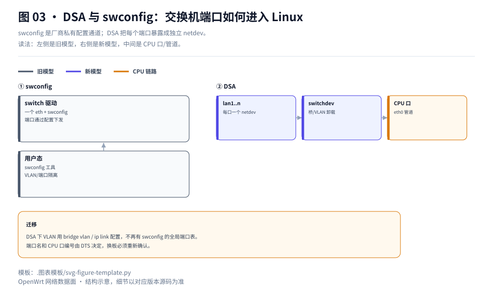

# DSA 与 bridge/VLAN

一句话结论：OpenWrt 的交换机配置经历了 **swconfig → DSA** 的迁移：swconfig 通过一个全局配置通道管理端口，DSA 把每个端口暴露成独立 netdev，再用 Linux bridge/VLAN 的标准接口管理。配置前先确认设备用的是哪套模型。

> 本篇定位：讲 DSA/swconfig 的差异、bridge/VLAN 的配置对象与端口语义。VLAN 协议原理见 [10-基础理论/02-链路层/VLAN 与 Trunk](../../../10-基础理论/11-网络科学/02-链路层/02-VLAN与Trunk.md)；内核桥机制见 [21-Linux/06-网桥与 netlink](../../21-Linux/06-网络子系统/04-网桥与netlink.md)。

## 目录

- [1 一句话模型](#s1)
- [2 速览](#s2)
- [3 端口、桥与 VLAN 字段](#s3)
- [4 配置与转发流程](#s4)
- [5 状态机与定时器](#s5)
- [6 设计取舍与边界](#s6)
- [7 与相邻主题的关系](#s7)
- [名词解释](#名词解释)
- [8 参考与关联](#s8)

## 1 · 一句话模型

```text
物理交换机端口 ──DSA──► lan1..lan4（独立 netdev）──► bridge ──► VLAN 过滤
                     └── CPU 口 ──► eth0（上联 CPU）
```

三个关键认知：

1. **DSA 不是“新交换机驱动”**：它改变的是端口在 Linux 里的呈现方式。
2. **bridge 负责二层转发，VLAN 负责隔离**：两者可以组合，但配置对象不同。
3. **端口名由 DTS 决定**：`lan1` 不一定对应面板上的 LAN1，必须以设备树/标签为准。

## 2 · 速览

| 项 | 内容 |
| --- | --- |
| 所属层/领域 | OpenWrt 二层数据面 |
| 核心对象 | DSA 端口、CPU 口、bridge、VLAN、PVID |
| 关键入口 | `/etc/config/network`、`bridge` 命令、`ip link` |
| 典型场景 | LAN 口聚合、VLAN 划分、WAN/LAN 隔离、IPTV |
| 主要标准 | IEEE 802.1Q、Linux bridge、DSA |

## 3 · 端口、桥与 VLAN 字段

| 对象/字段 | 作用 | 边界与误判 |
| --- | --- | --- |
| DSA 端口 | 每个交换机端口一个 netdev | 名字由 DTS 决定，不是固定编号 |
| CPU 口 | 交换机与 CPU 的上联 | 可能是 `eth0` 或专用 conduit |
| `config device` `type 'bridge'` | 创建 Linux bridge | 成员口用 `ports` 指定 |
| `ports` | 桥成员列表 | 写错端口会导致桥不通 |
| `vlan_filtering` | 开启 VLAN 过滤 | 关闭时 VLAN 规则不生效 |
| `vid` | VLAN ID | 1-4094，0/4095 保留 |
| `pvid` | 端口默认 VLAN | 未打标签的帧归入该 VLAN |
| tagged/untagged | 出端口是否带标签 | 接终端通常 untagged，接交换机通常 tagged |
| `bridge vlan` | 查看/配置端口 VLAN | 与 UCI 配置可能不同步 |

## 4 · 配置与转发流程



**读图**：左侧是 swconfig 的“全局交换机 + 配置工具”，右侧是 DSA 的“每口一个 netdev + 标准 bridge”。迁移时先确认端口模型，再谈配置语法。

> 图源：`images/图03-DSA.svg`

### 4.1 正常路径（DSA）

1. 驱动根据 DTS 注册 `lan1..lanN` 与 CPU 口。
2. netifd 读取 `network` 配置，创建 bridge 并加入成员口。
3. 若开启 VLAN 过滤，按 PVID/tagged 规则处理入向帧。
4. 桥查 FDB 转发；未知单播/广播泛洪到同 VLAN 成员。
5. 上联流量经 CPU 口进入三层。

### 4.2 异常分支

| 现象 | 原因 | 处理方向 |
| --- | --- | --- |
| 端口完全不通 | 端口名错、DSA 驱动未加载 | 查 `ip link` 与 dmesg |
| VLAN 间串通 | 未开启过滤、PVID 配错 | 查 `bridge vlan show` |
| tagged/untagged 错 | 对端期望与本地不一致 | 对照交换机侧配置 |
| 桥有成员但不转发 | STP 阻塞、成员未 up | 查桥状态与端口状态 |
| 换板后端口错位 | DTS 端口编号变化 | 以设备树/面板标签重新映射 |

## 5 · 状态机与定时器

二层转发没有连接状态机；桥端口有 STP/RSTP 状态（disabled/blocking/listening/learning/forwarding），FDB 表项有老化定时器（默认约 300 秒，待验证）。VLAN 配置本身是静态的，不随时间变化。

## 6 · 设计取舍与边界

- **为什么迁移到 DSA**：让交换机端口使用标准 Linux 网络接口，bridge/VLAN/TC 等工具可以直接作用，减少私有 ioctl。
- **为什么保留 swconfig 兼容**：大量旧设备仍在使用，迁移需要驱动和 DTS 配合。
- **代价**：DSA 下端口多、命名依赖 DTS，配置错误更隐蔽；swconfig 则工具与内核耦合。
- **不适用**：纯软件桥（无交换机）不需要 DSA，直接用 `ip link`/bridge 即可。
- **常见误判**：把 `lan1` 当成面板 LAN1；把 VLAN ID 当成端口号。

## 7 · 与相邻主题的关系

| 相邻对象 | 关系 |
| --- | --- |
| [00-数据面总览](./00-数据面总览.md) | 二层路径在整体数据面中的位置 |
| [01-fw3/fw4 与 nftables](./01-fw3-fw4与nftables.md) | zone 背后的接口/桥 |
| [03-NAT 与 offload](./03-NAT与offload.md) | 三层转发与快路径 |
| [10-基础理论/VLAN 与 Trunk](../../../10-基础理论/11-网络科学/02-链路层/02-VLAN与Trunk.md) | 802.1Q 标签与端口类型 |
| [21-Linux/06-网桥与 netlink](../../21-Linux/06-网络子系统/04-网桥与netlink.md) | 内核桥/FDB/netlink |

一句话边界：本篇讲“OpenWrt 怎么配交换机”，不讲 802.1Q 帧格式。

## 名词解释

> 缩写给出英文全称；非缩写用“—”表示。

| 术语 | 英文全称 | 解释 |
| --- | --- | --- |
| DSA | Distributed Switch Architecture | 把交换机端口暴露为独立 netdev 的框架。 |
| swconfig | Switch Configuration | 旧版 OpenWrt 的交换机配置工具/接口。 |
| CPU port | — | 交换机与 CPU 之间的上联端口。 |
| bridge | — | Linux 二层桥，按 FDB 转发帧。 |
| VLAN | Virtual Local Area Network | 虚拟局域网。 |
| PVID | Port VLAN ID | 端口默认 VLAN，处理未打标签帧。 |
| FDB | Forwarding Database | 桥的 MAC 地址转发表。 |
| STP | Spanning Tree Protocol | 生成树协议，防止二层环路。 |

## 8 · 参考与关联

**标准**

- IEEE 802.1Q、IEEE 802.1D；Linux DSA 与 bridge 文档。

**关联**

- [本目录索引](./.readme.md)
- [10-基础理论/VLAN 与 Trunk](../../../10-基础理论/11-网络科学/02-链路层/02-VLAN与Trunk.md)
- [21-Linux/06-网桥与 netlink](../../21-Linux/06-网络子系统/04-网桥与netlink.md)

---

> **本篇定位**：DSA/swconfig 与 bridge/VLAN 的配置模型。
> **素材来源**：`studyspace-v2/7.平台与集成/1.OpenWrt/3.管理平面/09-netifd-bridge.md`、`10-netifd-vlan.md`、`4.网络业务/2.LAN/02-网桥配置.md`。
> **待验证**：具体设备的端口命名、CPU 口编号与 DSA 驱动支持。
