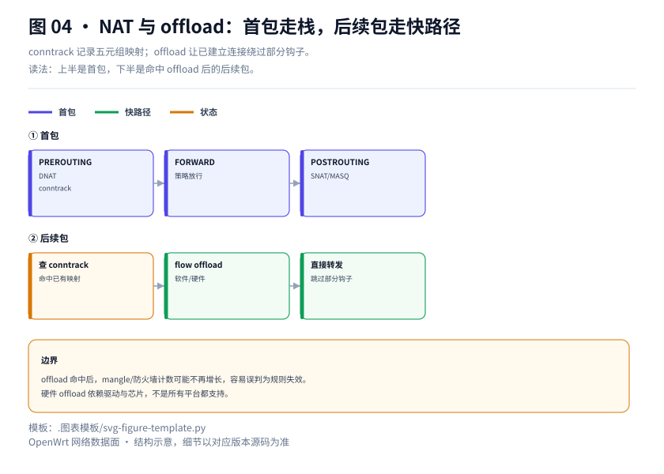

# NAT 与 offload

一句话结论：NAT 靠 **conntrack 记录连接映射**，只有首包完整走 NAT 链，后续包直接查表；offload 进一步把已建立连接交给快路径（软件 flowtable 或硬件），从而提升吞吐，但也让部分钩子与计数器“看不见”流量。

> 本篇定位：讲 SNAT/DNAT 的配置与 offload 的代价。防火墙 zone/rule 见 [01-fw3/fw4 与 nftables](./01-fw3-fw4与nftables.md)；内核 conntrack 机制见 [10-基础理论/NAT](../../../10-基础理论/11-网络科学/03-网络层/05-NAT.md)。

## 目录

- [1 一句话模型](#s1)
- [2 速览](#s2)
- [3 NAT 与 offload 的关键字段](#s3)
- [4 首包与快路径流程](#s4)
- [5 状态机与定时器](#s5)
- [6 设计取舍与边界](#s6)
- [7 与相邻主题的关系](#s7)
- [名词解释](#名词解释)
- [8 参考与关联](#s8)

## 1 · 一句话模型

```text
首包：PREROUTING(DNAT) → FORWARD → POSTROUTING(SNAT) → conntrack 记录
后续：查 conntrack →（命中 offload）→ 快路径转发
```

三个关键认知：

1. **NAT 是有状态的**：映射只在首包建立，后续包依赖 conntrack。
2. **SNAT 与 MASQUERADE 的差别在源地址选择**：前者写死地址，后者跟随出接口地址。
3. **offload 不是“加速开关”那么简单**：它改变包经过的钩子，影响计数、QoS 和部分规则。

## 2 · 速览

| 项 | 内容 |
| --- | --- |
| 所属层/领域 | OpenWrt 三层转发 |
| 核心对象 | conntrack、SNAT、DNAT、flowtable |
| 关键入口 | `/etc/config/firewall` 的 `nat`/`redirect`/`defaults` |
| 典型场景 | 共享上网、端口映射、多 WAN、高吞吐转发 |
| 主要标准 | RFC 3022、nftables flowtable |

## 3 · NAT 与 offload 的关键字段

| 对象/字段 | 作用 | 边界与误判 |
| --- | --- | --- |
| `zone.masq` | 对该 zone 出向做 MASQUERADE | 只影响出向，不负责放行 |
| `zone.masq6` | IPv6 的 masquerade | IPv6 通常用 NPTv6/路由，不一定要 NAT |
| `config nat` | 自定义 SNAT | `snat_ip` 必须是本机可达地址 |
| `config redirect` | DNAT/端口映射 | 需要放行 forward 与回程 NAT |
| `reflection` | 内网访问公网地址的回环 | 依赖 NAT loopback 支持 |
| `conntrack` | 连接跟踪表 | 表满会丢新连接 |
| `flow_offloading` | 软件快路径 | 命中后部分规则不执行 |
| `flow_offloading_hw` | 硬件快路径 | 依赖芯片/驱动，平台差异大 |

### 3.1 SNAT、MASQUERADE 与 DNAT

| 类型 | 改什么 | 何时用 | 代价/边界 |
| --- | --- | --- | --- |
| SNAT | 源地址固定映射 | 有固定公网地址、多 WAN 指定出口 | 地址变化要改配置 |
| MASQUERADE | 源地址跟随出接口 | DHCP/PPPoE 动态地址 | 依赖出接口选择，规则开销略高 |
| DNAT | 目的地址/端口映射 | 端口映射、DMZ | 需要放行 forward 与回程 NAT |
| 双向 NAT | 同时改源和目的 | 复杂发布/回环 | 规则顺序与 conntrack 必须匹配 |

判断口诀：**出向共享上网看 SNAT/MASQUERADE，入向发布服务看 DNAT，回环访问看 reflection。**

conntrack 表项是 NAT 排障的主证据（字段随内核版本略有差异）：

```text
tcp 6 431999 ESTABLISHED src=192.168.1.10 dst=203.0.113.5 sport=51234 dport=443 \
    src=203.0.113.5 dst=198.51.100.7 sport=443 dport=51234 [ASSURED]
```

前一组是“原始方向”，后一组是“回程改写后的方向”。**只看第一组会以为没做 NAT，看第二组才知道源地址被换成了公网地址。**

## 4 · 首包与快路径流程



**读图**：上半是首包完整路径，下半是命中 conntrack/offload 后的后续包。读图时重点看“哪些钩子被跳过”，这决定了计数和 QoS 是否符合预期。

> 图源：`images/图04-NAT-offload.svg`

### 4.1 正常路径

1. 首包进入 PREROUTING，命中 DNAT 则改目的地址。
2. conntrack 建立五元组映射，标记连接状态。
3. FORWARD 按 zone/rule 放行。
4. POSTROUTING 命中 SNAT/MASQUERADE，改源地址。
5. 后续包查 conntrack 直接翻译；若启用 offload，则进入 flowtable 快路径。

怎么判断“是不是走了快路径”：

| 证据 | 含义 | 边界 |
| --- | --- | --- |
| `conntrack -L` 里出现 `[OFFLOAD]` 标记 | 该连接已被卸载 | 标记名随内核版本变化 |
| nftables/iptables 计数只涨 1 | 首包之后不再过规则 | 正常现象，不是规则失效 |
| `tc -s qdisc` 统计远低于实际流量 | 队列被绕过 | QoS 与 offload 冲突的直接证据 |

### 4.2 异常分支

| 现象 | 原因 | 处理方向 |
| --- | --- | --- |
| 端口映射不通 | DNAT 后未放行、回程未 SNAT | 同时查 redirect、forward、nat |
| 内网访问公网地址失败 | 未开启 reflection/NAT loopback | 查 redirect 的 reflection |
| 多 WAN 源地址错 | MASQUERADE 跟随了错误出接口 | 查路由与 zone 绑定 |
| 限速/统计失效 | offload 命中 | 关闭 offload 或改用硬件队列 |
| 新连接偶发失败 | conntrack 表满 | 扩表或降低超时 |

**“NAT 不生效”先分清是首包还是后续包**：

| 现象 | 说明 | 判据 |
| --- | --- | --- |
| 计数器只涨 1 | 后续包走 conntrack，正常 | `conntrack -L` 有对应连接 |
| 首包就没命中 | 规则/zone/接口不匹配 | `nft list` 看规则位置与 zone |
| 首包命中、回程不通 | 回程被防火墙或路由挡 | 看回程方向与 `reflection` |
| 连接在、流量断 | 连接老化或快路径问题 | 看超时与 `[OFFLOAD]` |

## 5 · 状态机与定时器

核心状态是 conntrack 连接状态：**NEW → ESTABLISHED → 关闭/超时**，另有 RELATED/INVALID。定时器包括 TCP 建立/关闭超时、UDP/ICMP 超时、flowtable 老化。NAT 映射随连接状态存在，连接消失后释放。

## 6 · 设计取舍与边界

- **为什么用 MASQUERADE 而不是固定 SNAT**：动态 WAN 地址（DHCP/PPPoE）下无需手工维护地址。
- **为什么引入 offload**：弱 CPU 上转发吞吐受协议栈限制，快路径能显著提升。
- **代价**：offload 绕过部分 netfilter 钩子，导致计数、mangle、QoS 行为与预期不一致。
- **不适用**：需要逐包策略、深度检测或精确计费的场景，不宜启用硬件 offload。
- **常见误判**：看到 NAT 规则计数器只涨 1 就以为规则失效；首包之后由 conntrack 处理是正常现象。

> **推论**：offload 与“逐包处理”的能力是互斥的。需要 mangle 改标记、需要 tc 限速、需要精确计费或 DPI 时，offload 必须关；反过来，追求千兆转发时就得接受“计数不准、QoS 打折”。这不是配置错误，是架构取舍。

> **边界**：`[OFFLOAD]` 标记只说明软件 flowtable 命中；硬件 offload 可能连 conntrack 表项都不再更新，此时只能用接口计数或交换机统计判断流量。

## 7 · 与相邻主题的关系

| 相邻对象 | 关系 |
| --- | --- |
| [01-fw3/fw4 与 nftables](./01-fw3-fw4与nftables.md) | NAT 规则的 UCI 来源 |
| [04-WAN 接入与 PPPoE](./04-WAN接入与PPPoE.md) | 出接口地址与默认路由 |
| [05-QoS 与流量控制](./05-QoS与流量控制.md) | offload 与队列的冲突 |
| [10-基础理论/NAT](../../../10-基础理论/11-网络科学/03-网络层/05-NAT.md) | NAT 类型与报文改写原理 |
| [21-Linux netfilter 入门](../../21-Linux/06-网络子系统/01-netfilter/netfilter框架入门.md) | conntrack 与链机制 |

一句话边界：本篇讲“NAT/offload 怎么配、代价是什么”，不讲 NAT 穿透分类大全。

## 名词解释

> 缩写给出英文全称；非缩写用“—”表示。

| 术语 | 英文全称 | 解释 |
| --- | --- | --- |
| NAT | Network Address Translation | 网络地址转换。 |
| SNAT | Source Network Address Translation | 源地址转换。 |
| DNAT | Destination Network Address Translation | 目的地址转换。 |
| MASQUERADE | — | 跟随出接口地址的自动 SNAT。 |
| conntrack | Connection Tracking | 内核连接跟踪。 |
| flowtable | — | nftables 的转发快路径表。 |
| offload | — | 将转发卸载到软件快路径或硬件。 |
| NAT loopback | — | 内网访问公网映射地址时的回环处理。 |

## 8 · 参考与关联

**标准**

- RFC 3022；nftables flowtable 文档。

**关联**

- [本目录索引](./.readme.md)
- [01-fw3/fw4 与 nftables](./01-fw3-fw4与nftables.md)
- [05-QoS 与流量控制](./05-QoS与流量控制.md)

---

> **本篇定位**：NAT 状态、offload 路径与可观测性代价。
> **素材来源**：`studyspace-v2/7.平台与集成/1.OpenWrt/4.网络业务/3.关键组件服务/03-NAT与端口映射.md`。
> **待验证**：offload 默认值与硬件支持随平台/分支变化。
