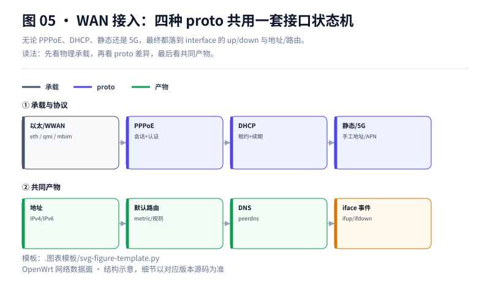

# WAN 接入与 PPPoE

一句话结论：WAN 接入的差异主要在 **proto 层**：PPPoE 做会话与认证，DHCP 做租约，静态直接配地址，5G 通过 QMI/MBIM 等通道拨号；但最终都收敛为 interface 的地址、默认路由、DNS 和 ifup/ifdown 事件。

> 本篇定位：讲四种接入方式的配置字段与状态收敛。PPPoE 协议报文见 [10-基础理论/PPP 与 PPPoE](../../../10-基础理论/11-网络科学/02-链路层/06-PPP与PPPoE.md)；接口状态机见 [02-系统框架/05-netifd 接口生命周期](../02-系统框架/05-netifd接口生命周期.md)。

## 目录

- [1 一句话模型](#s1)
- [2 速览](#s2)
- [3 四种 proto 的关键字段](#s3)
- [4 接入与收敛流程](#s4)
- [5 状态机与定时器](#s5)
- [6 设计取舍与边界](#s6)
- [7 与相邻主题的关系](#s7)
- [名词解释](#名词解释)
- [8 参考与关联](#s8)

## 1 · 一句话模型

```text
物理承载 ──► proto（pppoe/dhcp/static/qmi）──► 地址 + 默认路由 + DNS ──► ifup
```

三个关键认知：

1. **proto 决定“地址怎么来”**：不是所有 WAN 都需要拨号，静态和 DHCP 也是 proto。
2. **默认路由不是自动的**：要 `defaultroute`、metric 和对端配合；多 WAN 还要策略路由。
3. **MTU/MRU 是 PPPoE 的硬约束**：PPPoE 头占 8 字节，典型 MTU 1492，配错会出现“能 ping 不能开网页”。

## 2 · 速览

| 项 | 内容 |
| --- | --- |
| 所属层/领域 | OpenWrt 上行接入 |
| 核心对象 | interface、proto、PPPoE 会话、DHCP 租约、5G 模组 |
| 关键入口 | `/etc/config/network` |
| 典型场景 | 家庭宽带、企业专线、蜂窝备份、多 WAN |
| 主要标准 | PPP/PPPoE、DHCP、QMI/MBIM |

## 3 · 四种 proto 的关键字段

| proto | 关键字段 | 作用 | 边界与误判 |
| --- | --- | --- | --- |
| `pppoe` | `username`/`password` | 认证 | 密码含特殊字符时注意转义 |
| `pppoe` | `ac`/`service` | 指定接入集中器/服务名 | 一般不填，填错会拨不上 |
| `pppoe` | `mtu`/`mru` | 会话 MTU/MRU | 典型 1492，不能超过链路 MTU |
| `pppoe` | `keepalive` | 链路保活/重拨 | 太小会频繁重连 |
| `pppoe` | `ipv6` | 是否请求 IPv6 | 需要运营商支持 |
| `dhcp` | `hostname`/`clientid` | 租约标识 | 某些运营商绑定 MAC/Client ID |
| `dhcp` | `broadcast` | 广播标志 | 特殊网络需要 |
| `dhcp` | `peerdns` | 是否采用对端 DNS | 关闭后需自配 DNS |
| `static` | `ipaddr`/`netmask`/`gateway` | 固定地址 | 网关必须同网段可达 |
| `static` | `dns` | 静态 DNS | 可多个 |
| `qmi`/`mbim` | `device`/`apn` | 模组通道与 APN | 驱动/固件差异大 |
| `qmi`/`mbim` | `auth`/`pincode` | 认证与 SIM PIN | 错三次可能锁卡 |
| 通用 | `metric` | 路由优先级 | 多 WAN 选路关键 |
| 通用 | `defaultroute` | 是否安装默认路由 | 不是所有 proto 都支持 |

## 4 · 接入与收敛流程



**读图**：先看物理承载，再看 proto 差异，最后看共同产物（地址/路由/DNS/事件）。不同 proto 的分支只影响中间一段。

> 图源：`images/图05-WAN接入.svg`

### 4.1 PPPoE 正常路径

1. 在 WAN 设备上发现接入集中器（PADI/PADO/PADR/PADS）。
2. 建立 PPP 会话，进行 LCP 协商与 PAP/CHAP 认证。
3. IPCP/IPv6CP 协商地址与 DNS。
4. netifd 写入地址、默认路由，接口进入 UP。
5. 保活失败时按 keepalive 策略重拨。

### 4.2 DHCP/静态/5G 路径

- **DHCP**：发 Discover/Request，获得租约后在租期一半续约；地址变化会触发 ifupdate。
- **静态**：直接配置地址/网关，netifd 只负责下发与路由。
- **5G**：模组注册网络、激活 PDP、通过 QMI/MBIM 获取地址；信号/注册状态由模组管理。

### 4.3 异常分支

| 现象 | 原因 | 处理方向 |
| --- | --- | --- |
| PPPoE 认证失败 | 账号密码错、绑定 MAC、服务名错 | 查认证日志与运营商要求 |
| 能拨号不能上网 | MTU/MRU、DNS、NAT/防火墙 | 先测网关，再测 DNS |
| 频繁断线 | 链路质量、keepalive 过严 | 看 LCP 保活与线路日志 |
| DHCP 拿不到地址 | 上游无响应、Client ID 不匹配 | 查租约与广播标志 |
| 5G 不拨号 | APN/PIN/驱动/注册失败 | 查模组状态与信号 |
| 双 WAN 不切换 | metric/规则/mwan3 配置 | 查路由表与健康检查 |

## 5 · 状态机与定时器

PPPoE 有明确状态机：发现 → 会话 → 认证 → 网络层协商 → 运行 → 终止；DHCP 有租约状态（INIT/REQUESTING/BOUND/RENEWING/REBINDING）；5G 有模组注册与 PDP 激活状态。定时器包括 PPP 保活、DHCP 续约、5G 重连与健康检查。

## 6 · 设计取舍与边界

- **为什么用 proto 抽象**：不同接入方式对上层提供一致接口，netifd 只关心“地址/路由/状态”。
- **为什么 MTU 要单独配**：PPPoE 封装增加开销，统一按 1500 配会分片或丢包。
- **代价**：接入问题常跨物理层、认证、路由三层，定位需要分段。
- **不适用**：需要链路层桥接/透传的场景，不应让 OpenWrt 做三层终结。
- **常见误判**：把“拨号成功”当成“网络可用”；DNS、NAT、防火墙任一环都可能断。

## 7 · 与相邻主题的关系

| 相邻对象 | 关系 |
| --- | --- |
| [03-NAT 与 offload](./03-NAT与offload.md) | 出接口地址与 SNAT |
| [01-fw3/fw4 与 nftables](./01-fw3-fw4与nftables.md) | WAN zone 的放行策略 |
| [02-系统框架/04-netifd 设备与接口模型](../02-系统框架/04-netifd设备与接口模型.md) | proto 与 interface 的关系 |
| [10-基础理论/PPP 与 PPPoE](../../../10-基础理论/11-网络科学/02-链路层/06-PPP与PPPoE.md) | PPPoE 报文与状态机 |
| [10-基础理论/DHCPv4](../../../10-基础理论/11-网络科学/05-应用层/01-DHCPv4.md) | DHCP 租约与报文 |

一句话边界：本篇讲“OpenWrt 怎么配接入”，不讲运营商网络架构。

## 名词解释

> 缩写给出英文全称；非缩写用“—”表示。

| 术语 | 英文全称 | 解释 |
| --- | --- | --- |
| PPPoE | Point-to-Point Protocol over Ethernet | 以太网上的点对点协议。 |
| PPP | Point-to-Point Protocol | 点对点协议。 |
| LCP | Link Control Protocol | PPP 链路控制协议。 |
| PAP | Password Authentication Protocol | 明文密码认证协议。 |
| CHAP | Challenge Handshake Authentication Protocol | 挑战握手认证协议。 |
| IPCP | Internet Protocol Control Protocol | PPP 的 IPv4 协商协议。 |
| DHCP | Dynamic Host Configuration Protocol | 动态主机配置协议。 |
| APN | Access Point Name | 蜂窝网络接入点名称。 |
| QMI | Qualcomm MSM Interface | 高通模组控制接口。 |
| MBIM | Mobile Broadband Interface Model | 移动宽带接口模型。 |

## 8 · 参考与关联

**标准**

- RFC 1661（PPP）、RFC 2516（PPPoE）、RFC 2131（DHCP）。

**关联**

- [本目录索引](./.readme.md)
- [10-基础理论/PPP 与 PPPoE](../../../10-基础理论/11-网络科学/02-链路层/06-PPP与PPPoE.md)
- [02-系统框架/05-netifd 接口生命周期](../02-系统框架/05-netifd接口生命周期.md)

---

> **本篇定位**：WAN 四种接入方式的字段与状态收敛。
> **素材来源**：`studyspace-v2/7.平台与集成/1.OpenWrt/4.网络业务/1.WAN/`。
> **待验证**：5G 模组的 proto 名称、APN 字段与驱动支持随模组/分支变化。
