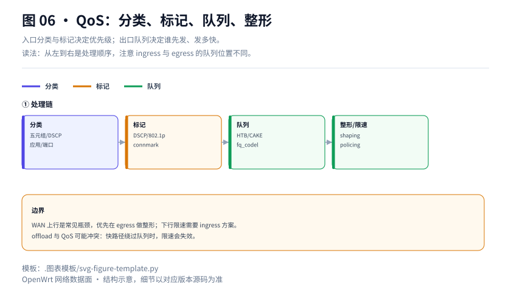

# QoS 与流量控制

一句话结论：QoS 的本质是**在瓶颈链路前做分类、标记和排队**：分类决定包属于谁，标记把优先级带到下游，队列/整形决定谁先发、发多快；WAN 上行通常是瓶颈，所以整形优先放在 egress。

> 本篇定位：讲 OpenWrt 的 QoS 组件与配置位置。NAT/offload 对 QoS 的影响见 [03-NAT 与 offload](./03-NAT与offload.md)；队列算法原理可参考 [10-基础理论/传输性能与调优](../../../10-基础理论/11-网络科学/04-传输层/03-传输性能与调优.md)。

## 目录

- [1 一句话模型](#s1)
- [2 速览](#s2)
- [3 QoS 组件与字段](#s3)
- [4 分类到队列的流程](#s4)
- [5 状态机与定时器](#s5)
- [6 设计取舍与边界](#s6)
- [7 与相邻主题的关系](#s7)
- [名词解释](#名词解释)
- [8 参考与关联](#s8)

## 1 · 一句话模型

```text
分类（五元组/应用）──► 标记（DSCP/802.1p）──► 队列（HTB/CAKE）──► 整形/限速
```

三个关键认知：

1. **没有瓶颈就没有队列**：QoS 只有在出口速率被限制时才有意义。
2. **标记是“跨设备”的约定**：DSCP/802.1p 只有下游认可才有用，否则只是本地优先级。
3. **offload 会让 QoS 失效**：快路径绕过队列，限速和优先级都不再按预期执行。

## 2 · 速览

| 项 | 内容 |
| --- | --- |
| 所属层/领域 | OpenWrt 流量管理 |
| 核心对象 | qdisc、class、filter、SQM、DSCP、802.1p |
| 关键入口 | `tc`、`/etc/config/sqm`、防火墙标记 |
| 典型场景 | 家庭限速、游戏/视频优先、多 WAN 分流 |
| 主要标准 | DiffServ/DSCP、IEEE 802.1p |

## 3 · QoS 组件与字段

| 组件/字段 | 作用 | 边界与误判 |
| --- | --- | --- |
| qdisc | 队列规则，决定出队顺序 | 默认 `fq_codel` 不等于已限速 |
| class | HTB 等分层队列中的带宽类 | 父类速率要大于子类之和 |
| filter | 把包分类到 class | 规则顺序影响命中 |
| SQM | 一套脚本/配置，封装整形与队列 | 需要填真实上下行带宽 |
| `download`/`upload` | SQM 的链路速率 | 填理论值会导致排队/浪费 |
| CAKE | 现代队列算法，集成整形 | 与 HTB 二选一，不要叠加 |
| fq_codel | 公平队列 + CoDel | 轻量，适合默认 |
| DSCP | IP 头中的优先级字段 | 跨域可能被重标记/清零 |
| 802.1p | VLAN 标签中的优先级 | 只在带标签链路有效 |
| connmark | 按连接保存标记 | 适合按连接分类，不逐包匹配 |

SQM 的最小配置（速率单位 kbit/s）：

```text
config queue 'wan'
	option enabled '1'
	option interface 'wan'
	option download '95000'
	option upload '18000'
	option qdisc 'cake'
	option script 'piece_of_cake.qos'
	option linklayer 'ethernet'
```

`download`/`upload` 填**实测带宽的 85%~95%**，不是套餐标称值；`qdisc` 选 `cake` 或 `fq_codel` 之一，不要和 HTB 叠加。

## 4 · 分类到队列的流程



**读图**：从左到右是处理顺序；队列在 egress 侧，ingress 限速需要额外方案（如 IFB）。注意 offload 命中后可能直接跳过队列。

> 图源：`images/图06-QoS.svg`

### 4.1 正常路径

1. 在防火墙/TC 中按五元组、应用或连接标记分类。
2. 写入 DSCP 或 802.1p，供下游队列/设备使用。
3. 在 WAN 出口挂 qdisc（HTB/CAKE），按类分配带宽。
4. 整形到略低于物理带宽，避免上游缓冲区排队。
5. 观察队列长度、丢包与延迟，调整参数。

速率怎么定，决定一半效果：

```text
实测下行 100 Mbps、上行 20 Mbps
  → SQM 填 90~95 Mbps / 18~19 Mbps
  → 填 100/20（标称值）会在上游缓冲区排队，延迟照样飙
```

### 4.2 异常分支

| 现象 | 原因 | 处理方向 |
| --- | --- | --- |
| 限速完全不生效 | offload 绕过队列 | 关闭 offload 或改用硬件队列 |
| 下行限速不准 | 只在 egress 做，未处理 ingress | 使用 IFB/ingress 方案 |
| 游戏仍然卡 | 分类未命中、队列算法不合适 | 查分类计数与 DSCP |
| 带宽利用率低 | 整形速率填得过低 | 按实测调整到 85%-95% |
| 多 WAN 优先级乱 | 标记未跨 WAN 保持一致 | 统一 DSCP/connmark 策略 |

**“限速/优先不生效”四步查**：

| 步骤 | 查什么 | 判据 | 答错的后果 |
| --- | --- | --- | --- |
| ① offload | 是否命中快路径 | `conntrack` 的 `[OFFLOAD]`、`tc -s` 统计偏低 | 队列被绕过，怎么调参都没用 |
| ② 方向 | 限的是 egress 还是 ingress | 在 WAN 出口看 `tc qdisc show` | 只有 ingress 方案却没建 IFB |
| ③ 分类 | 规则命中没有 | filter/class 计数 | 分类没命中，全部进默认类 |
| ④ 速率 | 填的是实测还是标称 | 与测速结果对比 | 填标称值，排队发生在运营商侧 |

## 5 · 状态机与定时器

QoS 没有连接状态机；队列有长度、阈值和老化。定时器/时间常数来自算法：CoDel 的排队时间目标、HTB 的令牌桶速率、CAKE 的调度周期。连接级标记依赖 conntrack。

## 6 · 设计取舍与边界

- **为什么在 egress 整形**：出口是自己可控的瓶颈，能把排队放在自己能调度的地方。
- **为什么用 CAKE/fq_codel**：相比纯 HTB，能同时控制缓冲膨胀与公平性，配置更简单。
- **代价**：分类与标记增加配置复杂度；offload 与 QoS 往往不可兼得。
- **不适用**：链路本身不是瓶颈（如内网万兆）时，QoS 收益有限。
- **常见误判**：把“带宽限制”当成“低延迟”；没有队列管理，限速也可能产生缓冲膨胀。

> **推论**：限速解决“公平”，队列管理解决“延迟”，两者不是一回事。只挂 HTB 限速不做 AQM，缓冲区照样堆满、延迟照样飙升；CAKE/fq_codel 的价值在“同时管住排队长度”。

> **边界**：QoS 只能在“自己可控的瓶颈”上生效。运营商侧或上游交换机的队列，你既看不到也管不了；这时唯一能做的是把整形速率压到略低于瓶颈，让排队发生在自己家里。

## 7 · 与相邻主题的关系

| 相邻对象 | 关系 |
| --- | --- |
| [00-数据面总览](./00-数据面总览.md) | QoS 在端到端路径中的位置 |
| [03-NAT 与 offload](./03-NAT与offload.md) | 快路径与队列的冲突 |
| [01-fw3/fw4 与 nftables](./01-fw3-fw4与nftables.md) | 用防火墙规则做分类/标记 |
| [10-基础理论/传输性能与调优](../../../10-基础理论/11-网络科学/04-传输层/03-传输性能与调优.md) | 缓冲膨胀、拥塞控制 |
| [30-产品与方案](../../../30-产品与方案/.readme.md) | 产品级 QoS 策略与业务分级 |

一句话边界：本篇讲“OpenWrt 怎么限速/排队”，不讲 DiffServ 全体系。

## 名词解释

> 缩写给出英文全称；非缩写用“—”表示。

| 术语 | 英文全称 | 解释 |
| --- | --- | --- |
| QoS | Quality of Service | 服务质量。 |
| tc | Traffic Control | Linux 流量控制工具。 |
| qdisc | Queueing Discipline | 队列规则。 |
| HTB | Hierarchical Token Bucket | 分层令牌桶，按类分配带宽。 |
| CAKE | Common Applications Kept Enhanced | 集成整形与队列管理的算法。 |
| fq_codel | Fair Queueing with Controlled Delay | 公平队列 + CoDel 延迟控制。 |
| DSCP | Differentiated Services Code Point | IP 头中的优先级字段。 |
| SQM | Smart Queue Management | OpenWrt 的智能队列管理配置。 |
| IFB | Intermediate Functional Block | 用于 ingress 整形的虚拟设备。 |

## 8 · 参考与关联

**标准**

- RFC 2474（DiffServ）、IEEE 802.1p；Linux tc 文档。

**关联**

- [本目录索引](./.readme.md)
- [03-NAT 与 offload](./03-NAT与offload.md)
- [10-基础理论/传输性能与调优](../../../10-基础理论/11-网络科学/04-传输层/03-传输性能与调优.md)

---

> **本篇定位**：QoS 分类、标记、队列与 offload 冲突。
> **素材来源**：`studyspace-v2/7.平台与集成/1.OpenWrt/4.网络业务/3.关键组件服务/06-QoS与限速配置.md`。
> **待验证**：SQM 默认算法与 offload 的平台支持。
