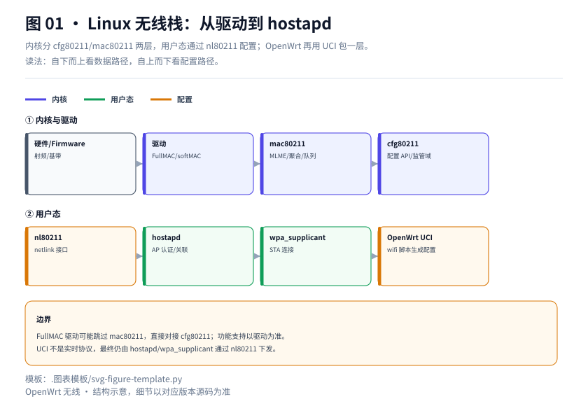

# 无线子系统总览

一句话结论：OpenWrt 的无线是**内核无线栈（驱动 + mac80211 + cfg80211）加用户态控制（hostapd/wpa_supplicant）**，再由 UCI 的 `wireless` 配置和 `wifi` 脚本包一层；排障要沿“配置 → 生成文件 → 进程 → nl80211 → 驱动”逐层确认。

> 本篇定位：给出无线栈的分层与组件职责。cfg80211/nl80211 细节见 [01-cfg80211 与 nl80211](./01-cfg80211与nl80211.md)，配置见 [02-hostapd 与 wireless 配置](./02-hostapd与wireless配置.md)。802.11 协议原理见 [10-基础理论/Wi-Fi](../../../10-基础理论/12-通信科学/04-无线通信/02-Wi-Fi/.readme.md)。

## 目录

- [1 一句话模型](#s1)
- [2 速览](#s2)
- [3 分层与关键对象](#s3)
- [4 配置与数据流程](#s4)
- [5 状态机与定时器](#s5)
- [6 设计取舍与边界](#s6)
- [7 与相邻主题的关系](#s7)
- [名词解释](#名词解释)
- [8 参考与关联](#s8)

## 1 · 一句话模型

```text
UCI wireless ──wifi 脚本──► hostapd/wpa_supplicant ──nl80211──► cfg80211 ──► 驱动
                                                              └──► mac80211（softMAC）
```

三个关键认知：

1. **UCI 不是协议**：它只是生成 hostapd 配置的中间层，最终配置通过 nl80211 下发。
2. **cfg80211 是配置面，mac80211 是数据/MLME 框架**：FullMAC 驱动可以只有 cfg80211。
3. **驱动决定能力**：信道、带宽、MU-MIMO、11r/11k/11v 是否可用，以驱动/firmware 上报为准。

## 2 · 速览

| 项 | 内容 |
| --- | --- |
| 所属层/领域 | OpenWrt 无线 |
| 核心对象 | radio、wifi-iface、hostapd、cfg80211、mac80211 |
| 关键入口 | `/etc/config/wireless`、`wifi` 命令、`iw` |
| 典型场景 | AP 配置、STA 上行、Mesh、漫游 |
| 主要标准 | IEEE 802.11a/b/g/n/ac/ax/be |

## 3 · 分层与关键对象

| 层/对象 | 作用 | 边界与误判 |
| --- | --- | --- |
| 硬件/Firmware | 射频、基带、MAC | 能力由 firmware 上报 |
| 驱动 | 寄存器/固件交互 | FullMAC 可能不含 mac80211 |
| mac80211 | 软件 MAC、聚合、队列、MLME | softMAC 驱动才使用 |
| cfg80211 | 配置 API、监管域、扫描结果 | 不负责数据转发 |
| nl80211 | 用户态配置接口 | 命令/属性随内核版本扩展 |
| hostapd | AP 认证、关联、密钥管理 | 不处理数据面转发 |
| wpa_supplicant | STA 扫描、连接、漫游 | 常与 netifd 配合 |
| `wifi` 脚本 | 读 UCI、生成配置、启停进程 | 不是常驻进程 |
| `wifi-device` | 射频参数 | 一个 radio 对应一个 phy |
| `wifi-iface` | 逻辑接口 | 多个 iface 可共享 radio |

沿这条链排障，每一层都有对应的观测点：

```text
iw phy                 # 驱动/cfg80211 上报了哪些 phy 与能力
iw dev                 # 接口是否存在、类型是什么
wifi status            # OpenWrt：按 radio/iface 汇总的状态（JSON）
ps | grep hostapd      # 进程在不在
```

## 4 · 配置与数据流程



**读图**：自下而上看数据路径（硬件→驱动→mac80211→协议栈），自上而下看配置路径（UCI→hostapd→nl80211→驱动）。两条路径在驱动处汇合。

> 图源：`images/图01-无线栈.svg`

### 4.1 正常路径（AP）

1. 驱动注册 phy，cfg80211 上报能力与监管域。
2. `wifi` 脚本读取 `wireless`，生成每个 phy 的 hostapd 配置。
3. hostapd 通过 nl80211 创建 BSS、设置信道/加密。
4. 终端扫描、认证、关联；hostapd 管理密钥与状态。
5. 数据帧经 mac80211/驱动收发，桥接到逻辑网络。

### 4.2 异常分支

| 现象 | 原因 | 处理方向 |
| --- | --- | --- |
| radio 不存在 | 驱动/firmware 未加载、DTS 错 | 查 `iw phy`、dmesg |
| SSID 不出现 | hostapd 未启动、信道不合法 | 查生成配置与 hostapd 日志 |
| 能关联不能上网 | 未绑定 network/桥、DHCP/DNS | 查 iface 的 `network` 与桥 |
| 速率低 | 带宽/干扰/功率/天线 | 查协商速率与信道占用 |
| 频繁掉线 | 驱动/firmware、电源管理、干扰 | 查内核日志与稳定性 |

**“SSID 不出现”五步查**：

| 步骤 | 查什么 | 判据 | 答错的后果 |
| --- | --- | --- | --- |
| ① phy 在不在 | 驱动/firmware 是否加载 | `iw phy` 有输出 | 没有 phy，改配置无意义 |
| ② 进程在不在 | hostapd 是否存活 | `ps`、`ubus call service list` | 进程反复退出，日志里只有一行 |
| ③ 生成配置 | UCI 是否成功展开 | `/var/run/hostapd-*.conf` 是否存在 | 文件没生成，问题在 `wifi` 脚本 |
| ④ 日志 | hostapd 报什么 | `logread -e hostapd` | 不看日志，只能猜信道/加密 |
| ⑤ 信道/监管域 | country 与 DFS | `iw reg get`、`iw list` | 信道非法，hostapd 起不来 |

## 5 · 状态机与定时器

无线侧有多层状态：接口（DOWN/UP）、BSS（启动/运行）、STA（未连接/认证/关联/四次握手/已连接）、漫游（测量/决策/切换）。定时器包括 beacon 间隔、扫描/测量、认证超时、密钥更新、DTIM 等；大部分由 hostapd/mac80211 管理。

## 6 · 设计取舍与边界

- **为什么分 cfg80211/mac80211**：把“配置 API”和“软件 MAC 实现”解耦，FullMAC 与 softMAC 都能接入。
- **为什么 OpenWrt 再加一层 UCI**：统一配置、支持多 radio/多 iface、便于 LuCI 管理。
- **代价**：配置到驱动之间层数多，日志分散；出错时很难一眼定位。
- **不适用**：需要厂商私有能力的场景，仍要专用工具/驱动接口。
- **常见误判**：把 `wifi reload` 当成“重启驱动”；它通常只重配 hostapd，驱动问题需重载模块。

> **推论**：`wifi reload` 的边界是“进程级”：它能重建 BSS、重读 UCI，但改不了驱动/firmware 的状态。驱动卡死、firmware 崩溃时，reload 只能看到“又失败一次”，要靠卸载/重载模块或重启来恢复。

> **边界**：`wifi status` 反映的是 hostapd/驱动上报的状态，不是空口实况。终端连不上但 status 显示 AP 正常，问题可能在加密协商、终端侧或干扰，不在 AP 的配置状态。

## 7 · 与相邻主题的关系

| 相邻对象 | 关系 |
| --- | --- |
| [01-cfg80211 与 nl80211](./01-cfg80211与nl80211.md) | 内核配置接口 |
| [02-hostapd 与 wireless 配置](./02-hostapd与wireless配置.md) | UCI 到 hostapd |
| [03-Wi-Fi 6/7 与射频参数](./03-WiFi6-7与射频参数.md) | 频段、带宽、功率 |
| [04-漫游与 EasyMesh](./04-漫游与EasyMesh.md) | k/v/r 与多 AP |
| [02-系统框架/04-netifd 设备与接口模型](../02-系统框架/04-netifd设备与接口模型.md) | 无线接口如何接入网络 |
| [10-基础理论/Wi-Fi](../../../10-基础理论/12-通信科学/04-无线通信/02-Wi-Fi/.readme.md) | 802.11 协议与帧 |

一句话边界：本篇讲“OpenWrt 无线由哪些层组成”，不展开 802.11 帧格式。

## 名词解释

> 缩写给出英文全称；非缩写用“—”表示。

| 术语 | 英文全称 | 解释 |
| --- | --- | --- |
| cfg80211 | Configuration 802.11 | 内核无线配置 API 层。 |
| mac80211 | — | 内核软件 MAC 框架。 |
| nl80211 | Netlink 802.11 | cfg80211 暴露的 netlink 接口。 |
| hostapd | Host Access Point Daemon | 用户态 AP 认证与关联守护进程。 |
| wpa_supplicant | Wi-Fi Protected Access Supplicant | 用户态 STA 连接客户端。 |
| FullMAC | Full MAC | 由硬件/固件实现完整 MAC 的驱动形态。 |
| softMAC | Software MAC | 由 mac80211 实现 MAC 的驱动形态。 |
| BSS | Basic Service Set | 一个 AP 的基本服务集。 |
| MLME | MAC Sublayer Management Entity | MAC 层管理实体。 |

## 8 · 参考与关联

**标准**

- IEEE 802.11；Linux cfg80211/mac80211 文档。

**关联**

- [本目录索引](./.readme.md)
- [10-基础理论/Wi-Fi](../../../10-基础理论/12-通信科学/04-无线通信/02-Wi-Fi/.readme.md)

---

> **本篇定位**：无线栈分层与 OpenWrt 组件职责。
> **素材来源**：`studyspace-v2/4.通信科学/1.无线/`、`studyspace/1.知识体系/7.openwrt/.../5.WiFi子系统/`。
> **待验证**：具体芯片的 FullMAC/softMAC 形态与 firmware 能力。
