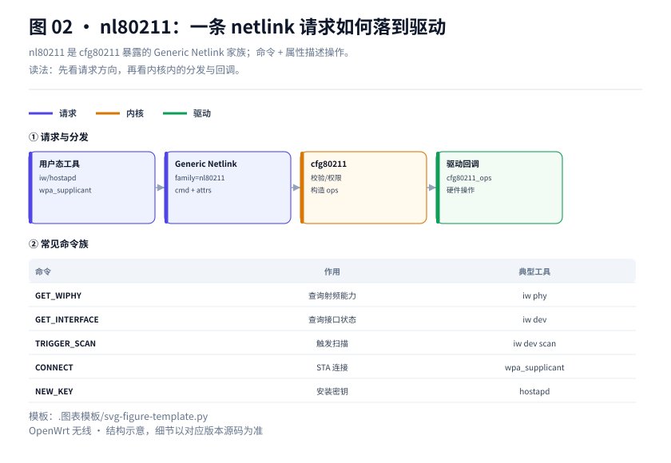

# cfg80211 与 nl80211

一句话结论：cfg80211 是内核里的**无线配置核心**，向上通过 Generic Netlink 家族 `nl80211` 暴露命令，向下调用驱动的 `cfg80211_ops`；`iw`、hostapd、wpa_supplicant 都是它的用户。

> 本篇定位：讲 nl80211 的命令/属性模型与 cfg80211 的分发路径。无线栈全貌见 [00-无线子系统总览](./00-无线子系统总览.md)；hostapd 配置见 [02-hostapd 与 wireless 配置](./02-hostapd与wireless配置.md)。

## 目录

- [1 一句话模型](#s1)
- [2 速览](#s2)
- [3 关键结构与命令](#s3)
- [4 请求分发流程](#s4)
- [5 状态机与定时器](#s5)
- [6 设计取舍与边界](#s6)
- [7 与相邻主题的关系](#s7)
- [名词解释](#名词解释)
- [8 参考与关联](#s8)

## 1 · 一句话模型

```text
iw/hostapd ──nl80211──► cfg80211 ──cfg80211_ops──► 驱动 ──► 硬件
              (cmd+attrs)   (校验/转换)
```

三个关键认知：

1. **nl80211 是“命令 + 属性”**：不是固定结构体，新增能力通过新属性扩展。
2. **cfg80211 负责策略与状态**：监管域、接口类型、扫描结果、连接状态都在这里维护。
3. **驱动只实现自己支持的回调**：不支持的命令返回 `-EOPNOTSUPP`，不是所有 phy 能力相同。

## 2 · 速览

| 项 | 内容 |
| --- | --- |
| 所属层/领域 | Linux 无线内核接口 |
| 核心对象 | wiphy、wireless_dev、cfg80211_ops、nl80211 命令 |
| 关键入口 | Generic Netlink family `nl80211`、`iw` |
| 典型场景 | 查询能力、扫描、连接、AP 启动、密钥安装 |
| 主要标准 | IEEE 802.11、Linux nl80211 规范 |

## 3 · 关键结构与命令

| 对象/命令 | 作用 | 边界与误判 |
| --- | --- | --- |
| `wiphy` | 一个射频（phy）的能力与状态 | 一个 phy 可有多个接口 |
| `wireless_dev` | 一个无线接口 | 类型决定可用操作 |
| `cfg80211_ops` | 驱动实现的回调集合 | 未实现的命令直接不支持 |
| `NL80211_CMD_GET_WIPHY` | 查询 phy 能力 | `iw phy` 的底层 |
| `NL80211_CMD_GET_INTERFACE` | 查询接口状态 | `iw dev` 的底层 |
| `NL80211_CMD_TRIGGER_SCAN` | 触发扫描 | 扫描结果异步返回 |
| `NL80211_CMD_CONNECT` | STA 连接 | 认证/关联由驱动或用户态完成 |
| `NL80211_CMD_NEW_KEY` | 安装密钥 | 加密模式不同，密钥类型不同 |
| `NL80211_CMD_SET_CHANNEL` | 设置信道 | 受监管域与 DFS 约束 |
| `NL80211_ATTR_*` | 命令属性 | 属性缺失/类型错会返回 `-EINVAL` |

### 3.1 常见异步事件

| 事件 | 含义 | 消费方 |
| --- | --- | --- |
| `NEW_WIPHY` / `DEL_WIPHY` | 射频注册/注销 | 管理工具 |
| `NEW_INTERFACE` / `DEL_INTERFACE` | 接口创建/删除 | netifd/管理工具 |
| `TRIGGER_SCAN` 完成 | 扫描结果就绪 | wpa_supplicant/iw |
| `CONNECT` / `DISCONNECT` | STA 连接状态 | supplicant/netifd |
| `NEW_STATION` / `DEL_STATION` | AP 下终端关联变化 | hostapd/统计 |
| `CH_SWITCH` / `DFS` | 信道切换/雷达事件 | hostapd/驱动 |

事件是“通知”，不是状态存储；错过事件后应重新查询接口/wiphy 状态。

错误码直接指向不同层，别混着查：

| 错误码 | 含义 | 通常原因 | 处理方向 |
| --- | --- | --- | --- |
| `-95` EOPNOTSUPP | 驱动没实现该回调 | 该 phy 不支持此特性 | 放弃该特性或换驱动 |
| `-22` EINVAL | 参数非法 | 信道/带宽/属性组合不合法 | 对照 `iw phy` 能力 |
| `-16` EBUSY | 资源忙 | 扫描中、接口已占用、已有 BSS | 停掉冲突操作再试 |
| `-13` EACCES | 权限不足 | 非 root、缺 capability | 提权或改权限 |

看事件流用 `iw event`：它把 nl80211 的异步事件逐条打印，是确认“驱动到底报了什么”的最短路径。

## 4 · 请求分发流程



**读图**：用户态工具把命令和属性打包成 Generic Netlink 消息；cfg80211 校验后调用驱动回调，驱动再操作硬件。任何一层不支持都会在返回值上体现。

> 图源：`images/图02-nl80211.svg`

### 4.1 正常路径

1. 用户态打开 `NETLINK_GENERIC`，解析 `nl80211` family id。
2. 发送命令与属性（如 `GET_WIPHY`、`TRIGGER_SCAN`）。
3. cfg80211 校验权限、接口状态与参数。
4. 调用驱动 `cfg80211_ops` 对应回调。
5. 驱动操作硬件，结果通过 netlink 返回或异步事件通知。

### 4.2 异常分支

| 现象 | 原因 | 处理方向 |
| --- | --- | --- |
| `EOPNOTSUPP` | 驱动未实现该命令 | 查驱动能力，不要强行配置 |
| `EINVAL` | 属性缺失/类型错/信道非法 | 对照 `iw phy` 能力与监管域 |
| 扫描无结果 | 接口忙、被禁用、扫描被取消 | 查接口状态与并发操作 |
| 连接失败 | 认证/关联/密钥阶段失败 | 分开看 nl80211 事件与 supplicant 日志 |
| 配置不生效 | 使用了错误的接口类型 | 确认 `iw dev` 的 type |

## 5 · 状态机与定时器

cfg80211 维护接口与连接状态，但不替代 802.11 状态机：扫描有 dwell 时间，认证/关联有超时，连接有 BSS 选择与断开事件。定时器多数在 mac80211/驱动/supplicant 中，cfg80211 负责状态与事件传递。

## 6 · 设计取舍与边界

- **为什么用 Generic Netlink**：可扩展、支持异步事件、比 ioctl 更适合复杂无线配置。
- **为什么命令与属性分离**：新增能力不必改内核 ABI，只要加属性；代价是用户态需要按能力探测。
- **代价**：直接使用 nl80211 编程复杂，通常通过 `iw`/hostapd 间接使用。
- **不适用**：厂商私有配置（校准、特殊模式）可能走 debugfs/vendor command，不在标准 nl80211 内。
- **常见误判**：把 `iw` 能看到的 phy 当成“所有功能都可用”；能力要以 `iw phy` 输出为准。

> **推论**：nl80211 的兼容性靠“能力探测”，不是靠版本号。同一个命令，A 芯片支持、B 芯片返回 `-95`；所以 hostapd/iw 在启动时都会先 `GET_WIPHY` 再决定发什么命令。看到“同样的配置换个板子就不行”，先比 `iw phy` 输出，而不是比 OpenWrt 版本。

> **边界**：厂商私有能力（校准、特殊 monitor 模式）不走标准 nl80211，`iw` 看不到也配不了；这类差异只能查厂商文档或驱动源码。

## 7 · 与相邻主题的关系

| 相邻对象 | 关系 |
| --- | --- |
| [00-无线子系统总览](./00-无线子系统总览.md) | 无线栈分层 |
| [02-hostapd 与 wireless 配置](./02-hostapd与wireless配置.md) | hostapd 如何调用 nl80211 |
| [03-Wi-Fi 6/7 与射频参数](./03-WiFi6-7与射频参数.md) | 信道/带宽能力的来源 |
| [21-Linux/06-网桥与 netlink](../../21-Linux/06-网络子系统/04-网桥与netlink.md) | netlink 通用机制 |

一句话边界：本篇讲“配置怎么下发”，不讲 802.11 管理帧格式。

## 名词解释

> 缩写给出英文全称；非缩写用“—”表示。

| 术语 | 英文全称 | 解释 |
| --- | --- | --- |
| cfg80211 | Configuration 802.11 | 内核无线配置核心。 |
| nl80211 | Netlink 802.11 | cfg80211 的 Generic Netlink 接口。 |
| wiphy | Wireless Physical Device | 一个射频设备的能力与状态。 |
| Generic Netlink | — | 可扩展的 netlink 家族机制。 |
| EOPNOTSUPP | Operation Not Supported | 操作不支持的错误码。 |
| DFS | Dynamic Frequency Selection | 动态频率选择，雷达信道避让。 |
| BSS | Basic Service Set | 基本服务集。 |

## 8 · 参考与关联

**标准**

- Linux nl80211 规范、IEEE 802.11；`iw` 文档。

**关联**

- [本目录索引](./.readme.md)
- [00-无线子系统总览](./00-无线子系统总览.md)
- [21-Linux/06-网桥与 netlink](../../21-Linux/06-网络子系统/04-网桥与netlink.md)

---

> **本篇定位**：cfg80211/nl80211 的结构、命令与分发。
> **素材来源**：`studyspace-v2/4.通信科学/1.无线/02-cfg80211.md`、`03-nl80211.md`。
> **待验证**：具体命令/属性随内核版本增加，需对照目标内核头文件。
