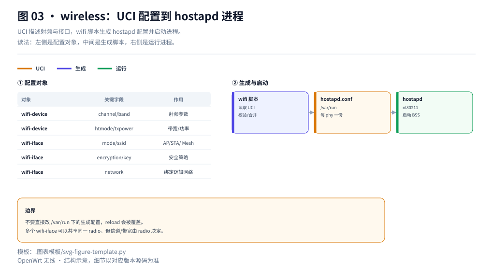

# hostapd 与 wireless 配置

一句话结论：OpenWrt 的 `/etc/config/wireless` 只是**声明**，`wifi` 脚本把它翻译成 hostapd 配置并启动进程；排查无线问题要同时看 UCI、生成的 `/var/run/hostapd-*.conf` 和 hostapd 日志。

> 本篇定位：讲 wireless 配置对象、hostapd 生成链路与安全模式。内核接口见 [01-cfg80211 与 nl80211](./01-cfg80211与nl80211.md)；漫游参数见 [04-漫游与 EasyMesh](./04-漫游与EasyMesh.md)。

## 目录

- [1 一句话模型](#s1)
- [2 速览](#s2)
- [3 配置对象与字段](#s3)
- [4 生成与启动流程](#s4)
- [5 状态机与定时器](#s5)
- [6 设计取舍与边界](#s6)
- [7 与相邻主题的关系](#s7)
- [名词解释](#名词解释)
- [8 参考与关联](#s8)

## 1 · 一句话模型

```text
/etc/config/wireless ──wifi 脚本──► /var/run/hostapd-<phy>.conf ──► hostapd
      (UCI)              (校验/展开)         (生成文件)          (nl80211)
```

三个关键认知：

1. **radio 与 iface 分离**：`wifi-device` 管射频，`wifi-iface` 管 SSID/加密/网络绑定。
2. **生成文件是只读产物**：直接改会被下一次 reload 覆盖。
3. **加密模式决定兼容性**：WPA2/WPA3 混合能兼容老终端，但会牺牲部分 WPA3 特性。

## 2 · 速览

| 项 | 内容 |
| --- | --- |
| 所属层/领域 | OpenWrt 无线配置 |
| 核心对象 | `wifi-device`、`wifi-iface`、hostapd |
| 关键入口 | `/etc/config/wireless`、`wifi` 命令 |
| 典型场景 | AP、STA 上行、多 SSID、WPA3、访客网络 |
| 主要标准 | IEEE 802.11、WPA2/WPA3（802.11i） |

## 3 · 配置对象与字段

### 3.1 `wifi-device`（radio）

| 字段 | 作用 | 边界与误判 |
| --- | --- | --- |
| `type` | 驱动类型，常见 `mac80211` | 不是芯片型号 |
| `path` | 绑定具体 phy | 多射频时写错会互换 |
| `channel` | 信道 | 受监管域/DFS 约束 |
| `band` | `2g`/`5g`/`6g` | 新旧版本字段名可能不同 |
| `htmode` | 带宽模式 | 与信道可用性相关 |
| `txpower` | 发射功率 | 受 country/EIRP 限制 |
| `country` | 监管域 | 影响可用信道与功率 |
| `disabled` | 是否禁用 radio | 禁用后 iface 不会启动 |

### 3.2 `wifi-iface`

| 字段 | 作用 | 边界与误判 |
| --- | --- | --- |
| `device` | 绑定 radio | 必须与 radio 名一致 |
| `mode` | `ap`/`sta`/`mesh`/`adhoc`/`monitor` | 模式决定可用参数 |
| `network` | 绑定逻辑网络 | 决定桥接/DHCP 行为 |
| `ssid` | 网络名 | 隐藏网络仍需正确配置 |
| `encryption` | 安全模式 | `psk2`/`sae`/`sae-mixed`/`owe` 等 |
| `key` | 预共享密钥 | WPA3 使用 SAE，不是直接 PSK 握手 |
| `hidden` | 隐藏 SSID | 不是安全措施 |
| `isolate` | 客户端隔离 | 影响访客网络 |
| `ieee80211r` | 快速漫游 | 需要 mobility domain |
| `ieee80211k` / `ieee80211v` | 邻居报告/过渡管理 | 终端不一定支持 |
| `macfilter` | MAC 过滤 | 可被伪造，不是强安全 |

UCI 与生成文件是“一份配置、两种形态”：

```text
config wifi-device 'radio0'
	option type 'mac80211'
	option path 'pci0000:00/0000:00:00.0'
	option band '5g'
	option channel '36'
	option htmode 'HE80'
	option country 'CN'

config wifi-iface 'default_radio0'
	option device 'radio0'
	option mode 'ap'
	option network 'lan'
	option ssid 'OpenWrt'
	option encryption 'sae-mixed'
	option key 'password'
```

展开后的 `/var/run/hostapd-phy0.conf` 大致是：

```text
interface=wlan0
ssid=OpenWrt
hw_mode=a
channel=36
ieee80211ax=1
wpa=2
wpa_key_mgmt=SAE WPA-PSK
ieee80211w=1
```

一个 UCI 字段可能展开成多行 hostapd 参数（`encryption 'sae-mixed'` → `wpa_key_mgmt` + `ieee80211w`），所以“UCI 看着对、hostapd 起不来”要看生成文件。

## 4 · 生成与启动流程



**读图**：左侧是 UCI 对象，中间是 `wifi` 脚本的展开与校验，右侧是 hostapd 进程。生成文件是排障的关键中间产物。

> 图源：`images/图03-wireless配置.svg`

### 4.1 正常路径

1. `wifi` 脚本读取 `wireless`，按 phy 分组。
2. 校验信道、加密、接口模式，展开默认值。
3. 生成 `/var/run/hostapd-<phy>.conf`（STA 模式生成 supplicant 配置）。
4. 启动/重载 hostapd，通过 nl80211 创建 BSS。
5. iface 绑定 `network`，由 netifd 接入桥/路由。

常用动作与观测点：

```text
wifi reload              # 重新生成配置并重载 hostapd（不动驱动）
wifi up radio0           # 只启某个 radio
logread -e hostapd       # hostapd 的报错集中在这里
cat /var/run/hostapd-phy0.conf   # 实际下发的配置
```

### 4.2 异常分支

| 现象 | 原因 | 处理方向 |
| --- | --- | --- |
| SSID 不广播 | hostapd 启动失败、信道非法 | 查生成配置与 hostapd 日志 |
| 终端连不上 | 加密模式不兼容、密钥错 | 先用 WPA2 验证，再切 WPA3 |
| 能连不能上网 | `network` 未绑定、桥/DHCP 错 | 查 iface 与桥成员 |
| 多 SSID 冲突 | 同 radio 信道/带宽冲突 | 同 radio 共享射频参数 |
| reload 后配置回退 | 改了生成文件 | 改 UCI，不要改 `/var/run` |

**“终端连不上”按三段查**：

| 段 | 查什么 | 判据 | 答错的后果 |
| --- | --- | --- | --- |
| ① AP 侧起没起 | BSS 是否建立 | 生成文件存在、hostapd 无报错 | AP 没起，改终端设置无用 |
| ② 认证阶段 | 关联/认证/四次握手在哪步断 | hostapd 日志的 `AP-STA-*` 事件 | 把密钥错当成信号差 |
| ③ 加密兼容 | 终端是否支持 SAE/PMF | 临时切 `psk2` 验证 | 混用 WPA3 模式，老终端直接失败 |

## 5 · 状态机与定时器

hostapd 管理 BSS 与 STA 状态：未关联 → 认证 → 关联 → 四次握手 → 已授权；还有密钥更新、beacon、DTIM、去认证超时。`wifi reload` 通常重配 hostapd，不重载驱动。

## 6 · 设计取舍与边界

- **为什么用 hostapd 而不是自己实现**：认证、关联、密钥管理复杂，hostapd 是成熟实现。
- **为什么 UCI 与 hostapd 配置分离**：UCI 面向产品和 LuCI，hostapd 配置面向进程；分层后可以支持多 radio/多 iface。
- **代价**：配置项映射不总是一对一，排障需要看生成文件。
- **不适用**：需要厂商私有特性的场景，可能要直接写 hostapd 配置或驱动命令。
- **常见误判**：把 `hidden` 当安全；把 `macfilter` 当访问控制的核心手段。

> **推论**：`sae-mixed` 是兼容性折中，不是“更安全的 WPA2”。它同时开 SAE 与 PSK，并启用管理帧保护（PMF）；老终端可能因此连不上。先用 `psk2` 验证链路，再切混合模式，是最省事的排查顺序。

> **边界**：生成文件 `/var/run/hostapd-*.conf` 是运行时产物，`wifi reload` 会重写。任何“手工改生成文件生效了”的做法都不可持续，重启或 reload 后一定回退。

## 7 · 与相邻主题的关系

| 相邻对象 | 关系 |
| --- | --- |
| [00-无线子系统总览](./00-无线子系统总览.md) | 无线栈分层 |
| [01-cfg80211 与 nl80211](./01-cfg80211与nl80211.md) | hostapd 的底层接口 |
| [03-Wi-Fi 6/7 与射频参数](./03-WiFi6-7与射频参数.md) | 信道/带宽/功率 |
| [04-漫游与 EasyMesh](./04-漫游与EasyMesh.md) | 11r/k/v 参数 |
| [02-系统框架/03-UCI](../02-系统框架/03-UCI.md) | UCI 配置模型 |

一句话边界：本篇讲“wireless 怎么变成 hostapd”，不讲 802.11i 握手细节。

## 名词解释

> 缩写给出英文全称；非缩写用“—”表示。

| 术语 | 英文全称 | 解释 |
| --- | --- | --- |
| hostapd | Host Access Point Daemon | 用户态 AP 守护进程。 |
| SSID | Service Set Identifier | 无线网络名称。 |
| PSK | Pre-Shared Key | 预共享密钥。 |
| SAE | Simultaneous Authentication of Equals | WPA3 的认证与密钥交换。 |
| OWE | Opportunistic Wireless Encryption | 无密码但加密的开放网络。 |
| BSS | Basic Service Set | 一个 AP 的基本服务集。 |
| DTIM | Delivery Traffic Indication Message |  Beacon 中的待决流量指示。 |
| EIRP | Equivalent Isotropically Radiated Power | 等效全向辐射功率。 |

## 8 · 参考与关联

**标准**

- IEEE 802.11、WPA2/WPA3 规范；hostapd 文档。

**关联**

- [本目录索引](./.readme.md)
- [01-cfg80211 与 nl80211](./01-cfg80211与nl80211.md)
- [04-漫游与 EasyMesh](./04-漫游与EasyMesh.md)

---

> **本篇定位**：wireless UCI 对象与 hostapd 生成链路。
> **素材来源**：`studyspace-v2/4.通信科学/1.无线/05-hostapd与安全.md`、`04-WiFi核心概念.md`。
> **待验证**：`band`/`htmode` 字段名与加密模式支持随版本变化。
