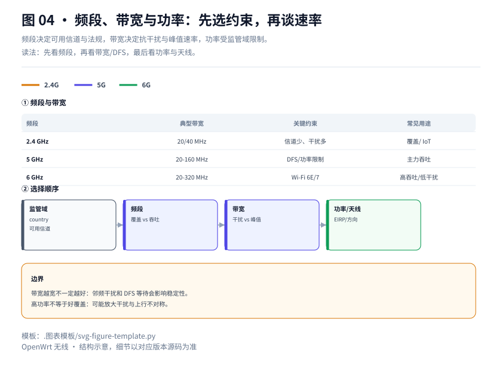

# Wi-Fi 6/7 与射频参数

一句话结论：Wi-Fi 6/7 的收益来自**更宽的频谱、更高效的 OFDMA/MU-MIMO 和更灵活的链路**，但这些能力都要以“监管域允许、驱动支持、终端配合”为前提；配置顺序永远是先定频段/信道/带宽，再谈速率特性。

> 本篇定位：讲频段、带宽、功率与 802.11ax/be 的关键特性。配置入口见 [02-hostapd 与 wireless 配置](./02-hostapd与wireless配置.md)；协议原理见 [10-基础理论/Wi-Fi](../../../10-基础理论/12-通信科学/04-无线通信/02-Wi-Fi/.readme.md)。

## 目录

- [1 一句话模型](#s1)
- [2 速览](#s2)
- [3 频段、带宽与功率字段](#s3)
- [4 选型与验证流程](#s4)
- [5 状态机与定时器](#s5)
- [6 设计取舍与边界](#s6)
- [7 与相邻主题的关系](#s7)
- [名词解释](#名词解释)
- [8 参考与关联](#s8)

## 1 · 一句话模型

```text
监管域 ──► 可用信道 ──► 频段/带宽 ──► 功率/天线 ──► 速率特性（OFDMA/MU-MIMO/MLO）
```

三个关键认知：

1. **频谱是硬约束**：country 决定可用信道、带宽和功率，配错可能违规或无法启动。
2. **带宽不是越大越好**：宽信道提高峰值，但更容易受干扰，DFS 还会带来等待。
3. **特性需要两端支持**：AP 支持 Wi-Fi 7，不代表老终端能享受 MLO/320 MHz。

## 2 · 速览

| 项 | 内容 |
| --- | --- |
| 所属层/领域 | OpenWrt 无线射频配置 |
| 核心对象 | radio、channel、htmode、txpower、country |
| 关键入口 | `/etc/config/wireless` 的 `wifi-device` |
| 典型场景 | 高吞吐、覆盖、干扰规避、6 GHz 部署 |
| 主要标准 | IEEE 802.11n/ac/ax/be |

## 3 · 频段、带宽与功率字段

| 字段/概念 | 作用 | 边界与误判 |
| --- | --- | --- |
| `band` | 选择 2.4/5/6 GHz | 6 GHz 需要 Wi-Fi 6E/7 硬件 |
| `channel` | 具体信道 | 受 country/DFS 约束 |
| `htmode` | 20/40/80/160/320 MHz | 实际带宽受信道连续性与驱动限制 |
| `txpower` | 发射功率 | 不能超过监管域 EIRP |
| `country` | 监管域 | 影响可用信道、功率、DFS |
| `cell_density` | 小区密度/覆盖策略 | 过高可能增加同频干扰 |
| `noscan` | 不主动扫描 | 可能影响 ACS/邻居发现 |
| OFDMA | 子载波资源单元 | 需要 AP/终端/驱动共同支持 |
| MU-MIMO | 多用户空间流 | 终端天线数与信道条件决定收益 |
| BSS coloring | 同频空间复用 | 需要驱动支持 |
| TWT | 目标唤醒时间 | 主要收益在终端功耗 |
| MLO | 多链路聚合 | Wi-Fi 7 特性，依赖驱动/固件 |

### 3.1 频段对比

| 频段 | 覆盖 | 干扰 | 峰值带宽 | 适用 |
| --- | --- | --- | --- | --- |
| 2.4 GHz | 强 | 高 | 较窄 | 远距离、IoT |
| 5 GHz | 中 | 中 | 宽 | 主力吞吐 |
| 6 GHz | 弱 | 低 | 很宽 | 近距高吞吐、6E/7 |

带宽不是“填个数就行”，它要求连续信道：

| htmode | 带宽 | 需要的连续 20 MHz 信道 | 备注 |
| --- | --- | --- | --- |
| HT20 | 20 MHz | 1 | 最稳，抗干扰 |
| HT40 | 40 MHz | 2 | 2.4 GHz 通常只能到 40 |
| VHT80 | 80 MHz | 4 | 5 GHz 主力 |
| VHT160 / HE160 | 160 MHz | 8 | 连续信道难找，DFS 概率高 |
| EHT320 | 320 MHz | 16 | 仅 6 GHz，Wi-Fi 7 |

> **推论**：带宽是被“频谱连续性”卡住的，不是被配置卡住的。同一段频谱里既有雷达信道又有别的 AP 时，160 MHz 往往凑不齐，驱动会自动降级到 80——看到“配了 160 实际 80”，先看信道占用，不要先怀疑配置。

## 4 · 选型与验证流程



**读图**：先看监管域与频段，再看带宽/DFS，最后看功率与天线。顺序反了会在“为什么信道起不来/速率上不去”之间反复。

> 图源：`images/图04-信道与频段.svg`

### 4.1 正常路径

1. 设置正确的 `country`，确认可用信道与功率上限。
2. 选择频段与信道：优先 non-DFS，必要时再选 DFS。
3. 设置 `htmode`，确认信道连续性满足带宽。
4. 调整 `txpower` 与天线，平衡覆盖与干扰。
5. 用终端实测协商速率、重传、RSSI/SNR 与吞吐。

验证要“配置值、协商值、实测值”三对照：

```text
iw reg get                 # 监管域与可用信道
iw dev wlan0 info          # 当前信道、带宽、类型
iw dev wlan0 link          # 终端的协商速率、信号、重传
iwinfo wlan0 info          # OpenWrt 汇总视图（若装了 iwinfo）
```

### 4.2 异常分支

| 现象 | 原因 | 处理方向 |
| --- | --- | --- |
| 信道无法启动 | country 不允许、DFS 未就绪 | 换 non-DFS 或等待 CAC |
| 带宽被降级 | 信道不连续、驱动限制 | 降带宽或换信道 |
| 速率远低于协商 | 干扰/重传/回程瓶颈 | 查 SNR、重传率与有线侧 |
| 6 GHz 不可见 | 硬件/驱动不支持、终端不支持 | 查 `iw phy` 与终端能力 |
| 覆盖差 | 功率/天线/位置 | 调整功率与天线，避免只看 dBm |

**“信道/带宽起不来”先看 DFS 状态**：

| 状态 | 含义 | 现象 | 处理 |
| --- | --- | --- | --- |
| 可用（non-DFS） | 无需检测 | 立即启动 | — |
| CAC 检测中 | 雷达信道需静默检测 | 等待 1~10 分钟（随监管域） | 等，或换 non-DFS |
| 雷达避让 | 检测到雷达，必须退出 | 信道突然切换/断开 | 让 ACS 换信道 |
| 不可用 | country 不允许 | 配置直接报错 | 改 country 或换信道 |

## 5 · 状态机与定时器

射频侧有 DFS 状态（可用/检测/避让）、ACS 扫描、CAC 等待；BSS 有启动/运行；终端有协商速率与省电状态。定时器包括 beacon、CAC、DFS 检测、TWT 周期，由驱动/hostapd 管理。

## 6 · 设计取舍与边界

- **为什么优先 5 GHz**：频谱宽、干扰相对少，覆盖与吞吐平衡较好；6 GHz 覆盖更短但干扰更低。
- **为什么宽信道有代价**：占用更多频谱、更容易受干扰、DFS 等待更长。
- **代价**：Wi-Fi 6/7 特性需要驱动、固件、终端三方支持，实际收益常低于理论值。
- **不适用**：高密度部署不应盲目追最大带宽，频率复用和功率控制更重要。
- **常见误判**：把天线增益/功率当成覆盖唯一因素；把协商速率当成实际吞吐。

> **推论**：协商速率是 PHY 速率，实测吞吐通常是它的 50%~70%——要扣 MAC 开销、ACK/BA、重传、信道共享与回程瓶颈。所以“2×2 HE80 协商 1201 Mbps、实测 700 Mbps”是正常结果，不是故障。

> **边界**：6 GHz 的干净频谱不代表覆盖好。它的穿透与绕射更差，隔一堵墙就可能掉到 2.4 GHz 的水平；6E/7 部署要按“同房间覆盖”规划，而不是按 5 GHz 的覆盖半径外推。

## 7 · 与相邻主题的关系

| 相邻对象 | 关系 |
| --- | --- |
| [00-无线子系统总览](./00-无线子系统总览.md) | 射频在无线栈中的位置 |
| [02-hostapd 与 wireless 配置](./02-hostapd与wireless配置.md) | 字段的配置入口 |
| [04-漫游与 EasyMesh](./04-漫游与EasyMesh.md) | 信道规划与漫游 |
| [10-基础理论/Wi-Fi](../../../10-基础理论/12-通信科学/04-无线通信/02-Wi-Fi/.readme.md) | 802.11 物理层与 MAC |
| [10-基础理论/射频与天线](../../../10-基础理论/12-通信科学/04-无线通信/01-射频与天线/.readme.md) | 功率、增益、EIRP |

一句话边界：本篇讲“怎么选频段/带宽/功率”，不讲射频电路设计。

## 名词解释

> 缩写给出英文全称；非缩写用“—”表示。

| 术语 | 英文全称 | 解释 |
| --- | --- | --- |
| OFDMA | Orthogonal Frequency Division Multiple Access | 正交频分多址，按资源单元调度。 |
| MU-MIMO | Multi-User Multiple-Input Multiple-Output | 多用户多输入多输出。 |
| BSS | Basic Service Set | 基本服务集。 |
| TWT | Target Wake Time | 目标唤醒时间，省电机制。 |
| MLO | Multi-Link Operation | 多链路操作，Wi-Fi 7 特性。 |
| DFS | Dynamic Frequency Selection | 动态频率选择，避让雷达。 |
| CAC | Channel Availability Check | 信道可用性检查。 |
| EIRP | Equivalent Isotropically Radiated Power | 等效全向辐射功率。 |
| ACS | Automatic Channel Selection | 自动信道选择。 |
| SNR | Signal-to-Noise Ratio | 信噪比。 |

## 8 · 参考与关联

**标准**

- IEEE 802.11ax/be；各国监管域规则。

**关联**

- [本目录索引](./.readme.md)
- [02-hostapd 与 wireless 配置](./02-hostapd与wireless配置.md)
- [10-基础理论/射频与天线](../../../10-基础理论/12-通信科学/04-无线通信/01-射频与天线/.readme.md)

---

> **本篇定位**：频段/带宽/功率与 Wi-Fi 6/7 特性边界。
> **素材来源**：`studyspace-v2/4.通信科学/1.无线/04-WiFi核心概念.md`、`07-WiFi排障与性能.md`。
> **待验证**：Wi-Fi 7/MLO 在目标 OpenWrt 分支与芯片上的支持程度。
