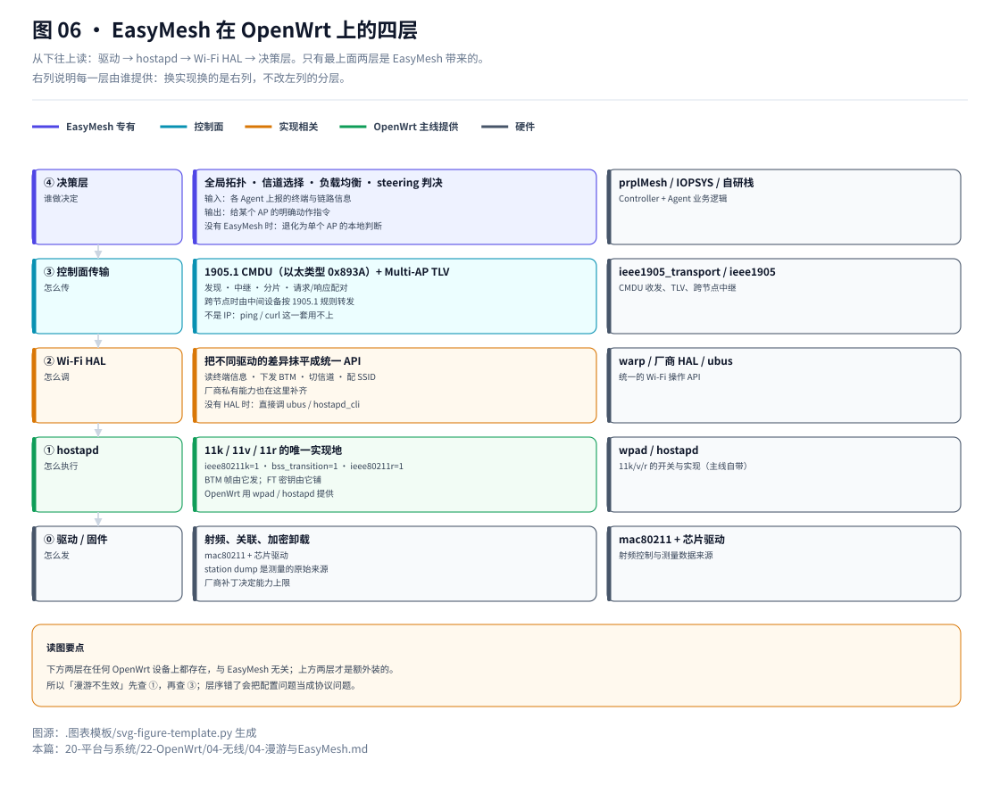
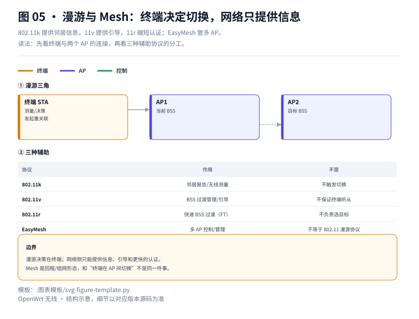
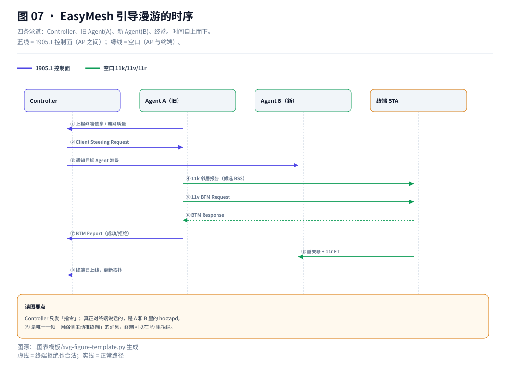
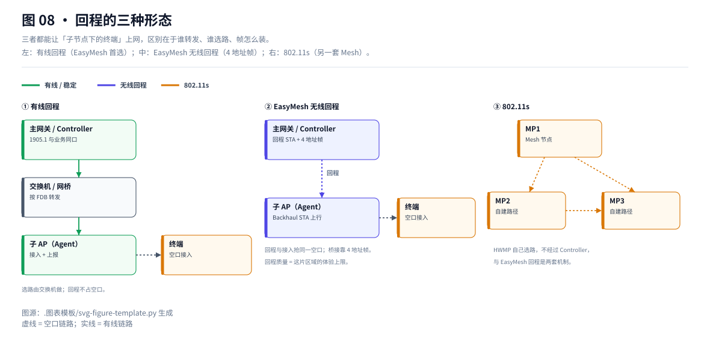

# 漫游与 EasyMesh（OpenWrt 视角）

一句话结论：**802.11k/v/r 是“终端 ↔ AP”这一层的原子能力，EasyMesh 是“AP ↔ AP”这一层的多 AP 管理框架**；两者不是版本关系，也不是父子关系——EasyMesh 通过 IEEE 1905.1 报文做全局决策，再命令某个 AP 用 hostapd 的 11k/v/r 能力去执行。OpenWrt 主线的 hostapd 只提供下半身（11k/v/r），EasyMesh 的上半身要另外装（prplMesh）或由芯片厂 SDK 提供。

> 本篇定位：讲清两层的主从关系、EasyMesh 在 OpenWrt 上的分层与进程、一次漫游的完整链路、回程的边界。配置项落在 [02-hostapd 与 wireless 配置](./02-hostapd与wireless配置.md)；射频规划见 [03-Wi-Fi 6/7 与射频参数](./03-WiFi6-7与射频参数.md)；802.11 帧与关联流程见 [10-基础理论/Wi-Fi](../../../10-基础理论/12-通信科学/04-无线通信/02-Wi-Fi/.readme.md)。其他 EasyMesh 实现（prplMesh / IOPSYS / 芯片厂自研 / FTTR 定制）只做差异对照，不展开源码。

## 目录

- [1 一句话模型](#s1)
- [2 速览](#s2)
- [3 先把四个东西分开](#s3)
- [4 OpenWrt 上的 EasyMesh 分层与进程](#s4)
- [5 控制面：1905.1 与 Multi-AP 报文](#s5)
- [6 一次漫游的完整链路](#s6)
- [7 回程：有线优先，无线兜底](#s7)
- [8 状态机与定时器](#s8)
- [9 设计取舍与边界](#s9)
- [10 与相邻主题的关系](#s10)
- [名词解释](#名词解释)
- [11 参考与关联](#s11)

## 1 · 一句话模型

先记住两个平面，其它都是细节：

```text
终端侧（STA ↔ AP）                 AP 侧（AP ↔ AP）
─────────────────                 ─────────────────
11k  邻居报告   ─┐                 1905.1 CMDU（0x893A）
11v  BTM 引导   ─┼── 被调用 ◄────  Controller：全局决策
11r  FT 快速切换 ─┘                 Agent：本地执行 + 上报
```

三个关键认知：

1. **两层不是包含关系。** 11k/v/r 不是 EasyMesh 的子集，EasyMesh 也不“实现”11k/v/r。单 AP 就能开 11k/v；反过来，一套合法的 EasyMesh 可以完全不开 11k/v/r（只做统一 SSID、信道协同、回程管理），漫游全靠终端自己盲扫。
2. **决策权在终端，框架只提供“更好的建议”。** 没有 EasyMesh 时，建议来自“当前这个 AP 的本地判断”；有 EasyMesh 时，建议来自“知道全局拓扑的 Controller”。终端仍然可以拒绝——这是标准给的权力，也是“踢线”体验差的根因。
3. **1905.1 只是承载。** 它本身不带任何 Wi-Fi 漫游语义，只提供“设备互相发现 + 二层传 TLV”的能力。谁在这个管道里放什么，是 EasyMesh 规范决定的。

> **一个够用的类比**：11k/v/r 是人的走、跑、跳——自身具备的基础动作，一个人也能做；EasyMesh 是编舞 + 指挥——它不创造动作，只决定“谁、什么时候、往哪跑”。类比失效的地方要记住：**舞者不会拒绝指挥，终端会**（BTM 有拒绝码，也有终端干脆不回）。

## 2 · 速览

| 项 | 内容 |
| --- | --- |
| 所属层/领域 | OpenWrt 无线漫游与多 AP 组网 |
| 核心对象 | BSS / ESS、mobility domain、FT 密钥层次、EasyMesh Controller/Agent、1905.1 CMDU |
| 关键入口 | `wireless` 的 `ieee80211k` / `bss_transition` / `ieee80211r`；EasyMesh 侧为 prplMesh 或厂商栈 |
| 典型场景 | 家庭多 AP、CPE + 扩展器、FTTR 主从光猫、企业 AC+AP |
| 主要标准 | IEEE 802.11k/v/r、IEEE 1905.1、Wi-Fi Alliance Multi-AP（EasyMesh）、IEEE 802.11s（另一种 Mesh） |
| 一句话边界 | 本篇讲机制与链路，不讲终端厂商的私有漫游算法 |

## 3 · 先把四个东西分开

### 3.1 802.11F：那个“听起来最像”的答案

经常有人问“EasyMesh 是不是 802.11F”。答案是**不是，而且 802.11F 已经死了**。

- **IAPP（Inter-Access Point Protocol）**：IEEE 802.11F-2003 推荐实践，解决“终端换 AP 后，旧 AP 怎么把客户端上下文（密钥、QoS 状态）交给新 AP”。
- **它跑在有线 DS 上**，是 AP 与 AP 之间的协议，用来配合企业瘦 AP 架构。
- **2006 年 IEEE 正式撤销该标准**。原因是它和 802.11r（FT）职责重叠，而 FT 把密钥预分发做进了 802.11 帧本身，更彻底。
- 今天的等价能力：**11r 的密钥层次（PMK-R0/R1）+ 控制器统一决策**，不需要单独的 AP 间上下文协议。

> 所以“11F 是 AP 间的漫游协议”这句话在 2006 年前是对的，现在只剩历史意义。看到它出现在资料里，基本可以判断那份资料有年头了。

### 3.2 11k/v/r：三个“原子能力”，各管一段

它们都是 IEEE 802.11 的修正案，跑在**空口的管理帧**里，通信双方永远是 **STA ↔ AP**——和“多 AP 怎么组网”没有关系。

| 能力 | AP 对终端说什么 | 它不管什么 | 不开会怎样 |
| --- | --- | --- | --- |
| **802.11k** | 邻居报告：附近还有哪些同 ESS 的 BSS、信道、BSSID、信号 | 不管“该不该切” | 终端只能全信道盲扫，扫描期断流更久 |
| **802.11v** | BTM：建议（或强推）你迁到某个候选 BSS，可带“即将强制断开”标志 | 不管“新 AP 认不认你” | 只能等终端自己觉得该走，容易“粘”在旧 AP |
| **802.11r** | FT：提前把密钥层次铺好，重关联时不用重跑完整认证 | 不管“选哪个目标”，也不保证不丢包 | PSK 下重连约 150 ms，EAP 下 500 ms 以上 |

三个能力可以独立开关，也可以任意组合。工程上常见组合是 **k + v**（引导够用）和 **k + v + r**（要低延迟语音/游戏）。

### 3.3 EasyMesh：一个“框架”，站在 AP 这一侧

EasyMesh 是 **Wi-Fi Alliance 的 Multi-AP 认证规范**（2018 年 R1 起），不是 IEEE 标准。它的通信双方是 **Controller ↔ Agent**，跑在二层，报文用 IEEE 1905.1 的 CMDU 封装。

它管的事：

- AP 之间自发现、入职（onboarding）、凭据分发
- 拓扑维护：谁是谁的上游、走有线还是无线回程、链路质量
- 能力与测量汇总：每个 Agent 的射频能力、每个终端的信号/速率/空口占用
- 全局决策：信道选择、负载均衡、客户端引导（steering）
- 回程管理：回程选路、回程 steering、业务隔离（VLAN）

它**不管**的事：AP 怎么发 beacon、终端怎么加密关联、密钥怎么派生——这些仍然是 hostapd + 驱动的事。

### 3.4 一张对照表，把四个概念钉死

| 名字 | 归属 | 通信双方 | 承载 | 现状 |
| --- | --- | --- | --- | --- |
| **802.11k/v/r** | IEEE 802.11 修正案 | STA ↔ AP | 空口管理帧 | 在用在演进（11be 仍在用） |
| **EasyMesh** | Wi-Fi Alliance Multi-AP | Controller ↔ Agent | 1905.1 CMDU（以太类型 `0x893A`） | R1→R5 持续迭代 |
| **802.11s** | IEEE 802.11 修正案 | MP ↔ MP（Mesh 节点） | 空口 Mesh 数据/路径帧 | 在用，但定位是“无线路由” |
| **802.11F / IAPP** | IEEE 推荐实践 | AP ↔ AP | 有线 DS | 2006 年撤销 |

还有第五个容易混进来的：**厂商私有的 AC+AP 方案**（华为、H3C、以及各种家用“Mesh 套装”）。它们同样会调 11k/v/r 做漫游，但控制器协议是私有的，不走 1905.1——**有漫游、没 EasyMesh**，完全正常。

### 3.5 两个反例，用来验证你真的分清了

- **有 11k/v/r，没有 EasyMesh**：传统企业 AC+AP。AC 做全局判决，下发指令让 AP 跑 11k/v/r。漫游体验可以很好。
- **有 EasyMesh，没开 11k/v/r**：一套只做统一 SSID + 信道协同 + 回程管理的组网。拓扑合法、能互通，但漫游退化成终端被动扫描。

> **推论**：看到“支持 EasyMesh”的宣传语，不能推出“漫游一定好”；看到“支持 11k/v/r”，也不能推出“能组网”。两句话问的是不同的事。

## 4 · OpenWrt 上的 EasyMesh 分层与进程

### 4.1 四层模型：谁在哪一层

理解 OpenWrt 的 EasyMesh，关键是接受“它是叠上去的，不是长在里面的”。



**读图**：从下往上看。最底下是驱动与固件，往上是 hostapd（**统一的下半身**），再往上是 Wi-Fi HAL（把不同驱动的差异抹平），最上面才是 Controller/Agent 的决策逻辑。右侧一列说明每一层由谁提供——**只有最上面一层是“EasyMesh 专有”的**，下面三层在没有 EasyMesh 的设备上照样存在。

> 图源：`images/图06-EasyMesh分层.svg`

| 层 | 职责 | 没有 EasyMesh 时存在吗 | 由谁提供 |
| --- | --- | --- | --- |
| 决策层 | 拓扑维护、信道选择、steering 判决 | 不存在（或退化为单 AP 本地判断） | prplMesh / IOPSYS `map` / 芯片厂自研 |
| 控制面传输 | 1905.1 CMDU 收发、TLV 编解码、跨节点中继 | 不存在 | prplMesh `ieee1905_transport` / IOPSYS `ieee1905` |
| Wi-Fi HAL | 把“读终端信息”“发 BTM”“切信道”抽象成统一 API | 部分存在（`ubus` + `hostapd_cli`） | `warp` / 厂商 HAL / 直接 ubus |
| hostapd | 11k 邻居报告、11v BTM、11r FT、关联与密钥 | **存在** | OpenWrt 的 `wpad`/`hostapd` |
| 驱动/固件 | 射频、加密卸载、厂商私有能力 | **存在** | `mac80211` + 芯片驱动 |

### 4.2 四类实现，进程名完全不同

同样是“跑 EasyMesh”，进程长相差别很大。这也是跨项目看代码时最容易迷路的地方。

| 实现分支 | 典型进程/组件 | 常见于 | 与 hostapd 的接口 |
| --- | --- | --- | --- |
| **prplMesh**（prpl 基金会，开源） | `ieee1905_transport`（1905.1 收发与中继）+ `beerocks_controller` + `beerocks_agent` | prplOS、RDK-B、部分海外 CPE | 直接经 `nl80211` 与 hostapd 控制接口操作，部分能力依赖 hostapd 补丁 |
| **IOPSYS / prplOS Multi-AP** | `ieee1905`（含 Multi-AP 插件）+ `map`（`mapd`）+ `warp`（Wi-Fi HAL） | 商用 CPE、早期第三方 FTTR 子节点 | `warp` 经 `ubus` 驱动 hostapd / wpa_supplicant |
| **芯片厂自研栈** | MTK 的 `map` 系、QCA 的 `repacd`/`lbd`、海思 SDK 内部进程（包名随 SDK 版本变化，**待验证**） | 运营商 FTTR、品牌 Mesh 套装 | 厂商定制 hostapd + 私有 ioctl/netlink |
| **usteer / dawn**（不是 EasyMesh） | `usteer`、`dawn` | 家用 OpenWrt 多 AP | 纯 `ubus`：读终端信息、调 `bss_transition` |

几个必须纠正的常见说法：

- **“prplMesh 没有独立的 1905 进程”——不对。** prplMesh 有独立的 `ieee1905_transport` 负责 CMDU 收发与跨接口中继，Controller/Agent 业务在 `beerocks_*` 里。真正的差别是：IOPSYS 把 1905 做成“可插 Multi-AP 插件的通用底座”，prplMesh 做成“专供 Multi-AP 的传输层”——**分层思路不同，不是有无之分**。
- **“OpenWrt 自带 EasyMesh”——不对。** 主线树里只有 hostapd 的 11k/v/r；EasyMesh 需要额外的 feed（如 `prplMesh-openwrt`）或厂商 SDK。
- **“装了名字里带 easymesh 的 LuCI 应用就是 EasyMesh”——不一定。** 社区固件里存在一类“统一 SSID + 802.11s 回程 + 简单踢线”的实现，功能上像 Mesh，但**不发 1905.1 CMDU，不兼容 WFA Multi-AP**。它解决的是“我家两个路由器”，不是“跨厂商互通”。

### 4.3 一个必要的认知：hostapd 是共同的下半身

不管上层是 prplMesh、`mapd` 还是海思自研栈，**最后一步动作都落在同一个地方**：

| 上层想做的事 | 最终落到 hostapd / 驱动 |
| --- | --- |
| 让终端看到邻居 | `ieee80211k=1`，必要时由外部程序生成邻居列表 |
| 建议终端换 AP | `bss_transition=1`，再通过控制接口下发 BTM Request |
| 缩短切换时间 | `ieee80211r=1` + 统一 `mobility_domain` + 密钥层次 |
| 读终端信号/速率 | `nl80211` station dump（`iw` 看到的那份数据） |
| 换信道 | `nl80211` 信道切换 + CSA（Channel Switch Announcement） |

> **推论**：调 EasyMesh 的 bug，先确认“下半身”是好的。11k/v/r 参数没配对、`wpad` 是精简版、`mobility_domain` 不一致——上层逻辑再正确，现象也一样是“漫游不生效”。排查顺序应该是**先单 AP 验证 11k/v/r，再查 1905 控制面**。

### 4.4 OpenWrt 配置侧的最小集

`/etc/config/wireless` 里，一个可漫游的 AP 大致长这样（字段含义见 [02](./02-hostapd与wireless配置.md)）：

```text
config wifi-iface 'default_radio1'
    option device 'radio1'
    option mode 'ap'
    option ssid 'home'
    option encryption 'psk2'
    option key '...'
    option ieee80211k '1'          # 11k：邻居报告
    option bss_transition '1'      # 11v：BTM 引导（旧版本写作 ieee80211v）
    option ieee80211r '1'          # 11r：FT
    option mobility_domain 'a1b2'  # 同一 ESS 内必须一致
    option ft_over_ds '0'          # 23.05 起默认 0（走空口）
    option ft_psk_generate_local '1'  # PSK 网络本地派生密钥，省掉跨 AP 拉取
    option nasid 'ap-livingroom'
```

三个容易踩空的点：

1. **`ieee80211v` 已被移除**，新版本用 `bss_transition`。写旧名字在部分版本上会静默不生效。
2. **`bss_transition` 需要完整版 `wpad`**。按 OpenWrt 文档，11v 依赖完整版 hostapd/wpad；精简版（如 `wpad-basic-*`）不含，装了也不会有 BTM。
3. **`mobility_domain` 不填时按 SSID 的 md5 前 4 字节自动生成**——多数情况下各 AP 会一致，但一旦有人手填了不同值，FT 就静默退化成完整认证。显式配死更稳。

## 5 · 控制面：1905.1 与 Multi-AP 报文

### 5.1 CMDU 长什么样

1905.1 定义了一个极简的容器：**CMDU（Control Message Data Unit）= 固定头 + 一串 TLV**。所有 EasyMesh 语义都装在这些 TLV 里。

| 字段 | 长度 | 作用 | 边界 |
| --- | --- | --- | --- |
| Message Version | 1 字节 | 协议版本 | 版本不匹配通常直接丢弃 |
| Message Type | 2 字节 | 消息类型（入职、拓扑、测量、steering…） | 决定后面该解析哪些 TLV |
| Message ID | 2 字节 | 请求/响应的配对键 | 响应必须回填同一个 ID |
| Fragment ID | 1 字节 | 分片序号 | 大报文（如拓扑响应）会分片 |
| Last Fragment | 1 字节 | 是否最后一片 | 收不全就无法解析 |
| TLV 列表 | 变长 | 类型(1) + 长度(2) + 值 | 未知类型按规范应跳过，不能报错退出 |

TLV 的设计是 1905.1 最值钱的地方：**扩展不需要改协议版本**。EasyMesh 新增的能力，基本都是在“未知 TLV 跳过”这条规则上叠加出来的。

### 5.2 二层怎么走：两个组播地址，两种可达范围

| 目的地址 | 用途 | 关键边界 |
| --- | --- | --- |
| `01:80:c2:00:00:13` | 1905.1 发现与通知（拓扑发现、拓扑通知） | 普通网桥会转发，能跨交换机 |
| `01:80:c2:00:00:0e` | 入职/配置类报文（WSC 交换） | **802.1D 网桥不转发**，只在本地链路可见 |
| Agent 单播 MAC | 拓扑查询/响应、测量、steering 等定向交互 | 依赖已建立的拓扑信息 |

> **由此得到一条实用推论**：入职（onboarding）必须发生在**同一个二层广播域**内。跨交换机的“远端 Agent 自动上线”不是不行，而是需要中间设备正确转发 1905.1 组播（有些交换机会把 `01:80:c2:xx` 当保留地址丢弃）。“新买的子节点插上没反应”，先怀疑这一层。

### 5.3 消息分组：EasyMesh 在管道里放了什么

不看具体编号，按用途分五组就够理解全局：

| 分组 | 典型消息 | 方向 | 作用 |
| --- | --- | --- | --- |
| 入职 | AP Autoconfiguration Search / Response / WSC / Renew | Agent → Controller，双向 | 发现控制器、交换凭据、拿到配置 |
| 拓扑与能力 | Topology Query / Response / Notification、AP Capability Report | 双向 | 谁在线、怎么连的、支持哪些能力 |
| 测量 | Link Metric Query/Response、AP Metrics、Associated Client 信息 | Controller ← Agent | 链路质量、终端信号与空口占用 |
| 信道 | Channel Preference Query/Report、Channel Selection Request/Response | Controller ↔ Agent | 全局信道规划，避免相邻 AP 同频 |
| 引导 | Client Steering Request、BTM Report、Backhaul Steering Request | Controller → Agent → Controller | 让某个终端（或某条回程）换位置 |

> **具体 message type 编号以实现/规范表格为准**（不同规范版本的编号表有增补），这里只保留语义。判读报文时先看“属于哪一组”，再查该组的 TLV。

### 5.4 为什么用 1905.1，而不是自己定一套

- **发现机制白送**：拓扑发现、拓扑通知、跨介质中继（以太/Wi-Fi/电力线）都是现成的。
- **TLV 可扩展**：厂商私有能力可以塞私有 TLV，标准节点按规则跳过——这也是“标准兼容但配不上对”的技术根源。
- **二层无关 IP**：不需要 IP 地址、不需要 DHCP，子节点上电就能说话。
- **代价**：调试门槛高。它不是 IP 协议，`ping`/`curl` 那套工具全用不上，只能靠专用解析工具看 TLV。

## 6 · 一次漫游的完整链路

### 6.1 先建立“谁决定”的直觉



**读图**：先看终端与两个 AP 的连接，再看 11k/v/r 各自的分工。注意虚线是“可选路径”——终端可以选择不切换，这是标准赋予它的权力。

> 图源：`images/图05-漫游与Mesh.svg`

### 6.2 再看一次带 EasyMesh 的完整时序



**读图**：四条泳道从左到右是 Controller、旧 Agent（A）、新 Agent（B）、终端。**蓝线走 1905.1 控制面（AP 之间）**，**绿线走空口（AP 与终端之间）**。关键在中间：Controller 只发“指令”，真正对终端说话的仍然是 A 和 B 的 hostapd。

> 图源：`images/图07-EasyMesh漫游时序.svg`

### 6.3 分阶段拆开

**阶段 0 · 入职（onboarding）**

1. Agent 上电，在本地链路发 Autoconfiguration Search。
2. Controller 回应，双方走 WSC 交换（M1–M8），Agent 拿到 SSID/凭据/回程配置。
3. Agent 上报能力（支持的频段、11k/v/r、回程类型），进入“已配置”状态。

> 这一阶段最容易失败，因为它是**唯一需要“邻居发现”的环节**，且依赖二层可达性。之后的所有交互都有明确的对端 MAC。

**阶段 1 · 稳态上报**

4. Agent 周期性上报：关联终端列表、每个终端的 RSSI/速率/空口占用、回程链路质量、自身信道利用。
5. Controller 维护一份全局拓扑 + 全局终端视图。

**阶段 2 · 触发与决策**

6. Controller 发现某个终端“信号在掉、而另一台 Agent 明显更好”，且满足自己的策略（迟滞、最小驻留时间、负载差阈值）。
7. Controller 选目标，向**目标 Agent（B）**发 Client Steering Request，同时通知**源 Agent（A）**。

**阶段 3 · 执行（关键：动作仍在 hostapd）**

8. A 通过 11k 邻居报告把 B（及其它候选 BSS）告诉终端（若终端已有缓存可跳过）。
9. A 的 hostapd 发 **BTM Request**（11v），附带候选 BSS 列表；必要时置“即将强制断开”标志施压。
10. 终端回 **BTM Response**（接受/拒绝/超时），A 把结果作为 BTM Report 上报 Controller。
11. 终端发起重关联到 B；若启用 11r，走 FT 快速切换（PSK 场景常见 15–75 ms 量级，未启用时 PSK 约 150 ms、EAP 500 ms 以上）。
12. B 上报“终端已在我这儿”，Controller 更新拓扑。

> **一个必须记住的分工**：Controller 决定“建议谁去哪”，**但 BTM 帧是 hostapd 发的，密钥是 11r 铺的**。1905.1 里没有一帧是发给终端的。

### 6.4 异常分支

| 现象 | 根因方向 | 处理方向 |
| --- | --- | --- |
| 终端“粘”在旧 AP，BTM 发了没反应 | 终端忽略 BTM / 拒绝码 / 不满足自身漫游条件 | 调策略阈值，别指望“强制踢”；确认终端支持 11v |
| 切过去了但断流明显 | 未启用 11r，或 `mobility_domain` 不一致导致回退完整认证 | 统一 domain，验证 FT 日志 |
| FT 只在部分终端生效 | **Windows 10/11 仅在 802.1X 下用 11r**，PSK 网络不用；Intel Mac 完全不支持 | 换 EAP，或接受这些终端的漫游延迟 |
| 新 Agent 插上不入职 | 入职报文跨了不转发 `01:80:c2:xx` 的交换机；或凭据/白名单不匹配 | 先接同一广播域验证，再查中间设备 |
| 信道来回跳、体验抖动 | 信道选择策略过于激进 / 测量数据不足 | 拉长决策周期，加迟滞 |
| 回程一断，整片区域掉线 | 无线回程单点，且没有回程 steering | 改有线回程，或启用回程选路 |

> **关于“踢线”**：直接 deauth 是能“解决”粘滞的，但它绕过了标准的协商语义，代价是 TCP 重传、视频卡顿、语音断字。BTM 里那个“即将强制断开”标志是标准给出的折中：先礼后兵，且给终端准备时间。**能谈就不要踢**。

## 7 · 回程：有线优先，无线兜底

### 7.1 三种回程形态



**读图**：左是有线回程（最稳，EasyMesh 首选）；中是 EasyMesh 的无线回程（Backhaul STA，走 4 地址帧，终端流量经上游 AP 转发）；右是 802.11s（另一套 Mesh，节点间跑路径选择，不是 EasyMesh）。三者的区别不在“有没有无线”，而在**谁负责转发和选路**。

> 图源：`images/图08-回程三形态.svg`

| 维度 | 有线回程 | EasyMesh 无线回程 | 802.11s |
| --- | --- | --- | --- |
| 谁选路 | 交换机/网桥（FDB） | Controller（回程 steering） | 节点自己（HWMP 路径选择） |
| 帧格式 | 普通以太帧 | **4 地址帧**（源/目的 + 两个 AP） | Mesh 数据帧（带 mesh 头） |
| 与上层关系 | 完全解耦 | 受 EasyMesh 控制面管理 | 独立于 EasyMesh |
| 典型代价 | 需要布线 | 占空口、跳数越多越差、易受干扰 | 配置复杂、跨厂商互通弱 |
| 何时用 | 有条件就优先 | 无法布线时的兜底 | 自组网/临时部署 |

### 7.2 为什么 4 地址帧是关键

普通 Wi-Fi 帧只有三个 MAC 地址（源、目的、BSSID）——因为默认“无线只连终端”。回程要传“别的设备”的帧，就必须多一个地址来区分“这帧的原始发送者”和“这帧的空口发送者”，于是有了 4 地址帧（WDS 同源）。

> **边界**：无线回程不是“把两个 AP 用网线换成无线”这么简单。它把回程链路和接入链路放在同一个信道上竞争空口时间——**回程占用的每一毫秒，都是从终端那里借的**。这就是为什么“三频/专用回程 radio”在 Mesh 产品里值钱。

### 7.3 业务隔离：VLAN 怎么过回程

R2 之后的标准做法是**业务隔离（traffic separation）**：每个 SSID 映射到一个 VLAN，回程上按 VLAN 打标，这样访客网、IPTV、语音在回程上互不可见。

- 有线回程：交换机上配 trunk。
- 无线回程：回程链路上按 VLAN 打标透传，需要两端一致。
- 常见失败：一端按 tagged 发、另一端按 untagged 收，表现为“主路由能上网、子节点下的设备拿不到地址”。

## 8 · 状态机与定时器

### 8.1 Agent 的入职状态机

EasyMesh 在 Agent 侧有一条明确的状态迁移，比“连上了/没连上”细：

```text
IDLE ──链路 up──► SEARCH ──收到响应──► WSC ──成功──► CONFIGURED
  ▲                  │                 │
  └──── 超时/失败 ───┴─────────────────┘
```

| 状态 | 在等什么 | 失败的表现 |
| --- | --- | --- |
| IDLE | 链路就绪 | 接口没 up、VLAN 配错 |
| SEARCH | Controller 的响应 | 组播不通（跨交换机被丢）、Controller 未启用 |
| WSC | 凭据交换完成 | 凭据错误、厂商校验拒绝、超时 |
| CONFIGURED | 周期上报与指令 | 已上线但“看不到终端”——HAL 读不到 station 信息 |

### 8.2 steering 会话的状态

一次引导是一个有始有终的会话：`Request → 下发 BTM → 等 Response → 上报 Report → 判定成功/失败`。**它不是一个瞬间动作**，失败的会话必须显式结束，否则 Controller 会以为“还在进行中”，后续不再对同一终端发起引导。

### 8.3 定时器与生命周期

| 定时器 | 管什么 | 说明 |
| --- | --- | --- |
| 拓扑/能力上报周期 | Controller 视图的新鲜度 | 太长则决策滞后，太短则控制面流量大 |
| 测量上报周期 | 终端信号与空口占用 | 决定 steering 的灵敏度 |
| 信道选择周期 | 全局信道规划 | 过于频繁会导致反复切换 |
| BTM 等待超时 | 终端多久不回算失败 | 与终端行为强相关，不能设太短 |
| `r0_key_lifetime` | PMK-R0 生命周期 | hostapd 默认 10000 分钟 |
| `reassociation_deadline` | 重关联截止时间（TU） | 默认 1000，部分终端需调大（Cisco 常用 20000） |

> **待验证**：各周期的具体默认秒数由 EasyMesh 规范版本与实现决定，不同栈差异较大；上表只给“管什么”，不给“必须是多少”。调参时以目标实现的配置文件为准。

## 9 · 设计取舍与边界

### 9.1 为什么决策权要留给终端

终端最清楚自己的射频环境、电量策略、业务优先级（比如正在通话时不愿切）。标准把最终决定权给它，换来的是**跨厂商可用**；代价是**网络侧无法保证结果**——这正是“漫游优化”永远做不到 100% 的原因。

### 9.2 为什么还要 EasyMesh

单 AP 的本地判断只看得到自己；多 AP 场景下，“哪个 AP 更好”需要全局信息（邻居负载、回程质量、信道规划）。EasyMesh 的价值不是“更强的踢线”，而是**把局部最优换成全局最优**，并且用统一报文替代厂商私有协议。

### 9.3 代价

- **栈很重**：一个 1905.1 传输 + Controller + Agent + HAL，资源占用和启动时序都比“hostapd 加两个参数”复杂得多。
- **互通是纸面承诺**：标准报文能对，不等于能配上对（见 9.5）。
- **调试面翻倍**：出问题要同时看空口（11k/v/r）、控制面（1905.1）、回程（4 地址/VLAN）三段。
- **对下半身有要求**：需要特定版本的 hostapd/wpad，部分能力依赖厂商补丁。

### 9.4 什么时候不需要

- **单 AP**：开 11k/v 就够了，甚至只开 11r 也能改善同设备跨频段切换。
- **两三个 AP、全有线、都跑 OpenWrt**：`usteer` 这类轻量 steering 守护进程性价比更高——它只用 ubus 读 station 信息、调 `bss_transition`，没有 1905.1，也没有 onboarding。
- **只需要“统一 SSID + 快速切换”**：统一 SSID + 11r + 合理功率规划就能得到不错的效果，不必上框架。

### 9.5 六个常见误判

1. **“支持 EasyMesh = 无缝漫游”**：EasyMesh 不强制开 11k/v/r；漫游好坏还取决于终端、功率规划、回程质量。
2. **“1905.1 是漫游协议”**：它只是承载。1905.1 里没有任何一帧发给终端。
3. **“报文标准就能跨厂商互通”**：入职校验、私有 TLV、profile 白名单都可能拦住。**协议兼容 ≠ 产品可配对**。
4. **“开了 11r 所有终端都会变快”**：Windows 在 PSK 网络下不用 11r；Intel Mac 不支持 11r；部分老终端甚至因 11r 关联失败。
5. **“`ieee80211v` 还是有效配置”**：该选项已被移除，改用 `bss_transition`；旧名字在部分版本静默失效。
6. **“802.11s 就是 EasyMesh 的无线回程”**：两者是不同标准。802.11s 自己做路径选择，EasyMesh 的回程由 Controller 管，帧格式也不同。

### 9.6 一条实用的判断顺序

遇到“漫游不好”的反馈，按这个顺序问，能省掉大量弯路：

1. 终端支持 11k/v/r 吗？（不支持就到此为止，只能优化功率与布点）
2. 单 AP 上 11k/v/r 生效了吗？（`wpad` 版本、`bss_transition`、`mobility_domain`）
3. 多 AP 之间参数一致吗？（同 SSID、同 domain、同加密方式）
4. 有控制面吗？控制面健康吗？（拓扑是否完整、Agent 是否 CONFIGURED）
5. 回程质量如何？（有线/无线、跳数、信道拥塞）

## 10 · 与相邻主题的关系

| 相邻对象 | 关系 |
| --- | --- |
| [00-无线子系统总览](./00-无线子系统总览.md) | 驱动/cfg80211/mac80211/hostapd 的分层，本篇的下半身 |
| [02-hostapd 与 wireless 配置](./02-hostapd与wireless配置.md) | 11k/v/r 的具体 UCI 字段与生成过程 |
| [03-Wi-Fi 6/7 与射频参数](./03-WiFi6-7与射频参数.md) | 信道、带宽、功率——决定“有没有必要漫游” |
| [10-基础理论/Wi-Fi](../../../10-基础理论/12-通信科学/04-无线通信/02-Wi-Fi/.readme.md) | 关联、认证、管理帧格式 |
| [30-产品与方案](../../../30-产品与方案/.readme.md) | CPE、FTTR 等产品侧的组网方案与运营商要求 |
| [40-平台与芯片](../../../40-平台与芯片/.readme.md) | 芯片厂自研 EasyMesh 栈的差异 |

一句话边界：本篇讲“两层怎么分工、OpenWrt 上怎么落地”，不讲终端厂商的私有漫游算法，也不展开某一家的 EasyMesh 源码。

## 名词解释

> 缩写给出英文全称；非缩写用“—”表示。

| 术语 | 英文全称 | 解释 |
| --- | --- | --- |
| EasyMesh | Wi-Fi EasyMesh | Wi-Fi Alliance 的多 AP 组网认证规范，商品名。 |
| Multi-AP | Multi-AP Specification | EasyMesh 的规范名，定义 Controller/Agent 行为。 |
| WFA | Wi-Fi Alliance | Wi-Fi 联盟，EasyMesh 的制定与认证机构。 |
| 1905.1 | IEEE 1905.1 | 家庭异构网络融合标准，提供发现、中继与 TLV 容器。 |
| CMDU | Control Message Data Unit | 1905.1 的控制报文单元，固定头 + TLV。 |
| TLV | Type-Length-Value | 可变长字段编码，扩展靠它。 |
| Controller | Multi-AP Controller | 多 AP 网络中的决策者，通常在主网关。 |
| Agent | Multi-AP Agent | 被管理的 AP，执行指令并上报测量。 |
| onboarding | — | 入职：新 Agent 发现控制器并获取凭据与配置的过程。 |
| backhaul | — | 回程：AP 之间承载终端流量的链路。 |
| fronthaul | — | 前传：AP 与终端之间的接入链路。 |
| BTM | BSS Transition Management | 802.11v 的引导机制，AP 建议终端换 BSS。 |
| FT | Fast BSS Transition | 802.11r 的快速切换，预分发密钥层次。 |
| MDID | Mobility Domain Identifier | FT 域标识，同域内才能快速切换。 |
| PMK-R0 | Pairwise Master Key – R0 | FT 的第一层密钥，由 R0KH 持有。 |
| PMK-R1 | Pairwise Master Key – R1 | FT 的第二层密钥，由 R1KH 下发到各 AP。 |
| R0KH | R0 Key Holder | 持有 PMK-R0 的实体，通常是首个关联的 AP。 |
| R1KH | R1 Key Holder | 持有 PMK-R1 的实体，即目标 AP。 |
| RSSI | Received Signal Strength Indicator | 接收信号强度，steering 的主要输入之一。 |
| BSS | Basic Service Set | 一个 AP 的一个射频实例。 |
| ESS | Extended Service Set | 同一 SSID 下多个 BSS 的集合。 |
| DS | Distribution System | 连接各 AP 的分布系统（通常是有线网络）。 |
| 4-address frame | Four-Address Frame | 带两个 AP 地址的帧，无线回程用。 |
| CSA | Channel Switch Announcement | 信道切换通告，换信道前通知终端。 |
| WSC | Wi-Fi Simple Configuration | 原 WPS，EasyMesh 用它做入职凭据分发。 |
| 802.11k | IEEE 802.11k | 无线资源测量，提供邻居报告。 |
| 802.11v | IEEE 802.11v | 无线网络管理，含 BTM 引导。 |
| 802.11r | IEEE 802.11r | 快速 BSS 过渡（FT）。 |
| 802.11s | IEEE 802.11s | 无线 Mesh 标准，节点间自建路径。 |
| IAPP | Inter-Access Point Protocol | 802.11F 定义的 AP 间上下文交接协议，2006 年撤销。 |
| prplMesh | prplMesh | prpl 基金会的开源 EasyMesh 实现。 |
| usteer | — | OpenWrt 的轻量 steering 守护进程，不是 EasyMesh。 |
| dawn | Decentralized WiFi Controller | OpenWrt 的分布式 AP 协调守护进程，不是 EasyMesh。 |
| OMCI | ONU Management and Control Interface | GPON/FTTR 的光链路管理接口。 |
| TR-069 | CPE WAN Management Protocol | 运营商远程管理 CPE 的协议。 |
| C-WAN | Converged WAN | 华为部分 FTTR 方案的自研组网架构。 |

## 11 · 参考与关联

**标准**

- IEEE 802.11k / 802.11v / 802.11r / 802.11s
- IEEE 1905.1-2013（Convergent Digital Home Network）
- Wi-Fi Alliance Multi-AP（EasyMesh）规范 R1–R5

**实现与文档**

- prplMesh：<https://prplfoundation.org/prplmesh/>（`ieee1905_transport` + `beerocks_controller` / `beerocks_agent`）
- prplMesh OpenWrt feed：<https://github.com/prplfoundation/prplMesh-openwrt>
- OpenWrt Wi-Fi 配置：<https://openwrt.org/docs/guide-user/network/wifi/basic>
- OpenWrt 漫游指南：<https://openwrt.org/docs/guide-user/network/wifi/roaming>
- usteer：<https://openwrt.org/docs/guide-user/network/wifi/usteer>

**关联**

- [本目录索引](./.readme.md)
- [02-hostapd 与 wireless 配置](./02-hostapd与wireless配置.md)
- [10-基础理论/Wi-Fi](../../../10-基础理论/12-通信科学/04-无线通信/02-Wi-Fi/.readme.md)

---

> **本篇定位**：讲清 11k/v/r 与 EasyMesh 的主从关系、EasyMesh 在 OpenWrt 上的分层与进程、一次漫游的完整链路、回程边界。
> **素材来源**：`studyspace-v2/4.通信科学/1.无线/06-漫游与Mesh.md`；与 AI 助手的整理对话（已逐条核对，修正了 “prplMesh 无独立 1905 进程” 等说法）。
> **待验证**：各实现的具体进程名与包名随 SDK 版本变化；EasyMesh 各周期定时器的默认值以规范与实现配置为准；海思/华为 FTTR 的 EasyMesh 兼容性与 profile 限制。
