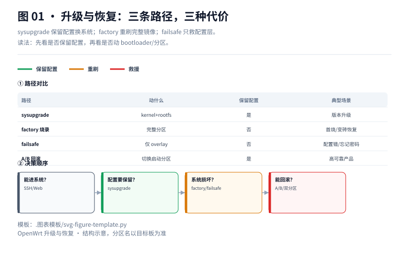

# 升级与恢复总览

一句话结论：OpenWrt 的“升级”有三条不同代价的路径——**sysupgrade 保留配置换系统、factory 镜像重刷完整分区、failsafe/firstboot 只处理配置层**；选错路径比操作失误更危险。

> 本篇定位：给出三条路径的边界、风险与选择顺序。具体流程见 [01-sysupgrade](./01-sysupgrade.md)、[02-双分区与回滚](./02-双分区与回滚.md)、[03-failsafe 与恢复模式](./03-failsafe与恢复模式.md)。

## 目录

- [1 一句话模型](#s1)
- [2 速览](#s2)
- [3 三条路径与分区对象](#s3)
- [4 选择与执行流程](#s4)
- [5 状态机与定时器](#s5)
- [6 设计取舍与边界](#s6)
- [7 与相邻主题的关系](#s7)
- [名词解释](#名词解释)
- [8 参考与关联](#s8)

## 1 · 一句话模型

```text
配置问题 ──► failsafe/firstboot（不动系统）
系统问题 ──► sysupgrade（保留配置，替换 kernel+rootfs）
严重损坏 ──► factory 烧录（重写分区，可能动 bootloader）
```

三个关键认知：

1. **先判断“坏在哪一层”**：配置、系统、引导，三层对应三种恢复手段。
2. **保留配置不是无代价**：跨版本配置可能不兼容，升级后仍需验证。
3. **最危险的是写 Flash 阶段**：掉电、错镜像、错分区都可能变砖。

## 2 · 速览

| 项 | 内容 |
| --- | --- |
| 所属层/领域 | OpenWrt 生命周期管理 |
| 核心对象 | kernel/rootfs/overlay 分区、sysupgrade、factory 镜像、failsafe |
| 关键入口 | `sysupgrade`、`firstboot`、bootloader |
| 典型场景 | 版本升级、配置恢复、变砖救援、批量出厂 |
| 主要标准 | OpenWrt 镜像元数据与平台升级脚本 |

## 3 · 三条路径与分区对象

| 路径 | 影响范围 | 配置 | 风险 | 适用 |
| --- | --- | --- | --- | --- |
| sysupgrade | kernel + rootfs（+ overlay 迁移） | 默认保留 | 中 | 正常版本升级 |
| factory 烧录 | 完整分区，可能含 bootloader | 不保留 | 高 | 首烧、严重损坏 |
| failsafe | 运行态，不动 Flash | 可清空 overlay | 低 | 配置错、忘记密码 |
| firstboot | 清空 overlay | 不保留 | 低 | 恢复出厂 |
| A/B 回滚 | 切换启动分区 | 取决于设计 | 低-中 | 高可靠产品 |

### 3.1 常见分区

| 分区 | 作用 | 边界与误判 |
| --- | --- | --- |
| bootloader | 引导、恢复模式 | 写错直接变砖 |
| kernel | 内核（可能在 UBI/FIT 内） | 与 rootfs 的布局强绑定 |
| rootfs | 只读系统 | sysupgrade 的主要目标 |
| rootfs_data / overlay | 可写配置层 | 升级时迁移或清空 |
| u-boot-env | 引导参数/启动标记 | 双分区回滚常在这里记录状态 |

## 4 · 选择与执行流程



**读图**：先看是否保留配置，再看是否动 bootloader/分区。矩阵给出四条路径的影响范围，决策顺序从“能否进系统”开始。

> 图源：`images/图01-升级总览.svg`

### 4.1 正常选择

1. 能进系统、只是配置错：优先 failsafe/firstboot 或挂载 overlay 修复。
2. 能进系统、需要换版本：sysupgrade，先备份配置。
3. 进不了系统、但 bootloader 可用：factory 镜像或恢复模式。
4. bootloader 也损坏：串口/烧录器，按平台救砖流程。

### 4.2 异常分支

| 现象 | 原因 | 处理方向 |
| --- | --- | --- |
| 升级后配置异常 | 跨版本配置不兼容 | 回滚配置或 `-n` 重刷 |
| 升级后无法启动 | 镜像/分区/元数据不匹配 | 串口日志，必要时 factory |
| 写入中断 | 掉电/存储坏块 | 重新烧录，检查 Flash 健康 |
| failsafe 进不去 | 触发时机/地址错、bootloader 坏 | 查按键时机与串口 |
| 回滚未生效 | 启动标记未写/健康检查缺失 | 查 bootloader 与环境变量 |

## 5 · 状态机与定时器

升级本身没有协议状态机，但有**启动尝试状态**：当前分区/备用分区、pending/confirmed、尝试次数。定时器包括启动等待、健康检查超时、回滚触发。通用 OpenWrt 默认不含 A/B，具体状态由厂商/平台脚本实现。

## 6 · 设计取舍与边界

- **为什么默认保留配置**：升级不应丢失网络/账号配置；但跨大版本时保留可能带来兼容问题。
- **为什么 factory 与 sysupgrade 分开**：前者用于完整重建，后者用于增量替换；混用会破坏分区假设。
- **代价**：升级路径多、平台差异大，文档必须绑定具体板型。
- **不适用**：bootloader 损坏时，任何系统内工具都无效，必须硬件级恢复。
- **常见误判**：把“能 ping 通”当成升级成功；服务、配置、回滚能力都要验证。

## 7 · 与相邻主题的关系

| 相邻对象 | 关系 |
| --- | --- |
| [01-sysupgrade](./01-sysupgrade.md) | 保留配置的系统升级 |
| [02-双分区与回滚](./02-双分区与回滚.md) | 高可靠启动切换 |
| [03-failsafe 与恢复模式](./03-failsafe与恢复模式.md) | 配置层救援 |
| [01-构建与包管理/04-镜像生成](../01-构建与包管理/04-镜像生成与Device-Profile.md) | 镜像类型与元数据 |
| [30-平台与芯片](../../../30-平台与芯片/.readme.md) | 具体平台的烧录/救砖 |

一句话边界：本篇讲“选哪条恢复路径”，不讲具体平台的烧录命令。

## 名词解释

> 缩写给出英文全称；非缩写用“—”表示。

| 术语 | 英文全称 | 解释 |
| --- | --- | --- |
| sysupgrade | System Upgrade | OpenWrt 的系统升级工具与流程。 |
| factory image | — | 工厂烧录/救援用完整镜像。 |
| failsafe | — | 启动时进入的最小救援模式。 |
| firstboot | — | 清空 overlay、恢复出厂配置的工具。 |
| overlay | — | 可写层，保存配置与运行时改动。 |
| A/B | — | 双分区启动方案，可回滚。 |
| bootloader | — | 引导程序，负责加载内核。 |

## 8 · 参考与关联

**标准**

- OpenWrt 官方 sysupgrade、failsafe 文档。

**关联**

- [本目录索引](./.readme.md)
- [01-构建与包管理/04-镜像生成](../01-构建与包管理/04-镜像生成与Device-Profile.md)

---

> **本篇定位**：升级/恢复路径选择与风险边界。
> **素材来源**：`studyspace-v2/7.平台与集成/1.OpenWrt/5.升级与恢复/`。
> **待验证**：双分区与启动标记的实现随厂商/平台变化。
