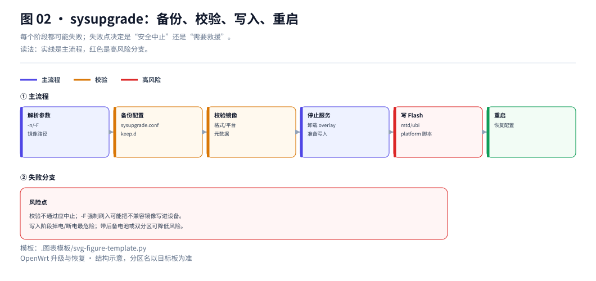

# sysupgrade 流程

一句话结论：sysupgrade 的核心是**“备份可保留的配置 → 校验镜像与平台 → 停止服务并卸载 overlay → 由平台脚本写入 Flash → 重启恢复配置”**；它不是简单的 `dd`，每一步都有平台相关的钩子与失败边界。

> 本篇定位：讲通用 sysupgrade 流程与配置保留机制。镜像如何生成见 [01-构建与包管理/04-镜像生成](../01-构建与包管理/04-镜像生成与Device-Profile.md)；双分区回滚见 [02-双分区与回滚](./02-双分区与回滚.md)。

## 目录

- [1 一句话模型](#s1)
- [2 速览](#s2)
- [3. 参数、保留清单与平台钩子](#s3)
- [4 执行流程](#s4)
- [5 状态机与定时器](#s5)
- [6 设计取舍与边界](#s6)
- [7 与相邻主题的关系](#s7)
- [名词解释](#名词解释)
- [8 参考与关联](#s8)

## 1 · 一句话模型

```text
备份配置 ──► 校验镜像 ──► 停止服务/卸载 overlay ──► platform 脚本写 Flash ──► 重启 ──► 恢复配置
```

三个关键认知：

1. **保留配置靠“清单”**：不是整个 overlay 原样复制，而是按 `sysupgrade.conf` 与 `keep.d` 选择。
2. **写 Flash 由平台脚本决定**：`platform_do_upgrade` 可能用 mtd、ubi、fit 或厂商工具。
3. **校验失败必须中止**：强制刷入不兼容镜像，后果可能是不可启动。

## 2 · 速览

| 项 | 内容 |
| --- | --- |
| 所属层/领域 | OpenWrt 系统升级 |
| 核心对象 | sysupgrade、配置备份、platform 脚本、镜像元数据 |
| 关键入口 | `sysupgrade`、`/lib/upgrade/`、`/etc/sysupgrade.conf` |
| 典型场景 | 版本升级、保留网络配置、批量升级 |
| 主要标准 | OpenWrt 镜像元数据与平台升级约定 |

## 3 · 参数、保留清单与平台钩子

| 对象/参数 | 作用 | 边界与误判 |
| --- | --- | --- |
| `sysupgrade <image>` | 升级并保留配置 | 镜像必须匹配设备 |
| `-n` | 不保留配置 | 等同于恢复默认配置 |
| `-F` | 强制升级 | 绕过兼容性检查，高风险 |
| `-v` | 输出详细过程 | 排障用 |
| `-b <file>` | 只生成配置备份 | 不刷机 |
| `-r <file>` | 恢复配置备份 | 与固件版本兼容性需确认 |
| `/etc/sysupgrade.conf` | 额外保留路径 | 写错会漏配置 |
| `/lib/upgrade/keep.d/` | 包/平台提供的保留清单 | 包卸载后清单可能消失 |
| `/etc/config/` | 默认保留的核心配置 | 跨版本可能不兼容 |
| `platform_check_image` | 平台镜像校验 | 不通过应中止 |
| `platform_do_upgrade` | 平台写入实现 | 与分区布局强绑定 |
| `fwtool` 元数据 | 设备/版本/兼容性 | 缺失时无法校验 |

四条最常用的命令形态：

```text
sysupgrade -l                     # 列出会被保留的文件（核对清单）
sysupgrade -b /tmp/backup.tar.gz  # 只备份配置，不刷机
sysupgrade -v /tmp/openwrt-*.bin  # 带日志升级，保留配置
sysupgrade -n /tmp/openwrt-*.bin  # 不保留配置（恢复默认）
```

> **推论**：升级前先 `sysupgrade -l`。它直接告诉你“哪些文件会被带走”，比翻 `sysupgrade.conf` 可靠——清单里少一条，升级后就是“配置丢了”。

### 3.1 保留与不保留

| 内容 | 默认 | 说明 |
| --- | --- | --- |
| `/etc/config/*` | 保留 | 网络、无线、防火墙等核心配置 |
| `/etc/sysupgrade.conf` 列出的路径 | 保留 | 产品自定义文件 |
| `/lib/upgrade/keep.d/*` | 保留 | 包/平台声明的保留项 |
| `/etc/passwd`、`/etc/shadow` | 保留 | 账号与密码 |
| `/tmp`、`/var` 运行时数据 | 不保留 | 缓存、租约、socket |
| 未列入清单的 overlay 文件 | 不保留 | 需要显式加入清单 |

保留清单越宽，升级后配置污染和兼容问题越多；建议只保留业务必需项。

## 4 · 执行流程



**读图**：主流程六个阶段；红色是高风险写入阶段。校验失败应安全中止，强制写入会把风险转移到重启后。

> 图源：`images/图02-sysupgrade.svg`

### 4.1 正常路径

1. 解析参数，确认镜像路径与是否保留配置。
2. 按保留清单生成配置备份（内存或临时文件）。
3. 调用平台校验：镜像格式、设备名、兼容性版本。
4. 停止相关服务，卸载 overlay，准备写入。
5. `platform_do_upgrade` 写入 kernel/rootfs，更新启动标记。
6. 重启，挂载新系统，恢复配置。

配置备份一般落在 `/tmp`（或内存文件系统），重启后由升级脚本的第二阶段解包回填 overlay。**这也解释了为什么“备份文件很大却升级后配置丢了”**：包在，但清单没包含你改的那个路径。

### 4.2 异常分支

| 现象 | 原因 | 处理方向 |
| --- | --- | --- |
| 校验失败 | 镜像不匹配/元数据缺失 | 换正确镜像，不要直接 `-F` |
| 写入失败 | 空间不足、坏块、分区只读 | 查 dmesg 与 Flash 健康 |
| 重启后配置丢失 | 保留清单缺失/恢复失败 | 检查 `sysupgrade.conf` 与备份文件 |
| 重启后不启动 | 分区/引导/镜像损坏 | 串口日志，factory 恢复 |
| 升级后服务异常 | 配置跨版本不兼容 | 对比默认配置，逐项迁移 |

**失败发生在哪一段，看什么**：

| 阶段 | 判据 | 处理 |
| --- | --- | --- |
| 校验 | `fwtool` 报设备/兼容性不匹配 | 换镜像；别用 `-F` 硬上 |
| 备份 | 备份包异常小/为空 | 清单没包含要保留的路径 |
| 写入 | dmesg 有 mtd/ubi/坏块错误 | 查 Flash 健康，必要时换板 |
| 重启 | 串口停在哪一段（见总览的三段） | 引导/内核/用户态分别处理 |

## 5 · 状态机与定时器

sysupgrade 本身是一次性流程；设备侧存在“启动尝试/确认”状态（尤其是 A/B 方案）。定时器包括校验超时、写入超时、重启等待与健康检查；通用方案没有自动回滚定时器。

## 6 · 设计取舍与边界

- **为什么保留配置要列清单**：overlay 里可能有缓存、密钥、临时文件，全部保留会污染新系统。
- **为什么平台脚本接管写入**：不同 Flash（NOR/NAND/eMMC）和引导（FIT/UBI）差异太大，通用工具无法覆盖。
- **代价**：升级行为高度依赖板级脚本，跨平台经验不能直接套用。
- **不适用**：bootloader 损坏、分区表损坏时，sysupgrade 无法修复。
- **常见误判**：把 `-F` 当“万能修复”；它只跳过检查，不解决不兼容。

> **推论**：`-F` 跳过的是“兼容性检查”，不是“分区假设”。它能让不匹配的镜像写进去，但如果分区布局、rootfs 格式或启动标记不同，结果往往是“刷成功了、起不来”，比拒绝升级更糟。

> **边界**：保留清单不是“越多越安全”。把 `/etc` 整个加进去，会把旧版本废弃的服务配置、证书、初始化脚本一起带过去；升级后的问题反而更难定位。

## 7 · 与相邻主题的关系

| 相邻对象 | 关系 |
| --- | --- |
| [00-升级与恢复总览](./00-升级与恢复总览.md) | 三条路径的选择 |
| [02-双分区与回滚](./02-双分区与回滚.md) | 写入后的启动确认 |
| [03-failsafe 与恢复模式](./03-failsafe与恢复模式.md) | 升级失败后的救援 |
| [01-构建与包管理/04-镜像生成](../01-构建与包管理/04-镜像生成与Device-Profile.md) | 镜像格式与元数据 |
| [40-平台与芯片](../../../40-平台与芯片/.readme.md) | 平台写入脚本与分区 |

一句话边界：本篇讲通用流程，具体写入命令以平台脚本为准。

## 名词解释

> 缩写给出英文全称；非缩写用“—”表示。

| 术语 | 英文全称 | 解释 |
| --- | --- | --- |
| sysupgrade | System Upgrade | OpenWrt 的系统升级工具。 |
| overlay | — | 可写层，保存配置与运行时改动。 |
| platform hook | — | 平台相关的校验/写入脚本钩子。 |
| fwtool | Firmware Tool | 读写镜像元数据的工具。 |
| metadata | — | 描述设备、版本、兼容性的镜像信息。 |
| mtd | Memory Technology Device | Linux 的 Flash 设备抽象。 |
| UBI | Unsorted Block Images | NAND 逻辑卷管理层。 |

## 8 · 参考与关联

**标准**

- OpenWrt 官方 sysupgrade 文档与 `/lib/upgrade/` 脚本。

**关联**

- [本目录索引](./.readme.md)
- [02-双分区与回滚](./02-双分区与回滚.md)
- [01-构建与包管理/04-镜像生成](../01-构建与包管理/04-镜像生成与Device-Profile.md)

---

> **本篇定位**：sysupgrade 阶段、配置保留与平台钩子。
> **素材来源**：`studyspace-v2/7.平台与集成/1.OpenWrt/5.升级与恢复/01-sysupgrade.md`。
> **待验证**：参数集合与平台脚本名随分支/厂商变化。
