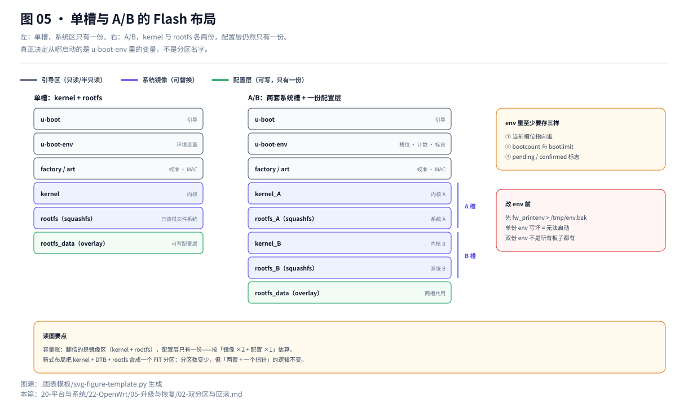

# 双分区与回滚

一句话结论：双分区（A/B）把"升级"变成**一次可撤销的启动选择**——镜像写备用槽，bootloader 只按"槽位 + 尝试次数 + 待确认标志"三个变量决定从哪启动，系统起来后自己确认；失败就回到旧槽。**三件套缺一件，A/B 就退化成"两份镜像"**。

> 本篇定位：讲 A/B 的分区布局、启动选择机制、健康检查与配置层策略。sysupgrade 主流程见 [01-sysupgrade](./01-sysupgrade.md)；救援模式见 [03-failsafe 与恢复模式](./03-failsafe与恢复模式.md)；U-Boot 与 DTS 的细节属于"启动与板级"，见 [学习地图 M02](../00-学习地图.md#m02-启动链与板级适配)。

## 目录

- [1 一句话模型](#s1)
- [2 速览](#s2)
- [3 分区布局：Flash 上到底怎么排](#s3)
- [4 启动选择：bootloader 只看三个变量](#s4)
- [5 升级与回滚流程](#s5)
- [6 健康检查：谁决定这次启动算成功](#s6)
- [7 配置层：overlay 放哪](#s7)
- [8 状态机与定时器](#s8)
- [9 设计取舍与边界](#s9)
- [10 与相邻主题的关系](#s10)
- [名词解释](#名词解释)
- [11 参考与关联](#s11)

## 1 · 一句话模型

```text
升级写 B ──► 标记 pending ──► 启动 B ──► 自检 ──► 确认（清 pending）
                                      └──失败──► 回退 A
```

三个关键认知：

1. **核心是"启动选择 + 确认"，不是复制两份 rootfs。** 没有 bootloader 参与，写两份镜像只是占空间。
2. **健康检查必须由系统完成。** bootloader 只会数"启动了几次失败"，它判断不了"业务是否真的正常"。
3. **配置层要单独设计。** 两套系统共用一份 overlay 会带来兼容问题，各自独立又会丢配置——这是 A/B 里最容易被忽略的一半。

> **一个反直觉的点**：A/B 翻倍的是**系统区**，不是整个 Flash。`rootfs_data`（overlay）通常只有一份，因为用户配置不该跟着槽位走。算容量账时按"镜像区 ×2 + 配置区 ×1"算，不是"整片 ×2"。

## 2 · 速览

| 项 | 内容 |
| --- | --- |
| 所属层/领域 | OpenWrt 高可靠升级 |
| 核心对象 | A/B 槽、bootloader 环境变量、启动计数、待确认标志、健康检查 |
| 关键入口 | bootloader、`fw_setenv`/`fw_printenv`、`/lib/upgrade/platform.sh` |
| 典型场景 | CPE/网关、无人值守设备、批量升级 |
| 主要标准 | 无统一标准，依厂商/平台实现 |
| 成立前提 | bootloader 可改、环境变量可写、镜像区能放两套 |

## 3 · 分区布局：Flash 上到底怎么排

A/B 不是"把 rootfs 复制一份"，而是**在分区表里多切出几个区，再让 bootloader 认识它们**。



**读图**：左列是常见的单槽布局，系统区只有一份；右列是 A/B，`kernel` 与 `rootfs` 各两份，而最下面的 `rootfs_data`（配置层）**仍然只有一份**。真正决定从哪启动的，不是分区名，是 `u-boot-env` 里那几个变量。

> 图源：`images/图05-A-B分区布局.svg`

| 分区/卷 | 作用 | 边界与误判 |
| --- | --- | --- |
| `u-boot` | 引导程序本体 | 一般只读；改它才是"真砖"风险 |
| `u-boot-env` | 环境变量：槽位、计数、标志 | **写坏直接不启动**；没有冗余副本时最危险 |
| `factory` / `art` | 校准数据、MAC | 升级绝不能覆盖；丢了无线可能起不来 |
| `kernel_A/B` | 内核（或 FIT 里的内核段） | 必须与同槽 rootfs 版本匹配 |
| `rootfs_A/B` | 只读根文件系统（squashfs） | 两槽容量相同，无法"新系统更大" |
| `rootfs_data` | 可写 overlay（ubifs/ext4） | 只有一份；共享还是独立是设计选择（见 §7） |
| `fit`（新式） | 内核 + DTB + rootfs 合成单分区 | 分区数变少，但"两套"的逻辑不变 |

### 3.1 单槽与 A/B 的取舍

| 维度 | 单分区 | A/B 双分区 |
| --- | --- | --- |
| Flash 占用 | 低 | 镜像区接近翻倍（配置区不变） |
| 升级风险 | 写入失败即无法启动 | 可回退旧槽 |
| 升级速度 | 快 | 写备用槽，量级相近（受 Flash 写速限制） |
| 配置迁移 | 简单 | 需设计共享/独立 overlay |
| 容量约束 | 小容量 NOR 也能做 | 需要能容纳两套镜像 |
| 适用 | 小容量、可救砖 | 无人值守、高可靠 |

### 3.2 老式 kernel+rootfs 与 FIT 的差别

老布局把内核和根文件系统分成两个区，升级时要分别校验、分别写；新式 FIT 把内核、DTB、rootfs 打进一个镜像，**校验点少一个，回滚粒度也更粗**（要么整包回退，要么都不变）。

> **边界**：不管哪种布局，"当前从哪启动"都不是分区名决定的——分区名只是约定，bootloader 里的变量才是事实。看到 `rootfs_B` 里是新镜像就以为"下次会启动它"，是最常见的误判。

## 4 · 启动选择：bootloader 只看三个变量

### 4.1 变量清单

| 变量 | 作用 | 边界 |
| --- | --- | --- |
| 当前槽位（如 `boot_slot` / `flag_boot_rootfs`） | 指向本次要启动的槽 | 命名随厂商变，别照抄 |
| `bootcount` | 已尝试启动次数 | 需要 bootloader 编译时开启计数特性 |
| `bootlimit` | 允许的最大尝试次数 | 与健康检查窗口要匹配，不能比它还短 |
| `altbootcmd` | 超过 `bootlimit` 后执行的备用命令 | 通常用它切回旧槽并清零计数 |
| `bootcmd` | 正常启动命令（读哪个分区、传什么 cmdline） | 写错就启动不了，改前先备份 env |
| `bootargs` | 内核命令行 | 与 DTS/分区名耦合 |
| `bootdelay` | 启动前的等待秒数 | 调试窗口；量产一般设 0–2 秒 |

### 4.2 一次完整的选择逻辑

```text
上电 → 读 env
  ├─ bootcount < bootlimit ──► 启动"当前槽" → bootcount+1 写回
  │                              ├─ 系统自检通过 → 清 pending、清 bootcount
  │                              └─ 没通过（崩溃/重启）→ 下一轮继续 +1
  └─ bootcount ≥ bootlimit ──► 执行 altbootcmd → 切回旧槽、清计数
```

三个要点：

1. **计数是"启动次数"，不是"失败次数"。** 正常启动也会 +1，所以必须有人在成功后被清零。
2. **回退动作发生在"下一次上电"，不是当场。** 所以"回退"必然伴随一次额外重启。
3. **谁先清、谁后清有顺序。** 先确认业务可用，再清 pending，最后清计数；顺序颠倒会出现"确认了但没清计数，下次仍回退"。

### 4.3 env 存在哪、怎么改

OpenWrt 用 `uboot-envtools` 读写，配置文件是 `/etc/fw_env.config`（声明 env 在哪个 MTD 分区、偏移、大小）：

- `fw_printenv` 读，`fw_setenv` 写；
- 写之前先 `fw_printenv > /tmp/env.bak`，这是唯一的后悔药；
- 双份 env（redundant env）不是所有板子都有，单份时一次写坏就无法启动。

> **待验证**：目标板 env 的偏移与大小、是否启用冗余副本、`bootcount` 存在 env 还是 RTC/其他后端——这几项必须按具体平台确认，不同 SoC 完全不同。

## 5 · 升级与回滚流程


**读图**：先看 bootloader 如何选择槽位，再看新系统的 pending → confirmed 流程。失败分支回到旧槽，前提是**旧槽在本次升级中没被覆盖**。

> 图源：`images/图03-双分区与回滚.svg`

### 5.1 正常路径

1. 当前运行 A，镜像写入 B（写入后校验）。
2. 设置 `pending`，把当前槽指向 B，清零 `bootcount`。
3. 重启进入 B，挂载 overlay，启动服务。
4. 健康检查通过，清除 `pending` 与 `bootcount`，确认 B。
5. 下次升级写入 A，形成交替——**永远保留一个"已知可用"的槽**。

### 5.2 与 sysupgrade 的衔接

OpenWrt 的升级脚本把"平台相关动作"抽到 `/lib/upgrade/platform.sh`：

| 钩子/变量 | 作用 |
| --- | --- |
| `platform_check_image()` | 镜像格式、机型校验，不合格直接拒绝 |
| `platform_do_upgrade()` | 真正写入：选择目标槽、写镜像、更新 env |
| `CI_KERNPART` / `CI_ROOTPART` / `CI_UBIPART` | 告诉脚本"内核/根文件系统/UBI 分区叫什么" |

所以"双分区"不是改个开关，而是**在 `platform_do_upgrade()` 里换目标分区，并同时改 env**。两者不同步，就会出现"镜像写到 B、启动还指向 A"这种看着成功、实际没升的情况。

`sysupgrade -n` 表示不保留配置；对 A/B 而言，它影响的是 overlay 里的内容，不是分区选择。

### 5.3 异常分支

| 现象 | 原因 | 处理方向 |
| --- | --- | --- |
| 新系统起不来，自动回退 | 镜像/分区/内核不匹配，计数达阈值 | 看 `altbootcmd` 是否真的切槽并清计数 |
| 回退不触发 | 计数没写、bootloader 不支持、env 只读 | 查 `fw_env.config` 与 `bootlimit` |
| 回退后仍起不来 | 旧槽已被覆盖，或两槽共用同一份坏配置 | 确认"交替写入"策略，overlay 加兜底 |
| 升级后配置异常 | overlay 共享 + 跨版本配置不兼容 | 配置迁移或独立 overlay（§7） |
| 升级"假成功" | 只写了镜像没改 env，重启还在旧槽 | 校验"当前槽"变量，不只看镜像校验 |
| 两槽都损坏 | 连续失败、写入错误、env 写坏 | 进 failsafe 或工厂烧录 |

## 6 · 健康检查：谁决定这次启动算成功

bootloader 只会数次数，**"这次算不算成功"是系统的判断**。判断错了，A/B 就是摆设。

| 检查项 | 能抓到什么 | 误判风险 |
| --- | --- | --- |
| 关键进程存活（procd 状态） | 服务崩溃重启循环 | 进程活着但功能不通 |
| 网络可达（默认路由/一次探测） | 拨号失败、上游不通 | **上游故障会让新系统背锅**，回退到同样坏的旧版 |
| 无线起来（接口存在 + 可关联） | 驱动/校准数据问题 | 无终端连接时无法验证 |
| 业务级探测（注册/心跳） | 端到端可用 | 需要外部依赖，测试环境难复现 |
| 看门狗未触发 | 卡死、内核 panic | 只能覆盖"死了"，覆盖不了"活着但不对" |

### 6.1 三种实现位置

1. **启动脚本里**：等若干秒后检查服务状态，通过就确认。简单，但"慢启动"会被误判。
2. **由业务服务确认**：真正就绪的那个进程负责写标志。最准，但要求它能感知升级上下文。
3. **首包/首次上线确认**：终端第一次成功上网才算成功。最贴近体验，但依赖有终端在场。

### 6.2 误回滚的两个来源

- **检查太严**：把"外网可用"当必要条件，上游一断就回滚，回滚完还是不通，形成来回反弹。
- **确认太早**：启动脚本刚拉起进程就确认，真正的故障（拨号失败、无线起不来）发生在确认之后，回退机制彻底失效。

> **一条经验规则**：健康检查只判断"**本机能控制的事**"。上游、终端、云端的可用性不该作为回滚依据，否则把外部故障变成了本地回滚。

## 7 · 配置层：overlay 放哪

| 策略 | 做法 | 好处 | 代价 |
| --- | --- | --- | --- |
| 共享一份 | 两个槽挂同一个 `rootfs_data` | 升级后配置无缝保留，容量省 | 跨版本配置不兼容时，回退也会带着新配置一起坏 |
| 每槽独立 | A/B 各一份 overlay | 回退能回到"连配置一起旧"的状态 | 升级后配置要迁移，否则等于恢复出厂 |
| 共享 + 迁移 | 共享，但升级时按版本做迁移/备份 | 兼顾体验与安全 | 需要版本化迁移逻辑，最容易出 bug |

> **推论**：如果产品承诺"回退到升级前"，overlay 就不能完全共享——至少要保留一份升级前的快照。否则"系统回退了，配置没回退"，用户看到的仍是一个坏掉的环境。

## 8 · 状态机与定时器

### 8.1 状态

核心状态是三个维度的组合：**当前槽（A/B）× 启动状态（pending/confirmed）× 计数（0..bootlimit）**。

| 状态 | 含义 | 谁会离开它 |
| --- | --- | --- |
| confirmed | 当前槽已验证可用 | 升级写入新槽时 |
| pending | 新槽待验证 | 健康检查通过 → confirmed；失败重启 → 计数 +1 |
| rollback | 计数达阈值，切回旧槽 | 下次启动进入旧槽的 confirmed |
| broken | 两槽都不可用 | 只能靠 failsafe / 工厂烧录 |

### 8.2 定时器

| 定时器 | 管什么 | 说明 |
| --- | --- | --- |
| `bootdelay` | 启动前等待 | 调试窗口；量产设 0–2 秒 |
| `bootlimit` | 允许尝试次数 | 要与"一次启动 + 自检"耗时匹配 |
| 确认窗口 | 从启动到写 confirmed 的最长时间 | 太短误确认，太长误回退 |
| 健康检查超时 | 单项检查的等待上限 | 拨号、无线关联的耗时要分开设 |
| 看门狗超时 | 卡死兜底 | 必须短于"确认窗口"，否则看门狗先重启 |

> **待验证**：以上阈值没有跨平台标准，按产品实测确定；回退阈值与确认窗口的取值建议写进产品配置文档，而不是散落在脚本里。

## 9 · 设计取舍与边界

- **为什么要 A/B**：无人值守设备的升级失败代价高，"可回退"比"一次成功"更现实。
- **为什么通用 OpenWrt 不默认 A/B**：Flash 容量有限，且需要 bootloader 配合（可改 env、支持计数）；不是所有设备都具备。
- **代价**：镜像区翻倍、`platform.sh` 复杂度上升、配置迁移成为长期负担。
- **不适用**：小容量 NOR Flash、bootloader 锁定不可改、env 单份且不可写的设备。
- **常见误判**：
  - 以为"写了两个 rootfs"就有回滚——没有标记与健康检查，只是两份镜像；
  - 以为"镜像校验通过"就是升级成功——env 没改，重启还在旧槽；
  - 以为"回退=恢复原状"——overlay 共享时配置已被新版本改过；
  - 以为"计数越多越安全"——阈值过大只是把失败拖长，用户体验更差。

## 10 · 与相邻主题的关系

| 相邻对象 | 关系 |
| --- | --- |
| [00-升级与恢复总览](./00-升级与恢复总览.md) | 三条升级路径的选择与代价 |
| [01-sysupgrade](./01-sysupgrade.md) | 写入前的备份、校验与配置保留 |
| [03-failsafe 与恢复模式](./03-failsafe与恢复模式.md) | 两槽都失败后的救援入口 |
| [01-构建与包管理/04-镜像生成](../01-构建与包管理/04-镜像生成与Device-Profile.md) | 分区表与镜像格式的来源 |
| [学习地图 M02](../00-学习地图.md#m02-启动链与板级适配) | U-Boot 环境、DTS 与分区布局（待补） |
| [40-平台与芯片](../../../40-平台与芯片/.readme.md) | 各平台 bootloader 与分区实现 |

一句话边界：本篇讲 A/B 的机制与取舍，不提供某平台的具体命令与环境变量名——那些随 bootloader 版本变化，必须按板子确认。

## 名词解释

> 缩写给出英文全称；非缩写用“—”表示。

| 术语 | 英文全称 | 解释 |
| --- | --- | --- |
| A/B | Active/Backup | 双槽方案：一套运行，一套待切换。 |
| slot | — | 一个可启动的系统分区组合（内核 + 根文件系统）。 |
| bootloader | — | 引导程序，负责按环境变量选择启动槽。 |
| env | — | bootloader 环境变量区，存放槽位、计数与标志。 |
| bootcount | — | 启动尝试计数，由 bootloader 维护。 |
| bootlimit | — | 允许的最大启动尝试次数，超过即触发回退。 |
| altbootcmd | — | 超过 bootlimit 后执行的备用启动命令。 |
| cmdline | Command Line | 内核启动参数（`bootargs`）。 |
| MTD | Memory Technology Device | Linux 的 Flash 抽象层，分区在 `/proc/mtd` 可见。 |
| UBI | Unsorted Block Images | NAND 的逻辑卷管理层，处理坏块与磨损均衡。 |
| SquashFS | — | 只读压缩文件系统，OpenWrt 根文件系统常用。 |
| overlay | — | 可写层，叠加在只读根文件系统之上。 |
| FIT | Flattened Image Tree | 内核 + DTB + rootfs 合成一体的镜像格式。 |
| OTA | Over-the-Air | 远程升级。 |
| pending | — | 新槽待确认状态。 |
| confirmed | — | 当前槽已验证可用。 |
| watchdog | — | 看门狗，超时未喂则强制重启。 |

## 11 · 参考与关联

**标准**

- 无统一标准；参考各平台 bootloader 与 OpenWrt 的 `/lib/upgrade/platform.sh` 实现。

**关联**

- [本目录索引](./.readme.md)
- [01-sysupgrade](./01-sysupgrade.md)
- [03-failsafe 与恢复模式](./03-failsafe与恢复模式.md)
- [学习地图](../00-学习地图.md)
- [40-平台与芯片](../../../40-平台与芯片/.readme.md)

---

> **本篇定位**：A/B 的分区布局、启动选择、健康检查与配置层策略。
> **素材来源**：`studyspace-v2/7.平台与集成/1.OpenWrt/5.升级与恢复/` 与平台升级实践。
> **待验证**：目标产品的槽位命名、env 存储位置与冗余、回退阈值与确认窗口。
