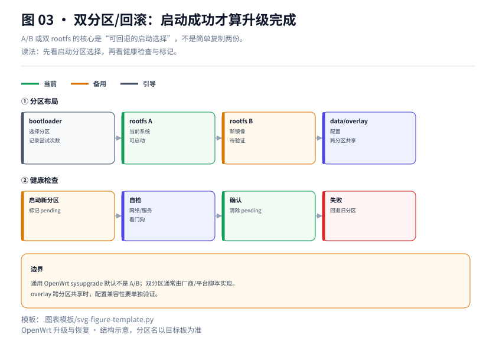

# 双分区与回滚

一句话结论：双分区（A/B）把“升级”变成**一次可撤销的启动选择**：新镜像写入备用分区，bootloader 记录尝试次数，系统启动后自检并通过标记确认；失败则回到旧分区。通用 OpenWrt 默认不是 A/B，这通常是厂商/平台增强。

> 本篇定位：讲 A/B 的分区、启动标记与健康检查。sysupgrade 主流程见 [01-sysupgrade](./01-sysupgrade.md)；救援模式见 [03-failsafe 与恢复模式](./03-failsafe与恢复模式.md)。

## 目录

- [1 一句话模型](#s1)
- [2 速览](#s2)
- [3 分区、标记与脚本](#s3)
- [4 升级与回滚流程](#s4)
- [5 状态机与定时器](#s5)
- [6 设计取舍与边界](#s6)
- [7 与相邻主题的关系](#s7)
- [名词解释](#名词解释)
- [8 参考与关联](#s8)

## 1 · 一句话模型

```text
升级写 B ──► 标记 pending ──► 启动 B ──► 自检 ──► 确认（清 pending）
                                      └──失败──► 回退 A
```

三个关键认知：

1. **双分区的核心是“启动选择 + 确认”**，不是简单复制两份 rootfs。
2. **健康检查必须由系统完成**：bootloader 只能按标记选择，不能判断业务是否正常。
3. **配置层要单独设计**：overlay 共享会带来兼容性问题，独立则升级后配置丢失。

## 2 · 速览

| 项 | 内容 |
| --- | --- |
| 所属层/领域 | OpenWrt 高可靠升级 |
| 核心对象 | A/B 分区、bootloader 环境、启动标记、健康检查 |
| 关键入口 | bootloader、`fw_setenv`、平台升级脚本 |
| 典型场景 | CPE/网关、无人值守设备、批量升级 |
| 主要标准 | 无统一标准，依厂商/平台实现 |

## 3 · 分区、标记与脚本

| 对象/机制 | 作用 | 边界与误判 |
| --- | --- | --- |
| rootfs A/B | 两套系统分区 | 容量翻倍，Flash 成本上升 |
| kernel A/B | 两套内核（可与 rootfs 绑定） | 内核与 rootfs 版本要匹配 |
| bootloader env | 记录当前槽/尝试次数 | 写坏环境变量可能无法启动 |
| `bootcount` | 启动尝试计数 | 阈值/清零策略要一致 |
| pending/confirmed | 新系统待确认/已确认 | 只写不读等于没有回滚 |
| 健康检查 | 网络/服务/看门狗 | 检查太严会误回滚 |
| overlay | 配置层 | 共享/独立各有代价 |
| 平台脚本 | 写入备用槽、更新标记 | 与分区名强绑定 |

### 3.1 单分区与 A/B 的取舍

| 维度 | 单分区 | A/B 双分区 |
| --- | --- | --- |
| Flash 占用 | 低 | 接近翻倍 |
| 升级风险 | 写入失败即无法启动 | 可回退旧槽 |
| 升级速度 | 快 | 写备用槽，速度相近 |
| 配置迁移 | 简单 | 需设计共享/独立 overlay |
| 适用 | 小容量、可救砖 | 无人值守、高可靠 |

A/B 不是“更安全”的同义词：没有健康检查和启动标记，备用槽只是多占空间。

## 4 · 升级与回滚流程



**读图**：先看 bootloader 如何选择槽位，再看新系统的 pending→confirmed 流程。失败分支回到旧槽，前提是旧槽未被覆盖。

> 图源：`images/图03-双分区回滚.svg`

### 4.1 正常路径

1. 当前运行 A，升级镜像写入 B。
2. bootloader 标记 B 为待启动，设置尝试次数。
3. 重启进入 B，挂载配置层，启动服务。
4. 健康检查通过，清除 pending，确认 B。
5. 下次升级写入 A，形成交替。

### 4.2 异常分支

| 现象 | 原因 | 处理方向 |
| --- | --- | --- |
| 新系统起不来 | 镜像/分区/内核不匹配 | bootloader 计数触发回退 |
| 回退不触发 | 计数未写、bootloader 不支持 | 查环境变量与引导脚本 |
| 回退后配置异常 | overlay 共享/版本不兼容 | 设计配置迁移或独立 overlay |
| 两槽都损坏 | 连续失败/写入错误 | 进入恢复模式或工厂烧录 |
| 升级后“假成功” | 健康检查太弱 | 增加业务级探测 |

## 5 · 状态机与定时器

核心状态：**当前槽（A/B）× 启动状态（pending/confirmed）× 尝试计数**。定时器包括启动等待、健康检查超时、确认窗口；计数达到阈值触发回退。具体状态存储位置由 bootloader/平台决定。

## 6 · 设计取舍与边界

- **为什么要 A/B**：无人值守设备升级失败代价高，可回滚比“一次成功”更现实。
- **为什么通用 OpenWrt 不默认 A/B**：Flash 容量有限，且需要 bootloader 配合；不是所有设备都支持。
- **代价**：分区容量翻倍、升级逻辑复杂、配置迁移难。
- **不适用**：小容量 NOR Flash、bootloader 不可改的设备。
- **常见误判**：以为写了两个 rootfs 就有回滚；没有启动标记和健康检查，只是“两份镜像”。

## 7 · 与相邻主题的关系

| 相邻对象 | 关系 |
| --- | --- |
| [00-升级与恢复总览](./00-升级与恢复总览.md) | 路径选择与风险 |
| [01-sysupgrade](./01-sysupgrade.md) | 写入与配置保留 |
| [03-failsafe 与恢复模式](./03-failsafe与恢复模式.md) | 双槽都失败后的救援 |
| [01-构建与包管理/04-镜像生成](../01-构建与包管理/04-镜像生成与Device-Profile.md) | 分区布局与镜像 |
| [30-平台与芯片](../../../30-平台与芯片/.readme.md) | bootloader/分区实现 |

一句话边界：本篇讲 A/B 机制，不提供某平台的 bootloader 命令清单。

## 名词解释

> 缩写给出英文全称；非缩写用“—”表示。

| 术语 | 英文全称 | 解释 |
| --- | --- | --- |
| A/B | — | 双分区/双槽启动方案。 |
| slot | — | 一个可启动的系统分区组合。 |
| bootloader | — | 引导程序，负责选择启动槽。 |
| bootcount | — | 启动尝试计数。 |
| pending | — | 新系统待确认状态。 |
| confirmed | — | 新系统已确认状态。 |
| overlay | — | 可写配置层。 |
| watchdog | — | 看门狗，异常时触发重启。 |

## 8 · 参考与关联

**标准**

- 无统一标准；参考各平台 bootloader 与 OpenWrt 厂商实现。

**关联**

- [本目录索引](./.readme.md)
- [01-sysupgrade](./01-sysupgrade.md)
- [30-平台与芯片](../../../30-平台与芯片/.readme.md)

---

> **本篇定位**：A/B 分区、启动标记与健康检查。
> **素材来源**：`studyspace-v2/7.平台与集成/1.OpenWrt/5.升级与恢复/` 与平台升级实践。
> **待验证**：目标产品的槽位命名、标记存储与回退阈值。
