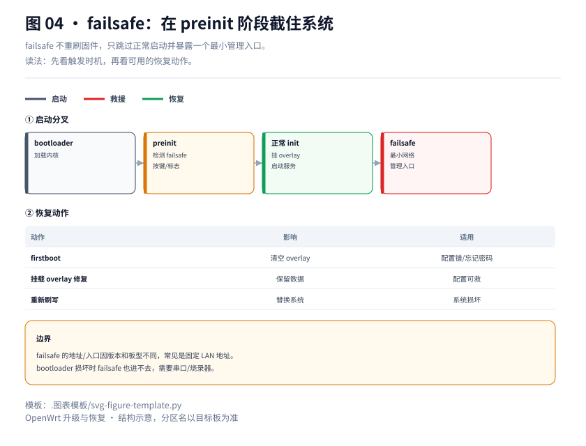

# failsafe 与恢复模式

一句话结论：failsafe 是 **preinit 阶段的一次“跳过正常启动”**：它不重刷固件，只提供一个最小系统和管理入口，用于修配置、清 overlay 或重新刷写；如果 bootloader 都进不去，就只能走硬件级恢复。

> 本篇定位：讲 failsafe 的触发、入口与恢复动作。正常升级见 [01-sysupgrade](./01-sysupgrade.md)；双分区回退见 [02-双分区与回滚](./02-双分区与回滚.md)。

## 目录

- [1 一句话模型](#s1)
- [2 速览](#s2)
- [3 触发方式与恢复动作](#s3)
- [4 进入与恢复流程](#s4)
- [5 状态机与定时器](#s5)
- [6 设计取舍与边界](#s6)
- [7 与相邻主题的关系](#s7)
- [名词解释](#名词解释)
- [8 参考与关联](#s8)

## 1 · 一句话模型

```text
bootloader ──► preinit ──检测 failsafe──► 最小系统 ──► 修复/清 overlay/重刷
                    └──正常──► 挂 overlay ──► 正常 init
```

三个关键认知：

1. **failsafe 发生在挂载 overlay 之前**：所以它能处理“配置把系统搞挂”的情况。
2. **它依赖 preinit 与触发条件**：按键时机、bootloader 标志、串口中断都可能影响。
3. **firstboot 只清配置层**：系统文件仍在，适合配置错误，不适合系统损坏。

## 2 · 速览

| 项 | 内容 |
| --- | --- |
| 所属层/领域 | OpenWrt 救援与恢复 |
| 核心对象 | preinit、failsafe、firstboot、overlay、bootloader |
| 关键入口 | 启动按键/串口、`firstboot`、bootloader 恢复模式 |
| 典型场景 | 配置错、忘记密码、升级失败、系统损坏 |
| 主要标准 | OpenWrt preinit 约定；平台恢复方式各异 |

## 3 · 触发方式与恢复动作

| 方式/动作 | 作用 | 边界与误判 |
| --- | --- | --- |
| 启动时按住 reset | 触发 failsafe | 时机因 bootloader 而异 |
| bootloader 标志/菜单 | 进入恢复/救援 | 需要串口或按键组合 |
| `firstboot` | 清空 overlay | 不修复系统分区 |
| 挂载 overlay 修复 | 保留数据改配置 | 需要能进 failsafe/救援 |
| 重新刷写 | 替换系统 | 需要可用镜像与写入通道 |
| bootloader 网络恢复 | TFTP/HTTP 刷机 | 依赖 bootloader 支持 |
| 串口/烧录器 | 硬件级恢复 | 最后手段，需拆机 |

### 3.1 failsafe 的典型特征

| 项 | 典型值 | 说明 |
| --- | --- | --- |
| 管理地址 | 固定 LAN 地址 | 常见 `192.168.1.1`，以版本为准 |
| 管理入口 | telnet/串口 | 不同版本可能只开其一 |
| 网络 | 最小接口 | 不启动完整网络服务 |
| 文件系统 | 不挂 overlay | 可手动挂载修复 |

它能做什么、不能做什么，要分清：

| 能做 | 不能做 |
| --- | --- |
| 改 `/etc/config` 修配置错 | 修内核/rootfs 损坏 |
| `firstboot` 清 overlay | 修 bootloader/分区表 |
| 挂载 overlay 取回文件 | 修 Flash 物理坏块 |
| 在救援系统里重新 sysupgrade | bootloader 都进不去时无从下手 |

> **推论**：failsafe 的价值是“配置错了还能进得去”，不是“什么都能救”。判断它有没有用，只看一个问题：**问题在 overlay 还是系统分区？** 在 overlay 就有救，在系统分区就得 factory 或硬件级恢复。

## 4 · 进入与恢复流程



**读图**：先看启动分叉，再看恢复动作矩阵。failsafe 的关键是“在 overlay 之前截住”，所以它能救配置层问题；bootloader 损坏时则完全失效。

> 图源：`images/图04-failsafe.svg`

### 4.1 正常路径

1. bootloader 加载内核，preinit 运行。
2. 检测到 failsafe 触发条件，设置救援标志。
3. 不挂载 overlay，启动最小网络与管理入口。
4. 用户登录后修复配置、挂载 overlay 或执行 `firstboot`。
5. 重启进入正常系统。

### 4.2 异常分支

| 现象 | 原因 | 处理方向 |
| --- | --- | --- |
| 进不了 failsafe | 按键时机错、bootloader 不支持 | 查文档/串口，尝试 bootloader 菜单 |
| 能进但无网络 | 最小网络未起、地址不对 | 串口登录或手工配地址 |
| firstboot 后仍异常 | 系统分区也损坏 | 重新刷写 factory 镜像 |
| 刷写失败 | 镜像/通道/Flash 问题 | 换镜像/换通道，检查硬件 |
| 完全无输出 | bootloader/硬件故障 | 串口、烧录器、硬件检修 |

**“进不了 failsafe”先分清是没触发还是没入口**：

| 步骤 | 查什么 | 判据 | 答错的后果 |
| --- | --- | --- | --- |
| ① 按键时机 | 是否在 preinit 窗口内按下 | 串口能看到启动打印时按住 | 按早了/晚了都不触发 |
| ② 串口确认 | 有没有 failsafe 提示 | 串口输出里有“failsafe”字样 | 没串口只能靠猜 |
| ③ 管理入口 | 地址/协议对不对 | 固定地址 ping、telnet/ssh 端口 | 地址猜错，以为没进去 |
| ④ 平台差异 | 该板是否支持按键触发 | 厂商文档/源码 | 有的板只支持串口中断 |

## 5 · 状态机与定时器

failsafe 没有复杂状态机，只有**正常启动/救援启动**两条路径；定时器主要是触发窗口（按键检测时间）和网络服务启动等待。恢复动作本身是一次性命令。

## 6 · 设计取舍与边界

- **为什么在 preinit 做救援**：此时还没挂 overlay，配置错误不会阻断救援入口。
- **为什么保留最小网络**：没有网络就只能串口，现场恢复成本高。
- **代价**：救援模式能力有限，不能修复 bootloader/分区表。
- **不适用**：bootloader 损坏、硬件故障、Flash 物理损坏。
- **常见误判**：把 failsafe 当“恢复出厂”；它只是入口，是否清配置取决于你执行的动作。

> **推论**：failsafe 与 firstboot 是“入口”与“动作”的关系：进 failsafe 不会清任何东西，`firstboot` 才会清 overlay。把两者混为一谈，会在“我只想改个密码”时把整份配置清掉。

## 7 · 与相邻主题的关系

| 相邻对象 | 关系 |
| --- | --- |
| [00-升级与恢复总览](./00-升级与恢复总览.md) | 三条恢复路径 |
| [01-sysupgrade](./01-sysupgrade.md) | 正常升级与配置保留 |
| [02-双分区与回滚](./02-双分区与回滚.md) | 自动回退失败后的救援 |
| [02-系统框架/06-hotplug](../02-系统框架/06-hotplug与事件链.md) | 按键事件与触发 |
| [21-Linux/03-启动与根文件系统](../../21-Linux/03-启动与根文件系统/02-启动失败定位.md) | 启动失败定位方法 |

一句话边界：本篇讲“怎么进救援、能做什么”，不讲硬件级烧录步骤。

## 名词解释

> 缩写给出英文全称；非缩写用“—”表示。

| 术语 | 英文全称 | 解释 |
| --- | --- | --- |
| failsafe | — | 启动时进入的最小救援模式。 |
| preinit | Pre-initialization | 挂载 rootfs/overlay 之前的初始化阶段。 |
| firstboot | — | 清空 overlay、恢复出厂配置的工具。 |
| overlay | — | 可写配置层。 |
| bootloader | — | 引导程序。 |
| TFTP | Trivial File Transfer Protocol | 简单文件传输协议，常用于 bootloader 刷机。 |

## 8 · 参考与关联

**标准**

- OpenWrt 官方 failsafe/firstboot 文档。

**关联**

- [本目录索引](./.readme.md)
- [01-sysupgrade](./01-sysupgrade.md)
- [21-Linux/03-启动失败定位](../../21-Linux/03-启动与根文件系统/02-启动失败定位.md)

---

> **本篇定位**：failsafe 触发、入口与恢复动作。
> **素材来源**：`studyspace-v2/7.平台与集成/1.OpenWrt/5.升级与恢复/02-恢复出厂.md`、`studyspace/.../6.其他/recovery.md`。
> **待验证**：failsafe 地址、登录方式与触发按键随版本/板型变化。
