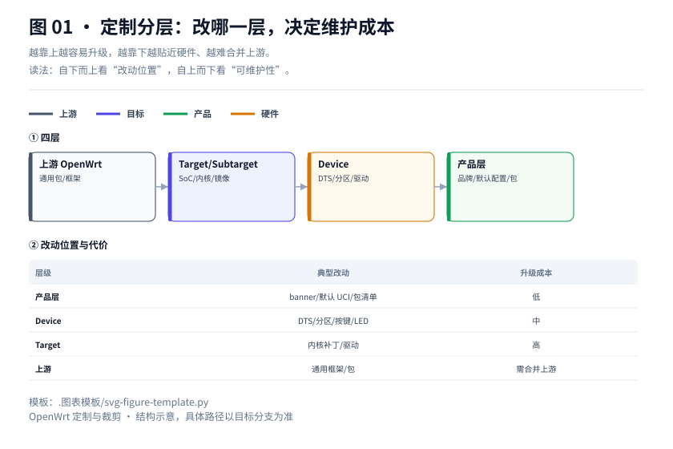

# 产品化定制总览

一句话结论：OpenWrt 产品化不是“改一堆文件”，而是**按层选择改动位置**：产品层放品牌/默认配置/包清单，Device 层放 DTS/分区，Target 层才动内核/驱动；越往下改，升级合并成本越高。

> 本篇定位：给出定制分层、改动归属与维护代价。品牌/默认配置见 [01-品牌与默认配置](./01-品牌与默认配置.md)，裁剪/补丁/SDK 见 [02-裁剪、补丁与 SDK 集成](./02-裁剪-补丁与SDK集成.md)。

## 目录

- [1 一句话模型](#s1)
- [2 速览](#s2)
- [3 分层与改动归属](#s3)
- [4 定制与升级流程](#s4)
- [5 状态机与定时器](#s5)
- [6 设计取舍与边界](#s6)
- [7 与相邻主题的关系](#s7)
- [名词解释](#名词解释)
- [8 参考与关联](#s8)

## 1 · 一句话模型

```text
上游 OpenWrt ──► Target/Subtarget ──► Device ──► 产品层
   通用框架          SoC/内核/镜像       DTS/分区     品牌/配置/包
```

三个关键认知：

1. **改动位置决定维护成本**：产品层最容易随上游升级，内核补丁最难。
2. **产品差异尽量做成“包/配置”**，不要散落在通用代码里。
3. **每一层都要能独立验证**：启动、网络、升级三条链路缺一不可。

## 2 · 速览

| 项 | 内容 |
| --- | --- |
| 所属层/领域 | OpenWrt 产品化 |
| 核心对象 | 产品层、Device、Target、私有 feed、补丁 |
| 关键入口 | `files/`、`package/`、`feeds.conf`、`target/linux/` |
| 典型场景 | 品牌定制、默认网络、功能裁剪、厂商 SDK 集成 |
| 主要标准 | OpenWrt 构建约定；无产品标准 |

## 3 · 分层与改动归属

| 层级 | 典型改动 | 维护成本 | 边界与误判 |
| --- | --- | --- | --- |
| 产品层 | banner、默认 UCI、LuCI、包清单 | 低 | 不要在这里改内核行为 |
| Device | DTS、分区、按键/LED、镜像名 | 中 | 板级差异不应污染 Target |
| Target/Subtarget | 内核补丁、驱动、镜像规则 | 高 | 改动需能随内核升级复基 |
| 私有 feed | 产品应用、专有包 | 中 | 版本要与主仓库匹配 |
| 上游通用 | 框架/公共包 | 最高 | 优先提交上游，避免长期分叉 |

## 4 · 定制与升级流程



**读图**：自下而上看改动落在哪一层，自上而下看可维护性。产品层改动最多但最容易合并；内核/驱动改动最少但最难维护。

> 图源：`images/图01-定制分层.svg`

### 4.1 正常路径

1. 明确产品差异：品牌、默认网络、功能集合、硬件接口。
2. 把差异分配到产品层/Device/Target，优先用配置和包解决。
3. 建立私有 feed 或产品包，固定版本与依赖。
4. 构建、烧录，验证启动/网络/升级。
5. 记录改动清单，随上游升级逐项复基。

### 4.2 异常分支

| 现象 | 原因 | 处理方向 |
| --- | --- | --- |
| 升级后定制丢失 | 改动在 overlay/临时文件 | 移到 `files/` 或包 |
| 上游合并冲突 | 改了通用代码/内核 | 缩小补丁，优先上游化 |
| 产品间互相污染 | 共用配置/包未隔离 | 用 Device/产品包隔离 |
| 镜像超限 | 定制包过多 | 裁剪或调整分区 |
| 默认配置不生效 | uci-defaults 未执行/被覆盖 | 查首次启动与 overlay |

## 5 · 状态机与定时器

没有统一状态机。产品化关注的是**版本状态**：上游基线、产品补丁集、私有 feed 版本、镜像版本；以及**首次启动状态**（默认配置是否已应用）。定时器主要来自升级/回滚与健康检查。

## 6 · 设计取舍与边界

- **为什么优先产品层**：升级成本最低，问题定位最容易；代价是有些硬件差异必须下沉。
- **为什么保留私有 feed**：产品应用可以独立版本化，不污染主仓库。
- **代价**：分层不清会导致“配置、包、补丁”三处重复，升级时互相打架。
- **不适用**：深度定制硬件/内核的产品，必须接受更高的维护成本。
- **常见误判**：把“能编出镜像”当成产品化完成；还要验证升级、恢复、量产一致性。

## 7 · 与相邻主题的关系

| 相邻对象 | 关系 |
| --- | --- |
| [01-品牌与默认配置](./01-品牌与默认配置.md) | 产品层的最小改动集 |
| [02-裁剪、补丁与 SDK 集成](./02-裁剪-补丁与SDK集成.md) | 裁剪、补丁与私有包 |
| [01-构建与包管理](../01-构建与包管理/.readme.md) | 构建、镜像与包 |
| [05-升级与恢复](../05-升级与恢复/.readme.md) | 产品升级与回滚 |
| [30-平台与芯片](../../../30-平台与芯片/.readme.md) | 厂商 SDK/驱动差异 |
| [40-产品与方案](../../../40-产品与方案/.readme.md) | 产品形态与业务方案 |

一句话边界：本篇讲“改动放哪一层”，不讲具体产品的业务方案。

## 名词解释

> 缩写给出英文全称；非缩写用“—”表示。

| 术语 | 英文全称 | 解释 |
| --- | --- | --- |
| 产品层 | — | 品牌、默认配置、包清单等产品差异。 |
| Device | — | 具体板型，绑定 DTS/分区/镜像。 |
| Target | — | 目标平台层级，通常对应架构与内核分支。 |
| 私有 feed | Private Feed | 产品自维护的包仓库。 |
| overlay | — | 可写层，保存配置与运行时改动。 |
| uci-defaults | UCI Defaults | 首次启动执行的默认配置脚本。 |
| ODM/OEM | Original Design/Equipment Manufacturer | 原始设计/设备制造商。 |

## 8 · 参考与关联

**标准**

- OpenWrt 官方 Build system、Package 与 Device 文档。

**关联**

- [本目录索引](./.readme.md)
- [01-品牌与默认配置](./01-品牌与默认配置.md)
- [02-裁剪、补丁与 SDK 集成](./02-裁剪-补丁与SDK集成.md)

---

> **本篇定位**：产品化分层与改动归属。
> **素材来源**：`studyspace-v2/7.平台与集成/1.OpenWrt/` 与产品化实践。
> **待验证**：具体产品的分层约定与私有 feed 结构。
