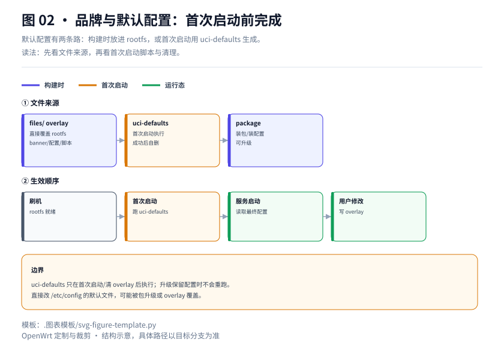

# 品牌与默认配置

一句话结论：品牌与默认配置的稳定做法是**构建时放入 rootfs（files/ 或产品包）+ 首次启动用 `uci-defaults` 生成/修正**；直接改运行中的 `/etc/config` 或 `/var` 文件，会在升级/重置后丢失。

> 本篇定位：讲品牌、默认网络、首次启动脚本与升级行为。定制分层见 [00-产品化定制总览](./00-产品化定制总览.md)；裁剪与补丁见 [02-裁剪、补丁与 SDK 集成](./02-裁剪-补丁与SDK集成.md)。

## 目录

- [1 一句话模型](#s1)
- [2 速览](#s2)
- [3 品牌与默认配置对象](#s3)
- [4 首次启动与生效流程](#s4)
- [5 状态机与定时器](#s5)
- [6 设计取舍与边界](#s6)
- [7 与相邻主题的关系](#s7)
- [名词解释](#名词解释)
- [8 参考与关联](#s8)

## 1 · 一句话模型

```text
files/ 或产品包 ──构建──► rootfs ──首次启动──► uci-defaults ──► 最终配置
                                             （成功后自删）
```

三个关键认知：

1. **构建时放入的文件是“默认值”**，运行后被 overlay 覆盖；升级保留配置时默认值不会重写。
2. **`uci-defaults` 只跑一次**：适合生成/迁移配置，不适合每次启动都执行的逻辑。
3. **品牌信息有多处入口**：banner、release、LuCI、hostname、设备型号，不要只改一处。

## 2 · 速览

| 项 | 内容 |
| --- | --- |
| 所属层/领域 | OpenWrt 产品化配置 |
| 核心对象 | `files/`、`uci-defaults`、banner、release、LuCI |
| 关键入口 | 构建树 `files/`、`/etc/uci-defaults/`、`/etc/config/` |
| 典型场景 | 品牌定制、默认网络、首次开机配置、恢复出厂 |
| 主要标准 | OpenWrt 文件布局与 UCI 约定 |

## 3 · 品牌与默认配置对象

| 对象 | 作用 | 边界与误判 |
| --- | --- | --- |
| `files/` | 构建时覆盖 rootfs 文件 | 路径必须与 rootfs 一致 |
| `/etc/uci-defaults/` | 首次启动脚本 | 成功执行后自删；失败会保留 |
| `/etc/banner` | 登录 banner | 只影响显示，不是品牌全部 |
| `/etc/openwrt_release` | 版本/描述 | 常由构建系统生成，直接改会被覆盖 |
| `/etc/os-release` | 系统标识 | 部分服务读取 |
| `/etc/config/system` | hostname/timezone | 默认值可被 overlay 覆盖 |
| `/etc/config/network` | 默认 LAN/WAN | 改错会导致首次无法访问 |
| LuCI 主题/语言 | 界面品牌 | 依赖 luci 包与主题包 |
| 产品包 | 品牌文件/脚本/应用 | 比散落 `files/` 更易维护 |

### 3.1 最小品牌文件清单

| 文件/路径 | 作用 | 注意 |
| --- | --- | --- |
| `/etc/banner` | 登录提示 | 不要放敏感信息 |
| `/etc/openwrt_release` | 版本描述 | 通常由构建生成 |
| `/etc/os-release` | 系统标识 | 与服务/脚本兼容 |
| `/etc/config/system` | hostname/timezone | 与产品命名一致 |
| `/etc/config/network` | 默认 LAN/WAN | 改错会失去管理入口 |
| `/etc/uci-defaults/<product>` | 首次启动修正 | 成功后自删 |
| LuCI 主题/语言包 | 界面品牌 | 依赖包是否安装 |

品牌不是只改 banner：版本、主机名、默认网络、Web 界面和恢复出厂后的表现要一致。

## 4 · 首次启动与生效流程



**读图**：先看文件来源（构建时/首次启动/运行态），再看首次启动顺序。`uci-defaults` 是一次性入口，成功后自删，避免每次启动重复执行。

> 图源：`images/图02-品牌与默认配置.svg`

### 4.1 正常路径

1. 构建时把品牌文件、默认配置放入 `files/` 或产品包。
2. 首次启动，procd 执行 `/etc/uci-defaults/` 脚本。
3. 脚本用 `uci` 生成/修正配置，成功后删除自身。
4. 服务启动，读取最终配置。
5. 用户修改写入 overlay，重启后保留。

### 4.2 异常分支

| 现象 | 原因 | 处理方向 |
| --- | --- | --- |
| 默认配置没生效 | uci-defaults 未执行/失败 | 查脚本退出码与日志 |
| 升级后品牌丢失 | 文件只在运行态/overlay | 移到 `files/` 或包 |
| 恢复出厂后配置错 | 默认文件被改坏 | 用干净构建验证 |
| 首次无法访问 | 默认 LAN/WAN 配错 | 串口/failsafe 修复 |
| 版本号不对 | 直接改 release 被覆盖 | 改构建变量/产品包 |

## 5 · 状态机与定时器

没有运行时状态机。关键状态是**首次启动是否已应用默认配置**：`uci-defaults` 脚本存在即未完成，成功后删除。没有定时器；重置/升级会重新触发首次启动逻辑（保留配置时通常不触发）。

## 6 · 设计取舍与边界

- **为什么用 `uci-defaults` 而不是直接写 `/etc/config`**：可以处理迁移、条件判断、命令执行，且只跑一次。
- **为什么品牌放包而不是散落文件**：可版本化、可卸载、可复用；代价是包结构稍复杂。
- **代价**：默认值与 overlay 的优先级容易混淆，升级后“看起来没生效”常是 overlay 覆盖。
- **不适用**：需要每次启动都修正的场景，应使用服务脚本或 hotplug。
- **常见误判**：把 `files/` 当成“永久配置”；用户改过之后，默认文件不会再覆盖。

## 7 · 与相邻主题的关系

| 相邻对象 | 关系 |
| --- | --- |
| [00-产品化定制总览](./00-产品化定制总览.md) | 分层与改动归属 |
| [02-裁剪、补丁与 SDK 集成](./02-裁剪-补丁与SDK集成.md) | 产品包与私有 feed |
| [02-系统框架/03-UCI](../02-系统框架/03-UCI.md) | UCI 配置模型 |
| [02-系统框架/01-procd 与 init](../02-系统框架/01-procd与init.md) | 首次启动与服务 |
| [05-升级与恢复/03-failsafe](../05-升级与恢复/03-failsafe与恢复模式.md) | 恢复出厂与救援 |

一句话边界：本篇讲“默认值与品牌怎么落盘”，不讲 LuCI 前端开发。

## 名词解释

> 缩写给出英文全称；非缩写用“—”表示。

| 术语 | 英文全称 | 解释 |
| --- | --- | --- |
| UCI | Unified Configuration Interface | OpenWrt 统一配置接口。 |
| uci-defaults | UCI Defaults | 首次启动执行的默认配置脚本。 |
| overlay | — | 可写层，保存用户修改。 |
| banner | — | 登录时显示的品牌/提示信息。 |
| rootfs | Root Filesystem | 根文件系统。 |
| hostname | — | 主机名。 |
| LuCI | Lua Configuration Interface | OpenWrt 的 Web 管理界面。 |

## 8 · 参考与关联

**标准**

- OpenWrt 官方 uci-defaults、品牌与 LuCI 文档。

**关联**

- [本目录索引](./.readme.md)
- [00-产品化定制总览](./00-产品化定制总览.md)
- [02-系统框架/03-UCI](../02-系统框架/03-UCI.md)

---

> **本篇定位**：品牌文件、默认配置与首次启动。
> **素材来源**：`studyspace-v2/7.平台与集成/1.OpenWrt/` 与产品化实践。
> **待验证**：release/LuCI 主题的具体路径随版本变化。
