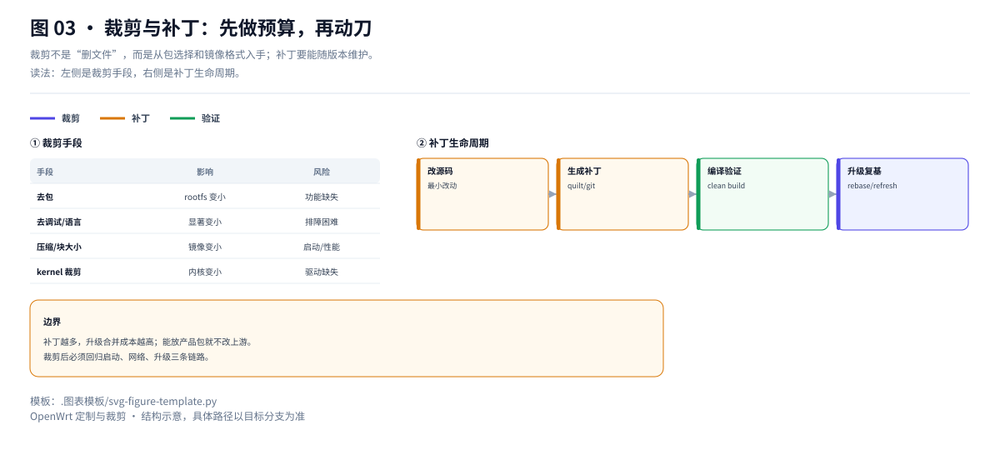

# 裁剪、补丁与 SDK 集成

一句话结论：裁剪要先有**镜像大小预算**，从包选择、调试信息、压缩格式入手；补丁要**最小化并可复基**；产品代码优先放私有 feed，用 SDK 单独编译，避免长期分叉上游。

> 本篇定位：讲裁剪手段、补丁生命周期与 SDK/私有 feed 的协作。品牌与默认配置见 [01-品牌与默认配置](./01-品牌与默认配置.md)；构建链见 [01-构建与包管理](../01-构建与包管理/.readme.md)。

## 目录

- [1 一句话模型](#s1)
- [2 速览](#s2)
- [3 裁剪、补丁与 SDK 对象](#s3)
- [4 裁剪与补丁流程](#s4)
- [5 状态机与定时器](#s5)
- [6 设计取舍与边界](#s6)
- [7 与相邻主题的关系](#s7)
- [名词解释](#名词解释)
- [8 参考与关联](#s8)

## 1 · 一句话模型

```text
预算（分区/镜像）──► 去包/去调试/换压缩 ──► 补丁（最小/可复基）──► SDK 编单包
```

三个关键认知：

1. **裁剪是预算问题**：先知道分区/镜像上限，再决定删什么，而不是“看着删”。
2. **补丁是负债**：每个补丁都要随内核/包升级复基，能上游化就上游化。
3. **SDK 与私有 feed 配合**：产品应用独立编译/版本化，主仓库只保留必要改动。

## 2 · 速览

| 项 | 内容 |
| --- | --- |
| 所属层/领域 | OpenWrt 产品化工程 |
| 核心对象 | 镜像预算、包集合、补丁、私有 feed、SDK |
| 关键入口 | `.config`、`target/linux/*/patches-*`、`package/*/patches` |
| 典型场景 | 小 Flash、去调试、驱动补丁、产品应用 |
| 主要标准 | OpenWrt 补丁/包约定；quilt 工作流 |

## 3 · 裁剪、补丁与 SDK 对象

| 对象/手段 | 作用 | 边界与误判 |
| --- | --- | --- |
| 分区/镜像上限 | 裁剪的硬约束 | 超限在镜像阶段才报错 |
| 去包 | 减小 rootfs | 可能破坏依赖/功能 |
| 去调试/语言包 | 显著减小 | 排障能力下降 |
| 压缩/块大小 | 减小镜像 | 影响启动时间/性能 |
| 内核裁剪 | 减小内核/模块 | 驱动缺失，回归成本高 |
| `target/linux/*/patches-*` | 内核/平台补丁 | 内核升级需复基 |
| `package/*/patches` | 单包补丁 | 包升级需复基 |
| quilt | 补丁管理工具 | 补丁顺序/刷新要一致 |
| 私有 feed | 产品包仓库 | 分支要与主仓库匹配 |
| SDK | 单包交叉编译 | 版本必须与固件同批 |

做预算时按组成拆，不要只盯一个总数：

| 组成 | 怎么量 | 压缩手段 | 风险 |
| --- | --- | --- | --- |
| 内核 + 模块 | kernel 镜像 + `/lib/modules` | 去掉不用的驱动/文件系统 | 硬件功能缺失，回归难 |
| 基础 rootfs | squashfs 体积 | 去语言包、文档、man | 现场排障能力下降 |
| 应用包 | 包体积汇总 | 去包或换轻量实现 | 依赖断裂 |
| 调试符号 | 二进制是否 strip | 开 strip | 现场无法用 gdb |

> **推论**：裁剪的收益是“省 Flash”，代价是“省掉的是排障与扩展能力”。所以顺序应是“先删明确不用的包，再删调试信息，最后才动内核”，并且每删一项都要记录，否则半年后没人知道为什么这个功能不可用。

## 4 · 裁剪与补丁流程



**读图**：左侧是裁剪手段与风险，右侧是补丁从修改到复基的生命周期。先做预算，再选择手段；补丁越少，升级越轻松。

> 图源：`images/图03-裁剪与补丁.svg`

### 4.1 裁剪路径

1. 确认分区/镜像上限与启动介质约束。
2. 统计当前镜像组成：内核、rootfs、包、调试信息。
3. 优先去包/去调试/去语言包，再考虑压缩与内核裁剪。
4. 每次裁剪后回归启动、网络、升级三条链路。

量体积的三个位置，分别对应“镜像 / 设备 / 包”：

```text
du -sh bin/targets/<target>/<subtarget>/    # 构建产物大小
df -h /overlay                              # 设备上可写层余量
opkg list-installed | wc -l                 # 设备上包数量（若用 opkg）
```

### 4.2 补丁路径

1. 在源码/包目录做最小修改。
2. 用 quilt/git 生成补丁，写清目的与上游状态。
3. 全量/单包编译验证。
4. 升级内核/包时复基补丁，冲突则重做或上游化。

### 4.3 异常分支

| 现象 | 原因 | 处理方向 |
| --- | --- | --- |
| 镜像仍超限 | 裁剪不彻底/分区小 | 重新做组成分析 |
| 裁剪后功能缺失 | 依赖未识别 | 查启动日志与包依赖 |
| 补丁编译失败 | 上游变更/上下文冲突 | 复基或重写 |
| 私有包版本不匹配 | feed 分支错 | 固定匹配分支/commit |
| SDK 编译产物不能装 | SDK 与固件不同批 | 换同批 SDK 重编 |

**补丁复基失败分三类**，处理方式不同：

| 类型 | 现象 | 处理 |
| --- | --- | --- |
| 上下文漂移 | hunk 失败、fuzz、`.rej` | 手工调整上下文，逻辑通常没变 |
| 接口/结构变更 | 编译报字段/函数不存在 | 按新 API 重写补丁 |
| 语义变化 | 能编过、行为变了 | 重新确认需求，可能不再需要该补丁 |

> **推论**：前两类是“机械劳动”，第三类是“重新设计”。复基时先判断属于哪类，能删的补丁优先删——上游已经修好的问题，保留补丁只会增加下次复基的成本。

## 5 · 状态机与定时器

没有运行时状态机。工程上跟踪的是**版本状态**：上游基线、补丁集、私有 feed commit、SDK 版本、镜像版本。没有定时器；复基周期由上游升级节奏决定。

## 6 · 设计取舍与边界

- **为什么先裁剪包而不是删文件**：包管理保证依赖与升级；直接删文件会留下坏依赖。
- **为什么补丁要最小**：减少复基冲突，便于上游化。
- **代价**：裁剪/补丁越多，回归与升级成本越高。
- **不适用**：Flash 充足且功能固定的产品，不必过度裁剪。
- **常见误判**：只看镜像大小不看运行时内存；只验证能启动，不验证升级。

> **推论**：补丁数量是产品化的“利息”——每加一个，后续每次内核/包升级都要付一次复基成本。所以能通过配置、包、自定义脚本解决的问题，不要用改源码补丁；补丁只留给“必须改上游行为”的场景。

> **边界**：裁剪到极限会改变产品定位：去掉调试信息后现场无法 gdb，去掉语言包后海外版本要重编。裁剪清单应作为产品决策记录，而不是构建时的临时动作。

## 7 · 与相邻主题的关系

| 相邻对象 | 关系 |
| --- | --- |
| [00-产品化定制总览](./00-产品化定制总览.md) | 分层与改动归属 |
| [01-品牌与默认配置](./01-品牌与默认配置.md) | 产品包与默认配置 |
| [01-构建与包管理/03-feeds 与包 Makefile](../01-构建与包管理/03-feeds与包Makefile.md) | 私有 feed 与包结构 |
| [01-构建与包管理/05-ImageBuilder、SDK 与 opkg](../01-构建与包管理/05-ImageBuilder-SDK与opkg.md) | SDK/ImageBuilder |
| [40-平台与芯片](../../../40-平台与芯片/.readme.md) | 厂商 SDK 与驱动补丁 |
| [05-升级与恢复](../05-升级与恢复/.readme.md) | 裁剪后的升级验证 |

一句话边界：本篇讲“怎么裁、怎么打补丁”，不讲具体厂商 SDK 的目录结构。

## 名词解释

> 缩写给出英文全称；非缩写用“—”表示。

| 术语 | 英文全称 | 解释 |
| --- | --- | --- |
| SDK | Software Development Kit | 针对已构建目标的交叉编译开发包。 |
| feed | — | 独立维护的包源码仓库。 |
| quilt | — | 管理补丁序列的工具。 |
| rebase | — | 把补丁重新应用到新基线上。 |
| rootfs | Root Filesystem | 根文件系统。 |
| squashfs | — | 只读压缩文件系统。 |
| UBI | Unsorted Block Images | NAND 逻辑卷管理层。 |
| regression | — | 回归验证，确认改动未破坏既有功能。 |

## 8 · 参考与关联

**标准**

- OpenWrt 官方 Patch、Package、SDK 文档；quilt 文档。

**关联**

- [本目录索引](./.readme.md)
- [01-构建与包管理/03-feeds 与包 Makefile](../01-构建与包管理/03-feeds与包Makefile.md)
- [01-构建与包管理/05-ImageBuilder、SDK 与 opkg](../01-构建与包管理/05-ImageBuilder-SDK与opkg.md)

---

> **本篇定位**：裁剪预算、补丁生命周期与 SDK/私有 feed。
> **素材来源**：`studyspace-v2/7.平台与集成/1.OpenWrt/1.构建体系/`、`6.包管理与生态/` 与产品化实践。
> **待验证**：补丁目录命名、SDK 包结构与厂商集成方式随版本变化。
