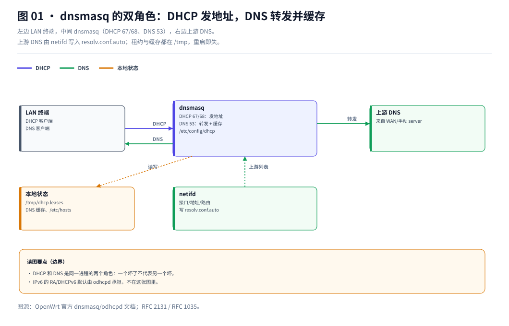

# dnsmasq 与 DHCP/DNS

dnsmasq 在 OpenWrt 里同时扮演两个角色：**给 LAN 侧发地址的 DHCP 服务器**（UDP 67/68）和**给 LAN 侧做解析的 DNS 转发/缓存**（UDP/TCP 53）。它不负责 WAN 拨号——上游地址、默认路由和上游 DNS 由 netifd 产出；dnsmasq 只是把上游 DNS 转给下游终端，并把结果缓存起来。

> 本篇定位：dnsmasq 的 DHCP 与 DNS 双角色、`/etc/config/dhcp` 的对象、租约与解析链路、与 netifd/odhcpd/防火墙的分工、常见失败判据。WAN 侧接入去 [04-WAN接入与PPPoE](../03-网络数据面/04-WAN接入与PPPoE.md)，接口模型去 [04-netifd设备与接口模型](../02-系统框架/04-netifd设备与接口模型.md)。

## 目录

- [1 一句话模型](#s1)
- [2 速览](#s2)
- [3 配置对象与字段](#s3)
- [4 DHCP 四步与租约](#s4)
- [5 DNS 解析链路与缓存](#s5)
- [6 与 netifd、odhcpd、防火墙的分工](#s6)
- [7 失败判据](#s7)
- [8 状态机与定时器](#s8)
- [9 设计取舍与边界](#s9)
- [10 与相邻主题的关系](#s10)
- [名词解释](#名词解释)
- [11 参考与关联](#s11)

## 1 · 一句话模型：上游给地址，下游发地址

```text
WAN：运营商 ──► netifd/proto ──► 地址 + 默认路由 + 上游 DNS
                                          │ 写 /tmp/resolv.conf.d/resolv.conf.auto
                                          ▼
LAN：终端 ◄── DHCP(67/68) ── dnsmasq ── DNS(53) ──► 上游 DNS
                                  │
                                  └─ 租约 /tmp/dhcp.leases、缓存、/etc/hosts
```

三个关键认知：

1. **dnsmasq 是“双角色”进程**：DHCP 和 DNS 共享同一份配置与同一个进程，但两条路径独立，一个坏了不代表另一个坏了。
2. **上游 DNS 不是 dnsmasq 配的**：它读 netifd 生成的 `resolv.conf.auto`（或手动 `server`），所以“WAN DNS 变了、LAN 没变”要先看这个文件。
3. **DNS 与 DHCP 都能单独关**：`port '0'` 只关 DNS，`ignore '1'` 只让某个接口不发地址。

## 2 · 速览

| 项 | 内容 |
| --- | --- |
| 所属层/领域 | OpenWrt 网络服务（LAN 侧） |
| 核心对象 | dnsmasq、`/etc/config/dhcp`、租约、上游 DNS |
| 关键端口 | DHCP 67/68（UDP）、DNS 53（UDP/TCP） |
| 关键文件 | `/tmp/dhcp.leases`、`/tmp/resolv.conf.d/resolv.conf.auto`、`/etc/hosts` |
| 典型场景 | 静态绑定、内网域名、DNS 污染排查、租约异常 |
| 主要标准 | RFC 2131（DHCP）、RFC 1035（DNS） |

## 3 · 配置对象与字段

全部在 `/etc/config/dhcp`，分三类：

| section | 作用 | 关键字段 | 边界与误判 |
| --- | --- | --- | --- |
| `dnsmasq` | DNS/DHCP 全局行为 | `domain`、`local`、`rebind_protection`、`cachesize`、`resolvfile`、`port` | `port '0'` 会关掉 DNS，只留 DHCP |
| `dhcp` | 某个接口的地址池 | `interface`、`start`、`limit`、`leasetime`、`ignore`、`dhcpv4`/`dhcpv6`/`ra` | 一个接口一个 section；`ignore` 只停 DHCP |
| `host` | 静态绑定/固定地址 | `name`、`mac`、`ip`、`dns`、`leasetime` | MAC 写错不会报错，只是不生效 |
| `domain` | 内网域名指向 | `name`、`ip` | 只影响解析，不影响路由 |
| `ipset` | 把域名结果写入 ipset | `name`、`domain` | 需要 ipset 支持与防火墙配合 |

几个最容易踩的全局项：

| 字段 | 作用 | 误配的后果 |
| --- | --- | --- |
| `rebind_protection '1'` | 拒绝上游返回私有地址的应答 | 内网上游用私网 IP 时，解析直接被拒 |
| `domainneeded '1'` | 只转发带点的域名 | 单标签主机名不会转发到上游 |
| `localservice '1'` | 只回答来自本地子网的查询 | 从 WAN 侧查会被拒（安全默认） |
| `authoritative '1'` | 对内网域名直接给 NXDOMAIN | 内网域名拼错时不会去上游兜底 |
| `cachesize` | DNS 缓存条数 | 太小会频繁回源，太大会占内存 |

> **边界**：`rebind_protection` 是安全机制，不是 bug。遇到“内网域名解析失败但公网正常”，先确认上游返回的地址是不是私有网段，再决定加 `rebind_domain` 例外，而不是直接关掉保护。

## 4 · DHCP 四步与租约

```text
终端：DHCPDISCOVER（广播，我要地址）
dnsmasq：DHCPOFFER（给你这个）
终端：DHCPREQUEST（我要这个）
dnsmasq：DHCPACK（确认，租约生效）
```

| 阶段 | 关键点 | 失败表现 |
| --- | --- | --- |
| DISCOVER/OFFER | 广播域内谁能应答 | 拿不到地址，终端自配 169.254 |
| REQUEST/ACK | 确认租约与参数（网关、DNS、租期） | 地址有但网关/DNS 为空 |
| 续租 | 到租期一半（T1）单播续租 | 续租失败后进入重绑定 |
| 释放 | 主动释放或到期 | 租约表残留旧记录 |

租约文件 `/tmp/dhcp.leases` 每行大致是“到期时间 MAC IP 主机名 客户端 ID”。**它是运行时文件，重启即清空**；要固定地址请写 `host` section，而不是改租约。

> **推论**：`/tmp/dhcp.leases` 里没有某台设备，不代表它没连过——租约可能被清理、也可能设备用的是静态 IP。判断“谁在线”要看 ARP/邻居表或无线关联表，不能只看租约。

## 5 · DNS 解析链路与缓存



**读图**：左边是 LAN 终端，右边是上游。DHCP 走 67/68，DNS 走 53；上游 DNS 来自 netifd 写出的 `resolv.conf.auto`，dnsmasq 只做转发与缓存。租约与缓存都在内存/`/tmp`，重启即失。

> 图源：`images/图01-dnsmasq双角色.svg`

一次解析的顺序（dnsmasq 视角）：

| 顺序 | 查什么 | 命中就返回 | 说明 |
| --- | --- | --- | --- |
| ① 本地 hosts | `/etc/hosts`、DHCP 租约主机名 | 是 | `expandhosts` 控制是否带域名后缀 |
| ② 内网域名 | `domain` section、`local` | 是 | 内网域名不走上游 |
| ③ 缓存 | 之前的应答（受 TTL 约束） | 是 | TTL 到期会重新回源 |
| ④ 上游 | `resolvfile` 里的服务器或 `server` | — | 多个上游按策略选择 |

| 观测点 | 命令 | 看什么 |
| --- | --- | --- |
| 上游列表 | `cat /tmp/resolv.conf.d/resolv.conf.auto` | netifd 是否写入了 DNS |
| 本机解析 | `nslookup example.com 127.0.0.1` | dnsmasq 本身是否正常 |
| 直连上游 | `nslookup example.com <上游IP>` | 上游是否可达 |
| 租约 | `cat /tmp/dhcp.leases` | 谁拿了什么地址 |

> **推论**：把“解析失败”分成三段测——终端到 dnsmasq、dnsmasq 到上游、上游到根——就能立刻判断是本地服务、上游配置还是运营商 DNS 的问题。直接抓包往往更慢。

## 6 · 与 netifd、odhcpd、防火墙的分工

| 组件 | 负责 | 不负责 |
| --- | --- | --- |
| netifd | 接口、地址、路由、上游 DNS 写入 | 不给 LAN 发地址 |
| dnsmasq | DHCPv4、DNS 转发/缓存、静态绑定 | 不做 RA/DHCPv6（默认） |
| odhcpd | IPv6 RA、DHCPv6、前缀委派 | 不做 IPv4 DHCP |
| 防火墙 | 放行 53/67/68、区域策略 | 不做地址分配 |

`/etc/config/dhcp` 里同一个 `dhcp` section 既写 `dhcpv4` 又写 `ra`/`dhcpv6`，但**执行者不同**：IPv4 由 dnsmasq，IPv6 的 RA/DHCPv6 由 odhcpd。所以“IPv6 没地址”要去查 odhcpd 与 RA，而不是 dnsmasq。

## 7 · 失败判据

| 现象 | 先查 | 再查 | 常见根因 |
| --- | --- | --- | --- |
| 终端拿不到 IP | `dhcp` section 的 `interface` 是否匹配 | dnsmasq 是否在跑、防火墙放行 67/68 | 接口名错、`ignore '1'` |
| 有 IP 无网关/DNS | DHCPOFFER 里的 option 是否下发 | `dhcp` 的 `dhcpv4` 设置 | 配了 `ignore`、上游未就绪 |
| 公网能通、域名不通 | `/tmp/resolv.conf.d/resolv.conf.auto` 是否为空 | 直连上游能否解析 | 上游 DNS 未下发/不可达 |
| 内网域名解析失败 | 上游返回是否私有地址 | `rebind_protection` 与 `rebind_domain` | 安全保护误伤 |
| 改了 hosts/domain 不生效 | 是否 commit + 重启 dnsmasq | 终端/本地缓存 TTL | 只改文件没重载 |
| DNS 很慢 | 上游 RTT 与丢包 | 缓存是否命中（cachesize） | 上游远、缓存太小 |

> **推论**：`dnsmasq` 的“改配置不生效”比别的服务更常见，因为它同时被 UCI、netifd（写 resolv.conf.auto）和 hotplug（接口事件）影响。判断时先确认“改的是哪一份”：`/etc/config/dhcp`、`resolv.conf.auto`、还是 `/etc/hosts`。

## 8 · 状态机与定时器

dnsmasq 没有连接状态机；它维护的是**租约表**与**DNS 缓存**，以及客户端的 DHCP 状态：

| 状态/定时器 | 作用 | 失败表现 |
| --- | --- | --- |
| 客户端 DHCP 状态 | INIT → SELECTING → REQUESTING → BOUND → RENEWING → REBINDING | 卡在 SELECTING：没有 OFFER |
| 租约 T1/T2 | 50%/87.5% 租期时续租/重绑定 | 续租失败后换地址或掉线 |
| DNS 缓存 TTL | 按记录 TTL 过期 | TTL 太长会“改了记录不生效” |
| 租约文件清理 | 到期删除或重启清空 | 看到旧租约误判在线设备 |

## 9 · 设计取舍与边界

- **为什么用 dnsmasq 而不是分开的 DHCP/DNS 服务**：一个进程、配置集中、资源占用小，适合嵌入式；代价是两者耦合在同一份配置与日志里。
- **为什么默认让 odhcpd 管 IPv6**：RA/DHCPv6/PD 的逻辑与 IPv4 差异大，拆开更清晰；代价是排障要区分两个进程。
- **为什么默认开 rebind protection**：防止上游 DNS 把内网地址“投毒”给终端；代价是内网权威 DNS 需要显式例外。
- **不适用**：需要 DNSSEC 验证、复杂视图（split-horizon）或大规模递归时，应换 unbound/BIND，而不是硬压 dnsmasq。
- **常见误判**：把“DNS 解析失败”当成“没网”；此时 ping IP 往往是通的。

## 10 · 与相邻主题的关系

| 相邻主题 | 关系 |
| --- | --- |
| [04-WAN接入与PPPoE](../03-网络数据面/04-WAN接入与PPPoE.md) | 上游地址与上游 DNS 的来源 |
| [04-netifd设备与接口模型](../02-系统框架/04-netifd设备与接口模型.md) | `dhcp` section 绑定的接口 |
| [03-UCI](../02-系统框架/03-UCI.md) | `/etc/config/dhcp` 的读写与生效 |
| [03-NAT与offload](../03-网络数据面/03-NAT与offload.md) | 终端出网时的地址转换 |
| [01-网络科学/DHCPv4](../../../10-基础理论/11-网络科学/05-应用层/01-DHCPv4.md) | DHCP 报文与状态机 |
| [01-网络科学/DNS](../../../10-基础理论/11-网络科学/05-应用层/03-DNS.md) | DNS 递归/迭代与缓存 |

一句话：**netifd 决定“往哪走”，dnsmasq 决定“给谁地址、帮谁解析”。**

## 名词解释

> 缩写给出英文全称；非缩写用“—”表示。

| 术语 | 英文全称 | 解释 |
| --- | --- | --- |
| dnsmasq | — | 轻量 DHCP + DNS 服务。 |
| DHCP | Dynamic Host Configuration Protocol | 动态主机配置协议。 |
| DNS | Domain Name System | 域名系统。 |
| lease | — | DHCP 租约，地址的有限期使用约定。 |
| T1 / T2 | — | 续租与重绑定定时器（租期的 50%/87.5%）。 |
| RA | Router Advertisement | 路由器通告（IPv6）。 |
| DHCPv6 | DHCP for IPv6 | IPv6 的动态地址配置。 |
| PD | Prefix Delegation | IPv6 前缀委派。 |
| odhcpd | OpenWrt DHCP Daemon | OpenWrt 的 IPv6 RA/DHCPv6 服务。 |
| TTL | Time To Live | DNS 记录的缓存生存时间。 |
| NXDOMAIN | — | 域名不存在的 DNS 应答码。 |
| rebind protection | — | 拒绝上游返回私有地址应答的防护。 |

## 11 · 参考与关联

**标准**

- RFC 2131 / 2132：DHCP。
- RFC 1035 / 1034：DNS。
- OpenWrt 官方 dnsmasq、odhcpd 与 DHCP 配置文档。

**关联**

- [04-WAN接入与PPPoE](../03-网络数据面/04-WAN接入与PPPoE.md)
- [04-netifd设备与接口模型](../02-系统框架/04-netifd设备与接口模型.md)
- [03-UCI](../02-系统框架/03-UCI.md)
- [本目录索引](./.readme.md)

---

> **本篇定位**：dnsmasq 的 DHCP/DNS 双角色、配置对象、租约与解析链路、失败判据；不展开 dnsmasq 源码与 DNSSEC 实现。
> **素材来源**：OpenWrt 官方 dnsmasq/odhcpd 文档与 `/etc/config/dhcp` 配置结构；本仓库 [04-WAN接入与PPPoE](../03-网络数据面/04-WAN接入与PPPoE.md)、[03-UCI](../02-系统框架/03-UCI.md) 的既有结论。
> **待验证**：各分支的 `cachesize` 默认值、`rebind_domain` 字段名与 hotplug 触发方式；IPv6 侧默认由 odhcpd 承担。
