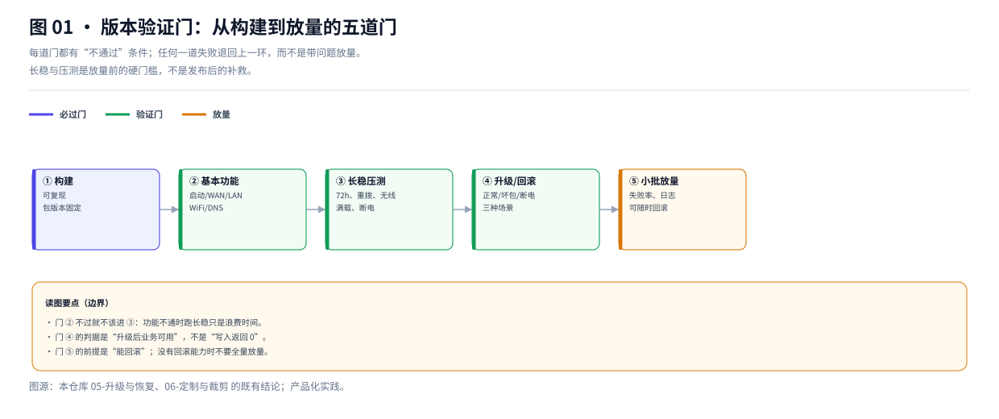

# 量产与稳定性

量产的门槛不是“能启动”，而是**每一台都能启动、连续跑 72 小时不退化、升级不砖、能回滚**。对应三件事：瘦身与启动优化（把资源留给业务）、长稳与压测（把偶发问题跑出来）、OTA 与版本迭代（把变更安全地送出去）。

> 本篇定位：量产阶段的验证方法、指标与判据、日志与 OTA 约束。裁剪手段本身去 [06-定制与裁剪/02-裁剪-补丁与SDK集成](../06-定制与裁剪/02-裁剪-补丁与SDK集成.md)，升级机制去 [05-升级与恢复/01-sysupgrade](../05-升级与恢复/01-sysupgrade.md)，分层定位去 [01-分层排障](./01-分层排障.md)。

## 目录

- [1 一句话模型](#s1)
- [2 速览](#s2)
- [3 瘦身与启动优化](#s3)
- [4 长稳与压测](#s4)
- [5 日志与异常上报](#s5)
- [6 OTA 与版本迭代](#s6)
- [7 版本验证门](#s7)
- [8 状态机与定时器](#s8)
- [9 设计取舍与边界](#s9)
- [10 与相邻主题的关系](#s10)
- [名词解释](#名词解释)
- [11 参考与关联](#s11)

## 1 · 一句话模型：先定指标，再谈“稳定”

```text
构建 ──► 瘦身/启动 ──► 功能回归 ──► 长稳压测 ──► OTA/回滚 ──► 放量
   │         │            │           │            │
 体积      时间          用例        指标趋势      可回滚
```

三个关键认知：

1. **“稳定”必须可量化**：没有指标和阈值，长稳测试只会得到“看起来还行”。
2. **量产问题多数是“退化”，不是“故障”**：内存缓慢上涨、启动慢几秒、重连变多，单次测试看不出来。
3. **OTA 是最后一道门，不是补丁手段**：升级失败能回滚，比“升级不出错”更现实。

## 2 · 速览

| 项 | 内容 |
| --- | --- |
| 所属层/领域 | OpenWrt 产品交付与运维 |
| 核心对象 | 镜像体积、启动时间、内存、连接数、升级包 |
| 关键指标 | 可用内存、conntrack 数、进程重启次数、重拨成功率、关联成功率 |
| 典型场景 | 版本发布前验证、现场问题复现、OTA 灰度 |
| 主要标准 | 无外部标准；以产品验收规范为准 |

## 3 · 瘦身与启动优化

### 3.1 瘦身的度量

| 维度 | 怎么量 | 目标 | 越界的后果 |
| --- | --- | --- | --- |
| 镜像体积 | `du -sh bin/targets/...`、设备上 `df -h` | 留 10%~15% 余量 | 升级写不下、overlay 不够 |
| 运行时内存 | `free`、`/proc/meminfo`、`slabtop` | 峰值留余量 | OOM、频繁回收、卡顿 |
| 启动时间 | 串口时间戳、`/proc/uptime` | 满足验收上限 | 上电到可用太慢 |
| 包数量 | `opkg list-installed` | 只留业务需要 | 攻击面与维护成本上升 |

### 3.2 启动慢的常见来源

| 来源 | 表现 | 手段 |
| --- | --- | --- |
| 串行等待 | 某个服务等网络/等设备超时 | 调整依赖与超时，别用固定 sleep |
| 服务过多 | rc.d 脚本逐个启动 | 裁剪服务、合并初始化 |
| 文件系统 | squashfs 块大小/压缩比不合适 | 调整块大小，权衡 CPU 与读放大 |
| 驱动初始化 | 射频/交换机校准耗时 | 查驱动日志，确认是否可延后 |

> **推论**：启动优化的收益有上限，且很容易用“延后启动”换数字——把服务挪到后台，`uptime` 好看但可用性没变。验收要看“业务可用时间”，不是“init 跑完的时间”。

## 4 · 长稳与压测



**读图**：从左到右五道门，每道门有明确的“不通过条件”。长稳不是最后补做的测试，而是放量前的硬门槛；任何一道门失败都退回上一环，而不是“带着问题放量”。

> 图源：`images/图01-版本验证门.svg`

### 4.1 必测项

| 测试 | 怎么做 | 通过判据 | 常见失败 |
| --- | --- | --- | --- |
| 72 小时长稳 | 正常业务 + 周期流量，持续 72h | 内存无单调上涨、无重启、无 OOM | 缓慢泄漏、看门狗复位 |
| 反复拨号 | WAN 断开/重连 N 次（如 500~1000） | 重拨成功率达标、无残留进程 | 拨号状态机卡死、socket 泄漏 |
| 无线压测 | 多终端反复关联/断开/漫游 | 关联成功率、掉线率达标 | 驱动队列卡死、认证失败累积 |
| 满载转发 | 双向打流到线速的 80%~90% | 吞吐稳定、时延不持续上升 | 队列堆积、CPU 软中断打满 |
| 断电测试 | 随机时刻断电，重复多次 | 每次都能启动、文件系统不损坏 | overlay 损坏、启动卡住 |
| 升级/回滚 | 正常升级、坏包升级、断电升级 | 能升级、能回滚、不砖 | 元数据缺失、回滚标记未写 |

### 4.2 指标怎么判“退化”

| 指标 | 采集 | 判据（趋势，不是绝对值） |
| --- | --- | --- |
| 可用内存 | `/proc/meminfo` 周期采样 | 无持续下降；稳态波动在合理范围 |
| slab | `/proc/slabinfo` | 无某个 cache 持续增长 |
| conntrack | `conntrack -C` 或 `/proc/sys/net/netfilter/nf_conntrack_count` | 不长期贴上限 |
| 进程重启 | procd 日志、`ubus call service list` | 长稳期间为 0（计划内重启除外） |
| WAN 重拨 | 拨号日志计数 | 成功率达标、间隔不异常 |
| 无线关联 | hostapd 事件计数 | 失败率不随运行时间上升 |
| 时延/丢包 | 周期 ping/iperf | 无随时间恶化的趋势 |

> **推论**：长稳要看“斜率”，不是“某一次的值”。内存从 40% 涨到 45% 不可怕，可怕的是每天稳定涨 1%；所以采样要按固定间隔落盘，事后画趋势，而不是只看测试结束那一刻。

## 5 · 日志与异常上报

| 级别 | 放什么 | 量产默认 |
| --- | --- | --- |
| error | 影响业务的失败（拨号失败、服务退出） | 保留 |
| warn | 可恢复异常（重试、超时） | 保留但限速 |
| info | 状态变化（接口 up/down、关联） | 按需 |
| debug | 报文/函数级细节 | 关闭（性能与隐私） |

要点：

1. **日志要能落盘且限大小**：`/tmp` 重启即失，持久化要写 flash，必须配轮转，避免写坏 Flash。
2. **异常要带上下文**：时间、接口、错误码、重试次数；只写“失败”无法定位。
3. **上报要可关闭**：现场/隐私场景必须能一键关闭，且默认最小化。

## 6 · OTA 与版本迭代

| 约束 | 做法 | 边界 |
| --- | --- | --- |
| 配置保留 | 固定保留清单，升级后 diff 默认值 | 跨大版本可能不兼容 |
| 兼容性 | 镜像带元数据与 `compat_version` | 改分区必须递增 |
| 回滚 | A/B 或保留旧镜像 | 单分区方案只能靠 factory 救 |
| 灰度 | 分批放量，观察失败率 | 没有回滚能力时不要全量 |
| 断电保护 | 写入阶段不可中断 | 掉电可能变砖 |

> **边界**：OTA 的“成功率”要按“升级后能正常业务”统计，不是按“写入返回 0”。写入成功但起不来，仍然是失败。

## 7 · 版本验证门

| 门 | 检查 | 不通过怎么办 |
| --- | --- | --- |
| ① 构建 | 可复现、包版本固定 | 修构建，不带病进测试 |
| ② 基本功能 | 启动、WAN、LAN、WiFi、DNS | 退回开发，不做长稳 |
| ③ 长稳/压测 | 第 4 节指标 | 定位泄漏/卡死，修完重跑 |
| ④ 升级/回滚 | 正常/坏包/断电三种场景 | 修升级脚本或回滚标记 |
| ⑤ 小批量放量 | 现场失败率、回传日志 | 停止放量，回滚 |

## 8 · 状态机与定时器

量产管理跟踪的是**版本状态**：开发中 → 候选 → 验证中 → 可放量 → 已放量 → 已弃用。没有运行时状态机；定时器是测试时长（72h）、采样间隔、灰度观察窗口。

## 9 · 设计取舍与边界

- **为什么先做功能回归再做长稳**：功能不通时跑 72 小时只是浪费机时。
- **为什么长稳要固定业务模型**：没有固定流量模型，指标不可比；两次测试的差异说不清是代码还是负载。
- **代价**：完整验证周期长，会拖慢发布；所以要把“必测项”和“抽测项”分开。
- **不适用**：一次性样机、内部验证可以缩短周期，但不能跳过升级/回滚验证。
- **常见误判**：把“跑了一天没重启”当成稳定；没看内存趋势与错误日志。

> **推论**：量产的稳定性是“设计出来的”，不是“测出来的”。测试只能证明“这版没退化”，不能把有泄漏的设计测成稳定；看到内存缓慢上涨，先查资源生命周期，而不是延长测试时间。

## 10 · 与相邻主题的关系

| 相邻主题 | 关系 |
| --- | --- |
| [06-定制与裁剪/02-裁剪-补丁与SDK集成](../06-定制与裁剪/02-裁剪-补丁与SDK集成.md) | 瘦身手段与补丁成本 |
| [05-升级与恢复/01-sysupgrade](../05-升级与恢复/01-sysupgrade.md) | 升级流程与配置保留 |
| [05-升级与恢复/02-双分区与回滚](../05-升级与恢复/02-双分区与回滚.md) | 回滚能力 |
| [01-分层排障](./01-分层排障.md) | 长稳发现的问题如何定位 |
| [30-产品与方案](../../../30-产品与方案/.readme.md) | 产品验收与运维要求 |

一句话：**量产看的是趋势与回滚能力，不是单次“能跑”。**

## 名词解释

> 缩写给出英文全称；非缩写用“—”表示。

| 术语 | 英文全称 | 解释 |
| --- | --- | --- |
| OTA | Over-the-Air | 远程升级。 |
| soak test | — | 长时间稳定性测试。 |
| OOM | Out Of Memory | 内存耗尽，内核会杀进程。 |
| slab | — | 内核对象缓存分配器。 |
| conntrack | Connection Tracking | 内核连接跟踪表。 |
| RSS | Resident Set Size | 进程常驻内存大小。 |
| A/B | — | 双分区启动与回滚方案。 |
| 灰度 | — | 分批放量发布。 |
| watchdog | — | 看门狗，超时未喂则复位。 |
| CDR | Call Detail Record | 话单（此处泛指业务记录）。 |

## 11 · 参考与关联

**标准**

- OpenWrt 官方 sysupgrade / procd / 日志文档。
- 产品验收规范（以项目为准）。

**关联**

- [01-分层排障](./01-分层排障.md)
- [05-升级与恢复/01-sysupgrade](../05-升级与恢复/01-sysupgrade.md)
- [06-定制与裁剪/02-裁剪-补丁与SDK集成](../06-定制与裁剪/02-裁剪-补丁与SDK集成.md)
- [本目录索引](./.readme.md)

---

> **本篇定位**：量产阶段的瘦身、长稳、压测、日志与 OTA 验证门；不提供具体测试脚本与厂商产线流程。
> **素材来源**：OpenWrt 官方升级/服务管理文档与本仓库既有结论；产品化实践。
> **待验证**：各产品的验收阈值（启动时间、内存上限、重拨成功率）以项目规范为准。
