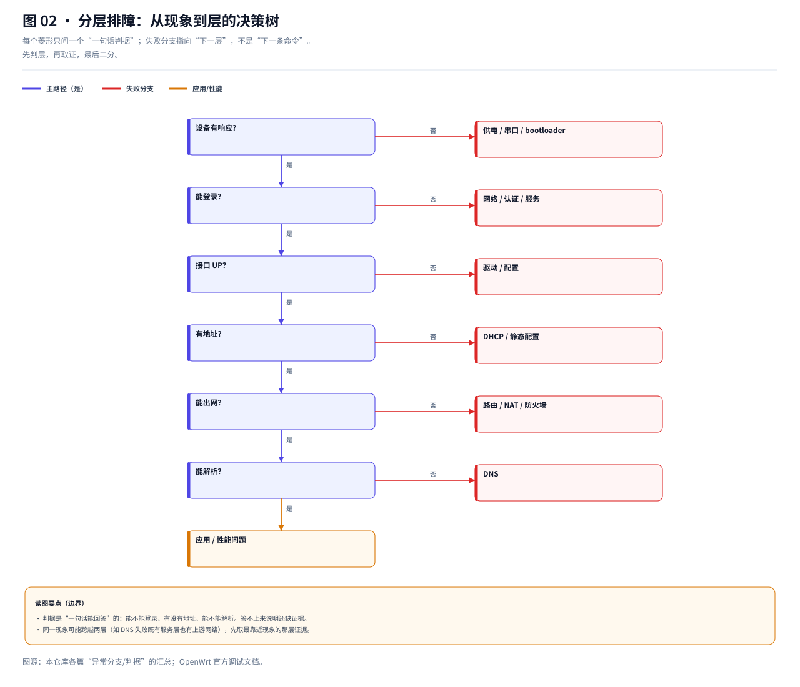

# 分层排障

OpenWrt 的故障几乎都能落到五层之一：**应用/配置 → 服务 → 框架 → 内核 → 驱动/硬件**。分层排障的价值不是“多背几张表”，而是**用最少的动作判断问题在哪一层**——层判错了，后面查得再细也是白查。

> 本篇定位：跨层定位的方法、四类典型现象的走查、构建失败复盘。各层的机制细节去 [02-系统框架](../02-系统框架/.readme.md)、[03-网络数据面](../03-网络数据面/.readme.md)、[04-无线](../04-无线/.readme.md)；量产验证去 [00-量产与稳定性](./00-量产与稳定性.md)。

## 目录

- [1 一句话模型](#s1)
- [2 速览](#s2)
- [3 五层模型](#s3)
- [4 定位四招：换、比、停、看](#s4)
- [5 四类现象走查](#s5)
- [6 构建失败复盘](#s6)
- [7 决策树](#s7)
- [8 状态机与定时器](#s8)
- [9 设计取舍与边界](#s9)
- [10 与相邻主题的关系](#s10)
- [名词解释](#名词解释)
- [11 参考与关联](#s11)

## 1 · 一句话模型：先定位层，再找证据

```text
现象 ──► 它在哪一层被破坏？ ──► 这一层有什么证据？ ──► 二分验证
          （配置/服务/框架/内核/驱动）      （状态/日志/计数）      （换/比/停）
```

三个关键认知：

1. **“网不通”不是一层的问题**：它至少涉及接口、地址、路由、NAT、防火墙、DNS 六件事。
2. **每层都有“一句话判据”**：能登录说明系统层没全坏；能 ping 网关说明二层/三层通；能解析说明 DNS 链正常。
3. **二分比穷举快**：关掉 offload、换一个口、换一台终端、停一个服务，每次只改一个变量。

## 2 · 速览

| 项 | 内容 |
| --- | --- |
| 所属层/领域 | OpenWrt 运维与调试 |
| 核心对象 | 现象、层、证据、二分 |
| 关键入口 | `logread`、`ubus`、`ip`/`nft`/`tc`、`dmesg` |
| 典型场景 | WiFi 连上不能上网、有线不通、拨号失败、升级后异常 |
| 主要标准 | 无外部标准；方法为主 |

## 3 · 五层模型

| 层 | 管什么 | 代表组件 | 一句话判据 |
| --- | --- | --- | --- |
| 应用/配置 | 业务参数、页面、脚本 | LuCI、UCI 配置、业务进程 | 配置值与预期一致 |
| 服务 | 谁在跑、有没有退出 | procd、hostapd、dnsmasq、netifd | 进程在、日志无反复退出 |
| 框架 | 配置如何变成运行态 | UCI→netifd→内核、ubus 事件 | ubus 状态与配置一致 |
| 内核 | 转发、NAT、路由、队列 | netfilter、conntrack、bridge、tc | 计数/表项符合预期 |
| 驱动/硬件 | 链路、射频、指示灯 | 网卡/无线驱动、DSA、firmware | `ip link`、`iw`、dmesg 正常 |

> **推论**：五层里只有“应用/配置”是持久的，其余四层都是运行态。**重启后恢复**说明问题在服务/框架/内核/驱动；**重启后仍错**才回到配置层。这一条能省掉一半试错。

## 4 · 定位四招：换、比、停、看

| 招式 | 怎么做 | 能排除什么 | 代价 |
| --- | --- | --- | --- |
| 换 | 换终端、换网线、换端口、换信道 | 终端侧、物理链路 | 需要备件 |
| 比 | 与同型号好设备对比配置/版本 | 配置差异、版本退化 | 需要对照机 |
| 停 | 停服务、关 offload、关防火墙一段规则 | 服务冲突、快路径绕过 | 会中断业务 |
| 看 | 日志、计数、状态、抓包 | 直接证据 | 需要知道看哪里 |

顺序建议：**先看（成本最低）→ 再比 → 再停 → 最后换**。反过来会浪费时间在拆机上。

## 5 · 四类现象走查



**读图**：从顶部现象出发，每个菱形问一个“一句话判据”。先走“能不能拿到 IP”，再走“能不能解析”，最后才看吞吐/时延。注意每条失败分支都指向“下一层”，而不是“下一步命令”。

> 图源：`images/图02-分层排障决策树.svg`

### 5.1 WiFi 连上但不能上网

| 步骤 | 判据 | 不通指向 |
| --- | --- | --- |
| ① 关联成功？ | hostapd 日志有 `AP-STA-CONNECTED` | 无线认证/加密（服务层） |
| ② 拿到 IP？ | 终端 `ip addr`、`/tmp/dhcp.leases` | DHCP/dnsmasq（服务层） |
| ③ 能 ping 网关？ | ping 路由器 LAN 地址 | 二层/桥/VLAN（内核层） |
| ④ 能 ping 公网 IP？ | ping 8.8.8.8 | 路由/NAT/防火墙（内核层） |
| ⑤ 能解析？ | nslookup 域名 | DNS 链路（服务层） |

这五步把“上不了网”拆成四种完全不同的故障，修法各不相同。

### 5.2 有线口不通

| 步骤 | 判据 | 可能原因 |
| --- | --- | --- |
| ① 链路 up？ | `ip link` 有 `LOWER_UP`、ethtool 速率 | 网线/对端口/驱动 |
| ② 在桥里？ | `bridge link show` | 配置漏加成员 |
| ③ VLAN 对？ | `bridge vlan show` | PVID/tagged 配错 |
| ④ 拿到地址？ | 租约/静态配置 | DHCP 或地址配置 |

### 5.3 拨号失败

| 步骤 | 判据 | 可能原因 |
| --- | --- | --- |
| ① 物理链路 | 网口 up、光猫侧正常 | 线路/光猫 |
| ② 认证 | 拨号日志的认证结果 | 账号/绑定/VLAN |
| ③ 地址与路由 | `ip addr`、`ip route` | 上游无响应、配置错 |
| ④ DNS/NAT | 解析与出网 | 上游 DNS、NAT/防火墙 |

### 5.4 升级后异常

| 步骤 | 判据 | 可能原因 |
| --- | --- | --- |
| ① 起没起来 | 串口/SSH 是否可达 | 镜像/分区/回滚 |
| ② 配置是否被保留 | 关键项与备份对比 | 保留清单缺失 |
| ③ 服务是否退化 | 进程、日志、版本 | 跨版本不兼容 |
| ④ 数据面是否正常 | 吞吐、NAT、无线 | 驱动/配置变化 |

> **边界**：升级后的异常先怀疑“配置保留”，再怀疑“镜像本身”。跨版本配置不兼容比新固件 bug 更常见。

## 6 · 构建失败复盘

| 步骤 | 做什么 | 判据 |
| --- | --- | --- |
| ① 找第一个错误 | 从日志开头找，不是最后一行 | 后面的错误多是连锁反应 |
| ② 判断阶段 | 配置/扫描/编译/镜像 | 决定看哪份日志 |
| ③ 单包复现 | `make package/<pkg>/compile V=s` | 缩小到包级 |
| ④ 分层清理 | 包 clean → tmp → dirclean | 不清工具链，省时间 |
| ⑤ 记录 | 改动、版本、复现命令 | 下次同类问题直接用 |

> **推论**：构建日志的“最后一行”通常是 `make: *** [target] Error 1`，信息量为零。真正的错误在更早的位置；用 `grep -n -i error` 从前往后找第一条。

## 7 · 决策树

```text
设备有响应？
├─ 否 → 供电/串口/bootloader → 硬件或引导层
└─ 是 → 能登录？
        ├─ 否 → 网络/认证/服务 → 服务层
        └─ 是 → 接口 UP？
                ├─ 否 → 驱动/配置 → 驱动或框架层
                └─ 是 → 有地址？
                        ├─ 否 → DHCP/静态配置 → 服务层
                        └─ 是 → 能出网？
                                ├─ 否 → 路由/NAT/防火墙 → 内核层
                                └─ 是 → 能解析？
                                        ├─ 否 → DNS → 服务层
                                        └─ 是 → 应用/性能问题
```

## 8 · 状态机与定时器

排障方法本身没有状态机与定时器。需要计时的只有两类：**偶发问题的观察窗口**（多久复现一次、持续多久）和**变更后的观察期**（升级/改配置后至少观察一个业务周期）。

## 9 · 设计取舍与边界

- **为什么分层而不是按现象查表**：现象会组合，层不会。同一层的问题无论表现成什么样，证据都在同一批命令里。
- **为什么先看后换**：看是只读操作，成本最低；换要拆机、要备件，且会引入新变量。
- **代价**：分层要求知道每层“看什么”，入门门槛比“照着步骤点”高。
- **不适用**：硬件损坏、供电异常这类问题，分层只能帮你确认“不是软件层”，不能修。
- **常见误判**：把“重启好了”当成修好了；没找到层，问题会复发。

> **推论**：排障的终点不是“恢复了”，而是“说得出哪一层坏了、为什么坏”。只恢复不定位，等于把问题留到量产现场。

## 10 · 与相邻主题的关系

| 相邻主题 | 关系 |
| --- | --- |
| [02-系统框架/05-netifd接口生命周期](../02-系统框架/05-netifd接口生命周期.md) | 接口状态与等待点 |
| [03-网络数据面/00-数据面总览](../03-网络数据面/00-数据面总览.md) | 分段验证的观测点 |
| [04-无线/00-无线子系统总览](../04-无线/00-无线子系统总览.md) | 无线五步查 |
| [07-网络服务/00-dnsmasq与DHCP-DNS](../07-网络服务/00-dnsmasq与DHCP-DNS.md) | DNS/DHCP 判据 |
| [00-量产与稳定性](./00-量产与稳定性.md) | 长稳发现问题的定位 |
| [05-升级与恢复](../05-升级与恢复/.readme.md) | 升级失败的分段 |

一句话：**先判层，再取证，最后二分——层判对，问题就小了一半。**

## 名词解释

> 缩写给出英文全称；非缩写用“—”表示。

| 术语 | 英文全称 | 解释 |
| --- | --- | --- |
| L1–L5 | — | 本文的五层：应用、服务、框架、内核、驱动。 |
| offload | — | 转发快路径，可能绕过部分钩子。 |
| conntrack | Connection Tracking | 内核连接跟踪。 |
| FDB | Forwarding Database | 桥的 MAC 转发表。 |
| PVID | Port VLAN ID | 端口默认 VLAN。 |
| procd | Process Daemon | OpenWrt 的 init 与服务管理。 |
| ubus | OpenWrt Bus | 进程间通信总线。 |
| dmesg | — | 内核环形缓冲区日志。 |
| 二分 | — | 每次只改一个变量，缩小范围。 |

## 11 · 参考与关联

**标准**

- OpenWrt 官方调试与日志文档；Linux 网络工具手册。

**关联**

- [00-量产与稳定性](./00-量产与稳定性.md)
- [03-网络数据面/00-数据面总览](../03-网络数据面/00-数据面总览.md)
- [02-系统框架/05-netifd接口生命周期](../02-系统框架/05-netifd接口生命周期.md)
- [本目录索引](./.readme.md)

---

> **本篇定位**：跨层定位方法、四类现象走查与构建失败复盘；不替代各层的机制细节。
> **素材来源**：本仓库各篇的“异常分支/判据”汇总与产品化实践；OpenWrt 官方调试文档。
> **待验证**：具体命令与日志字段随分支/平台变化，以目标系统为准。
