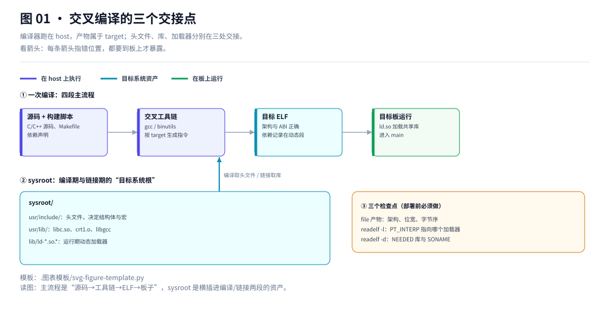

# 交叉编译模型与工具链

一句话结论：交叉编译是**在 host 上跑编译器、产出 target 的 ELF**；能不能跑起来不取决于“编译成功”，而取决于**三元组、sysroot、动态加载器三者一致**。

> 本篇定位：讲工具链的组成、三元组语义、sysroot 的作用与一次完整编译的交接点。ABI 具体冲突与报错对照见 [01-ABI与sysroot兼容](./01-ABI与sysroot兼容.md)；构建系统如何组织这些工具链见 [02-构建系统与Yocto](./02-构建系统与Yocto.md)。

## 目录

- [1 一句话模型](#s1)
- [2 速览](#s2)
- [3 工具链组成与三元组](#s3)
- [4 一次交叉编译的流程](#s4)
- [5 状态机与定时器](#s5)
- [6 设计取舍与边界](#s6)
- [7 与相邻主题的关系](#s7)
- [名词解释](#名词解释)
- [8 参考与关联](#s8)

## 1 · 一句话模型

```text
源码 ──target-gcc──► 目标 ELF ──复制──► 目标板 ──ld.so──► 进程
         │                 │                        │
      sysroot            interpreter             库版本
```

三个关键认知：

1. **编译器跑在 host，产物属于 target**：两者架构、字长、字节序、浮点 ABI 都可能不同。
2. **sysroot 是“目标系统的根”**：头文件、库、启动文件都从它取，不是从 host 的 `/usr` 取。
3. **链接成功 ≠ 能运行**：ELF 里记录的动态加载器路径和目标板上的实际路径必须对得上。

## 2 · 速览

| 项 | 内容 |
| --- | --- |
| 所属层/领域 | 嵌入式构建基础 |
| 核心对象 | 工具链（gcc/binutils/libc）、sysroot、三元组、ELF |
| 关键参数 | `--target`、`--sysroot`、`-march`、`-mfloat-abi`、`-static` |
| 典型场景 | 为 ARM/MIPS/AArch64 板卡编译内核、驱动、应用 |
| 主要标准 | ELF（System V ABI）、AAPCS、各架构 psABI |

## 3 · 工具链组成与三元组

### 3.1 工具链由哪些东西组成

| 组件 | 作用 | 缺失/错配时的现象 |
| --- | --- | --- |
| `binutils` | `as`/`ld`/`objcopy`/`readelf`，负责汇编与链接 | 链接报 `cannot find -lxxx`、`unrecognized relocation` |
| `gcc` | 驱动编译全流程，按 target 生成指令 | 生成 host 架构的 `.o`，板上 `Exec format error` |
| C 库（glibc/musl/uClibc） | 提供 `libc.so`、`ld.so`、头文件 | 运行期缺符号、`version GLIBC_x.y not found` |
| 启动文件（crt） | `crt1.o`/`crti.o`/`crtn.o`，负责 `_start` 与 `__libc_start_main` | 链接报 `cannot find crt1.o` |
| sysroot | 目标头文件与库的“虚拟根” | 不小心链到 host 的 `/usr/lib`，产物混入 host 库 |
| 调试器 | `gdb`/`gdbserver`，跨架构调试 | 只能用 printf 定位问题 |

### 3.2 三元组怎么读

```text
aarch64-openwrt-linux-musl
   │      │      │     └── ABI / C 库
   │      │      └──────── OS
   │      └─────────────── vendor（可省略）
   └────────────────────── 架构
```

| 字段 | 作用 | 边界 |
| --- | --- | --- |
| 架构 | 决定指令集与位宽（`arm`、`aarch64`、`mips`） | 同一架构还有 `-march`/`-mcpu` 细分 |
| vendor | 工具链发行方标识，多数情况不参与语义 | 不同厂商命名不一致，不要靠它判断 ABI |
| OS | 决定系统调用与对象格式（`linux`、`none-eabi`） | 裸机用 `none-eabi`，没有 libc |
| ABI | 决定浮点、C 库（`gnueabihf`、`musl`） | 最容易出错的一段，见下一篇 |

同一个板子，用 `arm-linux-gnueabi-` 和 `arm-linux-gnueabihf-` 编出来的程序**不能互换**：前者按软浮点传参，后者按硬浮点寄存器传参。

## 4 · 一次交叉编译的流程



**读图**：左侧是 host 上的工具链，中间是 sysroot（目标头文件与库），右侧是目标板；三条箭头分别代表“编译取头文件”“链接取库与启动文件”“运行取动态加载器”，任一条指错位置都会在板上才暴露。

> 图源：`images/图01-交叉编译的交接点.svg`

### 4.1 正常流程

```text
① 选工具链（与板子的架构/ABI 一致）
② 设置 sysroot（工具链自带或 SDK 提供）
③ 编译：gcc -c → .o（此时只依赖头文件）
④ 链接：ld 按 sysroot 找 crt*.o、libc、libgcc
⑤ 检查：file / readelf -l / readelf -d
⑥ 部署：ELF + 依赖库 + 加载器一起上板
```

要点：

- **编译阶段**只关心头文件与宏；头文件版本错，可能编过但结构体布局不同。
- **链接阶段**才把库和启动文件拉进来；`-L` 顺序决定同名库谁先被选中。
- **部署阶段**要保证 `readelf -l` 里的 `interpreter` 在板上存在。

### 4.2 异常分支：三条典型路径

| 现象 | 根因 | 定位手段 |
| --- | --- | --- |
| 板上执行报 `No such file or directory` | 动态加载器路径不存在（不是文件丢了） | `readelf -l app \| grep interpreter`，对照板上 `/lib/ld-*` |
| 链接报 `cannot find crt1.o` | 工具链不完整或 `--sysroot` 指错 | `gcc -print-sysroot`、`find` 找 `crt1.o` |
| 运行报 `Illegal instruction` | `-march`/`-mcpu` 高于板子，或浮点 ABI 不匹配 | 比对工具链 `-mcpu` 与 SoC 手册 |

## 5 · 状态机与定时器

本主题**没有运行期状态机，也没有定时器**；只有构建阶段的状态迁移：

```text
预处理 → 编译 → 汇编 → 链接 → 部署
```

每个阶段都可能“成功但产物不对”，所以检查点要放在**链接产物**（`file`/`readelf`）和**板上首跑**，而不是只看 `gcc` 返回码。

## 6 · 设计取舍与边界

### 6.1 为什么用 sysroot 而不是 `-I`/`-L` 堆路径

`-I`/`-L` 只影响查找顺序，仍可能悄悄用到 host 的头文件；`--sysroot` 改变的是“根”，让 `#include <stdio.h>`、`-lc`、`crt1.o` 全部落在目标系统里。代价是每套 target 要维护一份完整 sysroot。

### 6.2 静态链接 vs 动态链接

- 静态：部署简单、无加载器依赖，适合救援工具、initramfs；代价是体积大、libc 安全更新要重编。
- 动态：体积小、多进程共享；代价是必须保证板上库版本与加载器路径匹配。

### 6.3 优化等级与可调试性

`-O2` 会重排代码、内联函数，`gdb` 的单步与变量观察会失真；发布版保留 `-g` 的独立调试符号（`objcopy --only-keep-debug`）比直接 `-O0` 更实用。

### 6.4 什么时候不适用

- 目标性能足够、只是想跑脚本：直接带 Python/BusyBox 上板，不必交叉编译。
- 需要 GPU/NPU 专用运行时：优先用厂商 SDK 自带的工具链与 sysroot，混用通用工具链常缺专有库。

### 6.5 常见误判

- **“编译通过就能跑”**：交叉编译最常见的错觉，真正的验证在板上。
- **“换个 gcc 版本无所谓”**：libstdc++/glibc 的符号版本会随工具链变化。
- **“把 host 的 `.so` 拷过去就行”**：架构不同，加载即失败。

## 7 · 与相邻主题的关系

| 相邻对象 | 关系 |
| --- | --- |
| [01-ABI与sysroot兼容](./01-ABI与sysroot兼容.md) | 本篇的“一致性”展开成具体 ABI 冲突 |
| [02-构建系统与Yocto](./02-构建系统与Yocto.md) | 工具链与 sysroot 由构建系统批量产出 |
| [13-计算机基础/02-编译与链接](../../../10-基础理论/13-计算机基础/02-编译与链接.md) | 编译、链接、ELF 的通用原理 |
| [55-构建与调试](../../../50-软件开发/55-构建与调试/.readme.md) | Make/CMake 与本机调试 |
| [22-OpenWrt/01-构建与包管理](../../22-OpenWrt/01-构建与包管理/.readme.md) | OpenWrt 如何生成并使用自己的工具链 |

一句话：**本篇管“工具怎么摆、路径怎么指”，ABI 篇管“摆对了为什么还跑不起来”。**

## 名词解释

> 缩写给出英文全称；非缩写用“—”表示。

| 术语 | 英文全称 | 解释 |
| --- | --- | --- |
| host | — | 执行编译的机器，通常是 x86_64 开发机。 |
| target | — | 最终运行产物的设备，架构可与 host 不同。 |
| 三元组 | Target Triple | `arch-vendor-os-abi` 形式的工具链标识。 |
| sysroot | System Root | 目标系统头文件与库的根目录。 |
| ELF | Executable and Linkable Format | Linux 下可执行文件、目标文件、共享库的格式。 |
| ABI | Application Binary Interface | 二进制层面的调用约定、数据布局与符号规则。 |
| libc | C Standard Library | C 标准库实现，常见 glibc、musl、uClibc。 |
| ld.so | Dynamic Linker/Loader | 运行期加载共享库并重定位的程序。 |
| binutils | Binary Utilities | 汇编器、链接器、目标文件工具集合。 |
| CRT | C Runtime Startup | `crt1.o` 等启动文件，负责进入 `main` 前的初始化。 |
| DSO | Dynamic Shared Object | 动态共享库（`.so`）。 |
| PIE | Position Independent Executable | 位置无关可执行文件，配合 ASLR。 |

## 8 · 参考与关联

**参考**

- GCC 手册：`--sysroot`、`-print-sysroot`、`--target` 选项说明
- System V ABI 与各架构 psABI（ARM AAPCS、AArch64 PCS）
- musl libc 文档：动态加载器与 ABI 说明
- 源仓库 `4.其他技能/6.yocto/m-01-用于嵌入式系统的Linux-笔记.md`

**关联**

- [01-ABI与sysroot兼容](./01-ABI与sysroot兼容.md)
- [02-构建系统与Yocto](./02-构建系统与Yocto.md)
- [21-Linux/02-驱动与设备树](../../21-Linux/02-驱动与设备树/.readme.md)
- [23-嵌入式基础](../.readme.md)

---

> **本篇定位**：交叉编译的工具链组成、三元组语义、sysroot 与部署检查点。
> **素材来源**：`studyspace/4.其他技能/6.yocto/`（嵌入式 Linux 与构建系统背景）；通用交叉编译知识补写。
> **待验证**：不同厂商工具链的 sysroot 布局、默认 `-march` 与加载器路径差异较大，需以实际 SDK 为准。
