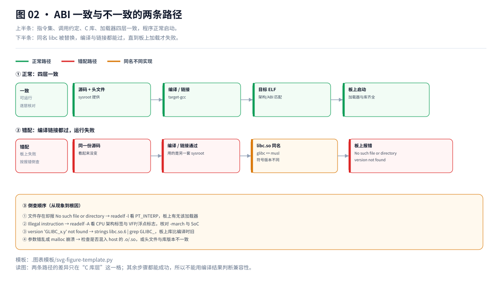

# ABI 与 sysroot 兼容

一句话结论：交叉编译的“跑不起来”绝大多数不是代码错，而是**二进制接口对不上**——浮点 ABI、C 库、符号版本、加载器路径四者中任意一个不一致，都会在板上才报错。

> 本篇定位：把 ABI 拆成可检查的几层，给出“现象 → 根因 → 验证命令”的对照。工具链怎么摆见 [00-交叉编译模型与工具链](./00-交叉编译模型与工具链.md)；构建系统如何锁定 ABI 见 [02-构建系统与Yocto](./02-构建系统与Yocto.md)。

## 目录

- [1 一句话模型](#s1)
- [2 速览](#s2)
- [3 ABI 的四层与 sysroot 结构](#s3)
- [4 错配的定位流程](#s4)
- [5 状态机与定时器](#s5)
- [6 设计取舍与边界](#s6)
- [7 与相邻主题的关系](#s7)
- [名词解释](#名词解释)
- [8 参考与关联](#s8)

## 1 · 一句话模型

```text
源码 ──头文件 ABI──► .o ──调用约定/符号──► 可执行文件
                                            │
                     加载器 + 共享库版本 ────┘   ← 不一致则板上失败
```

三个关键认知：

1. **ABI 是“编译期约定 + 运行期实现”两半**：头文件决定前者，板上的 `.so` 决定后者。
2. **同名不同 ABI 的库不能混用**：`libc.so.6` 在 glibc 与 musl 下语义完全不同。
3. **报错信息会骗人**：`No such file or directory` 往往指加载器缺失，不是文件真的不存在。

## 2 · 速览

| 项 | 内容 |
| --- | --- |
| 所属层/领域 | 嵌入式构建基础 / 兼容性 |
| 核心对象 | EABI、浮点调用约定、C 库、符号版本、`ld.so` |
| 关键参数 | `-mfloat-abi=hard/softfp/soft`、`-mabi=`、`--sysroot=` |
| 典型场景 | 换工具链、换 SDK、升级根文件系统后程序起不来 |
| 主要标准 | ARM AAPCS / EABI、AArch64 PCS、System V ABI、LSB 符号版本 |

## 3 · ABI 的四层与 sysroot 结构

### 3.1 按“出错顺序”分四层

| 层 | 内容 | 不一致时的现象 |
| --- | --- | --- |
| 指令集层 | 架构、位宽、字节序、`-march`/`-mcpu` | `Illegal instruction`、`Exec format error` |
| 调用约定层 | 参数寄存器、栈对齐、结构体传值、浮点 ABI | 参数错乱、浮点结果异常、栈崩溃 |
| C 库层 | glibc / musl / uClibc，`libc.so` 与头文件 | 缺符号、`version GLIBC_2.x not found` |
| 加载器层 | `ld.so` 路径、`SONAME`、`rpath` | `No such file or directory`、加载到错误库 |

### 3.2 sysroot 的典型布局

```text
sysroot/
├── usr/include/            # 头文件
├── usr/lib/                # 目标库、crt*.o
├── lib/                    # 加载器与基础库
│   └── ld-musl-aarch64.so.1
└── usr/lib/<triple>/       # 部分 SDK 的多架构布局
```

| 路径 | 作用 | 边界 |
| --- | --- | --- |
| `usr/include` | 编译期结构体与宏定义 | 与板上库不同版本时，结构体布局可能已变 |
| `usr/lib` | 链接期 `-lxxx` 的搜索目标 | `-L` 手加路径会破坏顺序 |
| `lib/ld-*.so.*` | 运行期加载器 | 路径写死在 ELF 的 `PT_INTERP` 里 |
| `usr/lib/<triple>` | 多 ABI 共存时的隔离目录 | 只有部分发行版采用 |

### 3.3 浮点 ABI 的三种取值

| 取值 | 参数传递 | 适用 | 风险 |
| --- | --- | --- | --- |
| `soft` | 全部用整数寄存器/栈模拟 | 无 FPU 的老芯片 | 性能差，但与硬浮点库不兼容 |
| `softfp` | 用 FPU 指令，但按整数寄存器传参 | 需要兼容软浮点生态 | 仍不能与 hard 库混链 |
| `hard` | 用 FPU 寄存器传参 | 现代 ARMv7+/AArch64 | 与 `gnueabi` 工具链产物互不兼容 |

AArch64 默认就是硬浮点，没有 `gnueabihf` 这一层差异；**这套区分主要出现在 32 位 ARM**。

## 4 · 错配的定位流程



**读图**：上半条是四层全部一致的正常路径；下半条在“C 库层”分叉，同名 `libc.so` 被替换后，编译能过、链接能过，直到板上加载才失败。箭头标注的是每层最直接的验证命令。

> 图源：`images/图02-ABI一致与不一致.svg`

### 4.1 正常流程：换工具链后的五步核对

```text
① file 产物           → 架构/位宽/字节序
② readelf -l          → interpreter 路径
③ readelf -d          → NEEDED 库与 SONAME
④ readelf --version-info → 依赖的符号版本
⑤ 板上 ls/ldd         → 加载器与库是否真的存在
```

### 4.2 异常分支对照表

| 现象 | 根因 | 验证 |
| --- | --- | --- |
| `No such file or directory`（文件明明存在） | `PT_INTERP` 指向的加载器不存在 | `readelf -l app \| grep interpreter` |
| `Illegal instruction` | `-march` 超出 SoC，或 hard/soft 浮点不符 | `readelf -A app` 看 Tag_CPU_arch、VFP 标志 |
| `version 'GLIBC_2.34' not found` | 板上 libc 比编译时旧 | `strings libc.so.6 \| grep GLIBC_` |
| `undefined symbol: ...` | 库同名但实现不同（glibc ↔ musl） | `nm -D` 对比符号表 |
| 参数值错乱、浮点变成 0 | 调用约定不一致（混入 host `.o`） | `file` 检查每个 `.o` 的架构 |
| 段错误在 `malloc` 内部 | 头文件与库版本不一致导致结构体布局不同 | 统一 sysroot，清理 `-I` 手加路径 |

### 4.3 sysroot 混用的典型来源

- Makefile 里同时写了 `-I/usr/include` 和 `--sysroot`，前者优先级更高。
- `pkg-config` 指向 host 的 `.pc` 文件，把 host 的 `-I`/`-L` 带进来。
- 第三方库自带的 `configure` 缓存了上次 host 编译的结果（`config.cache`）。
- 直接拷贝别人的 `libxxx.so`，架构对但依赖的 libc 版本不对。

## 5 · 状态机与定时器

本主题**没有状态机与定时器**。它只有一次性判定：四层全部一致 = 可运行，任意一层不一致 = 板上失败。判定必须在**部署前**完成，不要留到现场。

## 6 · 设计取舍与边界

### 6.1 统一 sysroot vs 每个包各自带库

统一 sysroot 便于排查、减少重复；代价是一处升级影响所有包。各包自带库能隔离，但容易出现同一进程加载两份 libc，直接崩溃。工程上优先统一，例外（厂商闭源库）单独放目录并在链接时显式指定。

### 6.2 静态链接规避 ABI 问题

静态链接能把 libc 固化进产物，避开加载器与符号版本问题；代价是体积、许可证（glibc 静态链接的 LGPL 约束）与安全更新。适合 initramfs、救援 shell，不适合整机应用。

### 6.3 musl vs glibc

musl 体积小、启动快、静态链接友好，适合嵌入式；但对 `iconv`、`NSS`、部分 GNU 扩展的兼容性弱。glibc 功能全，但体积与符号版本管理复杂。**二者不能混链**，切换等于换一整套 sysroot。

### 6.4 什么时候不适用

- 目标就是本机（native 编译）：不存在交叉 ABI 问题。
- 纯脚本/字节码部署：ABI 由解释器承担，只需保证解释器版本。

### 6.5 常见误判

- **“同一个 `libc.so.6` 文件名就是同一个库”**：glibc 与 musl 都可能用这个名字。
- **“编译警告里的 ABI 提示可以忽略”**：结构体布局变化往往只在运行期暴露。
- **“板上有 `libxxx.so` 就够了”**：还要看 `SONAME` 与符号版本是否匹配。

## 7 · 与相邻主题的关系

| 相邻对象 | 关系 |
| --- | --- |
| [00-交叉编译模型与工具链](./00-交叉编译模型与工具链.md) | 工具链与 sysroot 的摆放方式 |
| [02-构建系统与Yocto](./02-构建系统与Yocto.md) | 用 `MACHINE`/`DISTRO` 锁定 ABI 与 C 库 |
| [02-Boot与升级/00-固件布局与启动介质](../02-Boot与升级/00-固件布局与启动介质.md) | 根文件系统与库随镜像一起发布 |
| [13-计算机基础/02-编译与链接](../../../10-基础理论/13-计算机基础/02-编译与链接.md) | 符号、重定位、动态链接原理 |

一句话：**ABI 篇是“为什么跑不起来”的判据，工具链篇是“怎么把工具摆对”的方法。**

## 名词解释

> 缩写给出英文全称；非缩写用“—”表示。

| 术语 | 英文全称 | 解释 |
| --- | --- | --- |
| ABI | Application Binary Interface | 二进制层面的调用约定、数据布局与符号规则。 |
| EABI | Embedded Application Binary Interface | 嵌入式 ARM 的 ABI 约定，含浮点与栈规则。 |
| AAPCS | ARM Architecture Procedure Call Standard | ARM 过程调用标准，规定寄存器与栈的使用。 |
| hard-float | — | 用 FPU 寄存器传递浮点参数的 ABI。 |
| soft-float | — | 用整数运算模拟浮点、用整数寄存器传参的 ABI。 |
| softfp | — | 用 FPU 指令计算但按整数寄存器传参的折中 ABI。 |
| SONAME | Shared Object Name | 共享库的稳定标识名，记录在 ELF 动态段。 |
| PT_INTERP | Program Interpreter | ELF 中记录动态加载器路径的段。 |
| rpath | Run-time Search Path | 编译时写入的库搜索路径。 |
| GLIBC symbol versioning | — | glibc 用版本节点标记符号，避免升级破坏旧程序。 |
| musl | — | 轻量 C 标准库实现，常用于嵌入式与静态链接。 |
| uClibc | — | 面向嵌入式的精简 C 库，OpenWrt 早期常用。 |
| PIE | Position Independent Executable | 位置无关可执行文件。 |

## 8 · 参考与关联

**参考**

- ARM AAPCS 与 EABI 规范（ARM IHI 0042）
- System V ABI：ELF 与动态链接章节
- glibc 手册：符号版本与 `LD_LIBRARY_PATH` 行为
- musl libc 文档：动态加载器命名与兼容性说明

**关联**

- [00-交叉编译模型与工具链](./00-交叉编译模型与工具链.md)
- [02-构建系统与Yocto](./02-构建系统与Yocto.md)
- [21-Linux/03-启动与根文件系统](../../21-Linux/03-启动与根文件系统/.readme.md)
- [23-嵌入式基础](../.readme.md)

---

> **本篇定位**：ABI 四层模型、sysroot 布局与“现象 → 根因 → 验证”对照。
> **素材来源**：通用交叉编译与 ABI 知识补写；工具链背景见 `studyspace/4.其他技能/6.yocto/`。
> **待验证**：具体 SDK 的加载器命名（`ld-linux-*.so.*` / `ld-musl-*.so.1`）与多架构目录布局。
