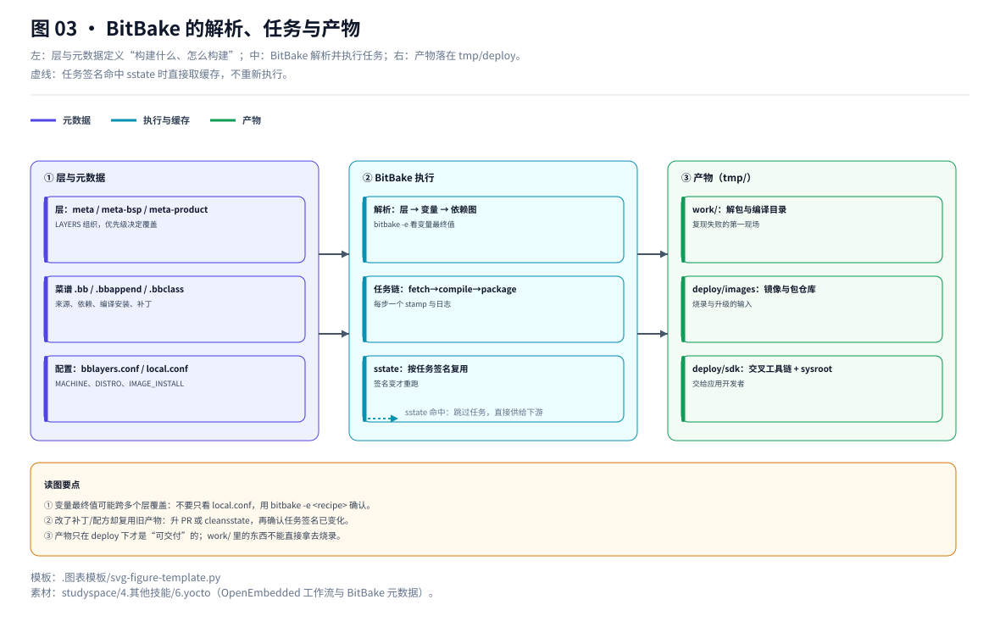

# 构建系统与 Yocto

一句话结论：嵌入式构建系统要解决的是**可复现地把“源码 + 补丁 + 配置 + 工具链”变成镜像和 SDK**；Buildroot 用 Make 直给，Yocto 用“元数据分层 + 任务”换取可维护性，OpenWrt 则是面向网络设备的专用发行版构建。

> 本篇定位：讲构建系统的选型与 Yocto/OpenEmbedded 的元数据模型、任务链与缓存机制。OpenWrt 的 make 调用链见 [22-OpenWrt/01-构建与包管理](../../22-OpenWrt/01-构建与包管理/.readme.md)；工具链本身见 [00-交叉编译模型与工具链](./00-交叉编译模型与工具链.md)。

## 目录

- [1 一句话模型](#s1)
- [2 速览](#s2)
- [3 元数据与层的结构](#s3)
- [4 构建流程与缓存](#s4)
- [5 状态机与定时器](#s5)
- [6 设计取舍与边界](#s6)
- [7 与相邻主题的关系](#s7)
- [名词解释](#名词解释)
- [8 参考与关联](#s8)

## 1 · 一句话模型

```text
层(meta-*) ──► BitBake 解析 ──► 任务链(do_fetch…do_image) ──► 镜像/SDK
   │                │                     │
菜谱/配置        变量与依赖           sstate 缓存
```

三个关键认知：

1. **Yocto 不是“一个发行版”，是“生产发行版的工具链 + 元数据”**；Poky 只是参考发行版。
2. **构建逻辑写在元数据里，不写在 BitBake 里**：BitBake 只是执行器。
3. **增量靠 sstate，不靠 make 时间戳**：任务输入（含变量、文件校验和）变了才重跑。

## 2 · 速览

| 项 | 内容 |
| --- | --- |
| 所属层/领域 | 嵌入式构建系统 |
| 核心对象 | 层、菜谱、类、追加文件、任务、sstate |
| 关键参数 | `BBLAYERS`、`MACHINE`、`DISTRO`、`IMAGE_INSTALL`、`SRC_URI` |
| 典型场景 | 定制 BSP、量产镜像、发布 SDK、长期维护多机型 |
| 主要标准 | OpenEmbedded 元数据规范、Yocto Project 参考手册 |

### 2.1 三种构建系统怎么选

| 维度 | Buildroot | Yocto/OpenEmbedded | OpenWrt |
| --- | --- | --- | --- |
| 上手成本 | 低（Make menuconfig） | 高（层、菜谱、变量） | 中（熟悉 make 即可） |
| 定制粒度 | 包级 | 任务级、可打补丁到单文件 | 包级 + 设备 profile |
| 多机型复用 | 一般 | 强（BSP 层隔离） | 强（Device/Profile） |
| 增量构建 | 依赖 make | sstate 共享缓存 | 包级编译 |
| 适合 | 中小项目、快速出原型 | 长期维护、多硬件、需 SDK | 路由器/网关类产品 |

## 3 · 元数据与层的结构

### 3.1 五类元数据文件

| 文件 | 作用 | 边界 |
| --- | --- | --- |
| `.conf`（`bitbake.conf`、`local.conf`） | 全局变量：路径、机器、发行版策略 | 菜谱里的同名变量只在本菜谱生效 |
| `.bb`（菜谱） | 描述一个软件包：来源、依赖、编译安装 | 一个菜谱一个包，版本升级靠新菜谱或 `PV` |
| `.bbclass`（类） | 可继承的通用任务实现（如 `autotools`） | 继承顺序影响覆盖结果 |
| `.bbappend`（追加） | 在其他层上改菜谱变量或补任务 | 文件名必须与基础菜谱同名，否则不生效 |
| `.inc`（包含） | 被多个菜谱 `require` 的公共片段 | 只做片段，不独立构建 |

### 3.2 层的职责

| 层 | 职责 | 典型内容 |
| --- | --- | --- |
| `meta`（OE-Core） | 基础菜谱与类 | 工具链、busybox、systemd |
| `meta-<vendor>` | 厂商 BSP | 内核、U-Boot、设备树、固件 |
| `meta-<distro>` | 发行版策略 | 包管理、镜像特性、默认服务 |
| `meta-<product>` | 产品定制 | 品牌、默认配置、裁剪 |

层的优先级由 `BBFILE_PRIORITY` 决定；`BBLAYERS` 只决定“参与构建”，不决定“谁覆盖谁”。

### 3.3 关键变量

| 变量 | 作用 | 常见误区 |
| --- | --- | --- |
| `MACHINE` | 选机器配置（架构、内核、DTB） | 与产品型号混为一谈 |
| `DISTRO` | 选发行版策略（libc、包管理、特性） | 以为它只影响镜像名 |
| `IMAGE_INSTALL` | 镜像包含的包列表 | 直接塞包名，忽略 `IMAGE_FEATURES` |
| `SRC_URI` | 源码地址、补丁、本地文件 | 漏写 `file://` 校验和导致解析失败 |
| `PV`/`PR` | 版本与修订号 | 改配方不升 `PR`，sstate 复用旧产物 |

## 4 · 构建流程与缓存



**读图**：左边是层与元数据，中间是 BitBake 的解析与任务链，右边是 `tmp/deploy` 的产物；虚线箭头表示 sstate 命中时直接取缓存、跳过任务执行。

> 图源：`images/图03-BitBake解析与任务链.svg`

### 4.1 正常流程

```text
① 初始化环境：source oe-init-build-env
② 解析元数据：bblayers.conf → 各层 layer.conf → bitbake.conf → 菜谱
③ 计算依赖与签名：任务签名决定是否命中 sstate
④ 执行任务：fetch → unpack/patch → configure → compile → install
              → package → image → populate_sdk
⑤ 产物落地：tmp/deploy/images、tmp/deploy/sdk
```

`tmp/` 下几个目录的含义：

| 目录 | 内容 |
| --- | --- |
| `work/` | 每个菜谱的解包与编译目录 |
| `sysroots/` | 按架构组织的目标 sysroot |
| `deploy/` | 镜像、包仓库、SDK、许可证清单 |
| `sstate-control/` | 共享状态缓存的清单 |
| `stamps/` | 任务完成标记与签名 |

### 4.2 异常分支

| 现象 | 根因 | 处理方向 |
| --- | --- | --- |
| `Nothing PROVIDES 'xxx'` | 菜谱不在 `BBLAYERS` 或包名错 | 查 `bitbake-layers show-recipes` |
| 两个层改了同一变量，结果不如预期 | 层优先级/继承顺序 | 看 `bitbake -e <recipe>` 的展开值 |
| 改了补丁但产物没变 | 任务签名未变或 sstate 命中 | 升 `PR`，或 `bitbake -c cleansstate` |
| `do_compile` 失败但手动 make 通过 | 环境被清空、交叉变量未注入 | 看 `temp/log.do_compile` |
| 镜像缺文件 | 包没进 `IMAGE_INSTALL` 或未进依赖 | `oe-pkgdata-util` 反查包归属 |

### 4.3 定位手段

- `bitbake -e <recipe>`：打印变量展开结果，判断“到底用了哪个值”。
- `bitbake -c devshell <recipe>`：进入与任务一致的环境手工复现。
- `bitbake -S none <recipe>`：输出任务签名，比较两次构建差异。
- `bitbake-layers show-layers/show-recipes`：确认层与菜谱的实际来源。

## 5 · 状态机与定时器

BitBake 没有连接状态机，但有**任务状态**与**签名机制**：

```text
未执行 ──签名未命中──► 执行中 ──成功──► 完成（写 stamp）
   │                     │
   └──签名命中 sstate────┴──失败──► 失败（保留日志，不写 stamp）
```

任务没有超时定时器；卡住通常是网络拉取源码或交互式 `configure` 等待输入。

## 6 · 设计取舍与边界

### 6.1 为什么用“层 + 追加”而不是直接改源码

层让 BSP、发行版、产品定制互相隔离，升级 OE-Core 时只改 `bbappend`。代价是**间接层多**：一个变量的最终值可能要跨 3-4 个文件才能看清，必须依赖 `bitbake -e`。

### 6.2 sstate 的收益与风险

sstate 让干净构建从数小时降到分钟级；但共享缓存可能把“别人的环境”带进来，出现“我这里能编、你那里不能”的假象。团队共享 sstate 时要求**工具链、元数据、路径后缀一致**。

### 6.3 可复现构建

固定 `SRCREV`、锁定层版本（`bblayers.conf` 用固定分支/提交）、记录 `local.conf` 与许可证清单，才能复现历史镜像。浮动分支是“今天能编、明天不一定”的主要来源。

### 6.4 什么时候不适用

- 只有一两个包、没有多机型需求：Buildroot 或手工 Makefile 更快。
- 产品强依赖 OpenWrt 的 netifd/fw4 生态：用 OpenWrt 构建体系，不要硬套 Yocto。

### 6.5 常见误判

- **“Yocto 是个 Linux 发行版”**：它是构建系统，Poky 才是参考发行版。
- **“改了 `.bbappend` 一定生效”**：文件名不匹配、层未加入、优先级低都会静默失效。
- **“sstate 命中说明没变化”**：签名只覆盖声明的输入，未声明的外部依赖变化不会被发现。

## 7 · 与相邻主题的关系

| 相邻对象 | 关系 |
| --- | --- |
| [00-交叉编译模型与工具链](./00-交叉编译模型与工具链.md) | 构建系统批量产出工具链与 sysroot |
| [01-ABI与sysroot兼容](./01-ABI与sysroot兼容.md) | `MACHINE`/`DISTRO` 锁定 ABI 与 C 库 |
| [22-OpenWrt/01-构建与包管理](../../22-OpenWrt/01-构建与包管理/.readme.md) | 另一套面向网络设备的构建体系 |
| [55-构建与调试](../../../50-软件开发/55-构建与调试/.readme.md) | Make/CMake 与通用构建原理 |
| [02-Boot与升级/00-固件布局与启动介质](../02-Boot与升级/00-固件布局与启动介质.md) | 镜像如何落到 Flash 分区 |

一句话：**Yocto 管“怎么把一堆源码稳定地变成镜像”，Boot 篇管“镜像怎么被加载”。**

## 名词解释

> 缩写给出英文全称；非缩写用“—”表示。

| 术语 | 英文全称 | 解释 |
| --- | --- | --- |
| Yocto | Yocto Project | 提供构建嵌入式 Linux 发行版的工具与元数据规范的项目。 |
| OpenEmbedded | OpenEmbedded | 社区维护的嵌入式构建框架，Yocto 复用其元数据。 |
| BitBake | — | 解析元数据并按任务执行构建的引擎。 |
| Poky | — | Yocto 的参考发行版与构建环境集合。 |
| layer | — | 组织菜谱、类与配置的目录单元。 |
| recipe | — | `.bb` 文件，描述一个软件包如何获取、编译、打包。 |
| bbappend | — | 在另一层追加/覆盖菜谱内容的文件。 |
| bbclass | — | 可被菜谱继承的通用任务实现。 |
| sstate | Shared State | 任务输出缓存，按签名复用。 |
| BSP | Board Support Package | 板级支持包，含内核、引导、设备树。 |
| DISTRO | Distribution | 发行版策略变量，决定 libc、包管理等。 |
| MACHINE | — | 目标机器配置变量，决定架构与板级文件。 |
| SDK | Software Development Kit | 供应用开发者使用的交叉工具链与 sysroot。 |
| PV / PR | Package Version / Package Revision | 菜谱版本号与修订号，影响缓存与升级。 |
| IMAGE_INSTALL | — | 镜像需要安装的包列表。 |

## 8 · 参考与关联

**参考**

- Yocto Project Reference Manual：元数据、变量、任务与 sstate 章节
- OpenEmbedded 元数据规范：层与菜谱组织
- BitBake User Manual：解析顺序、变量赋值与任务签名
- 源仓库 `4.其他技能/6.yocto/`（m-02 项目、m-03 OpenEmbedded、m-04 BitBake、m-08 菜谱）

**关联**

- [00-交叉编译模型与工具链](./00-交叉编译模型与工具链.md)
- [01-ABI与sysroot兼容](./01-ABI与sysroot兼容.md)
- [22-OpenWrt/01-构建与包管理](../../22-OpenWrt/01-构建与包管理/.readme.md)
- [23-嵌入式基础](../.readme.md)

---

> **本篇定位**：构建系统选型、Yocto 元数据模型、任务链与 sstate 的取舍。
> **素材来源**：`studyspace/4.其他技能/6.yocto/m-02~m-04`（Yocto/OpenEmbedded/BitBake）。
> **待验证**：不同 Yocto 版本的变量名与任务名（如 `do_populate_sdk` 在新版本的拆分）略有差异。
