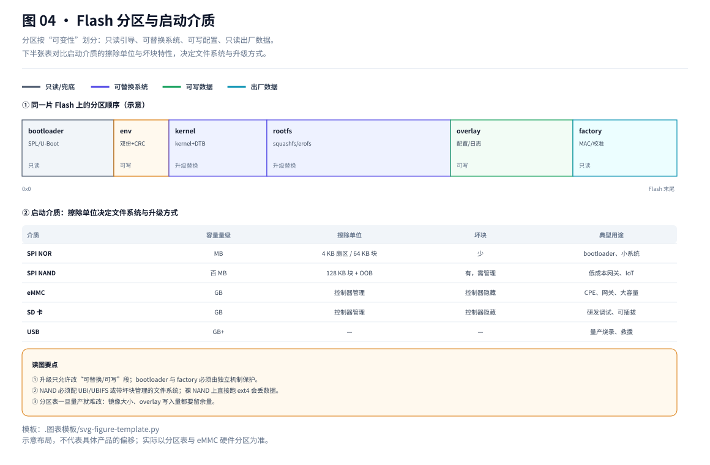

# 固件布局与启动介质

一句话结论：固件布局的本质是**按“可变性”分区**——不可变的引导、可替换的系统、可写的配置、只读的出厂数据分开放；启动介质则决定 BootROM 上电后去哪里找第一段代码。

> 本篇定位：讲 Flash 分区划分、启动介质差异、镜像形态与对齐约束。启动链各阶段做什么见 [21-Linux/03-启动链](../../21-Linux/03-启动与根文件系统/00-启动链.md)；U-Boot 参数见 [01-U-Boot工程实践](./01-U-Boot工程实践.md)；升级流程见 [02-升级回滚与安全启动](./02-升级回滚与安全启动.md)。

## 目录

- [1 一句话模型](#s1)
- [2 速览](#s2)
- [3 分区结构与介质](#s3)
- [4 上电到挂载的流程](#s4)
- [5 状态机与定时器](#s5)
- [6 设计取舍与边界](#s6)
- [7 与相邻主题的关系](#s7)
- [名词解释](#名词解释)
- [8 参考与关联](#s8)

## 1 · 一句话模型

```text
bootloader │ env │ kernel │ rootfs │ overlay │ factory
  只读       可写   可替换    可替换    可写      只读
```

三个关键认知：

1. **分区边界就是升级边界**：升级只会碰“允许替换”的那几段。
2. **擦除块是硬约束**：写 Flash 前要按擦除块对齐，跨界写会导致整块失效。
3. **bootloader 区不动**：它能兜底；一旦被写坏，只能靠烧录器或 BootROM 的救援模式。

## 2 · 速览

| 项 | 内容 |
| --- | --- |
| 所属层/领域 | 嵌入式存储与启动 |
| 核心对象 | Flash 分区、启动介质、镜像格式 |
| 关键参数 | 分区偏移/大小、擦除块、页大小、只读属性 |
| 典型场景 | 新板 bring-up、量产分区规划、升级方案设计 |
| 主要标准 | JEDEC（NOR/NAND）、eMMC（JEDEC JESD84）、GPT/MBR |

## 3 · 分区结构与介质

### 3.1 典型分区表

| 分区 | 内容 | 可写 | 作用 | 边界 |
| --- | --- | --- | --- | --- |
| `bootloader` | BootROM 之后的第一段引导（SPL/U-Boot） | 否 | 兜底与加载内核 | 写坏即“变砖”，量产不开放写 |
| `env` | U-Boot 环境变量 | 是 | 保存 `bootcmd`/`bootargs`/启动计数 | 双份冗余，损坏时回退默认值 |
| `kernel` | 内核镜像 + DTB | 升级时 | 被 bootloader 加载 | 与 rootfs 合并时边界消失 |
| `rootfs` | 只读根文件系统（squashfs/erofs） | 升级时 | 提供系统文件 | 只读不等于不可改，靠 overlay 承接写入 |
| `overlay`/`data` | 可写配置与用户数据 | 是 | 保存配置、密钥、日志 | 恢复出厂只清这里 |
| `factory` | 校准数据、MAC、序列号 | 否 | 出厂信息 | 升级绝不能覆盖，需单独备份 |

### 3.2 启动介质对比

| 介质 | 容量 | 擦除单位 | 坏块 | 典型用途 |
| --- | --- | --- | --- | --- |
| SPI NOR | 小（MB 级） | 4 KB 扇区 / 64 KB 块 | 少 | bootloader、小系统、配置 |
| SPI NAND | 中（百 MB 级） | 128 KB 块 + OOB | 有，需坏块管理 | 低成本路由器、IoT |
| eMMC | 大（GB 级） | 由控制器管理 | 控制器隐藏 | 网关、CPE、需要大容量 |
| SD 卡 | 大 | 由卡内控制器管理 | 控制器隐藏 | 开发调试、可插拔场景 |
| USB | 大 | — | — | 量产烧录、救援 |

NAND 必须配合 **UBI/UBIFS 或带坏块管理的文件系统**；直接在裸 NAND 上用 ext4 会在坏块出现后丢数据。

### 3.3 镜像形态

| 形态 | 内容 | 优点 | 代价 |
| --- | --- | --- | --- |
| 裸 kernel + 独立 rootfs | 两段分别写 | 可单独升级内核 | 版本搭配易错 |
| 合并镜像（kernel+rootfs） | 一段整体写 | 原子性好，升级简单 | 无法只换内核 |
| FIT | kernel/DTB/initrd/签名打包 | 可校验、可多配置选择 | 需要 bootloader 支持 |
| squashfs + overlay | 只读系统 + 可写层 | 省空间、抗写坏 | 写放大、overlay 需容量规划 |

## 4 · 上电到挂载的流程



**读图**：上半条是同一片 Flash 上的分区顺序，颜色区分“只读/可替换/可写”；下半张表对比五种启动介质的擦除单位与典型用途。

> 图源：`images/图04-Flash分区与启动介质.svg`

### 4.1 正常流程

```text
① BootROM 按拨码/熔丝选介质（eMMC/SPI/SD/USB）
② 读第一段引导（SPL 或整段 U-Boot）
③ U-Boot 读 env，决定从哪个分区加载 kernel/DTB
④ 内核挂 rootfs（ro），overlay 叠加为可写层
⑤ init 读取持久化配置
```

### 4.2 异常分支

| 现象 | 可能原因 | 排查方向 |
| --- | --- | --- |
| 完全无串口输出 | 启动介质选错、第一段引导损坏 | 拨码/熔丝、烧录器回读 |
| 卡在 U-Boot，提示找不到内核 | 分区偏移与镜像布局不一致 | `mtdparts`/`part list` 对照分区表 |
| 内核起来但 `mount` 失败 | rootfs 类型或分区号错、镜像截断 | `bootargs` 的 `root=`、校验和 |
| 升级后配置全丢 | overlay 被格式化或分区被覆盖 | 升级脚本是否保留 data 分区 |
| 偶发启动失败 | NAND 坏块、env 双份都损坏 | 坏块表、env 冗余与默认回退 |

## 5 · 状态机与定时器

分区本身没有状态机；与时间相关的只有 **U-Boot 的 `bootdelay` 倒计时**（默认数秒，可被按键打断）和 **看门狗**（启动阶段未喂狗会复位）。升级状态机在 [02-升级回滚与安全启动](./02-升级回滚与安全启动.md)。

## 6 · 设计取舍与边界

### 6.1 kernel 与 rootfs 合并还是分离

合并后升级是“整段替换”，原子性好、脚本简单；分离便于单独换内核，但必须维护版本搭配矩阵。消费类产品多选合并，需要频繁调内核的研发阶段多选分离。

### 6.2 squashfs + overlay vs 可写 ext4

只读系统 + overlay 能抗异常断电、恢复出厂只需清 overlay；代价是写入放大、overlay 空间要预留，且大量写入会加速 Flash 磨损。可写 ext4 简单，但断电损坏风险高。

### 6.3 分区大小怎么定

按“当前镜像 + 一个版本的增长 + 10%~20% 余量”定 rootfs；overlay 按日志/配置/证书的写入量定；env 与 factory 留双份。**分区表一旦量产就很难改**，前期宁可留余量。

### 6.4 什么时候不适用

- 有 eMMC 且支持多硬件分区（boot0/boot1/user）：可以用硬件分区做 A/B，弱化软件分区表。
- 纯 RAM 运行（initramfs）：没有持久化布局问题，但升级与配置保存要另设方案。

### 6.5 常见误判

- **“Flash 可以按字节覆盖写”**：NOR/NAND 必须先擦后写，且按块对齐。
- **“分区表只是软件约定”**：bootloader、内核、升级工具三处必须一致，任何一处偏移错都会写坏相邻分区。
- **“eMMC 没有坏块问题”**：控制器会做磨损均衡，但寿命耗尽仍会进入只读状态。

## 7 · 与相邻主题的关系

| 相邻对象 | 关系 |
| --- | --- |
| [21-Linux/03-启动链](../../21-Linux/03-启动与根文件系统/00-启动链.md) | 分区被谁、按什么顺序加载 |
| [01-U-Boot工程实践](./01-U-Boot工程实践.md) | env 与镜像加载的具体参数 |
| [02-升级回滚与安全启动](./02-升级回滚与安全启动.md) | 分区如何支撑 A/B 与回滚 |
| [22-OpenWrt/05-升级与恢复](../../22-OpenWrt/05-升级与恢复/.readme.md) | OpenWrt 的 firmware/overlay 具体划分 |
| [40-平台与芯片](../../../40-平台与芯片/.readme.md) | 各 SoC 的启动介质与烧录工具 |

一句话：**布局篇回答“东西放哪”，U-Boot 篇回答“怎么加载”，升级篇回答“怎么换”。**

## 名词解释

> 缩写给出英文全称；非缩写用“—”表示。

| 术语 | 英文全称 | 解释 |
| --- | --- | --- |
| NOR | Not-OR Flash | 可随机读、按扇区擦写的闪存，适合存放引导。 |
| NAND | Not-AND Flash | 密度高、按块擦写、有坏块的闪存。 |
| eMMC | Embedded MultiMediaCard | 集成控制器的嵌入式闪存，对外表现为块设备。 |
| SPL | Secondary Program Loader | 初始化 DDR 并加载完整引导的小程序。 |
| env | Environment | U-Boot 保存的键值配置区。 |
| FIT | Flattened Image Tree | U-Boot 的多镜像打包与校验格式。 |
| DTB | Device Tree Blob | 设备树二进制。 |
| MTD | Memory Technology Device | Linux 对裸 Flash 的抽象层。 |
| UBI | Unsorted Block Images | 裸 NAND 的磨损均衡与坏块管理层。 |
| UBIFS | UBI File System | 建立在 UBI 之上的日志文件系统。 |
| squashfs | — | 只读压缩文件系统，常用于 rootfs。 |
| overlay | — | 叠加在只读层之上的可写层。 |
| GPT | GUID Partition Table | 分区表格式，支持较多分区与备份表。 |
| A/B | A/B Slots | 双份系统分区，用于升级与回滚。 |

## 8 · 参考与关联

**参考**

- JEDEC JESD84（eMMC）、JESD230（NAND 接口）规范
- Linux 内核文档：`Documentation/mtd/`、`Documentation/filesystems/ubifs.rst`
- U-Boot 文档：`doc/develop/`、`doc/usage/`
- 源仓库 `1.知识体系/7.openwrt/6.其他/upgrade.md`（分区结构部分）

**关联**

- [01-U-Boot工程实践](./01-U-Boot工程实践.md)
- [02-升级回滚与安全启动](./02-升级回滚与安全启动.md)
- [22-OpenWrt/05-升级与恢复](../../22-OpenWrt/05-升级与恢复/.readme.md)
- [23-嵌入式基础](../.readme.md)

---

> **本篇定位**：Flash 分区划分、启动介质差异、镜像形态与擦除对齐约束。
> **素材来源**：`studyspace/1.知识体系/7.openwrt/6.其他/upgrade.md`、`recovery.md`；通用 Flash/分区知识补写。
> **待验证**：具体产品的分区偏移、擦除块大小与 eMMC 硬件分区方案。
